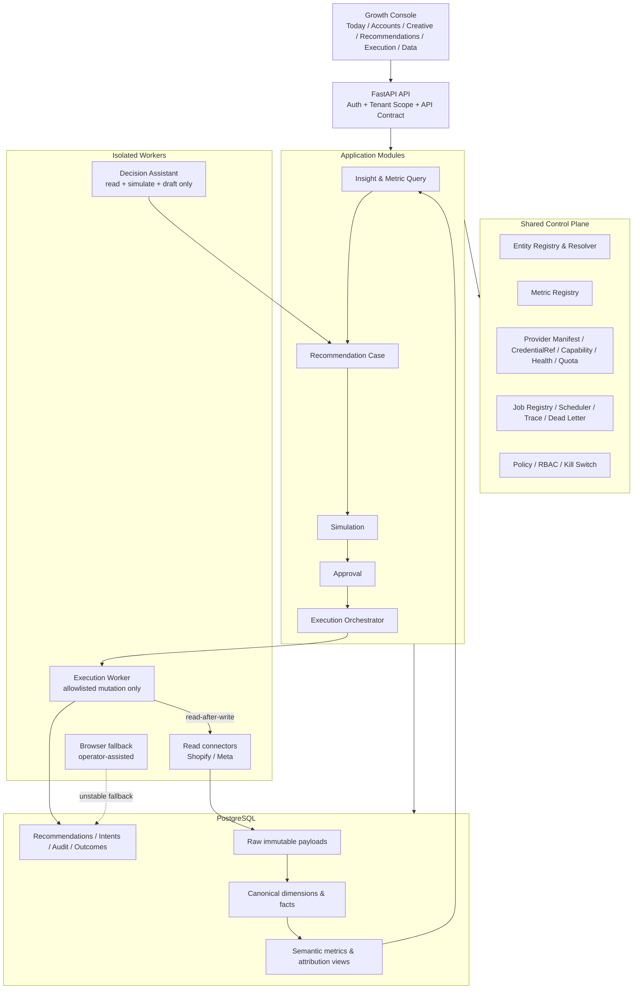

# AI DTC Growth Automation System 架构优化评审

> 评审日期：2026-08-10  
> 评审范围：仅依据 `PROJECT-ARCHITECTURE-BRIEF.md`；未检查同事电脑上的源码、数据库、截图与真实 Provider 调用，因此这是“架构与产品结构评审”，不是代码审计或生产验收。

## 1. 结论先行

这个项目有价值的核心不是“AI + 29 页后台”，而是：**把跨平台 DTC 数据转成可解释、可审批、可追溯的增长动作**。

当前最大的风险不是功能不够，而是建设顺序倒置：

- 已有 91 个模型、37 个路由模块、52 条规则、8 个 Agent、29 个页面；
- 但真实数据连接、统一实体 ID、统一指标语义、租户/RBAC、生产数据库、密钥管理和 CI 门槛仍未完成；
- 这会导致后续每接入一个真实平台，都要同时修模型、缓存、Scope、规则、页面和执行逻辑，技术债呈乘法增长。

建议立即把项目从“全功能增长操作系统”收缩为一个清晰的首期产品：

> **DTC Creative & Media Decision Control Plane**  
> 统一 Shopify + Meta（首期）的内容、广告与收入数据，发现可行动机会，生成有证据的建议，经人工审批后安全执行少量白名单动作，并验证结果。

第一阶段不要继续扩页面、规则、Agent 或 Provider 数量。先完成三件事：

1. 建立 canonical entity + 指标语义层，消除 ID、粒度和口径混乱；
2. 用真实 PostgreSQL、真实只读连接和最小租户权限跑通数据闭环；
3. 把规则、AI 建议、审批、执行整合为一条可追踪状态机。

## 2. 产品层面的缺口

Brief 对“系统有什么”描述充分，但对“谁每天为什么使用”仍不够清晰。以下问题未定，会直接改变架构：

| 必须明确的问题 | 为什么影响架构 |
|---|---|
| 首要用户是品牌主、投手、增长负责人，还是服务多品牌的代理商？ | 决定 Workspace/Brand/Account 权限粒度、Portfolio 是否为核心，以及审批链条 |
| 首期只读洞察，还是允许系统改预算/暂停广告？ | 决定执行系统是否现在就值得保持当前复杂度 |
| 首期最关键的三个动作是什么？ | 决定推荐规则、模拟器和 Provider 写接口的白名单 |
| 数据要求是小时级还是日级？ | 决定同步、存储、调度与成本；DTC 日常决策通常不需要所有表都实时化 |
| 成功指标是什么？节省分析时间、提高 MER、降低 CPA，还是减少误操作？ | 决定产品是否真的形成闭环，而不是页面数量增长 |
| 目标区域及数据合规边界是什么？ | 决定凭据、个人数据、数据驻留、审计和删除策略 |

建议先冻结一个可验证的 JTBD：

> 每天早上，增长负责人能在 10 分钟内知道“哪里变差、为什么、该做什么”，并能在同一处安全批准低风险动作。

配套首期指标：

- Time-to-insight：从数据更新到给出可行动建议的时间；
- Recommendation acceptance rate：建议被接受/修改/拒绝的比例；
- Safe execution rate：执行成功且读后验证一致的比例；
- Decision coverage：核心广告花费中可被统一解释的比例；
- Business guardrails：MER、贡献毛利、NCAC/CPA，而不只看平台 ROAS。

## 3. 现状结构中的主要问题

### P0：不解决就不应进入生产试点

| 问题 | 影响 | 建议 | 粗略工作量 |
|---|---|---|---|
| 产品边界过宽 | 数据、BI、CDP、规则、Agent、广告执行、浏览器自动化并行建设，无法判断首期价值 | 冻结新增功能；只保留“数据接入—洞察—建议—审批—执行—验证”一条主链 | 2–4 天完成范围决策 |
| canonical entity 缺失 | `entity_id` 混用 UUID、外部 ID、Mock ID；规则、缓存和执行可能指向错误对象 | 新增实体注册表、外部引用表和关系表；业务表只引用 canonical ID | 1–2 周 |
| 指标语义不统一 | 同名 ROAS、Revenue、Content Performance 在不同来源/粒度下不可比较，AI 解释也不可信 | 建立 metrics-as-code：口径、维度、币种、时区、归因窗口、来源、新鲜度、负责人 | 1–2 周 |
| SQLite 与 PostgreSQL 双轨 | JSON、时区、锁、唯一约束和并发行为无法代表生产 | 本地/CI 一律 PostgreSQL；SQLite 只保留为一次性 demo，最好删除运行路径 | 2–4 天 |
| 认证与租户隔离缺失 | Header 不是权限系统；可能跨品牌读写、审批伪造或越权执行 | 用户、Workspace Membership、Role、Brand/Account Grant；API 强校验，Postgres RLS 作为纵深防御 | 1–2 周 |
| Smoke 脚本未成为 CI 契约 | “本机通过”不等于每次变更都安全 | 把 17+34 个黄金场景纳入 pytest/integration；PR 阻断；增加 Postgres 与真实 API sandbox/recorded contract tests | 1 周 |

### P1：生产试点前完成

| 问题 | 影响 | 建议 | 粗略工作量 |
|---|---|---|---|
| 三套 Provider 抽象重复 | 凭据、限流、健康、错误映射分叉；但直接合并又可能破坏写权限红线 | 建立共享 Provider Control Plane；读连接器和写适配器保持不同接口、不同进程权限 | 1–2 周 |
| 事实表粒度重叠 | 同一指标可能来自 snapshot、daily fact 和平台维表，无法确定 source of truth | 采用 Raw → Canonical → Semantic → Operational 四层；每张 fact 明确 grain 与唯一键 | 1–2 周 |
| Celery、execution worker、browser worker 各自调度 | 重试、超时、幂等、死信和可观察性不一致 | 保留队列隔离，但统一 Job Registry、调度入口、状态模型、重试策略、trace ID 和告警 | 1–2 周 |
| 8 Agent 缺少必要性证明 | 成本、延迟、上下文漂移和评测面扩大；规则与 Agent 可能重复决策 | 收缩为一个 Decision Assistant + 受控工具；只有真正不同知识域或并行任务再拆 Agent | 1 周 |
| 29 页信息架构重复 | 用户要在 Overview、Monitor、Ads、Funnel、Command Center 间寻找同一问题 | 合并成 6 个工作域；实体详情用统一 Summary/Timeline/Metric Explorer | 1–2 周 |
| AdsPower/Playwright 位于主架构 | DOM 漂移、风控、登录态、合规与不可重复执行会污染生产闭环 | 浏览器自动化降级为明确标注的 fallback/人工辅助通道，不视作正式 Provider | 2–4 天调整边界 |

### P2：有真实客户和数据后再做

- 多触点归因、MMM、市场情报和复杂实验平台；
- 多级 Agent 团队与长期记忆；
- 多 Provider 自动预算分配；
- 全自动补偿或跨平台事务；
- 为规模预先微服务化。

这些能力都需要真实数据量、组织流程和动作反馈，否则容易成为演示复杂度。

## 4. 建议的目标架构

仍建议采用 **模块化单体 + 隔离执行 Worker**，不要在现阶段拆微服务。边界清楚比进程数量重要。



### 4.1 Canonical entity 模型

不要在 `recommendations.entity_id` 里继续兼容多种 ID。建议至少有：

```text
entity_registry
  id, workspace_id, brand_id, entity_type, status, created_at

external_entity_ref
  entity_id, provider, connected_account_id,
  external_type, external_id, valid_from, valid_to,
  UNIQUE(provider, connected_account_id, external_type, external_id)

entity_relation
  parent_entity_id, child_entity_id, relation_type,
  valid_from, valid_to
```

所有规则、推荐、Scope、缓存、执行意图只携带 canonical `entity_id`。真正调用 Provider 时，由 resolver 在指定 `connected_account_id` 下解析外部 ID。

同时修正实体层级表达：Campaign → AdGroup/AdSet → Ad；Content Asset → Publication → Promotion Link → Paid Creative。Order 不应直接挂在 Campaign 下，而应通过 attribution/touchpoint bridge 关联。

### 4.2 数据分层与事实粒度

建议固定四层：

1. **Raw**：原始 Provider 响应，只追加，带请求、游标、抓取时间、schema version；
2. **Canonical**：统一维表与事实表，平台字段映射在此完成；
3. **Semantic**：指标定义、汇率、时区、归因模型、窗口和可查询视图；
4. **Operational**：建议、审批、执行、审计、补偿、Outcome。

核心事实表需把 grain 写进文档与唯一键，例如：

```text
fact_ad_performance_daily
  grain = workspace + account + ad + local_date + source + attribution_window

fact_publication_performance_daily
  grain = workspace + account + publication + local_date + source

fact_order
  grain = shop + order

bridge_order_touchpoint
  grain = order + touchpoint + attribution_model + model_version
```

平台自报 ROAS、第一方归因和模型归因必须是不同 `measurement_basis`，不能被聚合成一个“唯一正确 ROAS”。

### 4.3 指标语义层

每个指标至少定义：

- `metric_key`、显示名、业务定义；
- numerator/denominator 与允许维度；
- 来源、时区、币种与汇率版本；
- attribution model/window；
- freshness SLA 与 data quality status；
- owner、version、deprecation policy。

前端、规则和 AI 必须通过同一 Metric Query Service 读取，不允许各自拼 SQL。dbt MetricFlow 的成熟思路是把指标定义成代码并编译为可复用查询，以避免多个消费端产生不同结果；项目可以借鉴思想，不一定首期引入整个 dbt Cloud。[dbt MetricFlow](https://github.com/dbt-labs/metricflow)

### 4.4 Provider Control Plane

“整合 Provider”不等于把读写客户端合成一个类。建议共享控制面，隔离数据面：

```text
ProviderManifest
  auth_type / scopes / capabilities / rate_limit / health_probe / api_version

CredentialRef
  workspace / provider / account / secret_ref / granted_scopes / expires_at

ReadConnector
  discover / backfill / incremental_sync / fetch_state

MutationAdapter
  validate / preview / execute / verify / reconcile
```

`MutationAdapter` 仅部署给 execution worker，使用单独凭据权限；普通 API、AI Worker、ETL Worker 都不能取得广告写密钥。

### 4.5 执行安全

现有 Frozen Intent、Revalidation、Read-after-write、Compensation、Kill Switch 的方向是对的，应保留，但收敛成一条明确状态机：

```text
DRAFT → SIMULATED → PENDING_APPROVAL → APPROVED
→ REVALIDATING → EXECUTING → VERIFYING
→ SUCCEEDED / REJECTED / EXPIRED / FAILED / UNKNOWN / COMPENSATED
```

批准的不是一段自然语言，而是一个不可变动作包：

```text
intent_hash + entity_version + policy_version + credential_version
+ metric_snapshot_id + action + parameters + expiry + approver
```

再校验任何一项变化都应回到审批，而不是“尽量执行”。首期写动作建议只开放：暂停/启用广告、日预算在限定百分比内调整。创建 Campaign、批量换素材、跨账户迁移等保持禁用。

### 4.6 Worker 与编排

现在不必立即从 Celery 迁移。先在 PostgreSQL 建统一 `job_run`/`job_attempt`/`job_event`，并统一：

- 幂等键、trace ID、超时、重试与 backoff；
- `sync`、`compute`、`ai`、`execution`、`browser` 队列；
- dead-letter、人工重放、取消与审计；
- transactional outbox，避免“数据库已提交但任务未发出”。

当审批可能跨天、执行步骤多、补偿复杂且 Celery 状态机维护成本明显上升时，再评估 Temporal。Temporal 的官方定位是让长时工作流在进程、网络或基础设施故障后从原位置恢复；适合复杂执行链，但不值得仅为了“架构先进”提前迁移。[Temporal 官方文档](https://docs.temporal.io/)

### 4.7 AI 架构

8 个 Agent 不是成熟度指标。LangGraph 官方文档也明确指出，并非所有复杂任务都需要多 Agent；单 Agent 配合正确工具常能得到相近结果，多 Agent 更适合知识域显著不同、需要并行或单 Agent 工具过多的场景。[LangGraph Multi-agent](https://langchain-ai.github.io/langgraph/tutorials/multi_agent/multi-agent-collaboration/)

首期建议只保留一个 `Decision Assistant`，工具限定为：

- `query_metrics(scope, metric, window, dimensions)`；
- `explain_change(metric_snapshot_id)`；
- `retrieve_rule_evidence(recommendation_id)`；
- `simulate_action(action, parameters)`；
- `draft_execution_intent(...)`。

AI 只能解释、比较、提问和起草 Intent；不能读取写密钥，也不能直接调用 Provider Mutation。规则引擎负责确定性触发和 guardrail，LLM 负责解释、归纳与补充假设，两者不要各自产生一套 Recommendation。

## 5. 前端信息架构与页面合并

29 页并不等于专业。建议围绕用户任务收敛成 6 个一级工作域：

| 一级工作域 | 核心问题 | 合并来源 |
|---|---|---|
| 今日决策 | 今天哪里异常、最值得做什么？ | Command Center、Overview、Live Monitor、Notifications |
| 账号与渠道 | 哪个品牌/账号/平台表现与连接状态如何？ | Portfolio、Accounts、Connections、Data Health |
| 内容与创意 | 哪些母素材、Publication、Paid Creative 真正有效？ | Content Intelligence、Content Detail、Creative、部分 Ads |
| 建议与实验 | 建议证据、模拟影响、接受/拒绝原因是什么？ | Rules、Recommendations、Funnel、Experiments、AI |
| 执行与审计 | 待审批、执行中、失败、未知、补偿是什么？ | Approval、Execution Queue、Detail、Policy、Kill Switch |
| 数据与设置 | 指标口径、Scope、权限、凭据、同步、规则如何管理？ | Settings、Environment、Profiles、Rule Console |

布局层面应采用：

- 桌面端 12 列 Grid，主内容最大宽度 1440–1600px，避免超宽屏内容缩在左侧；
- “结论/异常/建议”占主要视觉面积，连接状态和辅助筛选不与业务结论争夺权重；
- KPI 统一使用共享 `MetricCard`，高度、数值基线、同比位置一致；
- Entity Detail 统一为 `Summary + Trend + Drivers + Related Entities + Timeline`，不为每个实体复制页面；
- 1280、1440、1920、390 四档检查无效留白、拥挤、对齐、图表最小高度和横向溢出；
- 表格在移动端切为优先字段卡片或横向可控滚动，不强塞多列。

## 6. 国内外成熟案例：借鉴什么，不照抄什么

### 6.1 国外

#### Triple Whale：先做统一经营真相，再叠加 AI

Triple Whale 把收入、花费、利润、网站行为、归因、创意与产品分析放到统一数据视图中，并把 AI、MMM、灵活 BI 作为更上层能力。[Triple Whale 官方产品页](https://www.triplewhale.com/free)

可借鉴：

- 首页优先回答收入、花费、利润和渠道贡献，而不是展示系统模块数量；
- 一键连接和“单一经营视图”是入门价值，AI 是上层消费端；
- 创意分析与产品分析围绕决策任务组织。

不要照抄：其专有归因结论；项目应并列展示平台自报、第一方和模型归因，并呈现不确定性。

#### Smartly：Creative / Media / Intelligence 三个清晰域

Smartly 将产品能力明确拆成 Creative、Media、Intelligence，同时覆盖跨渠道管理、自动工作流、优化与统一数据分析。[Smartly 官方文档](https://docs.smartly.io/docs/introduction-to-smartly)

可借鉴：

- 用三个有业务含义的 bounded context 取代 29 个平铺页面；
- 创意生产、媒体执行和数据智能各自有边界，但共享实体、数据与权限底座；
- 自动化服务于明确工作流，不把所有功能包装成 Agent。

#### Adobe Experience Platform：统一 schema 与 identity namespace

Adobe XDM 先把跨系统数据标准化，区分 record 与 immutable time-series event；Identity Service 用 namespace + value 连接不同身份。[Adobe XDM](https://experienceleague.adobe.com/en/docs/experience-platform/xdm/home) · [Adobe Identity Service](https://experienceleague.adobe.com/en/docs/experience-platform/identity/home)

可借鉴：

- 本项目应建立 canonical entity 和 external ID namespace；
- 区分“实体当前属性”与“某时刻发生的事实事件”；
- schema/metric version 必须先于 AI 与规则消费。

不必照抄：完整 CDP/identity graph 的企业级复杂度。本项目首期只需处理品牌、账户、内容、广告和订单实体，不必先做消费者 360° 画像。

#### Shopify Campaign Autopilot：以目标、预算、护栏和审批组织自动化

Shopify 的 Campaign Autopilot 采用“连接渠道—设预算—加护栏—追踪优化”的用户路径，并强调用户可查看动作、批准上线和调整控制。[Shopify Campaign Autopilot](https://www.shopify.com/campaign-autopilot)

可借鉴：

- 前端从“我要达成什么目标”开始，而不是从规则或 Agent 列表开始；
- 预算、目标 ROAS/获客成本、审批需求是显式 guardrail；
- 自动化动作必须可见、可解释、可修改。

### 6.2 国内

#### 神策数据：CDP、分析、旅程优化分层

神策把统一客户档案、全场景分析和客户旅程优化分为不同引擎，旅程引擎再拆受众、触发时机、内容决策和触达通道。[神策产品体系](https://www.sensorsdata.cn/features/overview.html)

可借鉴：

- 数据底座、分析、决策/触达分层，不把所有能力塞进同一 Service；
- Recommendation 中显式表达对象、触发时机、内容/动作和渠道；
- 数据回流和生命周期管理是闭环的一部分。

#### GrowingIO：CDP 是数据中心，分析和运营是消费端

GrowingIO 明确把 CDP 定义为数据中心，用于打通多渠道数据和指标/标签体系，再由分析与运营能力消费。[GrowingIO CDP](https://www.growingio.com/products/cdp) · [GrowingIO 产品架构](https://docs.growingio.com/op-help/docs/2.3/product-intro/)

可借鉴：

- 先治理数据资产与指标，再增加分析工具；
- 数据、分析、运营均需开放接口，而不是页面直接依赖底层表；
- 部署后自动验证也值得用于 Provider 接入和租户配置验收。

#### Convertlab：显式触发条件与全生命周期日志

Convertlab 的自动流程以进入条件触发客户进入流程，并记录营销活动生命周期状态。[Convertlab 自动流程](https://app.convertlab.com/hc/docs/guide/workflow/) · [DM Hub 概述](https://api-docs.convertlab.com/v2/restapi/overview/)

可借鉴：

- 将 Recommendation/Execution 设计成用户看得懂的状态机；
- 每一步展示触发条件、证据、等待、退出、失败和审计记录；
- “流程画布”应在规则稳定后再做，不要先做一个华丽但语义不稳定的编辑器。

#### 阿里妈妈与巨量引擎：目标驱动的一站式经营，但有生态边界

阿里妈妈强调以人群、场景和经营目标组织一站式投放；巨量的公开方法论强调数据融合以及“洞察—度量—优化”链路。[阿里妈妈](https://www.alimama.com/index.htm) · [巨量引擎](https://www.oceanengine.com/insight/567)

可借鉴：

- 导航和流程围绕经营目标，而非 API 对象；
- 洞察、动作与度量必须回到同一经营目标；
- 对运营人员提供模板化策略，不让其直接面对 52 条底层 YAML 规则。

不能照抄：国内平台型产品拥有封闭生态内的身份、流量与转化数据，本项目跨 Meta/Google/Shopify，天然存在归因不完整、API 限流和权限差异，必须显式展示数据缺口和置信度。

## 7. 12 周改造路线图

### 第 0–2 周：冻结扩张，校准底座

- 明确 ICP、三个核心 JTBD、首期 Provider 与首期写动作；
- 所有开发和 CI 切到 PostgreSQL；
- 盘点 91 个模型：保留、合并、废弃、仅 demo 四类；
- 定义 canonical entity、fact grain、metric registry、Scope contract；
- 把 51 个 smoke 场景改造成 CI 测试；
- 停止增加新页面、规则和 Agent。

验收门槛：相同 Scope 下，API、规则、AI 和前端对 10 个核心指标返回同一口径。

### 第 3–6 周：真实只读闭环

- 接入一个 Shopify 店铺和一个 Meta 广告账户的最小真实只读连接；
- 完成 Provider Control Plane、CredentialRef、health/freshness；
- 建 Raw → Canonical → Semantic 数据链；
- 完成用户、Workspace Membership、Role 与品牌/账户权限；
- 首页只展示可验证的业务数据和数据质量，不以 Mock 混充 Live。

验收门槛：从真实订单和广告数据到一条带证据的 Recommendation 全链可追踪、可重放。

### 第 7–9 周：产品收敛与 AI 简化

- 合并导航为 6 个工作域；
- 建统一 Entity Summary、Metric Card、Timeline、Recommendation Case；
- 8 Agent 收缩为一个 Decision Assistant；
- 规则产生结构化信号，AI 生成解释和备选方案；
- 建 Recommendation 采纳/拒绝反馈与离线 eval 数据集。

验收门槛：目标用户能在 10 分钟内完成“发现—判断—模拟—审批”任务；桌面与移动端实测无明显空白失衡、拥挤、错位或横向溢出。

### 第 10–12 周：受限写试点

- 仅开放 Meta 白名单动作，使用最小权限写凭据；
- 固化 intent hash、版本绑定、过期、再校验、读后验证和 UNKNOWN 对账；
- 支持 workspace/account/action 三级 Kill Switch；
- 进行故障注入：超时、429、重复投递、凭据过期、外部状态漂移、返回未知；
- 建立审计导出与人工恢复手册。

验收门槛：任何 AI 或普通 API 进程都拿不到写密钥；重复请求不会重复执行；无法确认结果时 fail closed 并进入人工对账。

## 8. 如果只做三件事

1. **统一实体与指标语义**：没有它，规则、AI、缓存、页面和执行都可能对同一个对象给出不同答案。
2. **用真实 Postgres + 真实只读连接跑通最小闭环**：尽早暴露 API、时区、粒度、限流、权限和数据缺口，而不是继续强化 Mock 世界。
3. **把 29 页、52 规则、8 Agent 收敛为一个 Recommendation Case 工作流**：把产品价值集中在“有证据地做对一个决定”，而不是“能看到很多模块”。

## 9. 需要源码复核的事项

如果要进入第二轮代码级评审，至少需要以下材料：

- 10 个核心 ORM 模型与 0001–0007 migration；
- ScopeContext、API scope dependency 和缓存键实现；
- 规则输出 schema、Recommendation model 和冲突处理；
- LangGraph 图、8 个 Agent 的 prompt/tool/output schema；
- Execution Intent、Approval、Job、Audit、Compensation 的状态转换代码；
- Meta/Google 读写客户端、Credential 存储方式与权限范围；
- 10 张页面截图或可运行预览；
- 51 个 smoke 场景和 pytest 报告。

没有这些证据时，不能确认“写权限真的只在 execution 层”“Scope 已完全隔离”或“页面已经视觉合理”；Brief 只能说明设计意图。
