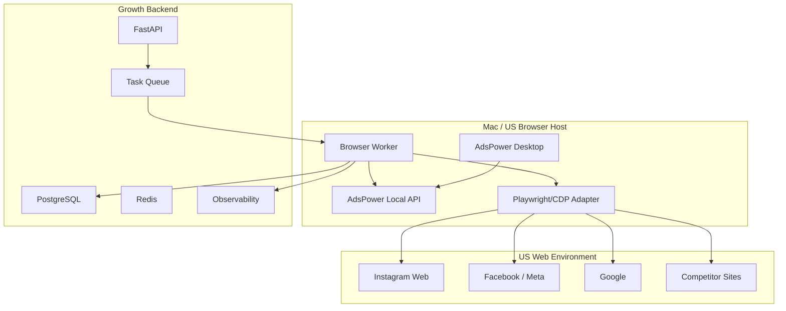
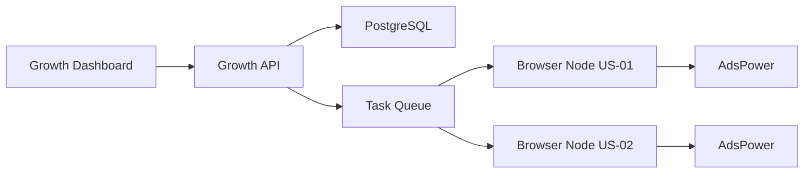
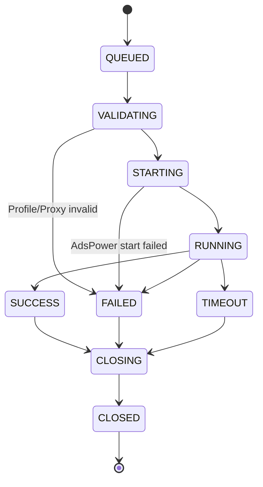
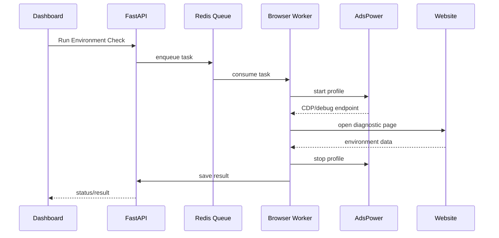
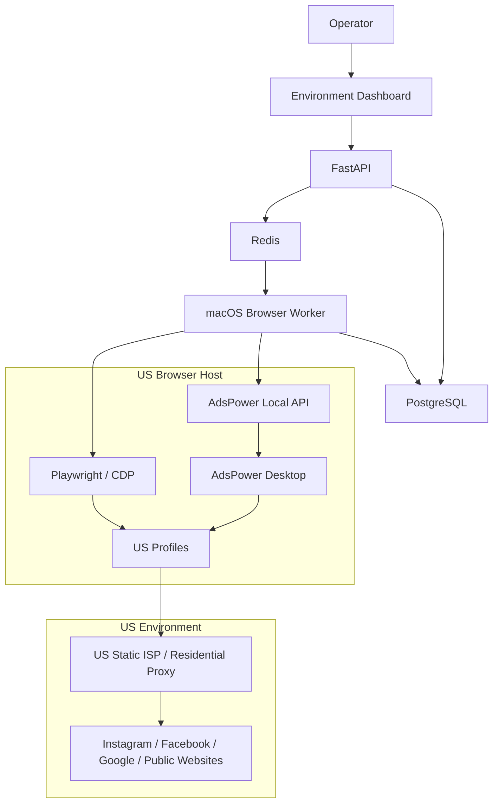

# AI DTC Growth Automation System

## PART 01 — System Architecture & US Operation Environment

**Version:** V1.0  
**Status:** Ready for Codex Implementation  
**Target Environment:** macOS host + AdsPower + US proxy + local worker + Dockerized backend  
**Primary Purpose:** 建立稳定、可监控、可扩展的美国浏览器运营环境，并为后续 Meta Ads / Google Ads / Shopify 数据中台与 AI Agent 提供浏览器执行基础设施。

---

# 0. 文档使用说明

本文件是整个 `AI DTC Growth Automation System` 的第一阶段开发规范。

Codex 必须遵循以下原则：

1. 本阶段只实现 **US Operation Environment / AdsPower Control Plane / Browser Worker / Environment Health Monitor**。
2. 本阶段 **不实现 Meta Ads 数据采集、不实现 Google Ads 数据采集、不实现 AI Agent 决策、不实现自动调预算**。
3. AdsPower 用于：
   - 美国浏览器环境；
   - 浏览器 Profile 隔离；
   - 账号会话保持；
   - 美国市场人工/自动化观察；
   - 后续允许范围内的浏览器自动化任务。
4. 广告正式数据必须优先使用官方 API，不能把 AdsPower 页面抓取当成广告数据主数据源。
5. 生产环境不得关闭 AdsPower API 鉴权。
6. 不允许把代理密码、AdsPower API Key、账号密码写死到代码或 Git 仓库。
7. 所有自动化任务必须可审计、可停止、可重试、有限流。
8. 所有浏览器自动化均应遵守目标平台条款、访问频率和账号权限边界；能通过官方 API 获得的数据，不使用浏览器抓取替代。

---

# 1. 项目背景

## 1.1 项目目标

构建一个面向美国市场 DTC 品牌的 AI Growth Operating System。

最终完整系统将完成：

```text
US Market Environment
        ↓
Ads / Commerce / Market Data
        ↓
Data Warehouse
        ↓
Growth Rule Engine
        ↓
AI Agent
        ↓
Human Approval
        ↓
Execution
        ↓
Learning & Audit
```

本 Part 负责最底层的：

> **US Operation Environment**

即为后续系统提供一个长期稳定的美国浏览器执行环境，而不是简单地“开 VPN 看 Instagram”。

---

# 2. 关键架构结论

## 2.1 AdsPower 的正确定位

AdsPower 不等于广告数据 API。

AdsPower 在本系统中的职责：

```text
AdsPower
├── Browser Profile Isolation
├── Proxy Binding
├── Fingerprint Consistency
├── Cookie / Session Persistence
├── US Browser Environment
├── Manual Market Observation
└── Controlled Browser Automation
```

以下数据不应该主要依赖 AdsPower 抓取：

```text
Meta Campaign Metrics
Google Ads Metrics
Shopify Orders
Revenue
Purchase Conversion
ROAS
Spend
CPA
```

这些数据后续分别通过：

```text
Meta Marketing API
Google Ads API
Shopify Admin API
```

获取。

---

## 2.2 为什么不能把整个系统都放在 AdsPower 里

AdsPower 是浏览器环境控制层，不是增长数据仓库，也不是规则引擎。

正确架构：



---

# 3. 部署模型

## 3.1 推荐方案

当前阶段采用：

> **Mac 本机 AdsPower + Local Browser Worker + Docker Backend**

原因：

AdsPower Local API 默认运行在安装 AdsPower 的本机，因此浏览器控制 Worker 应靠近 AdsPower 运行。

推荐：

```text
MacBook / Mac mini
│
├── AdsPower Desktop
│
├── US Proxy Profiles
│
├── Browser Worker
│
└── Docker
    ├── FastAPI
    ├── PostgreSQL
    ├── Redis
    └── Dashboard
```

---

## 3.2 未来生产升级

当系统稳定后，可迁移到专用 Mac mini 或 Windows 机器作为 Browser Node。

未来架构：



原则：

> 一个 Browser Node = 一台实际运行 AdsPower 的机器 + 一个 Browser Worker。

---

# 4. AdsPower Local API 集成规范

## 4.1 API Base URL

默认 Local API：

```text
http://localhost:50325
```

或 AdsPower 返回的 Local API 地址。

系统不得假定 API 永远固定为某个 Host。

需要设计：

```text
ADSPOWER_BASE_URL
```

环境变量。

---

## 4.2 鉴权

必须支持：

```http
Authorization: Bearer <ADSPOWER_API_KEY>
```

生产环境：

```text
API verification = ENABLED
```

禁止：

```text
关闭 API verification 后暴露 Local API
```

---

## 4.3 V2 API 优先

第一版封装以下接口。

### Browser Start

```http
POST /api/v2/browser-profile/start
```

最小请求：

```json
{
  "profile_id": "xxxx"
}
```

建议默认：

```json
{
  "profile_id": "xxxx",
  "headless": "0",
  "last_opened_tabs": "1",
  "proxy_detection": "0",
  "cdp_mask": "1",
  "delete_cache": "0"
}
```

返回值中需要保存：

```text
debug_port
ws.selenium
ws.puppeteer
webdriver
```

Browser Worker 后续通过 CDP / Playwright Adapter 连接浏览器。

---

### Browser Stop

```http
POST /api/v2/browser-profile/stop
```

请求：

```json
{
  "profile_id": "xxxx"
}
```

---

### Browser Profile Create

```http
POST /api/v2/browser-profile/create
```

Profile 创建必须由系统 Profile Service 统一控制。

禁止在业务代码中直接拼 JSON。

---

### Browser Profile List

```http
POST /api/v2/browser-profile/list
```

用于：

- 同步 AdsPower Profiles；
- 检测 Profile 是否存在；
- 获取 Profile 状态元数据；
- 定期 reconcile 数据库。

---

# 5. AdsPower Client 封装

创建：

```text
backend/integrations/adspower/
```

目录：

```text
adspower/
├── __init__.py
├── client.py
├── schemas.py
├── exceptions.py
├── profile_service.py
├── browser_service.py
├── health_service.py
└── mapper.py
```

---

## 5.1 AdsPowerClient

职责：

```text
HTTP Request
Authentication
Timeout
Retry
Rate Limit
Error Mapping
Structured Logging
```

接口：

```python
class AdsPowerClient:

    async def health_check(self): ...

    async def create_profile(self, payload): ...

    async def list_profiles(self, query): ...

    async def start_browser(self, profile_id): ...

    async def stop_browser(self, profile_id): ...
```

---

## 5.2 请求规则

默认：

```text
connect timeout: 3s
read timeout: 15s
```

对查询类请求：

```text
retry: 2
```

对创建 Profile / 开关浏览器等写操作：

不能盲目 retry。

必须先判断：

```text
是否已执行成功
```

避免重复创建。

---

## 5.3 API 限流

必须实现：

```text
AdsPowerRateLimiter
```

禁止高并发直接轰 Local API。

设计：

```text
Browser Management Queue
Concurrency = configurable
```

环境变量：

```env
ADSPOWER_MAX_CONCURRENCY=2
ADSPOWER_REQUESTS_PER_SECOND=1
```

第一阶段保守运行。

后续根据 AdsPower Profile 数量和版本调整。

---

# 6. Profile 设计

## 6.1 Profile 不等于账号

系统抽象：

```text
BrowserProfile
        ↓
Environment Identity
        ↓
Platform Accounts
```

一个 Profile 是一个长期浏览器身份。

建议不要频繁：

```text
换 IP
换时区
换 OS
换 UA
清 Cookie
```

---

## 6.2 Profile 类型

第一阶段创建 4 类 Profile。

### PROFILE_TYPE_BRAND

用途：

```text
品牌 Instagram / Facebook 正式运营
```

特点：

```text
高稳定性
低自动化频率
人工优先
固定美国 IP
```

---

### PROFILE_TYPE_RESEARCH

用途：

```text
美国市场内容观察
Reels / Search / Trend Research
```

特点：

```text
独立于品牌账号
允许受控自动化
不承担正式品牌账号风险
```

---

### PROFILE_TYPE_COMPETITOR

用途：

```text
竞品公开内容观察
```

特点：

```text
只访问公开信息
只读
禁止点赞 / 评论 / 关注等行为自动化
```

---

### PROFILE_TYPE_TEST

用途：

```text
自动化测试
页面兼容性测试
Browser Worker 验证
```

特点：

```text
不得绑定正式品牌主账号
```

---

# 7. Profile 数据库模型

创建：

```sql
browser_profiles
```

建议字段：

```sql
id UUID PRIMARY KEY

provider VARCHAR(32)
provider_profile_id VARCHAR(128) UNIQUE
profile_no VARCHAR(128)

name VARCHAR(255)
profile_type VARCHAR(32)

platform VARCHAR(64)

proxy_id UUID NULL

country CHAR(2)
region VARCHAR(128)
city VARCHAR(128)

timezone VARCHAR(128)
language VARCHAR(64)

browser_engine VARCHAR(32)
os_type VARCHAR(32)

status VARCHAR(32)

last_health_check_at TIMESTAMP
last_opened_at TIMESTAMP
last_closed_at TIMESTAMP

created_at TIMESTAMP
updated_at TIMESTAMP
```

---

# 8. Proxy 设计

## 8.1 原则

对于需要长期登录的品牌 Profile：

> 优先使用长期稳定、固定地区的美国 ISP / residential 类型代理。

本系统不写死任何代理供应商。

Proxy Provider 必须可替换。

---

## 8.2 Proxy 数据模型

创建：

```sql
proxies
```

字段：

```sql
id UUID PRIMARY KEY

provider VARCHAR(64)

proxy_type VARCHAR(16)

host VARCHAR(255)
port INTEGER

username_encrypted TEXT
password_encrypted TEXT

country CHAR(2)
region VARCHAR(128)
city VARCHAR(128)

is_static BOOLEAN
status VARCHAR(32)

last_ip VARCHAR(64)
last_checked_at TIMESTAMP
latency_ms INTEGER

created_at TIMESTAMP
updated_at TIMESTAMP
```

---

## 8.3 机密信息处理

禁止：

```text
proxy username/password 明文落日志
```

禁止：

```text
.env 提交 Git
```

必须：

```text
.env.example
```

只保留变量名。

---

# 9. 美国环境一致性策略

系统目标不是伪造所谓“绝对真实美国人”，而是：

> 建立长期一致的美国浏览器网络环境，避免 IP / timezone / language / geolocation 出现明显冲突。

---

## 9.1 推荐规则

```text
Proxy Country = US
Timezone = Auto by IP
Geolocation = Auto by IP
Language = en-US / en
Browser Kernel = Auto / current supported
UA = Match Browser Kernel
```

---

## 9.2 不推荐人工乱改指纹

AdsPower 本身支持自动生成大量指纹参数。

本系统默认策略：

```text
优先使用 AdsPower 自动匹配
```

而不是：

```text
随机伪造大量不一致参数
```

需要手工设置时，必须有理由并记录变更。

---

# 10. WebRTC 策略

WebRTC 可能暴露网络信息。

Profile 创建 Service 必须提供：

```text
webrtc_mode
```

系统允许：

```text
disabled
forward
proxy/replace
```

正式品牌环境禁止：

```text
real
```

除非明确经过人工审批。

默认：

```text
disabled
```

如果目标网站功能需要 WebRTC：

使用：

```text
forward
```

或经测试的代理匹配模式。

---

# 11. Profile Fingerprint 基线

第一阶段基线：

```json
{
  "automatic_timezone": "1",
  "location_switch": "1",
  "language_switch": "0",
  "language": ["en-US", "en"],
  "page_language_switch": "0",
  "page_language": "en-US",
  "webrtc": "disabled",
  "canvas": "1",
  "webgl_image": "1",
  "webgl": "3",
  "scan_port_type": "1"
}
```

注意：

Codex 不得直接复制某个过时固定 UA。

Browser kernel 与 UA 应尽量由 AdsPower 自动匹配。

---

# 12. Browser Worker

Browser Worker 是 Part 01 最重要的开发组件。

职责：

```text
1. 接收任务
2. 获取 Profile Lock
3. 检测代理
4. 启动 AdsPower Profile
5. 获取 CDP/WebSocket
6. 连接 Playwright
7. 执行 Task
8. 保存结果
9. 截图/日志
10. 关闭 Profile
11. 释放 Lock
```

---

# 13. Browser Worker 状态机



---

# 14. Browser Task 数据模型

创建：

```sql
browser_tasks
```

字段：

```sql
id UUID PRIMARY KEY

profile_id UUID

task_type VARCHAR(64)
task_name VARCHAR(255)

status VARCHAR(32)

payload JSONB
result JSONB

started_at TIMESTAMP
finished_at TIMESTAMP

retry_count INTEGER DEFAULT 0

error_code VARCHAR(128)
error_message TEXT

screenshot_path TEXT
log_path TEXT

created_at TIMESTAMP
updated_at TIMESTAMP
```

---

# 15. Profile Lock

绝对禁止：

> 两个 Worker 同时操作同一个 Profile。

使用 Redis：

```text
lock:browser_profile:{profile_id}
```

锁：

```text
TTL = task_timeout + safety_margin
```

获取不到锁：

```text
任务重新排队
```

不能强行并发。

---

# 16. Browser Automation 技术方案

推荐：

```text
Playwright
```

连接方式：

```text
AdsPower Start Browser
        ↓
return CDP / debug endpoint
        ↓
Playwright connect_over_cdp
        ↓
existing browser context
```

不得：

```text
Playwright 自己启动另一个普通 Chromium
```

否则会脱离 AdsPower Profile 环境。

---

# 17. Automation Adapter

创建：

```text
browser_worker/automation/
```

结构：

```text
automation/
├── base.py
├── playwright_adapter.py
├── page_guard.py
├── screenshot.py
└── tasks/
    ├── environment_check.py
    ├── public_page_snapshot.py
    └── smoke_test.py
```

---

# 18. 第一阶段允许的自动化

第一阶段只实现安全、低风险、只读 Task。

### environment_check

访问：

```text
IP / timezone / language diagnostic page
```

读取：

```text
public_ip
country
timezone
language
```

返回 Environment Health。

---

### public_page_snapshot

输入：

```text
URL
```

输出：

```text
title
final_url
screenshot
timestamp
```

用于验证美区页面展示环境。

---

### smoke_test

流程：

```text
Start Profile
→ Open Page
→ Read Title
→ Screenshot
→ Close Profile
```

---

# 19. 第一阶段禁止自动化

禁止 Codex 在 Part 01 实现：

```text
自动点赞
自动评论
自动关注
自动私信
自动注册账号
自动绕过验证码
自动绕过 2FA
自动修改广告
自动发布帖子
批量账号养号行为
```

这些不是本阶段目标。

---

# 20. Environment Health Monitor

必须开发环境检测系统。

每个 Profile 定期检查：

```text
Proxy Reachability
Public IP
Country
Timezone
Language
AdsPower API
Browser Launch
CDP Connection
```

---

# 21. Health 状态

```text
HEALTHY
DEGRADED
UNHEALTHY
UNKNOWN
```

判断示例：

### HEALTHY

```text
AdsPower API OK
Proxy OK
Country = US
Browser Start OK
CDP Connect OK
```

### DEGRADED

```text
Latency high
Timezone mismatch
Browser start slow
```

### UNHEALTHY

```text
Proxy dead
Country != US
AdsPower unavailable
Browser launch failed
```

---

# 22. Environment Check 数据模型

创建：

```sql
environment_health_checks
```

字段：

```sql
id UUID PRIMARY KEY

profile_id UUID

status VARCHAR(32)

public_ip VARCHAR(64)
country CHAR(2)

timezone VARCHAR(128)
language VARCHAR(128)

proxy_latency_ms INTEGER
browser_launch_ms INTEGER

checks JSONB

created_at TIMESTAMP
```

---

# 23. Dashboard — Part 01

本阶段做一个基础 Environment Dashboard。

---

## 23.1 Overview

顶部指标：

```text
Total Profiles
Healthy Profiles
Unhealthy Profiles
Running Browsers
Queued Tasks
Failed Tasks
```

---

## 23.2 Profile Table

字段：

```text
Profile
Type
Country
City
Proxy
Health
Browser Status
Last Check
Last Task
Actions
```

Actions：

```text
Health Check
Open
Close
Run Smoke Test
View Logs
```

---

## 23.3 Profile Detail

展示：

```text
Profile Metadata

Proxy Status

Fingerprint Baseline

Environment Health

Task History

Error History
```

---

# 24. 可视化逻辑

页面视觉优先级：

```text
异常 > 当前运行 > 环境状态 > 配置详情
```

首页不得堆大量技术字段。

示意：

```text
┌───────────────────────────────────────────────┐
│ US Operation Environment                     │
├───────────────────────────────────────────────┤
│ Profiles 4 │ Healthy 3 │ Warning 1 │ Tasks 2 │
├───────────────────────────────────────────────┤
│ ALERT                                         │
│ Research-US-01 timezone mismatch              │
├───────────────────────────────────────────────┤
│ Profile          Location     Health   Status  │
│ Brand-US-01      New York     ✓        Closed  │
│ Research-US-01   California   !        Open    │
│ Competitor-US    Texas        ✓        Closed  │
└───────────────────────────────────────────────┘
```

---

# 25. Dashboard 技术栈

建议：

```text
React
TypeScript
Vite
Tailwind CSS
```

Backend：

```text
FastAPI
```

本阶段不用复杂图表库。

---

# 26. Backend API

统一前缀：

```text
/api/v1
```

---

## Profile

```http
GET /api/v1/browser-profiles
GET /api/v1/browser-profiles/{id}
POST /api/v1/browser-profiles
POST /api/v1/browser-profiles/{id}/sync
POST /api/v1/browser-profiles/{id}/health-check
```

---

## Browser

```http
POST /api/v1/browser-profiles/{id}/open
POST /api/v1/browser-profiles/{id}/close
GET  /api/v1/browser-profiles/{id}/status
```

---

## Tasks

```http
POST /api/v1/browser-tasks
GET  /api/v1/browser-tasks
GET  /api/v1/browser-tasks/{id}
POST /api/v1/browser-tasks/{id}/cancel
```

---

## Environment

```http
GET /api/v1/environment/overview
GET /api/v1/environment/alerts
```

---

# 27. Repository 结构

Codex 创建：

```text
ai-dtc-growth-system/
│
├── README.md
├── .env.example
├── .gitignore
├── docker-compose.yml
│
├── docs/
│   └── PART-01-System-Architecture-US-Environment.md
│
├── backend/
│   ├── pyproject.toml
│   └── app/
│       ├── main.py
│       ├── core/
│       │   ├── config.py
│       │   ├── logging.py
│       │   └── security.py
│       │
│       ├── api/
│       │   └── v1/
│       │       ├── browser_profiles.py
│       │       ├── browser_tasks.py
│       │       └── environment.py
│       │
│       ├── models/
│       │   ├── browser_profile.py
│       │   ├── proxy.py
│       │   ├── browser_task.py
│       │   └── environment_health.py
│       │
│       ├── schemas/
│       │   ├── browser_profile.py
│       │   ├── proxy.py
│       │   └── browser_task.py
│       │
│       ├── services/
│       │   ├── browser_profile_service.py
│       │   ├── browser_task_service.py
│       │   └── environment_health_service.py
│       │
│       ├── integrations/
│       │   └── adspower/
│       │       ├── client.py
│       │       ├── schemas.py
│       │       ├── exceptions.py
│       │       ├── browser_service.py
│       │       └── profile_service.py
│       │
│       └── workers/
│           ├── celery_app.py
│           └── browser_worker.py
│
├── browser-worker/
│   ├── pyproject.toml
│   └── worker/
│       ├── main.py
│       ├── adspower.py
│       ├── locking.py
│       ├── automation/
│       │   ├── playwright_adapter.py
│       │   └── tasks/
│       │       ├── environment_check.py
│       │       ├── public_page_snapshot.py
│       │       └── smoke_test.py
│       └── observability/
│           ├── logger.py
│           └── metrics.py
│
├── frontend/
│   ├── package.json
│   └── src/
│       ├── pages/
│       │   ├── EnvironmentOverview.tsx
│       │   └── ProfileDetail.tsx
│       └── components/
│
└── tests/
```

---

# 28. macOS 与 Docker 注意事项

AdsPower Desktop 运行于 macOS Host。

如果后端在 Docker：

```text
container localhost != macOS localhost
```

因此不要直接在容器内写死：

```text
http://localhost:50325
```

建议：

### 方案 A — 推荐

Browser Worker 原生运行于 macOS。

```text
AdsPower Desktop
      ↓
macOS Browser Worker
      ↓
Redis / Backend
```

这是第一版最稳方案。

---

### 方案 B

如果确认网络连通性正常，可使用 Docker host bridge，例如：

```text
host.docker.internal
```

但必须经过 Smoke Test。

如果 AdsPower Local API 仅绑定本机回环地址导致容器无法访问，则回到方案 A。

Codex 不得为了省事修改 AdsPower API 监听范围并暴露到公网。

---

# 29. Browser Worker 与 Backend 通信

推荐：

```text
Redis Queue
```

流程：



---

# 30. 日志规范

统一 Structured JSON Logging。

字段：

```json
{
  "timestamp": "",
  "service": "browser-worker",
  "task_id": "",
  "profile_id": "",
  "event": "",
  "level": "",
  "duration_ms": 0,
  "error_code": null
}
```

禁止记录：

```text
Password
Cookie Value
API Key
Proxy Password
2FA Secret
Authorization Header
```

---

# 31. Error Code

创建标准错误码。

```text
ADSPOWER_UNAVAILABLE
ADSPOWER_AUTH_FAILED
PROFILE_NOT_FOUND
PROFILE_LOCKED
PROFILE_START_FAILED
PROFILE_STOP_FAILED

PROXY_UNAVAILABLE
PROXY_COUNTRY_MISMATCH
PROXY_TIMEOUT

CDP_CONNECTION_FAILED
BROWSER_TASK_TIMEOUT
BROWSER_TASK_FAILED

ENV_TIMEZONE_MISMATCH
ENV_LANGUAGE_MISMATCH
```

---

# 32. Alert System

Part 01 先实现 Dashboard Alert。

Alert 触发：

```text
Profile country != US
Proxy unavailable
AdsPower unavailable
3 consecutive browser launch failures
Timezone mismatch
Task failure rate > threshold
```

后续 Part 再接：

```text
Email
Feishu
Slack
```

---

# 33. Security

## 33.1 Secrets

使用：

```env
ADSPOWER_API_KEY=
ADSPOWER_BASE_URL=

DATABASE_URL=
REDIS_URL=

SECRET_KEY=
```

---

## 33.2 API Key

不得下发到 Frontend。

调用链：

```text
Frontend
→ FastAPI
→ AdsPower Integration
```

而不是：

```text
Frontend
→ AdsPower Local API
```

---

## 33.3 Browser Worker

只允许 Backend / Queue 调度。

不得做一个任意 URL + 任意 JS 的公网执行接口。

否则相当于远程浏览器执行器，风险过高。

---

# 34. Profile Configuration Change Audit

任何 Profile 关键配置修改都需要记录：

```sql
browser_profile_audits
```

字段：

```text
profile_id
field
old_value
new_value
operator
source
created_at
```

关键字段：

```text
proxy
country
timezone
language
browser kernel
WebRTC
UA
```

---

# 35. Environment Baseline

第一次建立正式 Profile 后：

运行：

```text
Baseline Check
```

保存：

```text
Country
Public IP
Timezone
Language
Browser
OS
Screen
WebRTC mode
```

后续每次运行：

与 Baseline 比较。

---

# 36. Drift Detection

定义：

> Profile Drift = 环境特征与建立时基线发生异常变化。

例如：

```text
US → JP
New York → Tokyo
America/New_York → Asia/Tokyo
English → Chinese
```

触发：

```text
CRITICAL ALERT
```

正式 Brand Profile 出现 Critical Drift 时：

```text
禁止自动启动平台运营任务
```

直到人工确认。

---

# 37. US Environment Profile 建议

第一版建议创建：

```text
01 Brand-US-East
02 Research-US-East
03 Competitor-US-East
04 Test-US-East
```

如果产品核心销售区域后续明确：

再增加：

```text
US-West
```

不建议一开始建立十几个地区环境。

---

# 38. 为什么不建议频繁切城市

运营目标是：

```text
环境稳定
```

不是：

```text
模拟美国不同州用户随机切换
```

对于正式账号：

```text
固定地区 > 随机地区
```

Research Profile 才适合单独设计不同地区样本。

---

# 39. 账号与浏览器环境边界

Brand Profile：

```text
允许：
人工登录
内容查看
官方运营

谨慎：
浏览器自动化

禁止：
批量高频行为
```

Research Profile：

```text
允许：
公开页面观察
环境测试
低频自动采集

禁止：
伪造互动
批量社交行为
```

---

# 40. 第一阶段测试计划

## Unit Test

覆盖：

```text
AdsPowerClient
ProfileService
RateLimiter
LockManager
HealthEvaluator
```

---

## Integration Test

必须：

```text
AdsPower Local API connected
Create Test Profile
List Profile
Start Browser
Connect Playwright
Open Diagnostic Page
Save Screenshot
Stop Browser
```

---

## Failure Test

模拟：

```text
AdsPower closed
Wrong API Key
Dead proxy
Proxy country mismatch
Browser launch timeout
Worker crash
Redis lock exists
```

---

# 41. Smoke Test 输出

运行：

```bash
make smoke-browser
```

或等价命令。

输出：

```text
AdsPower API         PASS
Profile Found        PASS
Proxy                 PASS
Country US            PASS
Browser Launch        PASS
CDP Connect           PASS
Page Load             PASS
Screenshot            PASS
Browser Close         PASS
```

失败时进程：

```text
exit code != 0
```

---

# 42. Definition of Done

Part 01 完成标准：

- [ ] AdsPower Desktop 可以正常运行。
- [ ] Local API Bearer Token 鉴权可用。
- [ ] 后端能够查询 AdsPower Profiles。
- [ ] 后端能够创建 Test Profile。
- [ ] Browser Worker 能启动指定 Profile。
- [ ] Browser Worker 能通过 Playwright/CDP 控制已启动 Browser。
- [ ] 能执行 `environment_check`。
- [ ] 能判断当前 Country 是否为 US。
- [ ] 能检测 timezone/language drift。
- [ ] 能保存 Health Check。
- [ ] 能完成 Browser Start → Task → Stop 生命周期。
- [ ] 同一 Profile 不会被并行使用。
- [ ] Dashboard 能显示 Profile 状态。
- [ ] Dashboard 能运行 Smoke Test。
- [ ] 所有关键操作都有日志。
- [ ] Secrets 不进入日志和 Git。
- [ ] Unit Tests 通过。
- [ ] Integration Smoke Test 通过。

---

# 43. 非目标

本阶段不做：

```text
Meta Marketing API
Google Ads API
Shopify API

Campaign Dashboard
ROAS Dashboard
Creative Analysis
Competitor Intelligence AI
Growth Rule Engine
LLM
LangGraph
Multi-Agent
Budget Automation
Ad Pause / Scale
```

这些进入后续 Part。

---

# 44. Part 01 最终架构



---

# 45. 后续 Part 接口边界

Part 02 的数据系统直接接：

```text
Meta Marketing API
Google Ads API
Shopify API
```

不要经过 AdsPower。

Part 03 Rule Engine 读取：

```text
Normalized Data Warehouse
```

Part 04 Agent 读取：

```text
Rule Results
Metrics
Creative Metadata
Market Intelligence
```

AdsPower 只作为：

```text
Browser Tool
```

存在于 Tool Layer。

---

# 46. 给 Codex 的最终执行指令

将以下内容作为本阶段主任务。

---

## CODEX MASTER INSTRUCTION — PART 01

You are the senior engineer responsible for implementing **Part 01 of AI DTC Growth Automation System**.

Your goal is NOT to implement the entire growth platform.

Your only goal in this phase is to build a reliable **US Operation Environment** based on AdsPower Local API, a local Browser Worker, Playwright/CDP, PostgreSQL, Redis, FastAPI and a minimal React dashboard.

### Architecture rule

AdsPower runs on the macOS host.

The preferred Browser Worker also runs on the macOS host and communicates with the backend through Redis/task queue.

Do not expose AdsPower Local API directly to the internet.

Keep AdsPower API verification enabled and use Bearer Token authentication.

### Required modules

Implement:

1. AdsPower API client
2. Browser profile management
3. Proxy metadata management
4. Browser Worker
5. Playwright/CDP adapter
6. Redis profile lock
7. Browser task lifecycle
8. Environment health check
9. Environment drift detection
10. Structured logging
11. Minimal environment dashboard
12. Tests
13. Docker backend services
14. macOS Browser Worker startup documentation

### AdsPower API

Prefer current V2 endpoints:

```text
POST /api/v2/browser-profile/create
POST /api/v2/browser-profile/list
POST /api/v2/browser-profile/start
POST /api/v2/browser-profile/stop
```

Authentication:

```http
Authorization: Bearer ${ADSPOWER_API_KEY}
```

Do not hard-code the API URL.

Use:

```env
ADSPOWER_BASE_URL=
ADSPOWER_API_KEY=
```

### Browser control

Start the browser through AdsPower first.

Use the returned debug/CDP endpoint to connect Playwright to the AdsPower-managed browser.

Do not launch an unrelated standard Chromium browser.

### Initial task types

Only implement:

```text
environment_check
public_page_snapshot
smoke_test
```

Do not implement:

```text
auto-like
auto-comment
auto-follow
auto-message
captcha bypass
account registration
ad modification
campaign management
```

### Required database tables

Implement migrations for:

```text
browser_profiles
proxies
browser_tasks
environment_health_checks
browser_profile_audits
```

### Required health checks

A profile is HEALTHY only if:

```text
AdsPower API reachable
Proxy reachable
Public country == US
Browser can launch
Playwright can connect
Basic page can load
```

Timezone and language mismatches must be surfaced as drift warnings.

### Locking

One profile can have only one active browser task at a time.

Use Redis distributed locks.

### Security

Never log:

```text
cookies
passwords
2FA secrets
proxy passwords
API keys
authorization headers
```

### UI

Create an Environment Dashboard with:

```text
Total Profiles
Healthy Profiles
Unhealthy Profiles
Running Profiles
Queued Tasks
Failed Tasks
```

Provide a profile table and detail page.

### Testing

Provide:

```text
unit tests
integration tests
smoke test command
```

The smoke test must execute:

```text
AdsPower health
→ profile query
→ browser start
→ Playwright connect
→ load page
→ screenshot
→ browser stop
```

### Deliverables

After coding, output:

1. Implemented file tree
2. Environment variables required
3. Database migrations
4. Local development startup commands
5. macOS Browser Worker startup command
6. Docker startup command
7. Smoke test command
8. Test results
9. Known limitations
10. Items deferred to Part 02

### Do not continue to Part 02 automatically.

Stop after Part 01 is complete and validated.

---

# 47. Codex 完成后需要回传给我的内容

完成后，请让 Codex 输出：

```markdown
# PART 01 IMPLEMENTATION REPORT

## 1. Completed Modules

## 2. Repository Tree

## 3. Environment Variables

## 4. AdsPower Connection Status

## 5. Browser Worker Status

## 6. Database Migration Status

## 7. Dashboard Status

## 8. Smoke Test Result

## 9. Automated Test Result

## 10. Known Issues

## 11. Screenshots

## 12. Ready / Not Ready for Part 02
```

将这份 Implementation Report 返回给 ChatGPT，再开始 Part 02。

---

# 48. 官方资料参考

本 Part 基于 AdsPower 现行官方文档设计，开发时如接口字段发生变化，以 AdsPower 当前 Local API 文档为准。

参考：

- AdsPower Local API Overview  
  `https://localapi-doc-en.adspower.com/docs/Rdw7Iu`

- AdsPower Local API — Open Browser V2  
  `https://localapi-doc-en.adspower.com/docs/Open-Browser-V2`

- AdsPower Local API — New Profile V2  
  `https://localapi-doc-en.adspower.com/docs/New-Profile-V2`

- AdsPower Local API — Query Profile V2  
  `https://localapi-doc-en.adspower.com/docs/Query-Profile-V2`

- AdsPower Local API — Close Browser V2  
  `https://localapi-doc-en.adspower.com/docs/Close-Browser-V2`

- AdsPower fingerprint_config  
  `https://localapi-doc-en.adspower.com/docs/Awy6Dg`

- AdsPower Help Center — Global Settings  
  `https://help.adspower.com/docs/global_settings`

- AdsPower Help Center — Create a Profile  
  `https://help.adspower.com/docs/creating_browser_profiles`

- AdsPower Local API MCP Server  
  `https://www.adspower.com/blog/adspower-local-api-mcp-server`

---

# 49. Part 01 结束

**下一阶段：**

```text
PART 02
Data Architecture
Meta Marketing API
Google Ads API
Shopify API
ETL
Normalized Data Model
Data Warehouse
Realtime / Scheduled Sync
```

Part 02 必须建立在 Part 01 已验收的基础上，但广告 API 数据采集本身不依赖 AdsPower Profile。
