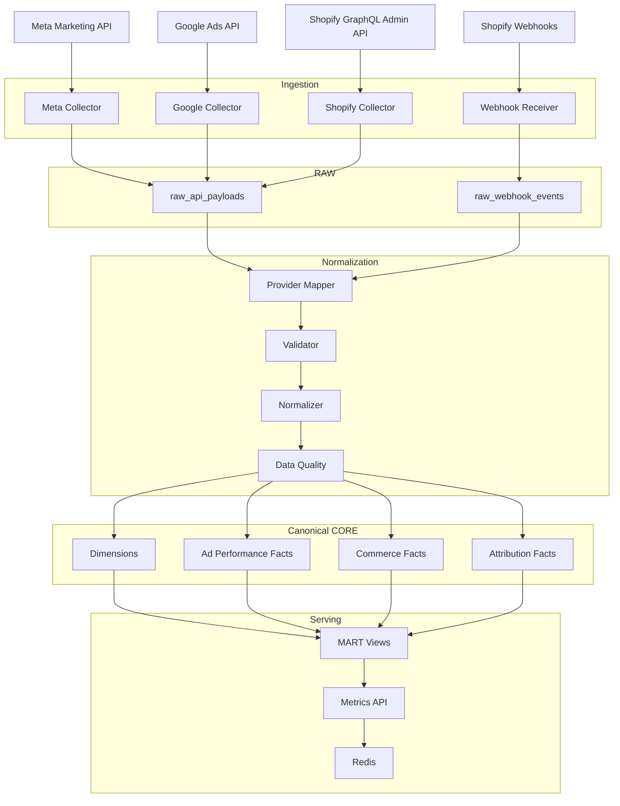
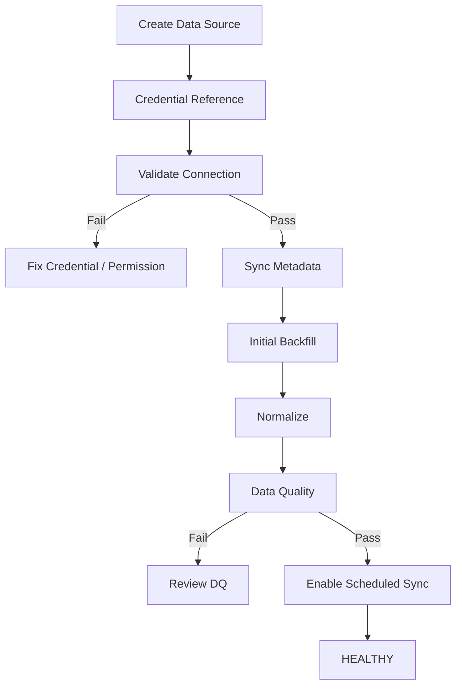
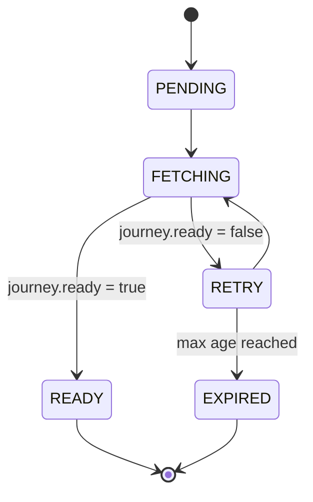
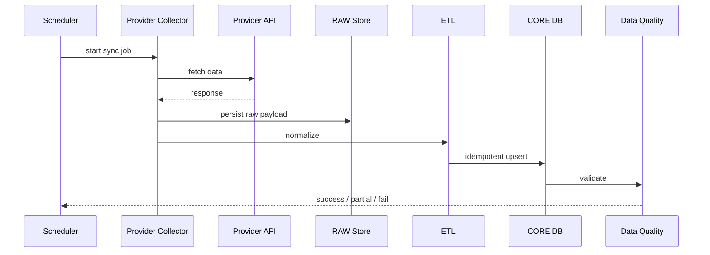

# AI DTC Growth Automation System

## PART 02 — Data Architecture, API Integration & Unified Marketing Data Model

**Version:** V1.0  
**Status:** Ready for Codex Implementation  
**Baseline Date:** 2026-08-10  
**Target:** Codex Development Reference  
**Depends On:** PART 01 shared backend infrastructure only. Advertising API ingestion does **not** depend on AdsPower or US browser profiles.

---

# 0. 文档目标

本 Part 建立整个系统的数据中台。

目标不是“把 Meta / Google / Shopify API 接上”，而是建立：

```text
Official APIs / Webhooks
        ↓
Provider Adapters
        ↓
RAW
        ↓
STAGING / ETL
        ↓
Canonical CORE
        ↓
MART
        ↓
Metrics API
        ↓
PART 03 Rule Engine
PART 04 Agents
PART 05 Dashboard
```

本阶段必须实现：

- Meta Marketing API 只读接入
- Google Ads API 只读接入
- Shopify GraphQL Admin API 只读接入
- Shopify Webhooks
- Initial Backfill
- Incremental Sync
- Rolling Reconciliation
- Raw Payload 留存
- 统一数据模型
- ETL / Mapping
- Idempotent Upsert
- 数据质量检测
- 数据新鲜度监控
- Sync Job 监控
- Mock Mode
- Metrics API
- Unit / Integration / Smoke Tests

本阶段禁止：

```text
AI Agent
LLM Decision
Growth Rule Engine
Campaign Mutation
Budget Change
Campaign Pause
Ad Creation
Bid Change
Creative Vision Analysis
Robyn / Meridian
```

所有广告平台连接在 PART 02 均为：

> READ ONLY

---

# 1. 核心架构原则

## 1.1 AdsPower 与广告数据解耦

错误：

```text
AdsPower
→ 打开 Ads Manager
→ 抓页面指标
→ Database
```

正确：

```text
Meta Marketing API ─┐
Google Ads API ─────┼──→ Data Platform
Shopify API ────────┘

AdsPower ─────────────→ Browser Tool Layer
```

AdsPower 负责：

- 美区浏览器环境
- 账号会话
- 公开市场观察
- 后续浏览器 Tool

AdsPower 不负责广告正式指标主数据。

---

## 1.2 数据源优先级

```text
Tier 1  Official API
Tier 2  First-party Webhook
Tier 3  First-party analytics
Tier 4  Public browser observation
Tier 5  Manual input
```

同一字段如果有 Tier 1 数据，不允许 Tier 4 覆盖。

---

# 2. API 版本基线

截至 2026-08-10：

```text
Meta Marketing API:       v26.0
Google Ads API:           v25
Shopify GraphQL Admin:    2026-07
```

版本必须配置化：

```env
META_GRAPH_API_VERSION=v26.0
GOOGLE_ADS_API_VERSION=v25
SHOPIFY_API_VERSION=2026-07
```

禁止在业务代码里散落：

```python
"/v26.0/"
"/v25/"
"/2026-07/"
```

Provider Adapter 从配置读取版本。

---

# 3. 总体数据架构



---

# 4. 数据分层

必须使用：

```text
RAW
STAGING
CORE
MART
```

## RAW

保存平台原始响应，用于：

- 回溯
- Schema Drift
- Mapper Bug 修复
- 再计算

示例：

```json
{
  "provider": "meta",
  "endpoint": "insights",
  "api_version": "v26.0",
  "request_hash": "...",
  "fetched_at": "...",
  "payload": {}
}
```

## STAGING

Provider-specific：

```text
stg_meta_insights
stg_google_campaign_metrics
stg_shopify_orders
```

负责：

- 类型转换
- Provider 字段解析
- Schema Validation

## CORE

长期稳定模型。

后续 Rule Engine / Agent 不允许直接读 Raw Provider JSON。

## MART

Dashboard / AI 查询层：

```text
mart_daily_growth_overview
mart_platform_daily
mart_campaign_daily
mart_commerce_daily
```

---

# 5. Source Adapter Contract

统一接口：

```python
class MarketingDataProvider(Protocol):

    async def validate_connection(self): ...

    async def sync_accounts(self): ...

    async def sync_dimensions(self): ...

    async def sync_performance(
        self,
        start_date,
        end_date
    ): ...

    async def backfill(
        self,
        start_date,
        end_date
    ): ...
```

实现：

```text
MetaProvider
GoogleAdsProvider
ShopifyProvider
MockProvider
```

目录：

```text
backend/app/integrations/
├── meta_ads/
│   ├── client.py
│   ├── provider.py
│   ├── schemas.py
│   ├── mappers.py
│   ├── parser.py
│   ├── rate_limit.py
│   └── exceptions.py
├── google_ads/
│   ├── client.py
│   ├── provider.py
│   ├── gaql.py
│   ├── schemas.py
│   ├── mappers.py
│   └── exceptions.py
└── shopify/
    ├── client.py
    ├── provider.py
    ├── graphql.py
    ├── webhooks.py
    ├── hmac.py
    ├── mappers.py
    └── exceptions.py
```

---

# 6. Data Source Registry

创建：

```sql
data_sources
```

核心字段：

```sql
id UUID PRIMARY KEY,
provider VARCHAR(32) NOT NULL,
name VARCHAR(255) NOT NULL,

external_account_id VARCHAR(255),
external_account_name VARCHAR(255),

status VARCHAR(32) NOT NULL,
api_version VARCHAR(32),

timezone VARCHAR(128),
currency VARCHAR(8),

credential_reference TEXT,

sync_enabled BOOLEAN DEFAULT TRUE,

last_successful_sync_at TIMESTAMP,
last_failed_sync_at TIMESTAMP,

metadata JSONB,

created_at TIMESTAMP,
updated_at TIMESTAMP
```

Provider：

```text
META_ADS
GOOGLE_ADS
SHOPIFY
```

---

# 7. Credential Architecture

数据库不得保存：

```text
plaintext access token
plaintext refresh token
developer token
client secret
service-account private key
```

Local Development：

```text
.env
```

Production：

```text
Secrets Manager / Vault
```

数据库只保存：

```text
credential_reference
```

例如：

```text
secret://meta/brand-main
secret://google/brand-main
secret://shopify/store-main
```

Frontend 永远拿不到真实 Token。

---

# 8. Meta Marketing API

## 8.1 目标

获取：

```text
Ad Account
Campaign
AdSet
Ad
Creative Metadata
Insights
Actions
Action Values
Breakdowns
Attribution-related reporting metadata
```

环境变量：

```env
META_ENABLED=false
META_GRAPH_API_VERSION=v26.0
META_ACCESS_TOKEN=
META_AD_ACCOUNT_ID=
```

PART 02 只读。

即使 Token 有写权限，也不得实现写操作。

---

# 9. Meta Entity Mapping

Provider：

```text
ACCOUNT
CAMPAIGN
ADSET
AD
```

Canonical：

```text
ACCOUNT
CAMPAIGN
AD_GROUP
AD
```

映射：

```text
Meta AdSet
→ dim_ad_groups
platform_group_type = META_ADSET
```

---

# 10. Meta Dimension Sync

Campaign 建议保存：

```text
id
name
status
effective_status
objective
buying_type
created_time
updated_time
start_time
stop_time
```

AdSet：

```text
id
campaign_id
name
status
effective_status
optimization_goal
billing_event
daily_budget
lifetime_budget
start_time
end_time
targeting
```

Ad：

```text
id
campaign_id
adset_id
name
status
effective_status
creative_id
created_time
updated_time
```

Targeting Raw JSONB 保留，同时可提取：

```text
countries
age_min
age_max
genders
placements
```

---

# 11. Meta Creative Metadata

PART 02 不做视频 AI 理解。

只保存平台 Metadata：

```text
creative_id
name
object_type
title
body
thumbnail_url
image_url
video_id
call_to_action
url_tags
landing_page_url
```

Raw response 必须保留。

---

# 12. Meta Insights

至少采集：

```text
date_start
date_stop

account_id
campaign_id
adset_id
ad_id

impressions
reach
frequency

clicks
inline_link_clicks
outbound_clicks

spend
cpm
cpc
ctr

actions
action_values
cost_per_action_type
purchase_roas
```

注意：

`actions` / `action_values` 是结构化数组。

禁止直接丢弃 `action_type`。

---

# 13. Meta Action Facts

创建：

```sql
fact_meta_actions_daily
```

字段：

```text
data_source_id
date

entity_type
entity_external_id

action_type
action_count
action_value
cost_per_action

attribution_setting
```

例如：

```text
purchase
add_to_cart
initiate_checkout
landing_page_view
link_click
```

不要假设 Action Type 永远固定。

---

# 14. Meta Breakdowns

第一版允许配置：

```text
country
age
gender
publisher_platform
platform_position
device_platform
```

Breakdown 使用独立表：

```text
fact_meta_breakdowns_daily
```

不要破坏主事实表 Grain。

---

# 15. Meta 历史策略

Meta 历史指标和 Breakdown 的可查询时间范围可能随版本变化。

规则：

```text
API 可回填多少 → 尽可能回填
本地拿到的数据 → 长期保存
以后 API 查不到 → 不影响本地历史
```

缺失必须：

```text
NULL / unavailable
```

禁止：

```text
missing = 0
```

---

# 16. Meta 同步策略

默认：

```env
META_INTRADAY_SYNC_MINUTES=15
META_RECONCILE_DAYS=3
META_NIGHTLY_RECONCILE_DAYS=7
META_WEEKLY_RECONCILE_DAYS=30
```

流程：

```text
Every 15 min:
today

Hourly:
D0 → D-3

Nightly:
last 7 days

Weekly:
last 30 days
```

重要：

> 15 分钟抓一次 ≠ 平台归因已经最终结算。

系统必须区分：

```text
ingestion freshness
attribution finality
```

---

# 17. Google Ads API

当前基线：

```text
Google Ads API v25
```

环境变量：

```env
GOOGLE_ADS_ENABLED=false
GOOGLE_ADS_API_VERSION=v25

GOOGLE_ADS_DEVELOPER_TOKEN=
GOOGLE_ADS_CUSTOMER_ID=
GOOGLE_ADS_LOGIN_CUSTOMER_ID=
GOOGLE_ADS_SERVICE_ACCOUNT_JSON_PATH=
```

Google Ads API 使用：

```text
OAuth 2.0
+
Developer Token
```

如果只管理自有/已授权账号：

优先考虑官方支持的 Service Account 流程。

如果未来做多商户 SaaS，再设计 Multi-user OAuth。

禁止做任何绕过登录、2SV、Passkey 的逻辑。

---

# 18. Google Reporting

使用：

```text
GoogleAdsService.Search
GoogleAdsService.SearchStream
GAQL
```

复杂报表优先：

```text
SearchStream
```

第一阶段同步：

```text
Customer
Campaign
AdGroup
AdGroupAd
Keyword View
Search Term View
Asset Group
```

`AssetGroup` 主要用于 Performance Max，不能强行映射为普通 `AdGroup`。

---

# 19. Google Campaign Performance

示意 GAQL：

```sql
SELECT
  campaign.id,
  campaign.name,
  segments.date,

  metrics.impressions,
  metrics.clicks,
  metrics.cost_micros,
  metrics.conversions,
  metrics.conversions_value,
  metrics.all_conversions,
  metrics.all_conversions_value
FROM campaign
WHERE segments.date BETWEEN @start_date AND @end_date
```

示例必须通过当前 v25 Field Reference 验证。

建立：

```text
GAQLQueryBuilder
```

不要把大量 GAQL 字符串散落在 Service。

---

# 20. Google AdGroup / Ad

AdGroup：

```text
campaign_id
ad_group_id
date

impressions
clicks
cost
conversions
conversion_value
```

Ad：

```text
campaign_id
ad_group_id
ad_id

status

impressions
clicks
cost
conversions
conversion_value
```

---

# 21. Google Search Term

创建：

```text
fact_google_search_terms_daily
```

字段：

```text
date
campaign_id
ad_group_id
search_term

impressions
clicks
cost
conversions
conversion_value
```

后续 PART 03 Google Search Rules 会直接使用。

---

# 22. Google Keyword

创建：

```text
fact_google_keywords_daily
```

字段：

```text
date
campaign_id
ad_group_id
criterion_id
keyword_text
match_type

impressions
clicks
cost
conversions
conversion_value
```

---

# 23. Google Conversion Actions

不能只存：

```text
conversions = N
```

还应支持：

```text
segments.conversion_action
```

创建：

```text
fact_google_conversion_actions_daily
```

这样后续可区分：

```text
Purchase
Add To Cart
Lead
Other
```

---

# 24. Google Cost

原始：

```text
cost_micros
```

Core：

```text
spend_amount
```

转换：

```text
spend_amount = cost_micros / 1_000_000
```

同时保留原始 `cost_micros`。

---

# 25. Google Segmentation

第一阶段支持：

```text
segments.date
segments.device
segments.ad_network_type
segments.conversion_action
```

不同分析需求使用不同 Query Preset。

不要默认一次塞很多 Segment。

---

# 26. Google Quota

必须实现：

```text
quota-aware collector
```

包括：

- batching
- SearchStream
- exponential backoff
- quota metrics
- job prioritization

如果出现：

```text
RESOURCE_EXHAUSTED
```

Job：

```text
RATE_LIMITED
```

不能无限 Retry。

默认同步：

```env
GOOGLE_INTRADAY_SYNC_MINUTES=15
GOOGLE_RECONCILE_DAYS=3
GOOGLE_NIGHTLY_RECONCILE_DAYS=7
GOOGLE_WEEKLY_RECONCILE_DAYS=30
```

---

# 27. Shopify GraphQL Admin API

当前基线：

```text
2026-07
```

使用：

```text
GraphQL Admin API
```

不要新建 REST Admin 数据层。

系统属于后台服务，应采用适合后台服务的 offline-capable access token 模式。

环境变量：

```env
SHOPIFY_ENABLED=false
SHOPIFY_API_VERSION=2026-07

SHOPIFY_SHOP_DOMAIN=
SHOPIFY_ACCESS_TOKEN=
SHOPIFY_WEBHOOK_SECRET=
```

---

# 28. Shopify Scope / Privacy

最小权限原则。

通常第一阶段需要：

```text
read_orders
read_products
```

如果某字段要求额外受保护客户数据权限：

先评估是否真的需要。

本系统默认不采集：

```text
customer name
email
phone
shipping address
billing address
client IP
```

分析层只保留匿名/Surrogate Customer ID。

---

# 29. Shopify = Commerce Ground Truth

广告平台回答：

```text
平台认为自己带来了多少转化
```

Shopify 回答：

```text
实际产生了多少订单和收入
```

因此：

```text
Actual Orders
Actual Revenue
Refund
Net Revenue
```

以 Shopify 为主。

禁止：

```text
Meta Purchases + Google Conversions = Total Orders
```

同一订单可能被多个平台同时归因。

---

# 30. Shopify Core Resources

同步：

```text
Shop
Products
Variants
Orders
Order Line Items
Refunds
Customer Journey Summary
```

Product：

```text
external_product_id
title
handle
vendor
product_type
status
source timestamps
```

Variant：

```text
external_variant_id
external_product_id
sku
title
price
compare_at_price
inventory_item_id
```

---

# 31. Order Facts

创建：

```sql
fact_orders
```

核心字段：

```text
data_source_id

external_order_id
order_name

order_created_at
order_updated_at

financial_status
fulfillment_status

currency

subtotal_amount
discount_amount
shipping_amount
tax_amount

gross_amount
current_total_amount
refunded_amount
net_revenue_amount

cancelled_at
source_name

provider_customer_id_hash

raw_metadata
```

所有财务定义必须按 Shopify 当前字段语义验证。

禁止凭字段名字猜收入公式。

---

# 32. Order Items / Refunds

`fact_order_items`：

```text
order_id
external_line_item_id
product_id
variant_id
sku
title
quantity
unit_price
line_discount
line_total
```

`fact_refunds`：

```text
external_refund_id
order_id
refund_created_at
refund_amount
currency
reason
raw_metadata
```

后续 Net ROAS 必须考虑退款。

---

# 33. Customer Journey Summary

使用：

```text
Order.customerJourneySummary
```

保存：

```text
ready
days_to_conversion
first_visit
last_visit
moments_count
```

如果：

```text
ready = false
```

不能判定：

```text
no attribution
```

必须进入：

```text
SHOPIFY_JOURNEY_ENRICH
```

重试直到：

```text
ready = true
```

或超过最大等待年龄。

---

# 34. Order Attribution

创建：

```text
fact_order_attribution
```

字段：

```text
order_id
journey_ready
days_to_conversion

first_source
first_landing_page
first_referrer_url
first_utm_source
first_utm_medium
first_utm_campaign
first_utm_content
first_utm_term

last_source
last_landing_page
last_referrer_url
last_utm_source
last_utm_medium
last_utm_campaign
last_utm_content
last_utm_term
```

UTM 是路径信号，不等于广告平台 Attribution。

如果 Landing Page URL 中存在：

```text
gclid
fbclid
utm_*
```

可以解析，但不作为必填字段。

---

# 35. Shopify Webhooks

用于近实时 Commerce Update。

第一阶段至少覆盖：

```text
order create/update/paid
refund create
product update
app uninstall
```

具体 Topic 字符串必须由 Codex 根据当前 Shopify 2026-07 Webhook Reference 验证。

Webhook 流程：

```text
Receive
↓
Read RAW BODY
↓
Verify HMAC
↓
Read Delivery ID
↓
Deduplicate
↓
Persist raw event
↓
Return 2xx quickly
↓
Async Process
```

禁止在 Webhook HTTP 请求中：

```text
跑复杂 ETL
跑 AI
跑大查询
```


# 36. Webhook Security

HTTPS Webhook 必须验证：

```text
X-Shopify-Hmac-SHA256
```

计算时使用：

```text
raw request body
```

不能：

```text
JSON parse → serialize → HMAC
```

Webhook 去重使用：

```text
X-Shopify-Webhook-Id
```

数据库唯一键：

```text
provider + delivery_id
```

重复 Webhook：

```text
return 2xx
do not process twice
```

---

# 37. Raw Webhook Events

创建：

```sql
raw_webhook_events
```

字段：

```text
id
provider
delivery_id
topic
shop_domain
api_version

headers_metadata
payload

received_at

verified
processed
processing_error
```

不要保存完整敏感 Header。

---

# 38. Shopify Initial Backfill

历史数据初始化优先使用：

```text
GraphQL Bulk Operations
```

用于：

```text
products
orders
order items
refunds
```

不要为几万行数据做大量同步分页请求。

Bulk 下载结果：

```text
stream parse
```

不要一次全部加载进内存。

状态机：

```text
CREATED
RUNNING
COMPLETED
FAILED
EXPIRED
```

---

# 39. Shopify Incremental Strategy

使用：

```text
Webhooks
+
GraphQL Reconciliation
```

Webhook：

```text
速度
```

Reconciliation：

```text
补漏
状态变化
退款
Customer Journey 延迟 enrichment
```

默认：

```env
SHOPIFY_RECONCILE_MINUTES=60
SHOPIFY_RECONCILE_DAYS=2
SHOPIFY_NIGHTLY_RECONCILE_DAYS=7
```

---

# 40. Canonical Data Model

核心维度：

```text
dim_marketing_accounts
dim_campaigns
dim_ad_groups
dim_ads
dim_creatives

dim_products
dim_product_variants
```

核心事实：

```text
fact_ad_performance_daily
fact_ad_performance_snapshots

fact_meta_actions_daily
fact_meta_breakdowns_daily

fact_google_keywords_daily
fact_google_search_terms_daily
fact_google_conversion_actions_daily

fact_orders
fact_order_items
fact_refunds
fact_order_attribution
```

系统表：

```text
data_sources
sync_jobs
sync_cursors
raw_api_payloads
raw_webhook_events
data_quality_issues
provider_api_usage
```

---

# 41. Marketing Account

```sql
dim_marketing_accounts
```

字段：

```text
id
data_source_id

platform
external_account_id
name

currency
timezone
status

created_at
updated_at
```

---

# 42. Campaign Dimension

```sql
dim_campaigns
```

字段：

```text
id
data_source_id
marketing_account_id

platform
external_campaign_id

name
status

objective
channel_type
channel_sub_type

start_at
end_at

raw_metadata

source_created_at
source_updated_at

created_at
updated_at
```

Unique：

```text
platform
marketing_account_id
external_campaign_id
```

---

# 43. Ad Group Dimension

Meta：

```text
AdSet
```

Google：

```text
AdGroup
```

统一：

```sql
dim_ad_groups
```

字段：

```text
id
campaign_id

platform
platform_group_type

external_group_id

name
status

optimization_goal
billing_event

daily_budget
lifetime_budget

targeting_metadata

source_created_at
source_updated_at
```

---

# 44. Ad / Creative Dimensions

`dim_ads`：

```text
id
campaign_id
ad_group_id

platform
external_ad_id

name
status

creative_id

source_created_at
source_updated_at

raw_metadata
```

`dim_creatives`：

```text
id
data_source_id

platform
external_creative_id

name
title
body

image_url
thumbnail_url
video_id
landing_page_url
cta_type

raw_metadata
created_at
updated_at
```

PART 04 再增加 AI Creative DNA。

---

# 45. Fact Ad Performance Daily

最核心事实表：

```sql
fact_ad_performance_daily
```

Grain：

> 一个 Platform Entity 在一个 Account Timezone Date 的表现。

字段：

```text
id

data_source_id
marketing_account_id

platform

entity_type
entity_id
external_entity_id

date
currency

impressions
reach

clicks
link_clicks
outbound_clicks

spend_amount

platform_conversions
platform_conversion_value

platform_purchases
platform_purchase_value

cpm
cpc
ctr
frequency

platform_reported_roas

source_attribution_metadata

sync_job_id
source_updated_at

created_at
updated_at
```

Entity Type：

```text
CAMPAIGN
AD_GROUP
AD
ASSET_GROUP
```

---

# 46. Grain Safety

这是硬性要求。

如果 Fact 同时存：

```text
Campaign
AdGroup
Ad
```

禁止：

```sql
SELECT SUM(spend_amount)
FROM fact_ad_performance_daily
WHERE date = CURRENT_DATE;
```

这会重复计算。

所有查询必须：

```text
明确 entity_type
```

或读取经过定义的 Mart。

---

# 47. Intraday Snapshots

为了支持“实时看盘”：

创建：

```text
fact_ad_performance_snapshots
```

Grain：

```text
provider
entity
source_date
observed_at
```

例如：

```text
10:00
10:15
10:30
```

指标：

```text
spend
impressions
clicks
purchase
conversion_value
```

用途：

```text
Spend velocity
No-purchase burn
Intraday CPA spike
实时趋势
```

Daily Fact 保存当前最新日值。

Snapshot 用于过程变化。

默认：

```env
INTRADAY_SNAPSHOT_RETENTION_DAYS=90
```

---

# 48. Raw API Payload

创建：

```sql
raw_api_payloads
```

字段：

```text
id
provider
data_source_id

endpoint
api_version

request_hash
request_metadata

payload

fetched_at
sync_job_id

created_at
```

大体量 Payload 后续可迁移 Object Storage。

接口抽象：

```text
RawStorage
```

实现可支持：

```text
PostgresRawStorage
FileRawStorage
S3RawStorage
```

---

# 49. Currency

任何事实必须保留：

```text
source currency
```

禁止默认全部 USD。

系统配置：

```env
REPORTING_CURRENCY=USD
```

这只是 Serving / Dashboard 报表币种。

未来可以增加：

```text
dim_fx_rates
```

PART 02 不需要接 FX API。

---

# 50. Timezone

所有事实保存：

```text
source_date
account_timezone
observed_at UTC
```

Platform Daily Metrics：

```text
按广告账户 timezone
```

Internal Timestamp：

```text
UTC
```

禁止使用：

```text
server local timezone
```

决定广告日边界。

---

# 51. Metric Registry

建立统一 Metric Registry。

例如：

```python
METRICS = {
    "spend": {...},
    "platform_roas": {...},
    "blended_roas": {...},
    "net_revenue": {...}
}
```

字段：

```text
metric_name
description
numerator
denominator
source
currency_behavior
null_behavior
```

---

# 52. Metric Semantics

## Spend

平台报告广告花费。

## Platform Conversions

广告平台自己的 Attribution Conversion。

## Platform ROAS

```text
platform attributed conversion value
/
platform spend
```

名称必须包含：

```text
platform
```

不能叫：

```text
true_roas
```

## Actual Orders

来源：

```text
Shopify
```

## Net Revenue

来源：

```text
Shopify
```

并考虑：

```text
refund
```

## Blended ROAS

```text
Shopify Net Revenue
/
Total Paid Media Spend
```

## MER

如果使用：

```text
Total Revenue / Total Marketing Spend
```

必须在 Registry 明确收入和 Spend 定义。

---

# 53. Attribution Layers

必须保留三套不同信息：

```text
1. Platform Attribution
   Meta / Google

2. Commerce Attribution
   Shopify Customer Journey

3. URL Attribution
   UTM / click identifiers
```

PART 02 不负责得出：

```text
真正归因
```

后续 Attribution Agent / MMM 再做融合。

禁止：

```text
Meta Purchases
+
Google Purchases
=
Shopify Orders
```

---

# 54. Null vs Zero

强制规则：

```text
0
```

表示：

```text
Provider 明确返回 0
```

```text
NULL
```

表示：

```text
unknown
not available
not applicable
not fetched
```

Ingestion 层禁止无脑：

```sql
COALESCE(..., 0)
```

---

# 55. Safe Division

所有：

```text
ROAS
CTR
CPC
CPA
CVR
```

必须 Safe Divide。

例如：

```text
spend = 0
```

则相关比率：

```text
NULL
```

不是：

```text
Infinity
```

---

# 56. Sync Jobs

创建：

```sql
sync_jobs
```

字段：

```text
id
data_source_id

provider
job_type
status

range_start
range_end

started_at
finished_at

records_received
records_inserted
records_updated
records_failed

api_requests

error_code
error_message

metadata

created_at
```

Job Type：

```text
CONNECTION_TEST
DIMENSION_SYNC
PERFORMANCE_INTRADAY
PERFORMANCE_RECONCILE
INITIAL_BACKFILL
SHOPIFY_ORDER_RECONCILE
SHOPIFY_JOURNEY_ENRICH
WEBHOOK_PROCESS
DATA_QUALITY_CHECK
```

Status：

```text
QUEUED
RUNNING
SUCCESS
PARTIAL_SUCCESS
FAILED
RATE_LIMITED
CANCELLED
```

---

# 57. Sync Cursor

创建：

```text
sync_cursors
```

字段：

```text
data_source_id
resource_type
cursor_type
cursor_value
watermark_at
updated_at
```

支持：

```text
pagination
updated_at watermark
bulk operation
```

---

# 58. Idempotency

同一时间窗口执行两次：

```text
结果必须相同
```

不能重复插入。

Performance Unique Key：

```text
data_source_id
entity_type
external_entity_id
date
```

使用：

```text
UPSERT
```

Webhook Unique：

```text
provider
delivery_id
```

---

# 59. Scheduler / Queues

沿用 PART 01：

```text
Celery + Redis
```

拆队列：

```text
queue:meta
queue:google
queue:shopify
queue:webhook
queue:etl
queue:data-quality
queue:backfill
```

优先级：

```text
P0 Shopify Webhook
P1 Intraday Ads Sync
P2 Rolling Reconciliation
P3 Nightly
P4 Historical Backfill
```

Backfill 必须低优先级。

默认：

```env
BACKFILL_MAX_CONCURRENCY=1
```

防止历史任务挤死实时任务。

---

# 60. Retry Policy

Retryable：

```text
network timeout
temporary 5xx
429
temporary resource exhausted
```

Non-Retryable：

```text
invalid credential
permission denied
invalid field
invalid account
unsupported API version
```

使用：

```text
Exponential Backoff + Jitter
```

示意：

```text
5s
15s
45s
120s
```

优先尊重 Provider 返回的 Retry / Throttle 信息。

---

# 61. Circuit Breaker

如果同一 Source：

```text
连续 Auth Failure
```

设置：

```text
AUTH_ERROR
```

并停止定时请求。

直到人工重新 Validate。

防止系统每 15 分钟持续失败。

---

# 62. Data Quality Engine

第一阶段规则：

```text
NEGATIVE_SPEND
IMPRESSIONS_LT_CLICKS
MISSING_ENTITY
UNKNOWN_CURRENCY
DUPLICATE_FACT
TIMEZONE_MISSING
ORDER_TOTAL_INVALID
REFUND_GT_ORDER
SOURCE_STALE
API_SCHEMA_DRIFT
```

创建：

```text
data_quality_issues
```

字段：

```text
id
data_source_id

rule_code
severity

entity_type
entity_id
date

message
context

status

created_at
resolved_at
```

Severity：

```text
INFO
WARNING
ERROR
CRITICAL
```

---

# 63. Schema Drift

如果：

```text
Required field missing
Field type changed
Unknown enum
Unexpected structure
```

不能 silent ignore。

记录：

```text
API_SCHEMA_DRIFT
```

并保留 Raw Payload。

---

# 64. Freshness Monitor

每个 Data Source：

```text
last_successful_sync_at
last_provider_data_at
sync_lag_seconds
```

Status：

```text
FRESH
DELAYED
STALE
FAILED
UNKNOWN
```

内部目标：

Meta / Google：

```text
Healthy ingestion < 20 min
```

Shopify Webhook：

```text
internal processing lag < 2 min
```

注意：

这只是内部 SLO。

不等于平台 Attribution Finality。

---

# 65. Provider API Usage

创建：

```text
provider_api_usage
```

字段：

```text
provider
data_source_id

window_start
window_end

request_count
success_count
failure_count
rate_limit_count

metadata
```

监控：

```text
request latency
sync duration
records read
records written
rate limiting
freshness
```

---

# 66. Structured Logging

示例：

```json
{
  "service": "meta-collector",
  "provider": "META_ADS",
  "data_source_id": "...",
  "sync_job_id": "...",
  "event": "performance_sync",
  "duration_ms": 1200,
  "records": 120,
  "error_code": null
}
```

禁止 Log：

```text
access token
refresh token
developer token
authorization header
service-account private key
customer email
customer phone
address
```

---

# 67. Unified Error Codes

```text
PROVIDER_AUTH_FAILED
PROVIDER_PERMISSION_DENIED
PROVIDER_RATE_LIMITED
PROVIDER_TIMEOUT
PROVIDER_SCHEMA_CHANGED
PROVIDER_INVALID_ACCOUNT

SYNC_FAILED
SYNC_PARTIAL
BACKFILL_FAILED

WEBHOOK_HMAC_INVALID
WEBHOOK_DUPLICATE

ETL_MAPPING_FAILED

DQ_NEGATIVE_SPEND
DQ_DUPLICATE
DQ_STALE_SOURCE
```

Provider 原始 Error Code：

保存在 metadata。

用户 UI 使用内部错误码。

---

# 68. Shopify GraphQL Cost

必须读取 GraphQL Response：

```text
extensions.cost
throttleStatus
```

实现：

```text
adaptive pacing
```

HTTP 200 不等于业务成功。

必须同时检查：

```text
GraphQL errors
userErrors
```

---

# 69. Data Lineage

每一条 CORE Fact 必须能追溯：

```text
Fact
↓
Sync Job
↓
Provider Request
↓
Raw Payload
```

后续 Agent 的“为什么建议暂停广告”才能可解释。

---

# 70. Transaction Boundary

一个 Sync Chunk：

```text
Fetch
↓
Persist RAW
↓
Parse STAGING
↓
Validate
↓
Transaction Upsert CORE
↓
DQ
↓
Mark SUCCESS
```

如果 CORE Upsert 失败：

Job 不得标 SUCCESS。

如果：

```text
100 rows
99 success
1 fail
```

状态：

```text
PARTIAL_SUCCESS
```

---

# 71. Backfill

默认：

```env
INITIAL_BACKFILL_DAYS=90
```

Meta / Google：

建议按：

```text
7-day chunk
```

Breakdown 大：

```text
1-day chunk
```

Chunk 大小必须配置化。

Shopify 大历史：

优先 Bulk Operations。

---

# 72. Rolling Reconciliation

不能只抓“新增数据”。

因为：

```text
late conversion
refund
order update
attribution update
```

都会改变过去数据。

因此：

```text
Intraday + Rolling Re-fetch
```

是核心策略。

---

# 73. Data State

可选字段：

```text
INTRADAY
RECONCILED
ARCHIVED
```

不要轻易使用：

```text
FINAL
```

除非 Provider 有明确 Finality 语义。

---

# 74. Mock Mode

必须支持：

```env
DATA_PROVIDER_MODE=mock
```

没有真实 Credential 也能启动全部 Data Pipeline。

Fixtures：

```text
fixtures/meta/
fixtures/google/
fixtures/shopify/
```

至少提供：

```text
healthy_growth
zero_purchase_burn
meta_creative_fatigue
google_high_cpc
shopify_refund_spike
api_rate_limit
schema_drift
```

PART 02 只生成数据，不做规则判断。

---

# 75. Demo Data

命令：

```bash
make seed-demo-data
```

生成至少：

```text
30 days

Meta:
2 campaigns
multiple adsets
multiple ads

Google:
Search campaign
PMax campaign
keywords
search terms

Shopify:
orders
refunds
UTM journeys
```

这样 PART 03 / PART 05 可以独立开发。


# 76. Serving APIs

PART 02 不做完整 Growth Dashboard，但必须提供稳定查询 API。

## Data Sources

```http
GET  /api/v1/data-sources
POST /api/v1/data-sources
GET  /api/v1/data-sources/{id}

POST /api/v1/data-sources/{id}/validate
POST /api/v1/data-sources/{id}/sync
POST /api/v1/data-sources/{id}/backfill
```

## Sync Jobs

```http
GET  /api/v1/sync-jobs
GET  /api/v1/sync-jobs/{id}
POST /api/v1/sync-jobs/{id}/retry
```

## Data Health

```http
GET /api/v1/data-health/freshness
GET /api/v1/data-health/quality
```

## Overview

```http
GET /api/v1/metrics/overview
```

参数：

```text
start_date
end_date
timezone
currency
```

返回至少：

```json
{
  "paid_spend": 0,
  "shopify_net_revenue": 0,
  "orders": 0,
  "blended_roas": null,
  "platforms": []
}
```

## Platform Metrics

```http
GET /api/v1/metrics/platforms
```

返回：

```text
Meta
Google
```

指标：

```text
spend
impressions
clicks
platform_conversions
platform_conversion_value
platform_roas
```

## Campaign Metrics

```http
GET /api/v1/metrics/campaigns
```

内部必须固定：

```text
entity_type = CAMPAIGN
```

## Commerce Metrics

```http
GET /api/v1/metrics/commerce
```

返回：

```text
orders
gross_revenue
discounts
refunds
net_revenue
aov
```

---

# 77. Basic MART

建立：

```text
mart_daily_growth_overview
mart_platform_daily
mart_campaign_daily
mart_commerce_daily
```

`mart_daily_growth_overview`：

```text
date

meta_spend
google_spend
total_paid_spend

shopify_orders
shopify_gross_revenue
shopify_refunds
shopify_net_revenue

blended_roas
```

Platform Reported Conversion Value 单独展示：

```text
meta_platform_purchase_value
google_platform_conversion_value
```

不要替代 Shopify Revenue。

---

# 78. Data Health 页面

PART 02 只做基础 Data Health UI。

示意：

```text
┌────────────────────────────────────────────────────────────┐
│ DATA HEALTH                                                │
├────────────────┬────────────────┬──────────────────────────┤
│ Meta Ads       │ Google Ads     │ Shopify                  │
│ HEALTHY        │ HEALTHY        │ HEALTHY                  │
│ 8 min ago      │ 11 min ago     │ webhook 14 sec ago       │
├────────────────┴────────────────┴──────────────────────────┤
│ Today                                                      │
│ Paid Spend        $620                                     │
│ Net Revenue       $2,410                                   │
│ Orders            18                                       │
│ Blended ROAS      3.89                                     │
├────────────────────────────────────────────────────────────┤
│ Recent Jobs                                                │
│ META_INTRADAY         SUCCESS                              │
│ GOOGLE_INTRADAY       SUCCESS                              │
│ SHOPIFY_WEBHOOK       SUCCESS                              │
└────────────────────────────────────────────────────────────┘
```

最终 Growth Dashboard 留给 PART 05。

---

# 79. Repository Structure

在 PART 01 基础上扩展：

```text
ai-dtc-growth-system/
│
├── docs/
│   ├── PART-01-System-Architecture-US-Environment.md
│   └── PART-02-Data-Architecture-API-Database.md
│
├── backend/
│   └── app/
│       ├── integrations/
│       │   ├── adspower/
│       │   ├── meta_ads/
│       │   ├── google_ads/
│       │   └── shopify/
│       │
│       ├── ingestion/
│       │   ├── orchestrator.py
│       │   ├── scheduler.py
│       │   ├── backfill.py
│       │   ├── reconciliation.py
│       │   └── idempotency.py
│       │
│       ├── etl/
│       │   ├── pipeline.py
│       │   ├── validators.py
│       │   ├── metric_registry.py
│       │   └── mappers/
│       │
│       ├── models/
│       │   ├── data_source.py
│       │   ├── marketing_account.py
│       │   ├── campaign.py
│       │   ├── ad_group.py
│       │   ├── ad.py
│       │   ├── creative.py
│       │   ├── ad_performance.py
│       │   ├── product.py
│       │   ├── order.py
│       │   ├── attribution.py
│       │   ├── sync_job.py
│       │   └── data_quality.py
│       │
│       ├── services/
│       │   ├── metrics_service.py
│       │   ├── data_source_service.py
│       │   ├── sync_service.py
│       │   └── data_health_service.py
│       │
│       ├── api/v1/
│       │   ├── data_sources.py
│       │   ├── sync_jobs.py
│       │   ├── metrics.py
│       │   ├── data_health.py
│       │   └── webhooks_shopify.py
│       │
│       └── workers/
│           ├── meta_tasks.py
│           ├── google_tasks.py
│           ├── shopify_tasks.py
│           ├── etl_tasks.py
│           └── dq_tasks.py
│
├── fixtures/
│   ├── meta/
│   ├── google/
│   └── shopify/
│
└── tests/
    ├── unit/
    ├── integration/
    └── fixtures/
```

---

# 80. Database Migration

使用：

```text
Alembic
```

禁止生产依赖：

```text
Base.metadata.create_all()
```

建议：

```text
PostgreSQL 16+
```

第一版不引入：

```text
ClickHouse
Snowflake
BigQuery
```

当前阶段 PostgreSQL 足够。

---

# 81. Index Requirements

至少建立：

```text
fact_ad_performance_daily:
(platform, date)
(entity_type, entity_id, date)
(data_source_id, date)

fact_orders:
(data_source_id, order_created_at)

sync_jobs:
(data_source_id, status)
(created_at)

raw_webhook_events:
(provider, delivery_id UNIQUE)
```

第一版不强制 Partition。

但 Fact Schema 必须为未来：

```text
date partition
```

留出空间。

---

# 82. Environment Variables

`.env.example` 至少：

```env
# Core
DATABASE_URL=
REDIS_URL=
REPORTING_CURRENCY=USD
DATA_PROVIDER_MODE=mock

# Meta
META_ENABLED=false
META_GRAPH_API_VERSION=v26.0
META_ACCESS_TOKEN=
META_AD_ACCOUNT_ID=
META_INTRADAY_SYNC_MINUTES=15
META_RECONCILE_DAYS=3
META_NIGHTLY_RECONCILE_DAYS=7
META_WEEKLY_RECONCILE_DAYS=30

# Google Ads
GOOGLE_ADS_ENABLED=false
GOOGLE_ADS_API_VERSION=v25
GOOGLE_ADS_DEVELOPER_TOKEN=
GOOGLE_ADS_CUSTOMER_ID=
GOOGLE_ADS_LOGIN_CUSTOMER_ID=
GOOGLE_ADS_SERVICE_ACCOUNT_JSON_PATH=
GOOGLE_INTRADAY_SYNC_MINUTES=15
GOOGLE_RECONCILE_DAYS=3
GOOGLE_NIGHTLY_RECONCILE_DAYS=7
GOOGLE_WEEKLY_RECONCILE_DAYS=30

# Shopify
SHOPIFY_ENABLED=false
SHOPIFY_API_VERSION=2026-07
SHOPIFY_SHOP_DOMAIN=
SHOPIFY_ACCESS_TOKEN=
SHOPIFY_WEBHOOK_SECRET=
SHOPIFY_RECONCILE_MINUTES=60
SHOPIFY_RECONCILE_DAYS=2
SHOPIFY_NIGHTLY_RECONCILE_DAYS=7

# Backfill
INITIAL_BACKFILL_DAYS=90
BACKFILL_MAX_CONCURRENCY=1

# Retention
RAW_PAYLOAD_RETENTION_DAYS=180
WEBHOOK_RETENTION_DAYS=180
INTRADAY_SNAPSHOT_RETENTION_DAYS=90
```

`.env.example` 不得包含真实值。

---

# 83. Connection Validation

每个 Provider 必须支持：

```text
Validate Connection
```

Meta 返回：

```text
API reachable
Token valid
Ad account accessible
Currency
Timezone
```

Google 返回：

```text
Developer token accepted
Auth valid
Customer reachable
Manager relationship valid
Currency
Timezone
```

Shopify 返回：

```text
GraphQL reachable
Token valid
Shop accessible
Scopes
Currency
Timezone
```

Source Health：

```text
HEALTHY
DEGRADED
AUTH_ERROR
RATE_LIMITED
STALE
DISABLED
UNKNOWN
```

---

# 84. Initial Setup Flow



---

# 85. Shopify Journey Enrichment State



---

# 86. Full Sync Sequence



---

# 87. Testing Strategy

## Unit

必须覆盖：

```text
Meta Mapper
Google Mapper
Shopify Mapper

cost_micros conversion
currency
timezone
null vs zero
safe division

Webhook HMAC
Webhook dedup

Idempotent Upsert
Data Quality
```

## Provider Fixture Contract

每个 Provider 保存脱敏 Fixture：

```text
fixture
→ parser
→ mapper
→ canonical
```

当 API Mapping 改动时必须跑 Contract Test。

## Mock Integration

必须测试：

```text
create mock sources
seed 30-day data
run backfill
run intraday
run reconciliation
process Shopify webhook
query metrics API
```

## Live Smoke

有 Credential 时：

```text
validate connection
fetch dimensions
fetch one-day metrics
no mutation
```

---

# 88. Read-only Guard

PART 02 Provider Client 不得暴露：

```text
create_campaign
update_campaign
pause_campaign
set_budget
create_ad
change_bid
```

不要预留空实现。

真正写操作在 PART 06 单独设计审批和 Guardrail。

---

# 89. Smoke Test Commands

必须提供：

```bash
make seed-demo-data
make smoke-data

make sync-meta
make sync-google
make sync-shopify

make backfill-meta DAYS=30
make backfill-google DAYS=30
make backfill-shopify DAYS=30
```

`make smoke-data` 示例：

```text
PostgreSQL             PASS
Redis                  PASS

Meta Connection        PASS / SKIP
Google Connection      PASS / SKIP
Shopify Connection     PASS / SKIP

Mock Backfill          PASS
ETL                    PASS
Idempotency            PASS
Webhook HMAC           PASS
Metric Grain Safety    PASS
Metrics Overview       PASS
Freshness              PASS
DQ Check               PASS
```

---

# 90. Definition of Done

PART 02 只有满足以下条件才完成。

## Architecture

- [ ] Provider Adapter 完成
- [ ] AdsPower 与 Ads API 完全解耦
- [ ] API Version 配置化
- [ ] RAW / CORE / MART 分层完成

## Meta

- [ ] Connection Validation
- [ ] Campaign Sync
- [ ] AdSet Sync
- [ ] Ad Sync
- [ ] Creative Metadata
- [ ] Insights
- [ ] Actions Explode
- [ ] Breakdown 支持
- [ ] Intraday Snapshot
- [ ] Rolling Reconciliation
- [ ] Backfill

## Google

- [ ] Connection Validation
- [ ] Campaign
- [ ] AdGroup
- [ ] Ad
- [ ] Keyword
- [ ] Search Term
- [ ] Conversion Action
- [ ] Asset Group Metadata
- [ ] Intraday Snapshot
- [ ] Rolling Reconciliation
- [ ] Backfill

## Shopify

- [ ] Connection Validation
- [ ] Product
- [ ] Variant
- [ ] Orders
- [ ] Order Items
- [ ] Refund
- [ ] HMAC
- [ ] Webhook Dedup
- [ ] Bulk Backfill
- [ ] Customer Journey
- [ ] Journey Enrichment

## Data

- [ ] Sync Jobs
- [ ] Sync Cursor
- [ ] Idempotency
- [ ] Data Quality
- [ ] Freshness
- [ ] Data Lineage
- [ ] Null vs Zero
- [ ] Currency
- [ ] Timezone
- [ ] Grain Guard

## Security

- [ ] No Token in frontend
- [ ] No Secret in logs
- [ ] No PII by default
- [ ] `.env` ignored
- [ ] `.env.example` available

## Tests

- [ ] Unit Tests pass
- [ ] Mock Integration pass
- [ ] Smoke Data pass
- [ ] Live read-only test documented

---

# 91. 为什么 PART 02 是后续核心基础

PART 03 Growth Rule Engine 会判断：

```text
Kill
Scale
Creative Fatigue
No-purchase Burn
High CPC
Funnel Problem
Refund Risk
Search Term Waste
```

如果数据层错误：

Rule Engine 会产生：

```text
False Alert
Wrong Pause
Wrong Scale
Wrong Budget Decision
```

所以 AI 不能直接读 Platform API。

必须：

```text
Official APIs
↓
Validated Data Platform
↓
Rule Engine
↓
Agents
```

---

# 92. CODEX MASTER INSTRUCTION — PART 02

You are the senior data/platform engineer implementing:

**AI DTC Growth Automation System — PART 02**

Your objective is to build a stable, auditable, read-only marketing and commerce data platform.

Do not implement AI agents or advertising mutations.

## Version baseline

Use configurable versions:

```text
Meta Marketing API v26.0
Google Ads API v25
Shopify GraphQL Admin API 2026-07
```

Do not scatter version literals through business services.

## Architecture

Implement:

```text
Provider API
→ Provider Adapter
→ RAW
→ STAGING / Mapper
→ Canonical CORE
→ MART
→ Metrics API
```

AdsPower must not be part of advertising metrics ingestion.

## Providers

Implement:

```text
MetaProvider
GoogleAdsProvider
ShopifyProvider
MockProvider
```

## Read Only

Do not implement:

```text
create campaign
update campaign
pause campaign
budget change
bid change
create ad
```

## Meta

Implement:

```text
connection validation
campaign
adset
ad
creative metadata
insights
actions parser
breakdowns
intraday snapshots
rolling reconciliation
historical backfill
raw persistence
```

Do not collapse action arrays without preserving `action_type`.

## Google Ads

Use:

```text
Google Ads API v25
GAQL
Search / SearchStream
```

Implement:

```text
campaign
ad group
ad
keyword
search term
conversion actions
asset group metadata
performance
intraday snapshot
reconciliation
backfill
```

Preserve `cost_micros` and also normalize spend.

## Shopify

Use GraphQL Admin API 2026-07.

Implement:

```text
products
variants
orders
order items
refunds
customerJourneySummary
webhooks
bulk operations
reconciliation
journey enrichment
```

Do not fetch or store unnecessary customer PII.

## Webhooks

Implement:

```text
raw-body HMAC verification
delivery-id deduplication
raw persistence
fast 2xx response
async processing
```

## Canonical Data

Implement at minimum:

```text
data_sources

dim_marketing_accounts
dim_campaigns
dim_ad_groups
dim_ads
dim_creatives

dim_products
dim_product_variants

fact_ad_performance_daily
fact_ad_performance_snapshots

fact_meta_actions_daily
fact_meta_breakdowns_daily

fact_google_keywords_daily
fact_google_search_terms_daily
fact_google_conversion_actions_daily

fact_orders
fact_order_items
fact_refunds
fact_order_attribution

raw_api_payloads
raw_webhook_events

sync_jobs
sync_cursors
data_quality_issues
provider_api_usage
```

## Metric semantics

Preserve distinction between:

```text
platform attributed conversion
Shopify actual order/revenue
UTM/customer journey
```

Never sum Meta + Google attributed conversions to derive actual orders.

## Grain

Every performance aggregation must explicitly control entity type.

Never add campaign + group + ad rows together.

## Time

Store:

```text
provider source date in account timezone
timestamps in UTC
account timezone
```

## Currency

Preserve source currency.

Do not assume USD at ingestion.

## Sync

Implement:

```text
intraday
rolling reconciliation
nightly reconciliation
backfill
```

Every sync must be idempotent.

## Mock Mode

The full pipeline must work with:

```env
DATA_PROVIDER_MODE=mock
```

without live credentials.

## Errors

Use typed errors:

```text
auth
permission
rate limit
timeout
schema drift
invalid account
```

Never infinite-retry non-retryable errors.

## Observability

Expose:

```text
last sync
freshness
records processed
errors
rate limits
duration
DQ issues
```

## Security

Never log:

```text
access tokens
refresh tokens
developer tokens
private keys
authorization headers
customer PII
```

## Testing

Provide:

```text
unit tests
provider fixture tests
mock integration
live read-only smoke instructions
```

Specifically test:

```text
HMAC
dedup
idempotency
timezone
currency
cost micros
null vs zero
grain safety
```

## Deliverables

At completion return:

1. Repository tree
2. Database migrations
3. Provider status
4. Environment variables
5. Mock startup
6. Live setup
7. Sync commands
8. Backfill commands
9. Smoke output
10. Test results
11. Data quality results
12. Known limitations
13. Deferred work
14. READY / NOT READY for PART 03

Do not automatically start PART 03.

---

# 93. CODEX IMPLEMENTATION ORDER

严格按顺序：

## Step 1

```text
Alembic migrations
Canonical models
```

## Step 2

```text
MockProvider
Fixtures
Seed demo data
```

先让无 API Pipeline 跑通。

## Step 3

```text
ETL
Idempotency
Sync Job
Data Quality
Freshness
```

## Step 4

```text
Shopify
```

先建立 Commerce Ground Truth。

## Step 5

```text
Meta
```

## Step 6

```text
Google Ads
```

## Step 7

```text
MART
Metrics API
```

## Step 8

```text
Scheduler
Reconciliation
Backfill
```

## Step 9

```text
Data Health UI
```

## Step 10

```text
Tests
Smoke Test
Implementation Report
```

---

# 94. Codex 完成后必须回传

```markdown
# PART 02 IMPLEMENTATION REPORT

## 1. Overall Status
READY / NOT READY

## 2. Completed Modules

## 3. Repository Tree

## 4. Database Migrations

## 5. Mock Provider

## 6. Shopify Integration
### Connection
### Orders
### Refunds
### Webhooks
### Bulk Backfill
### Customer Journey

## 7. Meta Integration
### Connection
### Campaign
### AdSet
### Ad
### Creative
### Insights
### Actions
### Reconciliation

## 8. Google Ads Integration
### Connection
### Campaign
### AdGroup
### Ad
### Keyword
### Search Term
### Conversion Actions
### Asset Groups
### Reconciliation

## 9. Data Quality

## 10. Data Freshness

## 11. Metrics API

## 12. Environment Variables

## 13. Mock Smoke Test

## 14. Live Read-Only Smoke Tests

## 15. Automated Test Results

## 16. Known Issues

## 17. Data Samples

## 18. Deferred Work

## 19. Ready / Not Ready for PART 03
```

把这份报告返回给 ChatGPT，再进入 PART 03。

---

# 95. PART 03 接口边界

PART 03：

```text
Growth Rule Engine
```

只读取：

```text
CORE
MART
Metric Registry
```

不允许 Rule Engine：

```text
直接请求 Meta
直接请求 Google
直接请求 Shopify
```

这样规则才能：

```text
可测试
可回放
可模拟
可解释
```

---

# 96. Official Reference Baseline

开发时以官方最新文档为最终准则。

## Meta

Marketing API:

https://developers.facebook.com/documentation/ads-commerce/marketing-api

Ads Insights:

https://developers.facebook.com/documentation/ads-commerce/marketing-api/insights

Insights Breakdowns:

https://developers.facebook.com/documentation/ads-commerce/marketing-api/insights/breakdowns

Marketing API v26:

https://developers.facebook.com/blog/post/2026/07/29/introducing-graph-api-v26-and-marketing-api-v26/

Ads Insights historical availability update:

https://developers.facebook.com/blog/post/2025/10/16/ads-insights-api-metric-availability-updates/

## Google Ads

Introduction:

https://developers.google.com/google-ads/api/docs/get-started/introduction

Release Notes:

https://developers.google.com/google-ads/api/docs/release-notes

Reporting:

https://developers.google.com/google-ads/api/docs/reporting/overview

Segmentation:

https://developers.google.com/google-ads/api/docs/reporting/segmentation

OAuth:

https://developers.google.com/google-ads/api/docs/oauth/overview

Service Accounts:

https://developers.google.com/google-ads/api/docs/oauth/service-accounts

Quota:

https://developers.google.com/google-ads/api/docs/best-practices/quotas

## Shopify

GraphQL Admin API:

https://shopify.dev/docs/api/admin-graphql/latest

API Limits:

https://shopify.dev/docs/api/usage/limits

Bulk Operations:

https://shopify.dev/docs/api/usage/bulk-operations/queries

Webhooks:

https://shopify.dev/docs/apps/build/webhooks

Webhook Verification:

https://shopify.dev/docs/apps/build/webhooks/verify-deliveries

Offline Access Tokens:

https://shopify.dev/docs/apps/build/authentication-authorization/access-tokens/offline-access-tokens

Customer Journey Summary:

https://shopify.dev/docs/api/admin-graphql/latest/objects/CustomerJourneySummary

---

# 97. PART 02 完成后的能力

完成后系统具备：

```text
Meta 广告数据
+
Google 广告数据
+
Shopify 订单
+
Shopify 收入
+
退款
+
搜索词
+
关键词
+
素材 ID
+
UTM / Customer Journey
+
近实时同步
+
数据健康监控
```

这时再进入：

# PART 03 — Growth Rule Engine

PART 03 将负责：

```text
Kill Rule
Scale Rule
Creative Fatigue
Audience Fatigue
Funnel Diagnosis
Budget Guardrail
Search Term Waste
Anomaly Detection
Experiment Rules
Decision Confidence
Human Approval Threshold
```

即从：

```text
系统看得见
```

进入：

```text
系统会判断
```
