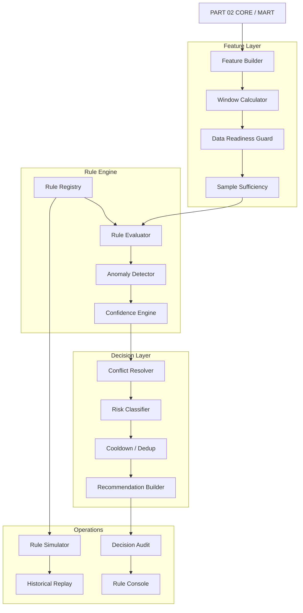
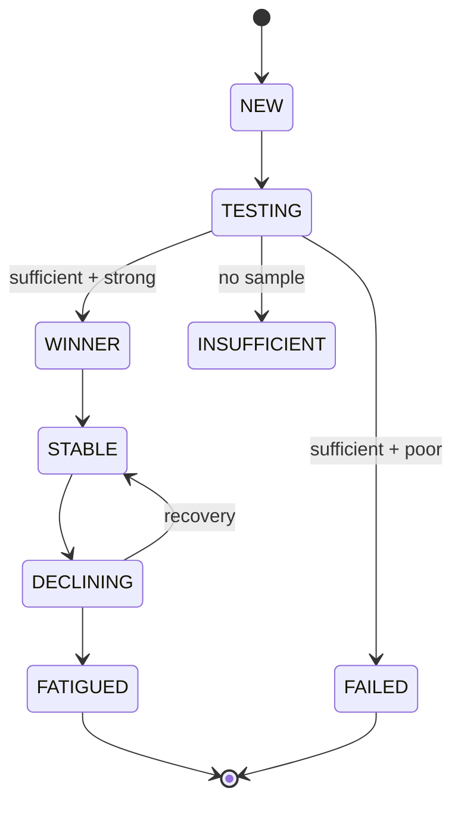
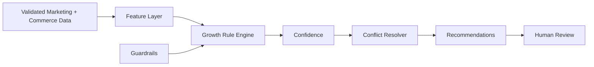

# AI DTC Growth Automation System

## PART 03 — Growth Rule Engine, Decision Guardrails & Rule Simulation

**Version:** V1.0  
**Status:** Ready for Codex Implementation  
**Baseline Date:** 2026-08-10  
**Target:** Codex Development Reference  
**Depends On:** PART 02 — Data Architecture, API Integration & Unified Marketing Data Model  
**Next:** PART 04 — Multi-Agent & AI Intelligence Architecture

---

# 0. 文档目标

PART 01 解决：

```text
系统能够在美国浏览器环境稳定运行
```

PART 02 解决：

```text
系统能够稳定、持续、可追溯地获取广告与订单数据
```

PART 03 解决：

> **系统如何基于可靠数据做出一致、可解释、可回放的投放判断。**

最终形成：

```text
Validated Data
      ↓
Feature Builder
      ↓
Rule Engine
      ↓
Anomaly Detection
      ↓
Conflict Resolver
      ↓
Decision Confidence
      ↓
Recommendation
      ↓
Human Approval / Future Auto Execution
      ↓
Audit / Replay / Learning
```

本阶段核心原则：

> **先规则，后 Agent；先可解释，后智能化；先建议，后自动执行。**

---

# 1. 本阶段必须实现

1. Rule Registry
2. Rule Definition Schema
3. Rule Versioning
4. Rule Evaluator
5. Feature Builder
6. Metric Window Engine
7. Sample Sufficiency Guard
8. Data Freshness Guard
9. Meta Performance Rules
10. Meta Creative Fatigue Rules
11. Meta Learning/Change Protection
12. Google Search Rules
13. Search Term Waste Detection
14. Negative Keyword Candidate Rules
15. Google Keyword Efficiency Rules
16. Funnel Diagnosis Rules
17. Commerce / Refund Rules
18. Cross-channel Guardrails
19. Anomaly Detection
20. Rule Conflict Resolution
21. Decision Confidence
22. Action Risk Classification
23. Human Approval Classification
24. Rule Cooldown
25. Recommendation Deduplication
26. Rule Simulation
27. Historical Replay
28. Rule Audit
29. Rule Dashboard API
30. Mock Scenario Validation
31. Unit / Integration Tests
32. Codex Implementation Report

---

# 2. 本阶段明确禁止

PART 03 不实现：

```text
LLM deciding whether to pause campaigns
LLM directly writing SQL
LLM directly calling Meta / Google
Automatic budget mutation
Automatic campaign pause
Automatic bid modification
Automatic negative keyword creation
Automatic ad creation
Multi-Agent orchestration
Creative video vision model
Robyn production MMM
Meridian production MMM
Reinforcement learning
```

本阶段：

> **Rule Engine 只产生结构化 Decision / Recommendation，不执行平台写操作。**

真正执行层在 PART 06。

---

# 3. 为什么不能让 LLM 直接判断投流

错误：

```text
Metrics
  ↓
GPT
  ↓
“这个广告表现不好，建议暂停”
```

问题：

```text
不可复现
不可回放
提示词变化影响结果
阈值不稳定
容易忽略数据不足
容易误判归因延迟
无法严格控制风险
无法做确定性测试
```

正确：

```text
Metrics
  ↓
Deterministic Feature Builder
  ↓
Rules + Statistical Guards
  ↓
Structured Findings
  ↓
Future AI Explanation / Strategy
```

AI 在 PART 04 负责：

```text
解释
归因假设
策略整合
内容建议
自然语言报告
```

而不是决定基础 Kill Rule 是否成立。

---

# 4. 官方方法论边界

Meta 官方强调：

```text
广告组启动后存在 learning phase
学习期间应尽量减少频繁调整
相似广告组过度拆分会造成 audience fragmentation
```

Google Ads 官方提供：

```text
Automated Rules
Negative Keywords
Search Terms
```

用于自动化日常管理和排除无关搜索。

但需要明确：

> Meta / Google 并没有提供一个适用于所有 DTC 品牌的固定 `CTR < X 就暂停`、`Frequency > 3 就疲劳`、`ROAS > 3 就 +20%` 的统一标准。

因此本系统所有数值必须属于：

```text
seed defaults
```

而不是：

```text
immutable industry truth
```

系统必须允许：

```text
Brand-specific
Account-specific
Campaign-specific
Objective-specific
Product-specific
```

覆盖。

---

# 5. Growth Rule Engine 总体架构



---

# 6. 规则引擎输入边界

Rule Engine 只允许读取：

```text
CORE Tables
MART Views
Metric Registry
Rule Configuration
Business Targets
Historical Decisions
```

禁止直接调用：

```text
Meta Marketing API
Google Ads API
Shopify API
AdsPower
Browser Worker
LLM
```

这样 Rule Engine 才能：

```text
offline replay
unit test
simulation
historical validation
deterministic execution
```

---

# 7. Rule Context

每次规则执行构建：

```python
RuleContext
```

核心字段：

```text
evaluation_time
source_timezone

platform
account_id

entity_type
entity_id

campaign_id
ad_group_id
ad_id
creative_id

objective

product_id
market
currency

business_targets

metrics
windows

data_freshness
sample_size

current_platform_status
recent_changes
active_experiments
```

---

# 8. Business Target Profile

规则不能只依赖平台平均值。

需要创建：

```text
business_target_profiles
```

字段：

```text
id
name

scope_type
scope_id

currency

target_cpa
target_roas
break_even_roas

target_aov
gross_margin_rate

max_daily_spend
max_campaign_daily_spend

refund_rate_warning
refund_rate_critical

created_at
updated_at
```

Scope：

```text
GLOBAL
PLATFORM
ACCOUNT
CAMPAIGN
PRODUCT
MARKET
```

优先级：

```text
Campaign
>
Account
>
Platform
>
Global
```

---

# 9. Break-even 指标

如果有产品成本与毛利数据：

建议计算：

```text
Break-even CPA
Break-even ROAS
Contribution Margin
```

例如：

```text
Break-even CPA
≈
Net Order Revenue
-
COGS
-
Variable Fulfillment Cost
-
Payment Fees
-
Expected Refund Cost
```

真正公式必须根据品牌业务成本定义。

不得在 Rule Engine 写死：

```text
利润 = 售价 × 某个固定比例
```

如果成本数据未知：

规则使用人工设置：

```text
target_cpa
target_roas
```

---

# 10. Rule Definition

规则必须是数据驱动配置。

创建：

```text
rule_definitions
```

字段：

```text
id
rule_key
name

category
platform

scope_type
scope_id

version

enabled
status

severity

evaluation_level

conditions
guards
action_template

cooldown_minutes

minimum_confidence

auto_execution_eligible

valid_from
valid_to

created_by
created_at
updated_at
```

Status：

```text
DRAFT
SHADOW
ACTIVE
PAUSED
DEPRECATED
```

---

# 11. Rule Versioning

任何规则修改：

不能覆盖旧版本。

例如：

```text
META_KILL_NO_PURCHASE
v1
v2
v3
```

历史 Decision 必须记录：

```text
rule_key
rule_version
```

这样 Replay 才知道当时使用什么规则。

---

# 12. Rule DSL

第一阶段不要开发复杂自定义编程语言。

使用：

```text
JSON / YAML Rule DSL
```

示例：

```yaml
rule_key: META_NO_PURCHASE_BURN
version: 1
platform: META
evaluation_level: AD

guards:
  min_age_hours: 24
  min_spend_multiple_of_target_cpa: 1.0
  data_freshness_minutes: 30

conditions:
  all:
    - metric: platform_purchases
      window: 3d
      operator: eq
      value: 0

    - metric: spend
      window: 3d
      operator: gte_target_multiple
      target: target_cpa
      multiple: 2.0

action:
  type: REVIEW_PAUSE
  risk: MEDIUM

cooldown_minutes: 1440
```

---

# 13. Rule Operators

第一阶段支持：

```text
eq
neq

gt
gte
lt
lte

between

percent_change_gt
percent_change_lt

ratio_gt
ratio_lt

target_multiple_gt
target_multiple_lt

zscore_gt
zscore_lt

is_null
not_null
```

禁止 Rule 中嵌入任意 Python。

---

# 14. Metric Windows

规则支持：

```text
1h
3h
6h
12h

1d
3d
7d
14d
30d
```

以及：

```text
current
previous_period
rolling
same_weekday_baseline
```

注意：

小时级指标必须来自 PART 02：

```text
fact_ad_performance_snapshots
```

---

# 15. Window Comparison

支持：

```text
today vs yesterday
3d vs previous 3d
7d vs previous 7d
today vs 7d baseline
```

对于日内：

更推荐：

```text
today up to local 14:00
vs
historical same weekday up to 14:00
```

而不是：

```text
今天半天
vs
昨天全天
```

---

# 16. Data Readiness Guard

任何 Kill / Scale 规则前必须先检查：

```text
source freshness
metric availability
entity active duration
sample sufficiency
attribution delay
recent major change
experiment participation
```

如果不满足：

输出：

```text
NO_DECISION
```

而不是：

```text
PASS / FAIL
```

---

# 17. Rule Evaluation Result

统一：

```text
TRIGGERED
NOT_TRIGGERED
NO_DECISION
SUPPRESSED
CONFLICTED
```

`NO_DECISION` 例如：

```text
数据不足
API stale
新广告刚启动
平台在学习
刚刚调整过预算
归因仍可能晚到
```

---

# 18. Sample Sufficiency

这是整个系统最重要的 Guardrail 之一。

不能：

```text
Spend $3
0 Purchase
→ Kill
```

也不能：

```text
1 Purchase
ROAS 8
→ Scale
```

Sample Sufficiency 可以使用：

```text
spend
clicks
landing page views
purchases
active duration
```

组合评分。

---

# 19. Reliability Score

建立：

```text
sample_reliability_score
```

范围：

```text
0 → 100
```

Seed Logic 示例：

```text
Spend maturity      30
Click maturity      20
Purchase maturity   30
Active duration     20
```

注意：

权重是初始值，可配置。

用于：

```text
Decision Confidence
```

不直接决定业务好坏。

---

# 20. Attribution Delay Guard

广告转化可能晚到。

规则需要：

```text
attribution_delay_buffer
```

例如：

新近 2 小时：

```text
只允许 WARNING
不允许 Kill
```

具体 Buffer：

按平台和账户历史延迟校准。

不要永久写死。

---

# 21. Recent Change Guard

创建：

```text
entity_change_events
```

记录未来平台变更：

```text
budget_change
bid_change
creative_change
targeting_change
status_change
campaign_structure_change
```

即使 PART 06 才真正执行写操作，

PART 03 先设计读取能力。

规则：

```text
if significant_change within cooldown
→ suppress scale / kill
```

---

# 22. Learning Protection

Meta 规则必须考虑：

```text
learning
learning_limited
recent significant edit
newly launched
```

如果 Provider 有明确 Delivery / Learning 状态：

直接读取。

否则：

用：

```text
newly_launched
recent_major_change
```

作为保守近似。

Learning Guard 触发：

```text
Scale Decision → SUPPRESSED
Aggressive Kill → downgraded to REVIEW
```

但：

```text
Hard Spend Guard
Account Safety
Policy Problem
```

不被 Learning Guard 阻止。

---

# 23. Rule Category

标准分类：

```text
DATA
SAFETY
CAMPAIGN
BUDGET
CREATIVE
AUDIENCE
SEARCH_TERM
KEYWORD
FUNNEL
COMMERCE
ATTRIBUTION
ANOMALY
EXPERIMENT
CROSS_CHANNEL
```

---

# 24. Severity

```text
INFO
LOW
MEDIUM
HIGH
CRITICAL
```

示例：

```text
Creative Fatigue
→ MEDIUM

Spend > Daily Hard Limit
→ CRITICAL

Data Stale
→ HIGH

Potential Negative Keyword
→ LOW
```

---

# 25. Action Type

PART 03 只生成 Action Intent：

```text
OBSERVE
INVESTIGATE
REVIEW_PAUSE
REVIEW_REDUCE_BUDGET
REVIEW_SCALE
REVIEW_NEGATIVE_KEYWORD
REFRESH_CREATIVE
CHECK_LANDING_PAGE
CHECK_CHECKOUT
CHECK_TRACKING
CHECK_INVENTORY
CHECK_REFUND
NO_ACTION
```

不真正执行。

---

# 26. Action Risk

```text
LOW
MEDIUM
HIGH
CRITICAL
```

建议：

```text
OBSERVE
→ LOW

REFRESH_CREATIVE
→ LOW/MEDIUM

REVIEW_SCALE
→ MEDIUM

REVIEW_PAUSE
→ MEDIUM/HIGH

future automatic negative keyword
→ MEDIUM/HIGH

future large budget mutation
→ HIGH
```

---

# 27. Human Approval

建立：

```text
approval_policy
```

PART 03 全部 Action：

```text
RECOMMENDATION_ONLY
```

但提前计算未来：

```text
approval_required
auto_execution_eligible
```

例如：

```text
LOW + high confidence
→ future auto eligible

HIGH
→ always human approval
```

---

# 28. Global Data Guard Rules

## DATA-001 — Source Stale

条件：

```text
source freshness > allowed threshold
```

Action：

```text
NO_ACTION
CHECK_DATA_SOURCE
```

效果：

```text
暂停依赖该 Source 的业务规则
```

---

# 29. DATA-002 — Shopify Missing

如果：

```text
Meta / Google 正常
但 Shopify stale / missing
```

禁止：

```text
Blended ROAS Kill
Store CVR diagnosis
Revenue-based cross-channel decisions
```

平台内部规则仍可执行：

```text
CTR
CPC
Spend
Platform CPA
```

但 Confidence 降低。

---

# 30. DATA-003 — Metric Discontinuity

例如：

```text
Spend 突然从正常值变 NULL
Conversions 全部消失
```

且多个 Campaign 同时出现。

优先判断：

```text
Tracking / API / Schema Issue
```

而不是：

```text
所有广告突然失效
```

Action：

```text
CHECK_TRACKING
```

---

# 31. Safety Guard — Hard Spend Limit

创建：

```text
GLOBAL_HARD_SPEND_LIMIT
```

条件：

```text
today spend > configured hard max
```

Severity：

```text
CRITICAL
```

Action：

```text
REVIEW_EMERGENCY_BUDGET_CONTROL
```

未来 PART 06 可设计 Auto Guard。

---

# 32. Safety Guard — Spend Velocity

日内花费速度异常：

```text
current spend velocity
>
historical same-time baseline × configured multiple
```

并且：

```text
revenue/conversion velocity not proportional
```

Action：

```text
INVESTIGATE
```

不是直接 Kill。

---

# 33. Safety Guard — Tracking Loss

条件示例：

```text
traffic still exists
clicks still exist
Shopify orders still exist
but platform conversions suddenly collapse across account
```

判断：

```text
possible attribution/tracking issue
```

Action：

```text
CHECK_TRACKING
```

不要因为 Platform ROAS 变 0 一次性暂停全账户。

---

# 34. Meta Rule Set

Meta 第一版规则：

```text
META-001 No Purchase Burn
META-002 CPA Overshoot
META-003 Strong Performer
META-004 Scale Candidate
META-005 Scale Cooldown
META-006 Creative Fatigue
META-007 CTR Deterioration
META-008 Frequency Pressure
META-009 High Click Low Purchase
META-010 Low CTR
META-011 CPM Shock
META-012 Delivery Collapse
META-013 Learning Protection
META-014 Audience Saturation Signal
META-015 Winner Creative
```

---

# 35. META-001 — No Purchase Burn

目标：

发现：

```text
持续花钱但没有购买
```

基础判断：

```text
platform_purchases = 0
AND
spend >= target_cpa × burn_multiple
```

Seed：

```text
burn_multiple = 2.0
```

注意：

`2.0` 是初始可配置值，不是官方标准。

Guards：

```text
active age
data freshness
minimum clicks
attribution delay
learning state
recent change
```

输出：

```text
REVIEW_PAUSE
```

Confidence 随：

```text
spend multiple
click count
duration
```

增加。

---

# 36. META-002 — CPA Overshoot

条件：

```text
CPA > target_cpa × configured_multiple
```

且：

```text
purchase_count >= minimum_purchase_sample
```

Seed：

```text
configured_multiple = 1.5
minimum_purchase_sample = 3
```

Action：

```text
REVIEW_REDUCE_BUDGET
or
INVESTIGATE
```

不能只看 CPA 一项。

同时输出：

```text
CTR
CPC
CVR
CPM
frequency
```

辅助诊断。

---

# 37. META-003 — Strong Performer

条件：

```text
ROAS >= target_roas
AND
CPA <= target_cpa
AND
sample reliability sufficient
```

输出：

```text
STRONG_PERFORMER
```

这只是 Label。

不等于：

```text
必须 Scale
```

---

# 38. META-004 — Scale Candidate

必须同时满足：

```text
Strong Performer
+
Minimum Purchase Sample
+
Minimum Active Duration
+
No recent significant change
+
Not in protected learning/cooldown
+
No account-level spend guard
```

Seed：

```text
min purchases = 5
min stable hours = 48
```

后续根据真实数据调整。

Action：

```text
REVIEW_SCALE
```

Suggested Scale：

```text
+10%
+15%
+20%
```

只能作为区间建议。

不能默认永远 +20%。

---

# 39. META-005 — Scale Cooldown

如果最近：

```text
budget increase
```

发生在：

```text
cooldown window
```

则：

```text
Scale Candidate → SUPPRESSED
```

Seed：

```text
24h
```

未来用账户数据校准。

---

# 40. META-006 — Creative Fatigue

不要只用 Frequency 判断。

推荐组合：

```text
Frequency rising
AND
CTR falling
AND/OR
CVR falling
AND/OR
CPA rising
```

示例 Seed：

```text
7d CTR drop >= 20%
frequency elevated vs own baseline
CPA worsening
```

输出：

```text
REFRESH_CREATIVE
```

而不是：

```text
pause audience
```

Creative Fatigue 判断：

必须比较：

```text
Creative own historical baseline
```

优于固定跨账户阈值。

---

# 41. META-007 — CTR Deterioration

条件：

```text
current CTR
<
previous baseline
```

并达到百分比下降。

只生成：

```text
Creative / Message Alert
```

不是直接 Kill。

因为 CTR 下降可能来自：

```text
audience expansion
placement mix
CPM shift
delivery mix
```

---

# 42. META-008 — Frequency Pressure

Frequency 只作为 Signal。

规则：

```text
frequency elevated vs baseline
AND
CTR/CVR deterioration
```

才升级为：

```text
Audience/Creative Saturation Signal
```

单独：

```text
frequency > 3
```

不能自动判断疲劳。

---

# 43. META-009 — High Click, Low Purchase

特征：

```text
CTR healthy
link clicks healthy
landing page traffic healthy
purchase CVR weak
```

Action：

```text
CHECK_LANDING_PAGE
CHECK_OFFER
CHECK_PRODUCT_PAGE
```

如果：

```text
ATC good
Checkout bad
```

Action：

```text
CHECK_CHECKOUT
```

---

# 44. META-010 — Low CTR

条件：

```text
impression sample sufficient
CTR materially below creative/account baseline
```

Action：

```text
REFRESH_CREATIVE
```

不要直接给：

```text
budget -30%
```

---

# 45. META-011 — CPM Shock

检测：

```text
CPM z-score
or
CPM vs same-weekday baseline
```

如果：

```text
CPM↑
CTR stable
CVR stable
```

可能属于：

```text
auction / seasonality / competition pressure
```

Action：

```text
OBSERVE / INVESTIGATE
```

而不是 Creative Failure。

---

# 46. META-012 — Delivery Collapse

条件：

```text
impressions/spend drop sharply
```

但：

```text
campaign still ACTIVE
```

检查：

```text
budget
bid
review/status
audience size
account issue
tracking
```

Action：

```text
INVESTIGATE_DELIVERY
```

---

# 47. META-013 — Learning Protection

如果：

```text
learning status active
or
new entity
or
recent significant edit
```

则：

```text
scale suppressed
soft underperformance downgraded
```

但不阻止：

```text
critical hard spend guard
policy issue
tracking issue
```

---

# 48. META-014 — Audience Saturation Signal

组合：

```text
frequency rising
reach growth slowing
CTR declining
CPA rising
```

Action：

```text
REVIEW_AUDIENCE_EXPANSION
REFRESH_CREATIVE
```

未来可结合：

```text
Advantage+ audience
broader targeting
new creative
```

但 PART 03 不执行。

---

# 49. META-015 — Winner Creative

Creative 至少满足：

```text
sufficient spend
sufficient purchases
ROAS >= target
CPA <= target
stable multiple days
```

输出：

```text
WINNER_CREATIVE
```

写入：

```text
creative_performance_labels
```

供 PART 04 Creative Agent 学习 Creative DNA。


# 50. Google Ads Rule Set

Google 第一版规则：

```text
GOOGLE-001 No Conversion Burn
GOOGLE-002 CPA Overshoot
GOOGLE-003 Search Term Waste
GOOGLE-004 Negative Keyword Candidate
GOOGLE-005 Keyword Strong Performer
GOOGLE-006 Keyword Waste
GOOGLE-007 CPC Shock
GOOGLE-008 CTR Weakness
GOOGLE-009 Conversion Rate Collapse
GOOGLE-010 Search Term Expansion Candidate
GOOGLE-011 Budget Constrained Signal
GOOGLE-012 PMax Efficiency Alert
GOOGLE-013 Brand / Non-brand Separation Guard
GOOGLE-014 Match Type Drift
GOOGLE-015 Conversion Tracking Anomaly
```

---

# 51. GOOGLE-001 — No Conversion Burn

逻辑与 Meta 类似：

```text
conversions = 0
AND
spend >= target_cpa × burn_multiple
```

但必须根据：

```text
campaign_type
conversion lag
search intent
```

调整。

Seed：

```text
burn_multiple = 2.0
```

Action：

```text
INVESTIGATE
REVIEW_PAUSE
```

Search Campaign 可以继续下钻：

```text
Search Term
Keyword
Ad Group
```

---

# 52. GOOGLE-002 — CPA Overshoot

条件：

```text
CPA > target_cpa × multiple
AND
conversion sample sufficient
```

Action：

```text
REVIEW_REDUCE_BUDGET
INVESTIGATE_QUERY_QUALITY
```

如果：

```text
Search Term Waste 同时触发
```

优先：

```text
清理搜索词
```

而不是先减少整个 Campaign Budget。

---

# 53. GOOGLE-003 — Search Term Waste

这是 Google Search 核心规则。

定义：

```text
search term has meaningful spend
AND
low/no conversions
AND
commercial relevance is weak or efficiency is poor
```

必须分两类：

### Semantic Waste

明显不符合产品意图：

```text
free
repair
manual
DIY
download
job
wholesale
```

仅为示例。

### Performance Waste

语义可能相关，但：

```text
spend high
conversion weak
```

不能自动当 Negative Keyword。

Action：

```text
REVIEW_NEGATIVE_KEYWORD
```

---

# 54. Negative Keyword 安全边界

Google 官方 Negative Keyword 会阻止相关搜索触发广告。

因此：

> 自动加否词属于高影响写操作。

PART 03 只生成候选：

```text
candidate_term
recommended_match_type
reason
spend
clicks
conversions
confidence
```

禁止执行。

---

# 55. GOOGLE-004 — Negative Keyword Candidate

规则分层：

### Tier A — High Confidence Semantic Waste

例如：

```text
搜索词明确与商品需求不同
```

要求：

```text
LLM semantic classification
```

属于 PART 04。

PART 03 只能基于：

```text
configured exclusion dictionary
historical operator labels
performance evidence
```

产生：

```text
candidate
```

### Tier B — Performance Waste

条件示例：

```text
spend >= target_cpa × 1.5
conversions = 0
clicks sufficient
```

Action：

```text
REVIEW_NEGATIVE_KEYWORD
```

---

# 56. Negative Match Type

不能假设：

```text
negative broad
negative phrase
negative exact
```

和正向 Keyword Match 完全相同。

Rule Output 必须记录：

```text
recommended_negative_match_type
```

但默认：

```text
human review
```

因为错误的 broad/phrase negative 可能阻断有效流量。

---

# 57. GOOGLE-005 — Keyword Strong Performer

条件：

```text
spend sufficient
conversions sufficient
CPA <= target
conversion value / cost >= target ROAS
```

Label：

```text
STRONG_KEYWORD
```

后续可用于：

```text
budget prioritization
query mining
copy strategy
```

---

# 58. GOOGLE-006 — Keyword Waste

条件：

```text
keyword spend high
AND
conversion efficiency poor
```

必须检查：

```text
associated search terms
```

如果只是少数坏 Search Term：

优先：

```text
negative candidate
```

而不是：

```text
pause keyword
```

---

# 59. GOOGLE-007 — CPC Shock

检测：

```text
CPC
vs
historical baseline
```

如果：

```text
CPC↑
CTR stable
CVR stable
```

可能是：

```text
auction pressure
competition
seasonality
```

Action：

```text
OBSERVE / INVESTIGATE
```

---

# 60. GOOGLE-008 — CTR Weakness

条件：

```text
impression sample sufficient
CTR below keyword/adgroup historical baseline
```

诊断候选：

```text
keyword-to-ad mismatch
weak ad copy
low relevance
SERP competition
query drift
```

PART 03 只输出：

```text
INVESTIGATE_AD_RELEVANCE
```

---

# 61. GOOGLE-009 — Conversion Rate Collapse

如果：

```text
Clicks stable
CPC stable
Conversions sharply down
```

并且 Shopify 同期：

```text
Site CVR also down
```

倾向：

```text
website / offer issue
```

如果 Shopify Orders 正常：

倾向：

```text
Google conversion tracking issue
```

Action：

```text
CHECK_TRACKING
or
CHECK_SITE
```

---

# 62. GOOGLE-010 — Search Term Expansion Candidate

Search Term：

```text
repeated conversions
CPA strong
commercial intent good
```

输出：

```text
REVIEW_ADD_KEYWORD
```

PART 03 不执行。

---

# 63. GOOGLE-011 — Budget Constrained Signal

如果：

```text
campaign strong performer
AND
budget-limited signal available
```

可生成：

```text
REVIEW_SCALE
```

但必须通过：

```text
account spend guard
target ROAS/CPA
cooldown
sample sufficiency
```

---

# 64. GOOGLE-012 — PMax Efficiency Alert

Performance Max 不应完全照搬 Search 规则。

第一版只做：

```text
spend
conversion value
ROAS
CPA
trend
asset group metadata
```

Rule：

```text
PMax ROAS deterioration
PMax no-conversion burn
PMax spend shock
```

不在 PART 03 做：

```text
PMax query-level automated negative
asset mutation
```

---

# 65. GOOGLE-013 — Brand / Non-brand Guard

如果系统中可以通过 Campaign Metadata 明确标记：

```text
BRAND
NON_BRAND
```

则必须分开 Target。

原因：

```text
Brand Search 通常天然 ROAS 更高
```

不能用 Brand Campaign 表现去判定 Non-brand Campaign 是否健康。

创建：

```text
campaign_strategy_labels
```

字段：

```text
BRAND_SEARCH
NON_BRAND_SEARCH
PMAX
SHOPPING
DISPLAY
VIDEO
OTHER
```

初始可人工标记。

---

# 66. GOOGLE-014 — Match Type Drift

对于 Broad / Phrase：

如果 Search Terms 越来越偏离核心商业意图：

输出：

```text
QUERY_DRIFT
```

需要：

```text
search-term distribution
conversion distribution
waste ratio
```

PART 04 可加入 Semantic Agent。

---

# 67. GOOGLE-015 — Conversion Tracking Anomaly

如果：

```text
Google Ads conversions suddenly collapse
```

但：

```text
Shopify orders stable
Meta traffic stable
Google clicks stable
```

优先：

```text
CHECK_GOOGLE_CONVERSION_TRACKING
```

而不是暂停 Google。

---

# 68. Funnel Rule Set

漏斗标准：

```text
Impression
↓
Click
↓
Landing Page View
↓
Product View
↓
Add To Cart
↓
Checkout
↓
Purchase
```

不同数据源可能无法提供全部步骤。

系统必须：

```text
use available stages
```

并标记：

```text
diagnostic completeness
```

---

# 69. Funnel Feature Model

建立：

```text
funnel_features
```

至少：

```text
CTR
Click-to-LPV
LPV-to-ATC
ATC-to-Checkout
Checkout-to-Purchase
Click-to-Purchase
```

无法计算时：

```text
NULL
```

---

# 70. FUNNEL-001 — Low CTR

表现：

```text
Impressions sufficient
CTR materially weak
```

倾向：

```text
Creative
Message
Audience
Search Relevance
```

Action：

```text
REFRESH_CREATIVE
INVESTIGATE_TARGETING
```

---

# 71. FUNNEL-002 — Click-to-Landing Drop

如果：

```text
Clicks high
Landing Page Views materially lower
```

检查：

```text
page load speed
broken URL
tracking
redirect
browser compatibility
```

Action：

```text
CHECK_LANDING_PAGE_TECH
```

---

# 72. FUNNEL-003 — LPV to ATC Weak

流量来了：

```text
Landing Page View
```

但：

```text
Add To Cart weak
```

可能：

```text
price
offer
product-market fit
product page persuasion
shipping uncertainty
trust
```

Action：

```text
CHECK_PRODUCT_PAGE
CHECK_OFFER
```

---

# 73. FUNNEL-004 — ATC to Checkout Weak

可能：

```text
cart friction
shipping surprise
discount UX
checkout CTA issue
```

Action：

```text
CHECK_CART
```

---

# 74. FUNNEL-005 — Checkout to Purchase Weak

可能：

```text
payment failure
shipping cost
tax surprise
trust concern
payment method
checkout bug
```

Action：

```text
CHECK_CHECKOUT
```

Severity：

根据掉点幅度。

---

# 75. FUNNEL-006 — High CTR Low Purchase

这类规则必须优先于：

```text
Creative Kill
```

因为广告可能成功吸引用户，

问题发生在站内。

Conflict Resolver 应识别：

```text
Creative CTR strong
Site CVR weak
```

避免输出：

```text
换素材
```

作为第一结论。

---

# 76. Commerce Rule Set

```text
COM-001 Revenue Drop
COM-002 Refund Spike
COM-003 AOV Drop
COM-004 Product Mix Shift
COM-005 Inventory Risk
COM-006 Payment Failure Signal
COM-007 Cancellation Spike
```

---

# 77. COM-001 — Revenue Drop

Shopify：

```text
orders and net revenue
vs
historical same-day baseline
```

如果同时：

```text
paid traffic stable
```

倾向：

```text
site / offer / conversion issue
```

如果 Paid Traffic 同时下滑：

倾向：

```text
traffic issue
```

---

# 78. COM-002 — Refund Spike

定义：

```text
refund_rate
=
refunded_orders / paid_orders
```

或：

```text
refund_amount / gross_revenue
```

两种都可以。

Metric Registry 必须明确。

Threshold 来自：

```text
Business Target Profile
```

Action：

```text
CHECK_REFUND
CHECK_PRODUCT_QUALITY
CHECK_EXPECTATION_GAP
```

---

# 79. COM-003 — AOV Drop

如果：

```text
orders stable
revenue down
AOV down
```

可能：

```text
discount mix
product mix
bundle performance
upsell failure
```

Action：

```text
INVESTIGATE_AOV
```

---

# 80. COM-004 — Product Mix Shift

某低毛利产品占比突然上涨：

如果成本模型可用：

```text
Revenue looks good
but contribution margin worsens
```

Action：

```text
CHECK_PRODUCT_MIX
```

第一版可以仅做监控。

---

# 81. COM-005 — Inventory Risk

如果 PART 02 后续接入库存字段：

当：

```text
winning campaign
→ landing product low inventory
```

Action：

```text
CHECK_INVENTORY
```

禁止 Scale。

如果库存数据尚未接入：

Rule：

```text
DISABLED
```

---

# 82. Cross-channel Rule Set

```text
XC-001 Blended ROAS Guard
XC-002 Paid Spend vs Revenue Divergence
XC-003 Platform Attribution Inflation Signal
XC-004 Channel Mix Concentration
XC-005 Total Daily Spend Guard
```

---

# 83. XC-001 — Blended ROAS Guard

```text
Shopify Net Revenue
/
Meta + Google Spend
```

如果：

```text
blended_roas
<
break_even_roas
```

持续多个窗口：

输出：

```text
ACCOUNT_EFFICIENCY_WARNING
```

不能立刻决定：

```text
Meta or Google 谁该砍
```

需要下钻平台。

---

# 84. XC-002 — Paid Spend / Revenue Divergence

如果：

```text
Total Paid Spend ↑
Shopify Net Revenue flat/down
```

Action：

```text
INVESTIGATE_CHANNEL_EFFICIENCY
```

---

# 85. XC-003 — Attribution Inflation Signal

如果：

```text
Meta attributed revenue
+
Google attributed revenue
>>
Shopify total revenue
```

这不是数据错误的充分条件。

只是说明：

```text
multi-touch attribution overlap likely
```

Action：

```text
ATTRIBUTION_CAUTION
```

禁止把平台归因相加。

---

# 86. XC-004 — Channel Concentration

例如：

```text
90% paid spend on one channel
```

但 Rule Engine 不应该自动建议分散。

只输出：

```text
CHANNEL_CONCENTRATION
```

后续 Meridian / Robyn / Strategy Agent 再分析。

---

# 87. XC-005 — Total Daily Spend Guard

如果：

```text
total paid spend > business configured daily hard cap
```

Severity：

```text
CRITICAL
```

Action：

```text
REVIEW_EMERGENCY_BUDGET_CONTROL
```

---

# 88. Creative Performance Labels

建立：

```text
creative_performance_labels
```

Label：

```text
NEW
TESTING
WINNER
STABLE
DECLINING
FATIGUED
FAILED
INSUFFICIENT_DATA
```

PART 03 只根据表现打 Label。

PART 04 再做：

```text
Creative DNA
Hook
Emotion
Scene
Music
Visual pattern
```

---

# 89. Creative Lifecycle



---

# 90. Anomaly Detection

固定规则不能发现所有问题。

所以加入：

```text
Anomaly Detector
```

但第一版不要上复杂 ML。

先实现：

```text
Rolling Baseline
Percent Deviation
Z-score
MAD
Same-weekday baseline
```

---

# 91. Robust Z-score / MAD

对于波动大的广告数据：

普通 Mean/Std 容易受异常值影响。

建议支持：

```text
Median
MAD
```

用于异常检测。

具体统计实现必须 Unit Test。

---

# 92. Anomaly Metrics

至少：

```text
Spend
CPM
CPC
CTR
CPA
CVR
ROAS
Orders
Revenue
Refund Rate
AOV
```

---

# 93. Anomaly Result

统一：

```text
metric
current_value
baseline_value
deviation
zscore
method
window
severity
```

Anomaly 本身不等于动作。

例如：

```text
CPM anomaly
```

只进入：

```text
Rule Context
```

---

# 94. Account-wide Anomaly

如果：

```text
many campaigns
same time
same direction
```

优先判断：

```text
systemic event
tracking issue
seasonality
platform auction shift
site issue
```

避免把每个 Campaign 单独暂停。

---

# 95. Rule Conflict

同一个 Entity 可能同时触发：

```text
Scale Candidate
Creative Fatigue
CPA Overshoot
```

不能全都推给用户。

必须：

```text
Conflict Resolver
```

---

# 96. Conflict Priority

默认：

```text
DATA / TRACKING
>
SAFETY
>
COMMERCE / SITE
>
PAUSE / REDUCE
>
CREATIVE / AUDIENCE
>
SCALE
>
OBSERVE
```

例如：

```text
Scale Candidate
+
Tracking Anomaly
```

结果：

```text
Scale SUPPRESSED
Check Tracking
```

---

# 97. Conflict Matrix

创建：

```text
rule_conflict_policies
```

例如：

```text
TRACKING_ISSUE vs SCALE
→ suppress SCALE

LEARNING_PROTECTION vs SCALE
→ suppress SCALE

FUNNEL_CHECKOUT_ISSUE vs CREATIVE_KILL
→ downgrade CREATIVE_KILL

HARD_SPEND_LIMIT vs LEARNING_PROTECTION
→ HARD_SPEND_LIMIT wins
```

---

# 98. Recommendation Deduplication

例如：

```text
META-006 Creative Fatigue
FUNNEL-001 Low CTR
META-007 CTR Deterioration
```

可能都建议：

```text
REFRESH_CREATIVE
```

用户只应该收到：

```text
1 条合并 Recommendation
```

包含：

```text
supporting_rules[]
```

---

# 99. Recommendation Structure

统一 JSON：

```json
{
  "recommendation_id": "...",
  "entity_type": "AD",
  "entity_id": "...",

  "primary_action": "REFRESH_CREATIVE",

  "severity": "MEDIUM",
  "confidence": 0.82,

  "summary_code": "CREATIVE_FATIGUE",

  "evidence": [],
  "supporting_rule_keys": [],

  "approval_required": true,
  "auto_execution_eligible": false,

  "created_at": "..."
}
```

---

# 100. Evidence Structure

```json
{
  "metric": "ctr",
  "window": "7d",
  "current": 0.011,
  "baseline": 0.016,
  "change_pct": -31.25,
  "source": "META_ADS"
}
```

这样 PART 04 LLM 可以准确解释。

---

# 101. Decision Confidence

Confidence 不等于模型概率。

第一版是：

> **Rule-based confidence score**

范围：

```text
0.0 → 1.0
```

组成：

```text
Data Freshness
Sample Reliability
Rule Strength
Signal Agreement
Cross-source Confirmation
Recent Change Penalty
Attribution Delay Penalty
```

---

# 102. Confidence Formula

建议：

```text
confidence =
  0.20 × data_freshness_score
+ 0.25 × sample_reliability_score
+ 0.25 × rule_strength_score
+ 0.20 × signal_agreement_score
+ 0.10 × cross_source_score
- penalties
```

这是 Seed Formula。

配置化。

不要宣称：

```text
82% probability the ad is bad
```

它只代表：

```text
system decision confidence
```

---

# 103. Confidence Band

```text
0.00 - 0.39 LOW
0.40 - 0.69 MEDIUM
0.70 - 0.84 HIGH
0.85 - 1.00 VERY_HIGH
```

Seed。

---

# 104. Rule Strength

例如：

No Purchase Burn：

```text
spend = 2.1 × target CPA
```

Rule Strength 比：

```text
spend = 5 × target CPA
```

更低。

所以：

```text
distance from threshold
```

应进入 Score。

---

# 105. Signal Agreement

例如：

Creative Fatigue：

如果同时：

```text
CTR ↓
Frequency ↑
CPA ↑
CVR ↓
```

Confidence 高。

如果只有：

```text
Frequency ↑
```

Confidence 低。

---

# 106. Cross-source Confirmation

例如：

Meta：

```text
purchase ↓
```

Shopify：

```text
orders from paid traffic ↓
```

相互支持。

如果：

Meta ↓
但 Shopify Stable：

需要：

```text
tracking concern
```

而不是高 Confidence Kill。

---

# 107. Cooldown

每个 Recommendation 类型有：

```text
cooldown
```

例如：

```text
REFRESH_CREATIVE: 24h
REVIEW_SCALE: 24h
CHECK_TRACKING: 6h
```

避免每 15 分钟重复报警。

---

# 108. Cooldown Key

建议：

```text
entity_id
+
primary_action
+
reason_group
```

例如：

```text
ad_123:REFRESH_CREATIVE:CREATIVE_FATIGUE
```

---

# 109. Escalation

Cooldown 内如果问题恶化：

允许升级。

例如：

之前：

```text
MEDIUM
```

现在：

```text
CRITICAL
```

则新的 Recommendation 可以突破 Cooldown。

---

# 110. Rule Evaluation Log

创建：

```text
rule_evaluations
```

字段：

```text
id
evaluation_run_id

rule_key
rule_version

entity_type
entity_id

result

context_snapshot
feature_snapshot

confidence

reason_codes

evaluated_at
```

历史回放不能依赖当前表状态。

所以要保留必要 Snapshot。

---

# 111. Recommendation Table

创建：

```text
recommendations
```

字段：

```text
id
entity_type
entity_id

platform

primary_action
reason_group

severity
confidence

status

approval_required
auto_execution_eligible

evidence
supporting_rules

created_at
updated_at
resolved_at
```

Status：

```text
OPEN
ACKNOWLEDGED
APPROVED
REJECTED
EXPIRED
RESOLVED
SUPERSEDED
```

---

# 112. Operator Feedback

创建：

```text
recommendation_feedback
```

字段：

```text
recommendation_id

operator_decision

reason
notes

created_at
```

Operator Decision：

```text
ACCEPT
REJECT
DEFER
FALSE_POSITIVE
CORRECT_BUT_NO_ACTION
```

这会成为后续规则校准数据。


# 113. Shadow Mode

所有新规则必须先进入：

```text
SHADOW
```

Shadow Rule：

```text
正常评估
正常记录
正常计算 Recommendation
但不展示为正式操作建议
```

用途：

```text
验证误报率
验证触发频率
验证阈值
历史对比
```

经过人工确认后：

```text
SHADOW
→ ACTIVE
```

---

# 114. Rule Promotion

建议流程：

```text
DRAFT
↓
Unit Test
↓
Historical Replay
↓
SHADOW
↓
Operator Review
↓
ACTIVE
```

高风险规则：

```text
ACTIVE
```

也不等于：

```text
AUTO EXECUTION
```

---

# 115. Historical Replay

必须实现：

```text
Rule Replay Engine
```

输入：

```text
rule version
historical date range
entity scope
```

输出：

```text
trigger count
entities affected
recommendations
false-positive labels if available
estimated action opportunities
```

---

# 116. Replay Principle

Replay 只能使用：

```text
当时之前可见的数据
```

禁止使用未来信息。

例如：

2026-07-01 10:00 判断时：

不能读取：

```text
2026-07-01 23:59 的最终转化
```

否则产生：

```text
look-ahead bias
```

---

# 117. Point-in-time Evaluation

为了更严格 Replay：

可使用 PART 02：

```text
intraday snapshots
```

重构：

```text
as-of time
```

如果历史快照不足：

Replay 必须标记：

```text
APPROXIMATE
```

不能伪装精确。

---

# 118. Simulator

建立：

```text
Rule Simulator
```

目的：

在规则上线前回答：

```text
如果 Kill threshold 从 2× CPA 改成 1.5×，
过去 30 天会多触发多少次？
```

或：

```text
如果 Scale minimum purchases 从 5 改成 10，
哪些广告不会被推荐扩量？
```

---

# 119. Simulator Inputs

```text
rule_key
candidate_config
date_range
scope
```

输出：

```text
trigger count
new triggers
removed triggers
affected spend
affected revenue
confidence distribution
entity list
```

注意：

PART 03 Simulator 不声称：

```text
如果当时执行，就一定赚多少钱
```

因为这是反事实问题。

---

# 120. Counterfactual Limitation

必须在 UI 标注：

> Rule replay tells us what the system **would have recommended**, not what the market outcome **would have been** after taking that action.

真正因果效果需要：

```text
Experiments
Incrementality
MMM
```

---

# 121. Experiment Guard

建立：

```text
active_experiments
```

字段：

```text
id
name

platform
scope_type
scope_id

experiment_type

start_at
end_at

protected_metrics

status

metadata
```

当 Entity 正在实验：

Rule Engine 应避免：

```text
未经批准改变测试变量
```

例如：

Creative A/B 测试中：

```text
Scale / Pause
```

可能破坏实验。

---

# 122. EXP-001 — Experiment Protection

如果：

```text
entity is in ACTIVE experiment
```

且 Action 会改变测试变量：

```text
Recommendation SUPPRESSED
```

除非：

```text
CRITICAL Safety Rule
```

---

# 123. Experiment Completion Candidate

如果：

```text
sample sufficient
test duration sufficient
winner gap meaningful
```

PART 03 可输出：

```text
REVIEW_EXPERIMENT_RESULT
```

但第一版不要做复杂 Frequentist/Bayesian Experiment Engine。

---

# 124. Statistical Significance Boundary

第一版 Rule Engine：

不需要所有规则都做：

```text
p-value
```

原因：

广告账户日常优化更适合：

```text
business thresholds
sample guards
confidence
replay
```

后续实验中心可以单独实现：

```text
Bayesian A/B
Sequential Testing
```

---

# 125. Rule Calibration

规则参数必须从：

```text
Seed Default
```

逐渐转成：

```text
Account Calibrated
```

例如：

Creative Fatigue Frequency：

不使用永远固定：

```text
3.0
```

而是：

```text
creative's historical failure distribution
account historical baseline
campaign objective
audience size
```

---

# 126. Calibration Source

优先级：

```text
Brand historical data
>
Account historical data
>
Platform historical data
>
Seed default
```

---

# 127. Threshold Configuration Table

创建：

```text
rule_parameters
```

字段：

```text
id

rule_key
parameter_key

scope_type
scope_id

value
value_type

source
confidence

valid_from
valid_to

created_at
updated_at
```

Source：

```text
SEED
MANUAL
HISTORICAL_CALIBRATION
EXPERIMENT
MODEL
```

PART 03：

```text
MODEL
```

暂不使用。

---

# 128. Seed Defaults

必须集中存：

```text
config/rules/defaults.yaml
```

不要散落在代码。

示意：

```yaml
meta:
  no_purchase_burn:
    spend_cpa_multiple: 2.0
    min_age_hours: 24
    cooldown_hours: 24

  scale_candidate:
    min_purchases: 5
    min_stable_hours: 48
    max_suggested_step_pct: 20

  creative_fatigue:
    ctr_drop_pct: 20

google:
  search_term_waste:
    spend_cpa_multiple: 1.5
```

文件顶部必须写：

```text
These are starting priors, not universal platform best practices.
```

---

# 129. Rule Packs

为了便于扩展：

```text
Rule Pack
```

第一版：

```text
core_safety
meta_performance
google_search
funnel
commerce
cross_channel
```

未来：

```text
google_pmax
creative_intelligence
retention
email
affiliate
```

---

# 130. Rule Pack Enablement

例如：

```yaml
rule_packs:
  core_safety: true
  meta_performance: true
  google_search: true
  funnel: true
  commerce: true
  cross_channel: true
```

如果某数据源未接：

自动：

```text
NOT_APPLICABLE
```

---

# 131. Capability Registry

Rule Engine 必须知道：

```text
有哪些数据能力可用
```

例如：

```text
META_INSIGHTS
META_ACTIONS
GOOGLE_SEARCH_TERMS
SHOPIFY_ORDERS
SHOPIFY_REFUNDS
SHOPIFY_JOURNEY
INVENTORY
```

规则声明：

```text
required_capabilities
```

缺失：

```text
NO_DECISION
```

---

# 132. Rule Dependency

示例：

```yaml
required_capabilities:
  - META_INSIGHTS
  - SHOPIFY_ORDERS
```

如果 Shopify 没接：

Rule：

```text
NO_DECISION
reason = MISSING_CAPABILITY
```

---

# 133. Feature Registry

不要每个 Rule 自己写 SQL。

建立：

```text
Feature Registry
```

例如：

```text
spend_1d
spend_3d
spend_7d

purchases_3d
platform_roas_7d

ctr_7d
ctr_prev_7d
ctr_change_pct

frequency_7d

shopify_orders_1d
shopify_net_revenue_1d

refund_rate_30d

search_term_spend_30d
```

---

# 134. Feature Builder

目录：

```text
backend/app/rules/features/
```

结构：

```text
features/
├── registry.py
├── windows.py
├── marketing.py
├── commerce.py
├── funnel.py
├── anomalies.py
└── readiness.py
```

Rule Engine 读取：

```text
FeatureSnapshot
```

而不是执行任意查询。

---

# 135. Feature Caching

同一次 Evaluation Run：

```text
相同 entity/window/metric
```

只算一次。

使用：

```text
in-process cache
```

或：

```text
Redis short-lived cache
```

第一版优先简单。

---

# 136. Evaluation Run

创建：

```text
rule_evaluation_runs
```

字段：

```text
id

scope
trigger_type

started_at
finished_at

rules_evaluated
entities_evaluated

triggered
no_decision
suppressed
failed

data_as_of

status

created_at
```

Trigger Type：

```text
SCHEDULED
MANUAL
REPLAY
SIMULATION
SHADOW
```

---

# 137. Evaluation Schedule

建议：

### Intraday Rules

```text
每 15-30 分钟
```

例如：

```text
hard spend
spend velocity
tracking anomaly
no-purchase burn
```

### Daily Rules

```text
每天一次
```

例如：

```text
creative fatigue
refund rate
keyword waste
winner classification
```

### Weekly Rules

```text
每周
```

例如：

```text
channel concentration
rule calibration report
long-window search term mining
```

不需要每个规则每 15 分钟跑。

---

# 138. Rule Scheduler

Rule Definition 增加：

```text
schedule_group
```

例如：

```text
INTRADAY
DAILY
WEEKLY
MANUAL
```

---

# 139. Anomaly Scheduler

Anomaly 计算可：

```text
hourly
daily
```

不要对很小样本做过密检测。

---

# 140. Budget Decision Guardrail

任何：

```text
REVIEW_SCALE
REVIEW_REDUCE_BUDGET
```

都必须附带：

```text
suggested_change_pct
max_allowed_change_pct
current_budget
proposed_budget
```

PART 03：

```text
proposed
```

不执行。

---

# 141. Suggested Budget Step

Seed：

```text
5%
10%
15%
20%
```

不要允许 Rule 直接建议：

```text
+100%
```

除非未来特殊策略显式允许。

---

# 142. Scale Decision

Suggested Step 应结合：

```text
confidence
sample reliability
margin to target
recent change
spend scale
```

例如：

```text
barely above target
→ +5%

far above target + high sample
→ +15-20%
```

仍需人工审批。

---

# 143. Reduce Decision

同理：

```text
soft deterioration
→ -5/-10%

strong deterioration
→ -15/-20%

critical no-purchase burn
→ review pause
```

但具体 Seed 配置化。

---

# 144. Pause vs Reduce

Rule Engine 不应把所有差广告：

```text
Pause
```

分层：

```text
OBSERVE
INVESTIGATE
REDUCE
PAUSE REVIEW
```

---

# 145. Recommendation Reason Codes

统一：

```text
NO_PURCHASE_BURN
CPA_OVERSHOOT
ROAS_BELOW_TARGET
ROAS_ABOVE_TARGET
CREATIVE_FATIGUE
CTR_DETERIORATION
FREQUENCY_PRESSURE
SEARCH_TERM_WASTE
KEYWORD_WASTE
CHECKOUT_DROP
REFUND_SPIKE
TRACKING_ANOMALY
SPEND_VELOCITY
LEARNING_PROTECTION
EXPERIMENT_PROTECTION
DATA_STALE
```

---

# 146. Explainability Contract

每个 Recommendation 必须能回答：

```text
What happened?
Compared with what?
Why is it important?
Which rule triggered?
What data supports it?
Why was another action suppressed?
What is the confidence?
What should human review?
```

PART 04 LLM 只是把这些结构化事实转成自然语言。

---

# 147. Example — Meta Burn Decision

```json
{
  "entity_type": "AD",
  "platform": "META",

  "primary_action": "REVIEW_PAUSE",
  "reason_group": "NO_PURCHASE_BURN",

  "severity": "HIGH",
  "confidence": 0.89,

  "evidence": [
    {
      "metric": "spend",
      "window": "3d",
      "value": 72.4
    },
    {
      "metric": "target_cpa",
      "value": 30.0
    },
    {
      "metric": "platform_purchases",
      "window": "3d",
      "value": 0
    }
  ],

  "guards": {
    "sample_sufficient": true,
    "data_fresh": true,
    "learning_protected": false
  }
}
```

---

# 148. Example — Funnel Issue Overrides Creative Kill

输入：

```text
CTR: strong
CPC: normal
LPV: strong
ATC: strong
Checkout: strong
Purchase: weak
```

触发：

```text
META CPA Overshoot
FUNNEL Checkout-to-Purchase Weak
```

Conflict Resolver 输出：

```text
Primary:
CHECK_CHECKOUT

Secondary:
OBSERVE_META_AD

Suppress:
REVIEW_PAUSE
```

原因：

广告已经完成获客任务，

问题更可能发生在 Checkout。

---

# 149. Example — Tracking Issue

输入：

```text
Meta purchase = 0
Google conversion = 0
Shopify orders = normal
Clicks = normal
```

结果：

```text
CHECK_TRACKING
```

而不是：

```text
Pause Meta
Pause Google
```

---

# 150. MMM Integration Boundary

Meta Robyn 和 Google Meridian 属于：

```text
Marketing Mix Modeling
```

更适合：

```text
channel contribution
response curve
longer-horizon budget allocation
scenario planning
```

而不是：

```text
15 分钟级 Kill Rule
```

因此：

PART 03 只预留：

```text
mmm_recommendations
```

接口。

不把 MMM 放进 Intraday Rule Engine。

---

# 151. Future MMM Interface

未来：

```text
MMM Output
↓
Budget Strategy Advisory
↓
Rule Guard
↓
Human Approval
```

例如：

```text
Meridian recommends Meta channel +15%
```

也不能直接执行。

需要：

```text
current account performance
business hard cap
campaign health
inventory
cash flow
```

共同决定。

---

# 152. Repository Structure

在 PART 02 上增加：

```text
backend/app/
│
├── rules/
│   ├── engine.py
│   ├── evaluator.py
│   ├── registry.py
│   ├── loader.py
│   ├── operators.py
│   ├── context.py
│   ├── result.py
│   │
│   ├── features/
│   │   ├── registry.py
│   │   ├── windows.py
│   │   ├── readiness.py
│   │   ├── marketing.py
│   │   ├── commerce.py
│   │   ├── funnel.py
│   │   └── anomalies.py
│   │
│   ├── guards/
│   │   ├── freshness.py
│   │   ├── sample.py
│   │   ├── attribution_delay.py
│   │   ├── learning.py
│   │   ├── cooldown.py
│   │   └── experiment.py
│   │
│   ├── conflict/
│   │   ├── resolver.py
│   │   └── policies.py
│   │
│   ├── confidence/
│   │   ├── scorer.py
│   │   └── components.py
│   │
│   ├── anomaly/
│   │   ├── rolling.py
│   │   ├── zscore.py
│   │   └── mad.py
│   │
│   ├── simulation/
│   │   ├── simulator.py
│   │   └── replay.py
│   │
│   └── recommendations/
│       ├── builder.py
│       ├── dedup.py
│       └── risk.py
│
├── models/
│   ├── rule_definition.py
│   ├── rule_parameter.py
│   ├── rule_evaluation.py
│   ├── recommendation.py
│   ├── recommendation_feedback.py
│   ├── business_target_profile.py
│   └── active_experiment.py
│
├── api/v1/
│   ├── rules.py
│   ├── recommendations.py
│   ├── simulations.py
│   └── rule_health.py
│
└── workers/
    └── rule_tasks.py

config/
└── rules/
    ├── defaults.yaml
    ├── core_safety.yaml
    ├── meta_performance.yaml
    ├── google_search.yaml
    ├── funnel.yaml
    ├── commerce.yaml
    └── cross_channel.yaml
```

---

# 153. Database Tables

至少：

```text
business_target_profiles
rule_definitions
rule_parameters
rule_evaluation_runs
rule_evaluations

recommendations
recommendation_feedback

rule_conflict_policies
active_experiments

creative_performance_labels
campaign_strategy_labels
entity_change_events
```

---

# 154. Rules API

```http
GET  /api/v1/rules
GET  /api/v1/rules/{rule_key}

POST /api/v1/rules/{rule_key}/enable
POST /api/v1/rules/{rule_key}/disable

POST /api/v1/rules/{rule_key}/shadow
POST /api/v1/rules/{rule_key}/activate
```

生产环境：

状态切换需要权限。

---

# 155. Rule Parameter API

```http
GET  /api/v1/rules/{rule_key}/parameters
PUT  /api/v1/rules/{rule_key}/parameters
```

必须生成：

```text
audit log
```

---

# 156. Recommendation API

```http
GET /api/v1/recommendations
GET /api/v1/recommendations/{id}

POST /api/v1/recommendations/{id}/acknowledge
POST /api/v1/recommendations/{id}/approve
POST /api/v1/recommendations/{id}/reject
POST /api/v1/recommendations/{id}/feedback
```

注意：

PART 03 的：

```text
approve
```

只代表业务审批。

不会触发平台执行。

---

# 157. Simulation API

```http
POST /api/v1/rule-simulations
GET  /api/v1/rule-simulations/{id}
```

Payload：

```text
rule_key
candidate_parameters
start_date
end_date
scope
```

---

# 158. Manual Evaluation API

```http
POST /api/v1/rules/evaluate
```

参数：

```text
scope_type
scope_id
rule_keys optional
as_of
```

主要用于：

```text
debug
manual review
```

---

# 159. Rule Console UI

PART 03 建立基础：

```text
Rule Console
```

页面：

```text
Overview
Recommendations
Rules
Simulation
Evaluation History
Feedback
```

---

# 160. Rule Overview

卡片：

```text
Active Rules
Shadow Rules
Open Recommendations
High Severity
Suppressed Decisions
Data-blocked Decisions
```

---

# 161. Recommendation Table

字段：

```text
Entity
Platform
Recommendation
Reason
Severity
Confidence
Evidence
Status
Created
```

支持筛选：

```text
Meta
Google
Campaign
AdGroup
Ad
Search Term
Severity
Action
Status
```

---

# 162. Rule Detail

显示：

```text
Rule Description
Current Version
Status

Guards
Conditions
Action

Current Parameters

Trigger Count 7d
No Decision Count
Suppressed Count

Recent Evaluations
Simulation
Version History
```

---

# 163. Simulation UI

输入：

```text
date range
parameter changes
scope
```

输出：

```text
Current Rule Triggers
Candidate Rule Triggers
New Triggers
Removed Triggers
Affected Entities
```

---

# 164. Decision Evidence UI

不要只显示：

```text
ROAS low
```

显示：

```text
7d ROAS: 1.42
Target ROAS: 2.20

Spend: $184
Purchases: 4

7d CPA: $46
Target CPA: $30

Data freshness: 8 min
Sample reliability: HIGH
```

---

# 165. Suppressed Decision UI

非常重要。

用户应该看到：

```text
Scale candidate detected
but suppressed because:
budget changed 8h ago
```

这样 Rule Engine 更可信。


# 166. Security & Permission

Rule Console 权限至少区分：

```text
VIEWER
OPERATOR
ADMIN
```

VIEWER：

```text
view rules
view recommendations
view simulations
```

OPERATOR：

```text
acknowledge
feedback
approve/reject recommendation
```

ADMIN：

```text
change parameters
activate/shadow/disable rules
```

PART 03 不提供平台广告写权限。

---

# 167. Audit Requirements

以下动作全部 Audit：

```text
rule created
rule version changed
parameter changed
rule enabled
rule disabled
rule shadowed
rule activated

recommendation approved
recommendation rejected

simulation executed
manual evaluation executed
```

Audit 字段：

```text
actor
action
target
before
after
timestamp
request_id
```

---

# 168. Rule Health

规则本身也需要监控。

指标：

```text
evaluation count
trigger rate
no_decision rate
suppression rate
error rate
feedback acceptance rate
false positive rate
```

---

# 169. Suspicious Rule Detection

例如某规则突然：

```text
过去平均每天触发 2 次
今天触发 200 次
```

可能：

```text
data issue
schema issue
parameter mistake
```

自动：

```text
RULE_HEALTH_WARNING
```

高风险规则可自动：

```text
pause rule
```

但第一版只报警。

---

# 170. Feedback Metrics

根据 Operator Feedback：

计算：

```text
acceptance_rate
rejection_rate
false_positive_rate
```

用于下一版规则校准。

禁止 PART 03 自动根据少量反馈修改参数。

---

# 171. Rule Calibration Report

每周生成：

```text
rules with high false positives
rules rarely triggered
rules always suppressed
rules producing duplicate recommendations
rules with insufficient samples
```

后续 PART 04 Agent 可以解释。

---

# 172. Testing Philosophy

Rule Engine 必须比普通业务代码有更强测试覆盖。

因为未来一旦连接执行层：

规则错误可能直接影响广告预算。

要求：

```text
Deterministic
Reproducible
Point-in-time safe
Versioned
Auditable
```

---

# 173. Unit Tests — Operators

覆盖：

```text
eq
gt/gte
lt/lte

percent change
ratio
target multiple

null
safe divide

z-score
MAD
```

边界：

```text
zero denominator
NULL
negative
insufficient history
```

---

# 174. Unit Tests — Windows

必须验证：

```text
account timezone
today
previous day
rolling 3d
rolling 7d
previous 7d
same weekday
intraday same-time baseline
```

防止：

```text
UTC day
```

错误替代账户当地日。

---

# 175. Unit Tests — Guards

测试：

```text
stale data
low sample
new entity
attribution delay
learning protection
recent budget change
experiment protection
cooldown
```

---

# 176. Unit Tests — Conflict Resolver

至少：

```text
tracking vs scale
learning vs scale
hard spend vs learning
checkout issue vs creative kill
search-term waste vs campaign reduce
```

结果必须固定。

---

# 177. Golden Scenario Tests

创建：

```text
tests/rules/scenarios/
```

至少：

```text
meta_no_purchase_burn.json
meta_good_new_ad_learning.json
meta_creative_fatigue.json
meta_high_ctr_bad_checkout.json

google_search_term_waste.json
google_tracking_failure.json
google_strong_keyword.json

shopify_refund_spike.json

cross_channel_bad_blended_roas.json
data_stale.json
```

每个 Scenario：

```text
Input Features
Expected Trigger
Expected Suppression
Expected Action
Expected Severity
Expected Confidence Band
```

---

# 178. Critical Test — New Ad Protection

输入：

```text
Ad age = 3h
Spend = $20
Purchases = 0
Target CPA = $15
```

即使：

```text
Spend > target CPA
```

也不应马上：

```text
REVIEW_PAUSE
```

预期：

```text
NO_DECISION / OBSERVE
```

具体由 Guard 参数控制。

---

# 179. Critical Test — Mature Burn

输入：

```text
Ad age = 72h
Spend = $90
Target CPA = $30
Purchases = 0
Clicks sufficient
Data fresh
No recent changes
```

预期：

```text
NO_PURCHASE_BURN
REVIEW_PAUSE
HIGH confidence
```

---

# 180. Critical Test — Tracking Failure

输入：

```text
Meta platform purchase = 0
Google conversion = 0
Shopify orders normal
Paid clicks normal
```

预期：

```text
CHECK_TRACKING
```

禁止：

```text
REVIEW_PAUSE_ALL
```

---

# 181. Critical Test — Funnel Override

输入：

```text
CTR strong
CPC healthy
ATC healthy
checkout entered
purchase collapsed
```

预期：

```text
CHECK_CHECKOUT
```

Creative Kill 必须被降低优先级。

---

# 182. Critical Test — Search Term Waste

输入：

```text
search term spend = 2 × target CPA
0 conversion
click sample sufficient
```

预期：

```text
REVIEW_NEGATIVE_KEYWORD
```

不是自动添加 Negative Keyword。

---

# 183. Critical Test — Scale Protection

输入：

```text
ROAS very strong
CPA strong
but budget changed 4h ago
```

预期：

```text
SCALE_CANDIDATE detected
REVIEW_SCALE suppressed
```

Reason：

```text
RECENT_CHANGE_COOLDOWN
```

---

# 184. Historical Replay Test

选一段 Mock 30 天数据：

运行：

```text
rule v1
```

保存结果。

再次执行：

结果必须完全一致。

修改：

```text
rule parameter
```

形成 v2。

结果允许变化，但 v1 历史结果不能变化。

---

# 185. Simulation Test

例如：

```text
No Purchase Burn:
2.0× CPA
→
1.5× CPA
```

Simulation 必须输出：

```text
additional triggers
removed triggers
affected entities
```

不能修改正式规则。

---

# 186. Performance Test

目标：

第一版至少支持：

```text
100 campaigns
1,000 ad groups
10,000 ads/search terms
50+ active rules
```

一次 Daily Evaluation 不应做：

```text
N rules × N entities × arbitrary SQL
```

应通过：

```text
batch features
precomputed marts
feature cache
```

减少查询。

---

# 187. Rule Evaluation Batch

优先：

```text
load feature matrix
```

而不是：

```text
for every ad:
  query database 20 times
```

Codex 必须关注 N+1 Query。

---

# 188. Rule Engine Failure Isolation

某个 Rule 报错：

```text
不能终止整个 evaluation run
```

记录：

```text
rule result = ERROR
```

继续其他规则。

Critical Infrastructure Failure：

才终止 Run。

---

# 189. Data Freshness Dependency

如果 Source Stale：

相关规则：

```text
NO_DECISION
```

不是：

```text
0 purchases
```

这个区别必须测试。

---

# 190. Mock Mode

沿用 PART 02：

```env
DATA_PROVIDER_MODE=mock
```

新增：

```env
RULE_ENGINE_ENABLED=true
RULE_ENGINE_MODE=shadow
```

默认本地：

```text
SHADOW
```

---

# 191. Environment Variables

`.env.example` 增加：

```env
# Rule Engine

RULE_ENGINE_ENABLED=true
RULE_ENGINE_MODE=shadow

RULE_INTRADAY_INTERVAL_MINUTES=15
RULE_DAILY_RUN_HOUR=8
RULE_WEEKLY_RUN_DAY=1

RULE_DEFAULT_TIMEZONE=UTC

RULE_CONFIDENCE_MIN_DISPLAY=0.40

RULE_SIMULATION_MAX_DAYS=180

RULE_ENABLE_ANOMALY_DETECTION=true

RULE_RECOMMENDATION_RETENTION_DAYS=730
RULE_EVALUATION_RETENTION_DAYS=730
```

Rule Threshold 不建议全部塞 `.env`。

存：

```text
defaults.yaml
+
database overrides
```

---

# 192. CLI / Make Commands

必须提供：

```bash
make rules-load

make rules-evaluate
make rules-evaluate-meta
make rules-evaluate-google

make rules-shadow

make rules-replay DAYS=30

make rules-simulate RULE=META_NO_PURCHASE_BURN

make rules-test-scenarios
```

---

# 193. Rule Smoke Test

提供：

```bash
make smoke-rules
```

输出：

```text
Database                    PASS
Metric Registry             PASS
Feature Registry            PASS

Rule Load                   PASS
Rule Versioning             PASS

Mock Meta Rules             PASS
Mock Google Rules           PASS
Funnel Rules                PASS
Commerce Rules              PASS
Cross-channel Rules         PASS

Freshness Guard             PASS
Sample Guard                PASS
Learning Guard              PASS
Cooldown                    PASS

Conflict Resolver           PASS
Recommendation Dedup        PASS
Confidence Engine           PASS

Historical Replay           PASS
Simulation                  PASS

Audit                       PASS
```

---

# 194. Definition of Done

PART 03 只有满足以下全部条件才算完成。

## Engine

- [ ] Rule Registry
- [ ] Rule DSL
- [ ] Rule Versioning
- [ ] Rule Evaluator
- [ ] Feature Registry
- [ ] Feature Builder
- [ ] Window Engine
- [ ] Batch Evaluation
- [ ] No arbitrary Python in rules

## Guardrails

- [ ] Data Freshness Guard
- [ ] Sample Sufficiency
- [ ] Attribution Delay
- [ ] Recent Change
- [ ] Learning Protection
- [ ] Experiment Protection
- [ ] Cooldown

## Meta

- [ ] No Purchase Burn
- [ ] CPA Overshoot
- [ ] Strong Performer
- [ ] Scale Candidate
- [ ] Creative Fatigue
- [ ] CTR Deterioration
- [ ] Frequency Pressure
- [ ] High Click Low Purchase
- [ ] CPM Shock
- [ ] Delivery Collapse
- [ ] Audience Saturation
- [ ] Winner Creative

## Google

- [ ] No Conversion Burn
- [ ] CPA Overshoot
- [ ] Search Term Waste
- [ ] Negative Keyword Candidate
- [ ] Strong Keyword
- [ ] Keyword Waste
- [ ] CPC Shock
- [ ] CTR Weakness
- [ ] CVR Collapse
- [ ] Search Term Expansion Candidate
- [ ] Budget Constrained
- [ ] PMax base alerts
- [ ] Brand/Non-brand label support
- [ ] Match Type Drift signal
- [ ] Tracking Anomaly

## Funnel

- [ ] CTR diagnosis
- [ ] Click→LPV
- [ ] LPV→ATC
- [ ] ATC→Checkout
- [ ] Checkout→Purchase
- [ ] Funnel conflict priority

## Commerce

- [ ] Revenue Drop
- [ ] Refund Spike
- [ ] AOV Drop
- [ ] Product Mix signal
- [ ] Inventory capability guard
- [ ] Cancellation/Payment extension capability

## Cross-channel

- [ ] Blended ROAS
- [ ] Spend vs Revenue divergence
- [ ] Attribution overlap caution
- [ ] Channel concentration
- [ ] Total spend hard guard

## Decision

- [ ] Conflict Resolver
- [ ] Recommendation Dedup
- [ ] Confidence Engine
- [ ] Risk Classification
- [ ] Approval Flag
- [ ] Evidence Contract

## Operations

- [ ] Shadow Mode
- [ ] Rule Health
- [ ] Historical Replay
- [ ] Simulation
- [ ] Audit
- [ ] Feedback
- [ ] Rule Console API
- [ ] Basic Rule Console UI

## Testing

- [ ] Unit tests
- [ ] Golden scenarios
- [ ] Replay deterministic
- [ ] Simulation no mutation
- [ ] Smoke Rules pass
- [ ] No production ad write path

---

# 195. PART 03 完成后的系统能力



此时系统已经从：

```text
“数据看板”
```

升级为：

```text
“可解释的投流决策系统”
```

但仍未进入：

```text
AI Agent
自动执行
```

这是刻意设计的。

---

# 196. CODEX MASTER INSTRUCTION — PART 03

You are the senior decision-systems engineer implementing:

**AI DTC Growth Automation System — PART 03: Growth Rule Engine**

PART 01 has established the browser/environment layer.

PART 02 has established the canonical marketing and commerce data platform.

Your task is to build a deterministic, auditable, replayable Growth Rule Engine.

Do NOT build ad mutation or LLM decision logic.

---

## A. Core Principle

The Rule Engine must read only:

```text
CORE
MART
Metric Registry
Business Targets
Rule Configuration
Historical Rule Metadata
```

It must never directly query:

```text
Meta API
Google API
Shopify API
AdsPower
LLM
```

---

## B. Deterministic Decision Layer

Implement:

```text
Feature Builder
Window Engine
Readiness Guards
Rule Registry
Rule Evaluator
Anomaly Detector
Confidence Engine
Conflict Resolver
Recommendation Builder
Cooldown
Deduplication
Audit
Replay
Simulation
```

Given the same:

```text
data snapshot
rule version
parameters
evaluation time
```

the result must be identical.

---

## C. Rules Are Versioned

Rules must be versioned.

Never mutate historical rule versions.

Every evaluation must record:

```text
rule_key
rule_version
```

---

## D. Rules Are Configurable

Thresholds such as:

```text
2 × target CPA
20% CTR decline
5 purchases
24h cooldown
20% scale step
```

are SEED DEFAULTS.

They are not universal platform truths.

Place defaults in configuration and support scoped overrides.

---

## E. Rule Status

Support:

```text
DRAFT
SHADOW
ACTIVE
PAUSED
DEPRECATED
```

All new rules should be able to run in SHADOW mode.

---

## F. Business Targets

Implement configurable:

```text
target_cpa
target_roas
break_even_roas
gross_margin
daily spend limits
refund thresholds
```

Support scope hierarchy:

```text
campaign
account
platform
global
```

---

## G. Guards

No high-impact recommendation may bypass:

```text
data freshness
sample sufficiency
attribution delay
recent-change cooldown
learning protection
experiment protection
```

except explicit CRITICAL safety rules.

---

## H. Meta Rules

Implement the first rule pack covering:

```text
No Purchase Burn
CPA Overshoot
Strong Performer
Scale Candidate
Scale Cooldown
Creative Fatigue
CTR Deterioration
Frequency Pressure
High Click Low Purchase
Low CTR
CPM Shock
Delivery Collapse
Learning Protection
Audience Saturation
Winner Creative
```

Do not treat Frequency alone as proof of fatigue.

Use multiple signals and historical baselines.

---

## I. Google Rules

Implement:

```text
No Conversion Burn
CPA Overshoot
Search Term Waste
Negative Keyword Candidate
Keyword Strong Performer
Keyword Waste
CPC Shock
CTR Weakness
Conversion Rate Collapse
Search Term Expansion Candidate
Budget Constrained Signal
PMax Base Efficiency Alerts
Brand / Non-brand labels
Match Type Drift
Conversion Tracking Anomaly
```

Negative keyword output must remain a recommendation.

Do not execute it.

---

## J. Funnel Rules

Implement stage diagnosis when data is available:

```text
Impression
Click
Landing Page
Add to Cart
Checkout
Purchase
```

Missing stages must be NULL / capability unavailable, not zero.

---

## K. Commerce Rules

Implement:

```text
Revenue Drop
Refund Spike
AOV Drop
Product Mix Signal
Inventory Capability Guard
```

Shopify remains commerce ground truth.

---

## L. Cross-channel Rules

Implement:

```text
Blended ROAS Guard
Paid Spend vs Revenue Divergence
Attribution Overlap Caution
Channel Concentration
Total Spend Hard Guard
```

Never sum Meta and Google attributed purchases as actual orders.

---

## M. Confidence

Implement a rule-based confidence score.

It is NOT a calibrated probability.

Use components such as:

```text
freshness
sample reliability
rule strength
signal agreement
cross-source confirmation
penalties
```

Store component scores for explainability.

---

## N. Conflict Resolution

Implement explicit conflict policies.

Priority baseline:

```text
DATA / TRACKING
>
SAFETY
>
COMMERCE / SITE
>
PAUSE / REDUCE
>
CREATIVE / AUDIENCE
>
SCALE
>
OBSERVE
```

Do not send contradictory recommendations to the operator.

---

## O. Recommendation Contract

Each recommendation must include:

```text
entity
platform
action
reason
severity
confidence
evidence
supporting rules
suppressed reasons
approval_required
auto_execution_eligible
```

---

## P. No Execution

PART 03 must not contain:

```text
Meta update calls
Google mutate calls
budget changes
campaign pause
negative keyword creation
```

Even approved recommendations remain internal until PART 06.

---

## Q. Simulation

Implement parameter simulation.

Simulation must never alter:

```text
active rule parameters
production recommendations
provider accounts
```

---

## R. Historical Replay

Replay must avoid look-ahead bias.

Use point-in-time snapshots where available.

If exact point-in-time data is unavailable, label replay:

```text
APPROXIMATE
```

---

## S. Testing

Implement:

```text
operator tests
window/timezone tests
guard tests
conflict tests
golden scenario tests
replay determinism
simulation isolation
```

The critical safety scenarios defined in this document must pass.

---

## T. UI

Implement a basic Rule Console:

```text
Overview
Recommendations
Rules
Rule Detail
Simulation
Evaluation History
Feedback
```

Do not build the final Growth Dashboard yet.

---

## U. Deliverables

When finished, return:

1. Implemented repository tree
2. Database migrations
3. Rule packs implemented
4. Default parameters
5. Business target configuration
6. Guards implemented
7. Conflict policies
8. Confidence implementation
9. Rule Console status
10. Mock scenarios
11. Replay results
12. Simulation results
13. Smoke test
14. Automated tests
15. Known limitations
16. Deferred work
17. READY / NOT READY for PART 04

Do not automatically implement PART 04.

---

# 197. CODEX IMPLEMENTATION ORDER

严格按以下顺序。

## Step 1 — Schema

```text
rule tables
business targets
recommendations
audit
experiments
```

## Step 2 — Feature Layer

```text
Feature Registry
Metric Windows
Timezone-safe windows
Batch feature loading
```

## Step 3 — Guards

```text
freshness
sample
attribution delay
recent changes
learning
experiment
cooldown
```

## Step 4 — Core Rule Engine

```text
DSL
operators
registry
versioning
evaluator
```

## Step 5 — Core Safety

```text
stale data
hard spend
spend velocity
tracking anomalies
```

## Step 6 — Meta Rule Pack

Implement all required Meta V1 rules.

## Step 7 — Google Rule Pack

Implement Google Search / base PMax V1 rules.

## Step 8 — Funnel + Commerce

Implement diagnosis.

## Step 9 — Cross-channel

Implement Blended ROAS / account-level guards.

## Step 10 — Decision Layer

```text
confidence
conflict resolver
risk
approval flags
dedup
```

## Step 11 — Shadow / Audit

Implement:

```text
shadow
evaluation history
feedback
rule health
```

## Step 12 — Replay / Simulator

Implement historical replay and parameter simulation.

## Step 13 — API / UI

Build basic Rule Console.

## Step 14 — Tests

Run:

```text
unit
golden scenarios
replay
simulation
smoke
```

## Step 15 — Implementation Report

Stop after PART 03.

---

# 198. Codex 完成后必须回传

```markdown
# PART 03 IMPLEMENTATION REPORT

## 1. Overall Status
READY / NOT READY

## 2. Repository Tree

## 3. Database Migrations

## 4. Rule Engine Core

## 5. Rule DSL

## 6. Feature Registry

## 7. Business Target Profiles

## 8. Guards
### Freshness
### Sample
### Attribution Delay
### Recent Change
### Learning
### Experiment
### Cooldown

## 9. Meta Rule Pack

## 10. Google Rule Pack

## 11. Funnel Rules

## 12. Commerce Rules

## 13. Cross-channel Rules

## 14. Anomaly Detection

## 15. Confidence Engine

## 16. Conflict Resolver

## 17. Recommendation System

## 18. Shadow Mode

## 19. Rule Simulation

## 20. Historical Replay

## 21. Rule Console

## 22. Golden Scenario Results

## 23. Smoke Test Results

## 24. Automated Test Results

## 25. Known Issues

## 26. Deferred Work

## 27. Ready / Not Ready for PART 04
```

把该报告返回给 ChatGPT。

---

# 199. PART 04 输入契约

PART 04：

```text
Multi-Agent & AI Intelligence Architecture
```

只能基于：

```text
Recommendations
Rule Evaluations
Evidence
CORE / MART
Creative Metadata
Search Term Data
Browser Tool Results
```

AI Agent 不能绕过 Rule Engine 直接决定高风险 Action。

未来：

```text
Rule Engine:
确定事实与边界

Agent:
解释、整合、提出策略

Human:
审批

Execution Layer:
安全执行
```

---

# 200. Open-source / Modeling Integration Roadmap

后续可以接：

## Google Meridian

用途：

```text
long-horizon media effectiveness
channel ROI
response curves
budget optimization scenarios
```

Meridian 的 Budget Optimizer 支持在给定约束下进行预算优化。

它属于：

```text
strategic budget layer
```

不是 15 分钟实时规则层。

## Meta Robyn

用途：

```text
MMM
channel contribution
adstock / saturation
budget allocation research
```

Robyn 是 Meta Marketing Science 开源 MMM 项目。

同样放在：

```text
strategic modeling layer
```

不替代：

```text
intraday Rule Engine
```

---

# 201. Official Reference Baseline

开发时以官方最新文档为准。

## Meta

Performance Marketing / Learning Phase:

https://www.facebook.com/business/ads/performance-marketing

Ad Set Structure / Learning:

https://www.facebook.com/business/ads/ad-set-structure

Meta Ads Automation:

https://www.facebook.com/business/ads/automation

Meta Advantage+ Audience:

https://www.facebook.com/business/ads/meta-advantage-plus/audience

## Google Ads

Automated Rules:

https://support.google.com/google-ads/answer/2497710

Negative Keywords:

https://support.google.com/google-ads/answer/2453972

Negative Keyword Lists:

https://support.google.com/google-ads/answer/7449003

Google Ads API:

https://developers.google.com/google-ads/api/docs/start

## Google Meridian

https://developers.google.com/meridian

Optimization Overview:

https://developers.google.com/meridian/docs/user-guide/optimization-overview

Budget Optimization:

https://developers.google.com/meridian/reference/api/meridian/analysis/optimizer/BudgetOptimizer

## Meta Robyn

https://github.com/facebookexperimental/Robyn

---

# 202. PART 03 结束

完成本 Part 后，系统已经具备：

```text
数据
+
规则
+
数据充分性判断
+
异常检测
+
冲突处理
+
置信度
+
可解释证据
+
操作建议
+
Shadow
+
历史回放
+
规则模拟
```

此时系统第一次拥有真正意义上的：

> **Growth Decision Engine**

下一阶段：

# PART 04 — Multi-Agent & AI Intelligence Architecture

PART 04 将负责：

```text
Supervisor / Orchestrator
Performance Agent
Creative Intelligence Agent
Search Intelligence Agent
Funnel Diagnosis Agent
Competitor Intelligence Agent
Strategy Agent
Model Router
Tools
Memory
Knowledge
Structured Outputs
Agent Evaluation
Human-in-the-loop
```

AI 层必须站在 PART 03 的确定性决策层之上，而不是替代它。
