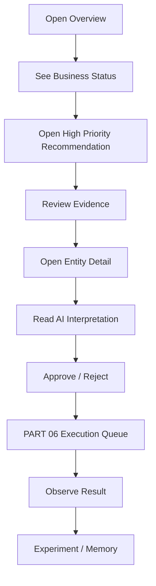
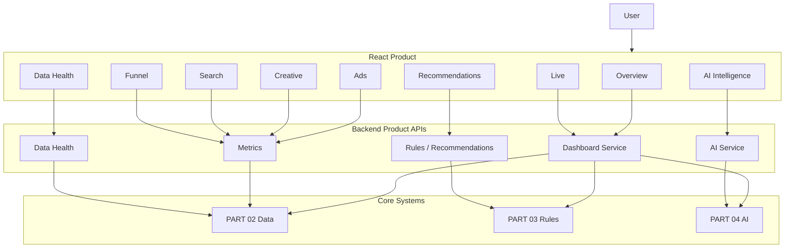

# AI DTC Growth Automation System

## PART 05 — Growth Dashboard & Product Experience

**Version:** V1.0  
**Status:** Ready for Codex Implementation  
**Baseline Date:** 2026-08-10  
**Target:** Codex Development Reference  
**Depends On:**  
- PART 01 — US Operation Environment  
- PART 02 — Data Architecture & API Integration  
- PART 03 — Growth Rule Engine  
- PART 04 — Multi-Agent & AI Intelligence Architecture  

**Next:** PART 06 — Automation Execution & Approval System

---

# 0. 文档目标

PART 05 的目标不是“做一个好看的 Dashboard”。

真正目标是：

> 把前四个 Part 的数据、规则、AI、环境能力，组合成运营人员每天可用、可判断、可执行决策的产品界面。

系统最终用户不是：

```text
数据库工程师
AI 工程师
```

而是：

```text
品牌负责人
投放运营
内容运营
增长负责人
管理者
```

所以产品必须做到：

```text
1. 先告诉用户现在发生了什么
2. 再告诉用户为什么
3. 再告诉用户应该看哪里
4. 再告诉用户建议做什么
5. 最后才展示底层复杂数据
```

---

# 1. 产品定位

产品名：

```text
AI Growth Center
```

内部定位：

```text
DTC Growth Operating Console
```

它不是：

```text
Meta Ads Manager 替代品
Google Ads UI 克隆
Shopify Analytics 克隆
```

而是一个：

```text
Cross-channel Decision Workspace
```

核心逻辑：

```text
Observe
↓
Diagnose
↓
Prioritize
↓
Decide
↓
Review
↓
Execute
↓
Learn
```

---

# 2. 产品信息架构

建议一级导航：

```text
Overview
Live Monitor
Ads
Creative Lab
Search Intelligence
Funnel
Competitors
Recommendations
Experiments
Data Health
AI Intelligence
Settings
```

---

# 3. 一级导航解释

## Overview

回答：

```text
今天整体怎么样？
```

## Live Monitor

回答：

```text
现在有没有正在发生的异常？
```

## Ads

回答：

```text
Meta / Google 哪些 Campaign、AdGroup、Ad 有问题？
```

## Creative Lab

回答：

```text
哪些素材赢了？为什么？哪些疲劳了？
```

## Search Intelligence

回答：

```text
Google Search Term / Keyword 哪些有效、哪些浪费？
```

## Funnel

回答：

```text
用户在哪个漏斗节点流失？
```

## Competitors

回答：

```text
公开市场和竞品最近有什么变化？
```

## Recommendations

回答：

```text
系统建议我今天做什么？
```

## Experiments

回答：

```text
正在测试什么？结果如何？
```

## Data Health

回答：

```text
这些数据能不能相信？
```

## AI Intelligence

回答：

```text
AI 是怎么得出结论的？
```

## Settings

回答：

```text
目标、规则、数据源、权限怎么配置？
```

---

# 4. 产品核心原则

## 4.1 Decision First

首页不应该先放：

```text
20 张图
50 个指标
```

应该先放：

```text
Business Status
Priority Alerts
Top Recommendations
```

---

## 4.2 Progressive Disclosure

第一层：

```text
结论
```

第二层：

```text
证据
```

第三层：

```text
底层数据
```

用户不需要一开始看到所有技术细节。

---

## 4.3 Evidence Everywhere

任何 AI 或 Rule 结论都必须能展开：

```text
Why?
Evidence
Compared with what?
Data freshness
Confidence
```

---

## 4.4 Data != AI

UI 必须明显区分：

```text
Deterministic Data
Rule Finding
AI Inference
AI Hypothesis
```

例如使用 Badge：

```text
DATA
RULE
AI
HYPOTHESIS
```

不要把 AI 推断显示成事实。

---

# 5. 全局布局

建议 Desktop First。

主要使用场景：

```text
1440px / 1920px 桌面
```

但支持：

```text
1024px
768px
```

移动端：

只保留：

```text
Overview
Alerts
Recommendations
```

复杂运营页面不强求移动端完整体验。

---

# 6. App Shell

结构：

```text
┌─────────────────────────────────────────────────────────────┐
│ Top Bar                                                     │
├──────────────┬──────────────────────────────────────────────┤
│ Sidebar      │ Main Content                                 │
│              │                                              │
│ Overview     │                                              │
│ Live         │                                              │
│ Ads          │                                              │
│ Creative     │                                              │
│ Search       │                                              │
│ Funnel       │                                              │
│ ...          │                                              │
└──────────────┴──────────────────────────────────────────────┘
```

---

# 7. Top Bar

包含：

```text
Brand / Workspace Selector
Date Range
Timezone
Currency
Data Freshness
Global Search
AI Query
User Menu
```

---

# 8. Workspace Selector

未来支持多品牌。

第一版：

```text
一个品牌
```

但 Schema 保留：

```text
workspace_id
brand_id
```

避免未来重构。

---

# 9. Global Date Range

Preset：

```text
Today
Yesterday
Last 7 Days
Last 14 Days
Last 30 Days
This Month
Custom
```

---

# 10. Comparison

支持：

```text
Previous Period
Previous Week
Previous Month
Same Weekday Baseline
No Comparison
```

不要默认所有页面：

```text
today vs yesterday
```

---

# 11. Timezone

显示：

```text
Account Timezone
```

并允许：

```text
Business Reporting Timezone
```

所有图表必须显示当前时区。

---

# 12. Currency

如果只有 USD：

默认：

```text
USD
```

但组件必须支持：

```text
source currency
reporting currency
```

---

# 13. Data Freshness Indicator

Top Bar：

```text
● Fresh — Meta 8m / Google 11m / Shopify 14s
```

如果 Stale：

```text
⚠ Data delayed
```

点击进入：

```text
Data Health
```

---

# 14. Global Search

可以搜索：

```text
Campaign
Ad Group
Ad
Creative
Keyword
Search Term
Product
Recommendation
```

---

# 15. AI Query

入口：

```text
Ask Growth AI
```

但简单问题：

```text
昨天 Meta 花了多少钱？
```

直接走：

```text
Metrics API
```

不调用 LLM。

复杂问题：

```text
为什么 Meta ROAS 下降但 CTR 提高？
```

才走 PART 04 Agent Graph。

---

# 16. Overview 页面目标

Overview 回答：

```text
今天生意整体怎么样？
哪里有问题？
今天先做什么？
```

---

# 17. Overview 页面结构

```text
Business Health
↓
Core KPIs
↓
Priority Recommendations
↓
Platform Performance
↓
Creative / Search / Funnel Highlights
↓
AI Daily Brief
```

---

# 18. Business Health

顶部一个大状态：

```text
HEALTHY
WATCH
AT RISK
CRITICAL
```

不能由 LLM 自由生成。

由：

```text
Rule Engine + Business Targets
```

决定。

---

# 19. Health Score

可选：

```text
Growth Health Score
0-100
```

第一版建议：

不要急着做一个神秘总分。

更推荐：

```text
Business Status
```

由明确规则触发。

如果未来做 Score：

必须公开计算逻辑。

---

# 20. Core KPI Cards

建议：

```text
Paid Spend
Net Revenue
Orders
Blended ROAS
AOV
Refund Rate
```

---

# 21. KPI Card 结构

每张：

```text
Label
Current Value
Comparison %
Target
Status
Mini Trend
```

例如：

```text
Blended ROAS

3.42
-12.4% vs previous 7d

Target: 3.0
STATUS: HEALTHY
```

---

# 22. KPI 状态

```text
GOOD
WATCH
BAD
UNKNOWN
```

状态必须来自：

```text
Business Targets
```

不能只按涨跌颜色。

例如：

```text
ROAS -10%
```

但仍远高于 Target：

不应该显示红色。

---

# 23. Revenue

首页优先：

```text
Shopify Net Revenue
```

不是：

```text
Meta Revenue + Google Revenue
```

---

# 24. Paid Spend

```text
Meta Spend + Google Spend
```

按统一币种展示。

---

# 25. Blended ROAS

```text
Shopify Net Revenue / Total Paid Spend
```

明确 Tooltip。

---

# 26. Priority Recommendations

Overview 最关键模块。

最多展示：

```text
3-5 条
```

按：

```text
Severity
Impact
Urgency
Confidence
```

排序。

---

# 27. Recommendation Card

结构：

```text
[HIGH] Creative fatigue detected

Ad: META / Vintage Hook 03

Why:
CTR -28%
Frequency +36%
CPA +42%

Recommendation:
Refresh creative before scaling.

Confidence:
High

[Review] [Why?]
```

---

# 28. Recommendation 不要直接显示太多

不要：

```text
20 条 Alert
```

首页只显示 Top Priority。

其他进入：

```text
Recommendations Center
```

---

# 29. Platform Summary

Meta / Google 两张主要卡片。

字段：

```text
Spend
Platform ROAS
CPA
Conversions
CTR
Status
```

注意：

```text
Platform ROAS
```

必须明确：

```text
Platform-reported
```

---

# 30. Business vs Platform

首页需要同时展示：

```text
Blended Business Metrics
```

和：

```text
Platform Metrics
```

避免：

用户误以为 Meta ROAS 就是真实业务 ROAS。

---

# 31. Performance Trend

推荐一个主趋势图：

```text
Spend
Net Revenue
Blended ROAS
```

不建议一屏堆 8 条线。

允许切换 Metric。

---

# 32. Trend Chart

支持：

```text
Daily
Hourly
```

Today：

```text
Hourly
```

7d / 30d：

```text
Daily
```

---

# 33. Creative Highlight

首页：

```text
Top Winner
Creative Fatigue
New Testing
```

每类最多：

```text
1-3
```

---

# 34. Search Highlight

展示：

```text
Top Waste Search Term
Top Expansion Candidate
Query Drift
```

---

# 35. Funnel Highlight

展示：

```text
Biggest Drop-off
```

例如：

```text
Checkout → Purchase
-31% vs baseline
```

---

# 36. AI Daily Brief

PART 04 Strategy Agent 输出。

UI：

```text
Today in 60 seconds
```

内容：

```text
What changed
Why it matters
What to do
What not to change
```

必须可展开 Evidence。

---

# 37. AI Daily Brief 结构化渲染

不要直接存：

```text
Markdown blob
```

前端读取：

```text
structured JSON
```

然后渲染。

---

# 38. Live Monitor 页面

目标：

```text
实时看盘
```

更准确：

```text
Near-real-time operational monitor
```

因为广告归因存在延迟。

---

# 39. Live Monitor 顶部

显示：

```text
Last Data Update
Current Local Time
Account Timezone
```

并标：

```text
Intraday metrics are provisional
```

---

# 40. Live Monitor 关键指标

```text
Spend Today
Orders Today
Net Revenue Today
Blended ROAS Today

Spend Velocity
Order Velocity
Revenue Velocity
```

---

# 41. Spend Velocity

显示：

```text
Current
Expected by this time
Deviation
```

例如：

```text
Spend at 14:00:
$420

Expected:
$310

+35%
```

---

# 42. Velocity Baseline

优先：

```text
same weekday
same local time
historical median
```

而不是：

```text
Yesterday Full Day
```

---

# 43. Live Alerts

展示：

```text
CRITICAL
HIGH
```

例如：

```text
Spend velocity abnormal
Tracking anomaly
No-purchase burn
Data stale
Checkout failure
```

---

# 44. Live Timeline

显示：

```text
10:15 Spend spike
10:30 Rule triggered
10:45 Recommendation created
11:20 Operator acknowledged
```

---

# 45. Live Table

按实体：

```text
Campaign
Spend
Orders/Conv
CPA
ROAS
Velocity
Status
```

支持：

```text
Meta
Google
```

---

# 46. Ads 页面

一级：

```text
Ads
```

二级 Tab：

```text
All
Meta
Google
```

---

# 47. Ads Hierarchy

支持：

```text
Campaign
↓
Ad Group / AdSet
↓
Ad
```

Google：

额外：

```text
Asset Group
```

---

# 48. Ads Table

核心字段：

```text
Name
Platform
Status

Spend
Impressions
Clicks
CTR
CPC

Conversions
CPA
Platform ROAS

Rule Status
Recommendation
```

---

# 49. 表格原则

默认不要展示所有字段。

支持：

```text
Column Customize
```

并保存用户偏好。

---

# 50. Row Status

每行：

```text
Healthy
Watch
At Risk
Insufficient Data
Learning
Data Issue
```

---

# 51. Row Expand

展开：

```text
Trend
Rule Findings
AI Diagnosis
Recent Changes
Creative
Targeting / Keyword
```

---

# 52. Campaign Detail

结构：

```text
Header
KPIs
Trend
Structure
Recommendations
Creative
Search
Funnel
Change History
AI Diagnosis
```

---

# 53. Campaign Header

显示：

```text
Campaign Name
Platform
Status
Objective
Strategy Label
Account
Created
```

---

# 54. Campaign Detail KPI

```text
Spend
CPA
Platform ROAS
Conversions
CTR
CVR
```

并显示：

```text
Target
```

---

# 55. Recent Changes

来自：

```text
entity_change_events
```

显示：

```text
Budget +15%
8h ago
```

用于理解：

```text
为什么 Scale 被 suppress
```

---

# 56. Rule Findings Panel

显示：

```text
Triggered
Suppressed
No Decision
```

例如：

```text
Scale candidate — SUPPRESSED
Reason: budget changed 8h ago
```

---

# 57. Creative Lab 页面

目标：

> 从“广告素材文件夹”升级为“可学习的创意资产系统”。

Tab：

```text
Library
Performance
Creative DNA
Lifecycle
Briefs
```

---

# 58. Creative Library

卡片：

```text
thumbnail
creative name

platform
first seen
status

spend
ROAS
CPA

lifecycle label
AI analysis status
```

---

# 59. Creative Lifecycle Filter

```text
NEW
TESTING
WINNER
STABLE
DECLINING
FATIGUED
FAILED
INSUFFICIENT
```

---

# 60. Creative Detail

布局：

```text
Video Preview
↓
Performance
↓
Creative DNA
↓
Timeline
↓
Rule Findings
↓
AI Analysis
↓
Related Creatives
```

---

# 61. Creative Performance

显示：

```text
Spend
Purchases
CPA
ROAS
CTR
Frequency
```

趋势：

```text
7d
14d
30d
```

---

# 62. Creative DNA

结构化展示：

```text
Hook
Opening Action
Product Appearance
Scene
Emotion
Audio
Pacing
CTA
Story Structure
Target Intent
```

---

# 63. Video Timeline

例如：

```text
0.0s  Close-up cassette
0.8s  Insert cassette
2.3s  Close lid
3.1s  Press play
6.2s  Tape rotation
11.5s CTA
```

---

# 64. Creative Comparison

选择：

```text
2-4 creatives
```

对比：

```text
Performance
Hook
Scene
Emotion
Timing
CTA
```

---

# 65. Winner Pattern

AI 可以生成：

```text
Common patterns among recent winners
```

但必须带：

```text
Evidence
Sample Count
Date Range
```

---

# 66. Creative Fatigue View

显示：

```text
Frequency Trend
CTR Trend
CPA Trend
Lifecycle
```

---

# 67. Creative Briefs

来自 PART 04。

每个 Brief：

```text
Objective
Hypothesis
Hook
First 3 Seconds
Scene Sequence
Audio
CTA
Avoid
Measurement Plan
```

状态：

```text
DRAFT
APPROVED
IN_PRODUCTION
PUBLISHED
ARCHIVED
```

---

# 68. Search Intelligence 页面

Tab：

```text
Search Terms
Keywords
Query Clusters
Negative Candidates
Expansion Candidates
```

---

# 69. Search Term Table

字段：

```text
Search Term
Campaign
Ad Group

Intent
Commercial Relevance

Spend
Clicks
Conversions
CPA
Value

Rule Status
AI Classification
Candidate Action
```

---

# 70. Search Intent Badge

```text
BRAND
PRODUCT
CATEGORY
INFORMATIONAL
REPAIR
DIY
FREE
COMPETITOR
IRRELEVANT
UNKNOWN
```

---

# 71. Negative Candidate Queue

显示：

```text
Term
Reason
Spend
Clicks
Conversions
Semantic Class
Confidence
Recommended Match Type
```

操作：

```text
Approve
Reject
Defer
```

PART 05：

Approve 仅表示：

```text
业务审批
```

PART 06 才真正执行。

---

# 72. Expansion Candidate

显示：

```text
Search Term
Conversions
CPA
ROAS
Frequency
Current Keyword Coverage
```

Action：

```text
Review Add Keyword
```

---

# 73. Query Clusters

聚类：

```text
Cassette player
Portable cassette
Retro music player
Repair/manual
Gift
```

展示：

```text
Spend
Conversions
CPA
Trend
```

---

# 74. Funnel 页面

目标：

```text
用户到底在哪一步掉了？
```

---

# 75. Funnel Main View

```text
Impressions
↓
Clicks
↓
Landing Page
↓
Add to Cart
↓
Checkout
↓
Purchase
```

每一步：

```text
Volume
Step CVR
Baseline
Change
```

---

# 76. Funnel Limitation

某阶段无数据：

显示：

```text
Not Available
```

不要显示：

```text
0
```

---

# 77. Funnel Diagnosis

右侧：

```text
Primary Problem
Likely Causes
Evidence
Checks
Confidence
```

---

# 78. Device Breakdown

支持：

```text
Desktop
Mobile
Tablet
```

---

# 79. Geo Breakdown

支持：

```text
Country
Region
```

如果数据量不足：

隐藏。

---

# 80. Landing Page Breakdown

展示：

```text
URL
Sessions/LPV
ATC
Purchase
CVR
Revenue
```

---

# 81. Competitors 页面

目标：

```text
公开市场研究
```

不是：

```text
批量抓竞品私有数据
```

---

# 82. Competitor Watchlist

字段：

```text
Brand
Platform
Profile/Page
Last Scan
New Content
Status
```

---

# 83. Competitor Feed

显示：

```text
Screenshot
Public Post / Page
Captured Time

AI Tags
Hook
Scene
Offer
CTA
```

---

# 84. Competitor Trend

例如：

```text
Gift positioning ↑
Bedroom nostalgia ↑
Unboxing ↑
```

必须标：

```text
Observed public sample
```

不是市场总体事实。

---

# 85. Competitor Evidence

每条分析：

```text
URL
Timestamp
Screenshot
Content Hash
```

---

# 86. Recommendations Center

这是整个产品第二核心页面。

Tab：

```text
Open
Acknowledged
Approved
Rejected
Resolved
Expired
```

---

# 87. Recommendation Priority

排序：

```text
Critical Safety
High Impact
High Confidence
Time-sensitive
```

---

# 88. Recommendation Detail

结构：

```text
What happened
Why
Evidence
Rule
AI Explanation
Risk
Suggested Action
What not to do
Approval
History
```

---

# 89. Recommendation Evidence

必须显示：

```text
Metric
Current
Baseline
Target
Window
Freshness
```

---

# 90. Rule vs AI

显示：

```text
Rule Finding:
CPA > target by 58%

AI Interpretation:
Most likely driven by checkout conversion decline.
```

两者分开。

---

# 91. Recommendation Action

PART 05：

可以：

```text
Approve
Reject
Defer
Acknowledge
```

不能：

```text
直接执行广告写操作
```

---

# 92. Approval Packet

如果批准：

UI 展示：

```text
Entity
Current State
Proposed Change
Risk
Evidence
Confidence
Expires
Rollback Plan
```

---

# 93. Approval Expiry

显示：

```text
Valid for 8 hours
```

过期：

```text
EXPIRED
```

需重新评估。

---

# 94. Experiments 页面

目标：

```text
系统化学习
```

而不是只记录 A/B Test 名字。

Tab：

```text
Active
Planned
Completed
Learnings
```

---

# 95. Experiment Card

```text
Hypothesis
Variable
Control
Treatment
Primary Metric
Guardrail
Start
Expected End
Status
```

---

# 96. Experiment Detail

显示：

```text
Design
Metrics
Current Progress
Rule Protection
Notes
Result
Learning
```

---

# 97. Experiment Protection

如果实验中：

```text
Campaign / Creative
```

被 Rule Engine Suppress 了：

UI 显示：

```text
Protected by Experiment
```

---

# 98. Completed Experiment

最终记录：

```text
Result
Confidence
What changed
What we learned
What to reuse
```

---

# 99. Data Health 页面

目标：

> 告诉运营人员：今天看到的数字是否可信。

---

# 100. Data Source Cards

```text
Meta Ads
Google Ads
Shopify
AdsPower
AI Providers
```

显示：

```text
Connection
Last Successful Sync
Freshness
Error Rate
Rate Limit
Records
```

---

# 101. Data Quality

显示：

```text
Critical
Error
Warning
Info
```

例如：

```text
Shopify stale
Meta schema drift
Google auth error
```

---

# 102. Freshness Timeline

展示：

```text
last 24h sync status
```

---

# 103. Sync Jobs

表：

```text
Provider
Job
Range
Status
Records
Duration
Error
```

---

# 104. Replay Sync

Admin：

允许：

```text
Retry
Backfill
Reconcile
```

这些是内部数据任务，不是广告写操作。

---

# 105. AI Intelligence 页面

目标：

```text
让 AI 系统可见、可审计、可调试
```

Tab：

```text
Runs
Trace
Models
Knowledge
Memory
Evals
Cost
```

---

# 106. AI Run Table

字段：

```text
Task
Status
Agents
Duration
Cost
Model Calls
Tool Calls
Created
```

---

# 107. AI Run Detail

显示：

```text
User/System Task
Graph
Agent Steps
Tool Calls
Evidence
Strategy
Reviewer Result
Limitations
Cost
```

---

# 108. Trace Privacy

UI 不显示：

```text
private chain-of-thought
```

只显示：

```text
safe step summaries
structured inputs
structured outputs
tool evidence
```

---

# 109. Models

显示：

```text
Provider
Configured Role
Health
Latency
Cost
Error Rate
```

---

# 110. Knowledge

显示：

```text
Document
Version
Status
Last Indexed
Chunks
```

---

# 111. Memory

显示：

```text
Proposed
Verified
Active
Stale
Invalidated
```

可以：

```text
Approve
Invalidate
```

---

# 112. Evals

显示：

```text
Agent Version
Eval Score
Critical Failures
Regression
Cost
Latency
```

---

# 113. AI Cost

按：

```text
Today
7d
30d
```

以及：

```text
Agent
Model
Task
```

分组。


# 114. Settings 页面

Settings 不要成为杂物间。

一级：

```text
Workspace
Business Targets
Data Sources
Rules
AI
Permissions
Notifications
```

---

# 115. Business Targets

允许配置：

```text
Target CPA
Target ROAS
Break-even ROAS
AOV Target
Daily Spend Cap
Campaign Spend Cap
Refund Warning
Refund Critical
```

支持 Scope：

```text
Global
Platform
Account
Campaign
Product
Market
```

---

# 116. Rule Settings

这里不直接编辑复杂 YAML。

UI 提供：

```text
Rule
Status
Current Version
Parameters
Scope Override
Cooldown
Shadow / Active
```

复杂变更：

进入：

```text
Advanced
```

---

# 117. AI Settings

配置：

```text
Primary Model Role
Fast Model Role
Video Model Role
Daily Cost Limit
Review Revision Limit
Memory Policy
Browser Research Toggle
```

真正 API Key：

不回显。

---

# 118. Notifications

第一版可支持：

```text
In-app
Email
Feishu later
Slack later
```

规则：

```text
Critical only
High + Critical
Daily Digest
Weekly Digest
```

---

# 119. Notification Center

Top Bar：

```text
Bell
```

只放：

```text
Critical
High
Approval Required
Data Failure
```

不要把所有 AI 分析都推送。

---

# 120. Approval Queue

建议放：

```text
Recommendations
```

也可以 Top Bar 显示：

```text
3 approvals
```

---

# 121. Interaction State

所有异步页面必须支持：

```text
Loading
Empty
Partial
Stale
Error
Permission Denied
Unavailable
```

不能只有：

```text
Spinner
```

---

# 122. Loading State

优先：

```text
Skeleton
```

但关键数据顶部：

如果有上一版 Cache：

可以显示：

```text
Last known data
```

并标：

```text
Updating...
```

---

# 123. Partial Data

例如：

```text
Meta OK
Google FAIL
Shopify OK
```

Overview 仍然可以显示。

但：

```text
Paid Spend
```

必须标：

```text
Partial
```

不能假装完整。

---

# 124. Stale Data

显示：

```text
Data from 42 minutes ago
```

并降低相关 Recommendation 的 UI 强度。

---

# 125. Empty State

例如：

Creative Lab：

```text
No creative data yet.
Sync Meta creatives first.
```

附：

```text
Go to Data Sources
```

---

# 126. Permission State

用户无权限：

```text
You can view this recommendation but cannot approve it.
```

不要隐藏整个页面导致用户不知道功能存在。

---

# 127. Error UX

错误必须可行动。

差：

```text
Something went wrong.
```

好：

```text
Google Ads authentication expired.
Last successful sync: 10:42.
Reconnect in Settings → Data Sources.
```

---

# 128. Status System

全产品统一 Status。

数据：

```text
FRESH
DELAYED
STALE
FAILED
```

广告实体：

```text
HEALTHY
WATCH
AT_RISK
INSUFFICIENT_DATA
LEARNING
```

Recommendation：

```text
OPEN
ACKNOWLEDGED
APPROVED
REJECTED
RESOLVED
EXPIRED
```

AI：

```text
RUNNING
WAITING_HUMAN
COMPLETED
PARTIAL
FAILED
```

不要不同页面重复发明状态。

---

# 129. Severity System

统一：

```text
INFO
LOW
MEDIUM
HIGH
CRITICAL
```

颜色不是唯一编码。

同时使用：

```text
icon
label
text
```

---

# 130. Accessibility

要求：

```text
WCAG AA contrast
keyboard navigation
visible focus
semantic HTML
aria-labels
chart text alternatives
```

不要用：

```text
红/绿颜色 alone
```

表达好坏。

---

# 131. Theme

建议：

```text
Light
Dark
System
```

Growth Console 长时间使用：

Dark 可以支持。

---

# 132. Visual Design Direction

关键词：

```text
Professional
Dense but readable
Analytical
Calm
Operational
```

避免：

```text
Crypto dashboard neon
过度渐变
大面积玻璃拟态
过多阴影
营销官网风格
```

---

# 133. Layout Density

支持：

```text
Comfortable
Compact
```

运营人员常用：

```text
Compact
```

---

# 134. Design Tokens

建议统一：

```text
spacing
radius
border
surface
text
status
chart
```

Tailwind 配合 CSS Variables。

---

# 135. Typography

优先：

```text
system font stack
```

数字：

建议：

```text
tabular-nums
```

方便列对齐。

---

# 136. Table Design

Growth 系统会大量用表。

必须支持：

```text
Sticky Header
Sorting
Filtering
Column Resize optional
Column Visibility
Pagination / Virtualization
Row Expansion
Bulk Select future
```

---

# 137. Table Performance

如果：

```text
10,000 Search Terms
```

不要一次渲染全部。

使用：

```text
Server Pagination
or
Virtualized Rows
```

---

# 138. URL State

Filters：

```text
date
platform
status
campaign
```

应该进入 URL Query。

这样：

```text
刷新不丢
可以分享
```

---

# 139. Saved Views

第一版可选。

后续运营很有价值：

```text
Meta High Risk
Google Waste Terms
Creative Fatigue
```

Schema 预留：

```text
saved_views
```

---

# 140. Global Filter Context

页面共享：

```text
Workspace
Date Range
Comparison
Timezone
Currency
```

局部页面：

再加：

```text
Platform
Campaign
Status
```

---

# 141. Deep Link

任何 Recommendation：

点击 Entity：

进入：

```text
Campaign Detail
Creative Detail
Search Term Detail
```

并保持：

```text
date window
```

---

# 142. Evidence Drawer

全局通用组件：

```text
EvidenceDrawer
```

点击：

```text
Why?
```

右侧展开。

内容：

```text
Rule
Metrics
Baseline
Targets
AI Explanation
Data Freshness
Source Refs
```

---

# 143. AI Explanation Drawer

AI 内容单独：

```text
AI Interpretation
```

标：

```text
Inference
Hypothesis
```

---

# 144. Source Ref UI

用户不需要看到：

```text
metric://campaign/xxx/...
```

前端转换为：

```text
Meta Campaign Metric
Shopify Revenue
Rule META-006
```

但 Debug Mode 可查看 raw ref。

---

# 145. Debug Mode

Admin 可以打开：

```text
Developer / Debug
```

显示：

```text
Source IDs
Rule IDs
Prompt Version
Agent Version
Sync Job
Trace ID
```

普通运营默认隐藏。

---

# 146. Chart Library

推荐：

```text
ECharts
```

或项目现有稳定 Chart Library。

理由：

```text
复杂 tooltip
time series
large datasets
crosshair
responsive
```

不要为了简单卡片全都做图。

---

# 147. Chart Rules

每张图必须回答一个问题。

错误：

```text
Spend
Revenue
CTR
CPA
ROAS
Orders
AOV
Refund
全部一张双轴图
```

正确：

拆成：

```text
Business Trend
Media Efficiency
Funnel
```

---

# 148. Dual Axis

尽量少用。

如果必须：

清晰标：

```text
left axis
right axis
```

不要用三个轴。

---

# 149. Tooltip

包含：

```text
Date/Time
Value
Comparison
Target
Status
```

---

# 150. Chart Annotation

重要事件：

```text
Budget changed
Creative launched
Tracking issue
Experiment started
```

可显示在趋势图上。

---

# 151. Real-time Updates

不需要全站 WebSocket。

建议：

```text
Polling
```

Overview：

```text
1-5 min
```

Live Monitor：

```text
30-60 sec
```

Recommendation：

```text
30-60 sec
```

Data Health：

```text
30-60 sec
```

根据实际数据同步频率。

---

# 152. SSE / WebSocket

PART 05 可选：

```text
SSE
```

用于：

```text
AI Run progress
approval update
long task
```

不需要为广告指标做伪实时 WebSocket。

---

# 153. Frontend Stack

建议：

```text
React
TypeScript
Vite

Tailwind CSS

TanStack Query
TanStack Table

React Router

ECharts

Zod
```

如果项目已有 Next.js：

可以继续现有栈。

不要为了本 Part 重写。

---

# 154. State Management

Server State：

```text
TanStack Query
```

UI State：

```text
React state/context
```

复杂全局状态才：

```text
Zustand
```

不要一开始引入重 Redux。

---

# 155. API Client

建立：

```text
frontend/src/api/
```

按领域：

```text
metrics
ads
creative
search
funnel
recommendations
experiments
data-health
ai
settings
```

---

# 156. API Response Envelope

建议：

```json
{
  "data": {},
  "meta": {
    "request_id": "...",
    "data_as_of": "...",
    "timezone": "America/New_York",
    "currency": "USD",
    "partial": false
  },
  "errors": []
}
```

---

# 157. Data as-of

所有关键 Metrics Response：

返回：

```text
data_as_of
```

前端显示：

```text
Updated 8 min ago
```

---

# 158. Partial Response

如果跨数据源：

```text
Meta OK
Google FAIL
```

API：

```json
{
  "meta": {
    "partial": true
  },
  "errors": [
    {
      "source": "GOOGLE_ADS",
      "code": "SOURCE_STALE"
    }
  ]
}
```

---

# 159. Overview API

建议：

```http
GET /api/v1/dashboard/overview
```

参数：

```text
start_date
end_date
compare
workspace
timezone
currency
```

返回：

```text
business_status
kpis
recommendations
platforms
trend
highlights
daily_brief
```

---

# 160. Live API

```http
GET /api/v1/dashboard/live
```

返回：

```text
today
velocity
alerts
campaigns
timeline
freshness
```

---

# 161. Ads APIs

```http
GET /api/v1/ads/campaigns
GET /api/v1/ads/campaigns/{id}

GET /api/v1/ads/ad-groups
GET /api/v1/ads/ads
```

---

# 162. Creative APIs

```http
GET /api/v1/creatives
GET /api/v1/creatives/{id}

GET /api/v1/creatives/{id}/performance
GET /api/v1/creatives/{id}/ai-analysis

GET /api/v1/creative-briefs
POST /api/v1/creative-briefs
```

---

# 163. Search APIs

```http
GET /api/v1/search-intelligence/terms
GET /api/v1/search-intelligence/keywords
GET /api/v1/search-intelligence/clusters

GET /api/v1/search-intelligence/negative-candidates
GET /api/v1/search-intelligence/expansion-candidates
```

---

# 164. Funnel APIs

```http
GET /api/v1/funnel/overview
GET /api/v1/funnel/landing-pages
GET /api/v1/funnel/devices
GET /api/v1/funnel/geography
```

---

# 165. Competitor APIs

```http
GET /api/v1/competitors
GET /api/v1/competitors/{id}
GET /api/v1/competitors/{id}/snapshots
GET /api/v1/competitor-intelligence/trends
```

---

# 166. Recommendation APIs

沿用 PART 03：

```http
GET /api/v1/recommendations
GET /api/v1/recommendations/{id}

POST /api/v1/recommendations/{id}/acknowledge
POST /api/v1/recommendations/{id}/approve
POST /api/v1/recommendations/{id}/reject
POST /api/v1/recommendations/{id}/feedback
```

---

# 167. Experiment APIs

```http
GET  /api/v1/experiments
POST /api/v1/experiments

GET /api/v1/experiments/{id}
PUT /api/v1/experiments/{id}

POST /api/v1/experiments/{id}/complete
```

---

# 168. Settings APIs

```http
GET /api/v1/settings/business-targets
PUT /api/v1/settings/business-targets

GET /api/v1/settings/notifications
PUT /api/v1/settings/notifications

GET /api/v1/settings/permissions
```

---

# 169. Frontend Route Structure

```text
/
├── overview
├── live
├── ads
│   ├── campaigns
│   ├── campaigns/:id
│   ├── ad-groups
│   └── ads
├── creative
│   ├── library
│   ├── :id
│   └── briefs
├── search
│   ├── terms
│   ├── keywords
│   ├── clusters
│   ├── negatives
│   └── expansion
├── funnel
├── competitors
│   └── :id
├── recommendations
│   └── :id
├── experiments
│   └── :id
├── data-health
├── ai
│   ├── runs
│   ├── runs/:id
│   ├── models
│   ├── knowledge
│   ├── memory
│   ├── evals
│   └── cost
└── settings
```

---

# 170. Component Structure

建议：

```text
components/
├── app-shell/
├── kpi/
├── charts/
├── tables/
├── filters/
├── status/
├── recommendation/
├── evidence/
├── ai/
├── creative/
├── funnel/
└── common/
```

---

# 171. Shared Components

必须统一：

```text
KpiCard
StatusBadge
SeverityBadge
FreshnessBadge
MetricDelta
TargetIndicator
EvidenceDrawer
RecommendationCard
EntityLink
EmptyState
ErrorState
PartialDataBanner
DataAsOf
```

---

# 172. Metric Formatting

统一：

```text
currency
percentage
ratio
integer
compact number
duration
```

例如：

```text
$1,284.20
3.42×
12.4%
18,420
```

---

# 173. Decimal Precision

建议：

```text
Spend:
2 decimals

ROAS:
2 decimals

CTR/CVR:
2 decimals %

CPA:
2 decimals

Counts:
integer
```

不要不同页面：

```text
ROAS 3.423156
```

---

# 174. Target Indicator

例如：

```text
CPA $27
Target $30
GOOD
```

不要只显示：

```text
-10%
```

---

# 175. Change Direction Semantics

不是所有：

```text
↑
```

都是好。

例如：

```text
CPA ↑
Refund ↑
```

是坏。

Metric Registry 应定义：

```text
positive_direction
```

前端读取。

---

# 176. Permission Model

角色建议：

```text
VIEWER
ANALYST
OPERATOR
ADMIN
```

---

# 177. VIEWER

允许：

```text
view dashboards
view recommendations
view AI analysis
```

---

# 178. ANALYST

增加：

```text
run AI analysis
run simulation
create experiment draft
```

---

# 179. OPERATOR

增加：

```text
acknowledge
approve/reject recommendations
manage experiment
```

---

# 180. ADMIN

增加：

```text
data sources
business targets
rule parameters
AI settings
permissions
```

---

# 181. Permission Backend First

前端隐藏按钮不算安全。

Backend 必须：

```text
authorize
```

---

# 182. Audit UI

Admin 可查看：

```text
who
what
when
before
after
```

例如：

```text
Rule threshold changed
Recommendation approved
Business target changed
```

---

# 183. Keyboard Navigation

高频运营：

建议：

```text
/
```

Focus Search。

可选：

```text
g o → Overview
g r → Recommendations
```

不是 MVP 阻塞。

---

# 184. Command Palette

可选：

```text
Cmd/Ctrl + K
```

支持：

```text
Go to Campaign
Open Recommendation
Ask Growth AI
```

后续实现。

---

# 185. Global AI Panel

可以设计右侧：

```text
Ask Growth AI
```

但不要变成：

```text
漂浮 ChatGPT
```

应自动携带当前页面 Scope。

例如在 Campaign Detail：

AI Query 默认 Context：

```text
campaign_id
date
current filters
```

---

# 186. AI Panel Example

用户：

```text
为什么这个 Campaign CPA 上升？
```

自动：

```text
scope = current campaign
```

无需重新告诉 AI Campaign ID。

---

# 187. AI Answer UI

结构：

```text
Answer
Evidence
Confidence
Limitations
Related Recommendation
```

不是只返回一个 Chat Bubble。

---

# 188. Data / Rule / AI Layering

Campaign 页面：

```text
DATA
Spend $420

RULE
CPA Overshoot triggered

AI
Likely driven by checkout conversion decline
```

这是产品最核心的认知设计。

---

# 189. Explainability

任何 Recommendation：

点击：

```text
Why?
```

至少 2 步以内看到：

```text
Evidence
Rule
AI Interpretation
```

---

# 190. No Black-box Score

不要加入无法解释：

```text
AI Quality Score 87
```

除非：

```text
计算公式明确
```

---

# 191. Recommendation Impact

第一版可以用：

```text
HIGH / MEDIUM / LOW
```

不要直接伪造：

```text
预计多赚 $1,253
```

没有因果模型前不做。

---

# 192. Estimated Opportunity

如果未来展示：

```text
Estimated Opportunity
```

必须明确：

```text
scenario estimate
```

不是：

```text
guaranteed impact
```

---

# 193. Responsive Behavior

Desktop：

```text
Sidebar + full tables
```

Tablet：

```text
Collapsible sidebar
reduced columns
```

Mobile：

```text
Overview
Alerts
Recommendations
Approval
```

---

# 194. Mobile Approval

高风险审批在移动端：

显示：

```text
Evidence
Risk
Expiry
```

不要只有：

```text
Approve
```

大按钮。

---

# 195. Loading Performance

目标：

```text
Overview shell < 1s perceived
Cached first paint
main data < 2-3s typical
```

真实取决于部署。

不要阻塞页面等待：

```text
AI Daily Brief
```

先渲染数据。

---

# 196. AI Async

AI 内容：

```text
独立加载
```

Overview：

数据先显示。

AI Brief：

后到。

---

# 197. Query Cache

TanStack Query：

```text
staleTime
refetchInterval
```

按页面配置。

---

# 198. Frontend Error Boundary

至少：

```text
Page Error Boundary
AI Widget Error Boundary
Chart Error Boundary
```

某个 AI Card 崩：

不能整个 Dashboard 白屏。

---

# 199. Browser Compatibility

至少：

```text
Chrome current
Edge current
Safari current
```

---

# 200. Testing Strategy

UI 必须有：

```text
Unit
Component
Integration
E2E
Visual Regression optional
Accessibility
```


# 201. Component Tests

至少覆盖：

```text
KpiCard
StatusBadge
SeverityBadge
FreshnessBadge
MetricDelta
EvidenceDrawer
RecommendationCard
PartialDataBanner
```

---

# 202. Integration Tests

至少：

```text
Overview data load
Campaign detail
Creative detail
Recommendation detail
Search negative queue
Funnel diagnosis
Data Health
AI Run detail
```

---

# 203. E2E — Overview

流程：

```text
Login
↓
Open Overview
↓
Select Last 7 Days
↓
Verify KPIs
↓
Open Recommendation
↓
Open Evidence
```

---

# 204. E2E — Recommendation Approval

流程：

```text
Open Recommendation
↓
Review evidence
↓
Approve
↓
Status = APPROVED
```

验证：

```text
No provider mutation happened
```

因为 PART 06 尚未实现。

---

# 205. E2E — Data Failure

模拟：

```text
Google stale
```

预期：

```text
Partial banner
Google marked stale
Overview still renders
Blended paid spend marked partial
```

---

# 206. E2E — AI Failure

模拟：

```text
AI provider timeout
```

预期：

```text
Metrics remain available
AI section shows unavailable
No page crash
```

---

# 207. E2E — Search Candidate

流程：

```text
Open Search Intelligence
↓
Negative Candidates
↓
Open term
↓
Review spend/conversions/AI class
↓
Approve candidate
```

结果：

```text
Business approval only
```

---

# 208. E2E — Creative

流程：

```text
Creative Library
↓
Winner filter
↓
Open Creative
↓
View DNA
↓
Compare with fatigued creative
```

---

# 209. Accessibility Tests

至少：

```text
keyboard
focus
contrast
ARIA
table labels
form labels
```

---

# 210. Performance Tests

重点：

```text
10k Search Terms
1k Ads
large creative library
```

验证：

```text
pagination/virtualization
no browser freeze
```

---

# 211. Frontend Mock Mode

沿用系统 Mock。

新增：

```env
VITE_API_MODE=mock
```

或项目对应配置。

前端无 Backend 也可：

```text
Storybook / fixture
```

但最终 Integration 必须走真实 Backend Mock API。

---

# 212. Demo Scenarios

至少：

```text
healthy_day
meta_at_risk
google_search_waste
checkout_failure
tracking_anomaly
creative_fatigue
refund_spike
partial_data
ai_unavailable
critical_spend
```

---

# 213. Screenshot Fixtures

Codex 完成 UI 后：

必须输出至少以下页面截图：

```text
Overview
Live Monitor
Campaign Detail
Creative Detail
Search Intelligence
Funnel
Recommendations
Data Health
AI Run Detail
```

---

# 214. UI Acceptance — Overview

必须满足：

- [ ] 10 秒内能看懂今天总体状态
- [ ] 能看到真实 Shopify Net Revenue
- [ ] 能看到 Paid Spend
- [ ] 能看到 Blended ROAS
- [ ] 能看到 Top Recommendations
- [ ] 能看 Meta / Google 分平台情况
- [ ] 能看到 Data Freshness
- [ ] AI Brief 不阻塞数据加载
- [ ] AI 内容与 Rule/Data 明确区分

---

# 215. UI Acceptance — Live Monitor

- [ ] Today spend
- [ ] Today orders
- [ ] Today revenue
- [ ] Spend velocity
- [ ] Revenue/order velocity
- [ ] High/Critical alerts
- [ ] Intraday provisional label
- [ ] Timeline
- [ ] Campaign live table
- [ ] Freshness

---

# 216. UI Acceptance — Ads

- [ ] Campaign hierarchy
- [ ] Meta / Google filter
- [ ] Target comparisons
- [ ] Rule status
- [ ] Recommendation
- [ ] Expand detail
- [ ] Trend
- [ ] Recent changes
- [ ] Data / Rule / AI layers

---

# 217. UI Acceptance — Creative

- [ ] Creative Library
- [ ] Lifecycle
- [ ] Preview
- [ ] Performance
- [ ] Creative DNA
- [ ] Timeline
- [ ] AI Analysis
- [ ] Comparison
- [ ] Creative Brief

---

# 218. UI Acceptance — Search

- [ ] Search Terms
- [ ] Keywords
- [ ] Intent classification
- [ ] Performance evidence
- [ ] Negative candidates
- [ ] Expansion candidates
- [ ] Business approval only
- [ ] No automatic Google mutation

---

# 219. UI Acceptance — Funnel

- [ ] Funnel stages
- [ ] Missing data != zero
- [ ] Step conversion
- [ ] Baseline comparison
- [ ] AI diagnosis
- [ ] Device / landing-page drilldown

---

# 220. UI Acceptance — Recommendations

- [ ] Priority
- [ ] Severity
- [ ] Confidence
- [ ] Evidence
- [ ] Rule
- [ ] AI interpretation
- [ ] Approval
- [ ] Expiry
- [ ] Audit history
- [ ] No execution

---

# 221. UI Acceptance — Data Health

- [ ] Source status
- [ ] Last sync
- [ ] Freshness
- [ ] DQ issues
- [ ] Jobs
- [ ] Retry/reconcile for authorized admin
- [ ] Partial-source behavior

---

# 222. UI Acceptance — AI Intelligence

- [ ] Runs
- [ ] Safe trace
- [ ] Agent steps
- [ ] Tool calls
- [ ] Model health
- [ ] Knowledge
- [ ] Memory
- [ ] Evals
- [ ] Cost
- [ ] No chain-of-thought exposure

---

# 223. Dashboard Backend Aggregation

前端不要为了 Overview：

```text
发 15 个零散请求
```

建立 Dashboard Aggregator：

```text
DashboardService
```

Backend 聚合：

```text
Metrics
Recommendations
Platform
Highlights
AI Brief ref
Freshness
```

---

# 224. Avoid Frontend Business Logic

前端不要自己决定：

```text
CPA 是否危险
ROAS 是否好
Recommendation priority
Business health
```

这些来自：

```text
Backend / Rule Engine
```

前端主要负责：

```text
presentation
interaction
filtering
```

---

# 225. Metric Registry to Frontend

Backend 可以返回：

```text
metric metadata
```

例如：

```json
{
  "key": "cpa",
  "label": "CPA",
  "format": "currency",
  "positive_direction": "down",
  "target": 30
}
```

前端避免写死：

```text
CPA ↑ 一定绿色
```

---

# 226. Frontend Domain Types

创建：

```text
frontend/src/domain/
```

例如：

```text
metrics.ts
recommendations.ts
ads.ts
creative.ts
search.ts
funnel.ts
ai.ts
health.ts
```

---

# 227. Runtime Validation

API Response：

使用：

```text
Zod
```

验证关键 Response。

避免 Backend Schema 变化：

直接把 UI 搞坏。

---

# 228. API Error Contract

统一：

```json
{
  "error": {
    "code": "SOURCE_STALE",
    "message": "Google Ads data is delayed.",
    "source": "GOOGLE_ADS",
    "request_id": "..."
  }
}
```

---

# 229. Empty vs Error

严格区分：

```text
No data
```

和：

```text
Failed to load
```

---

# 230. Notification Model

创建：

```text
notifications
```

字段：

```text
id
user_id

type
severity

title
body

entity_type
entity_id

recommendation_id

read_at
created_at
```

---

# 231. Notification Type

```text
RECOMMENDATION
APPROVAL_REQUIRED
DATA_FAILURE
CRITICAL_ALERT
AI_RUN_FAILED
EXPERIMENT_UPDATE
```

---

# 232. Dashboard Preferences

创建：

```text
user_dashboard_preferences
```

保存：

```text
default workspace
default date range
default comparison
table columns
density
theme
saved filters
```

---

# 233. Workspace Model

即使第一版只有一个品牌：

创建：

```text
workspaces
```

最小字段：

```text
id
name
timezone
reporting_currency
status
```

其他表未来加入：

```text
workspace_id
```

---

# 234. Workspace Boundary

所有 API：

必须验证：

```text
用户是否有 workspace 权限
```

避免未来多品牌后：

数据串户。

---

# 235. Audit

UI 关键操作：

```text
Recommendation approve/reject
Target change
Rule parameter change
Data source reconnect
Experiment change
Memory approve/invalidate
```

全部进入 Audit。

---

# 236. Feature Flags

建立：

```text
feature_flags
```

至少支持：

```text
creative_ai
competitor_intelligence
ai_memory
experiments
execution_preview
```

方便逐步上线。

---

# 237. Execution Preview

PART 05 可预留：

```text
Execution Preview
```

当 Recommendation Approved：

显示：

```text
Ready for execution layer
```

但不显示可执行按钮，直到 PART 06。

---

# 238. PART 06 预留字段

Recommendation Detail 预留：

```text
execution_status
execution_id
last_revalidated_at
rollback_available
```

PART 05 不赋值或显示：

```text
Not enabled
```

---

# 239. Product Analytics

系统自身也需要埋点。

第一版：

```text
page_view
recommendation_open
recommendation_approve
recommendation_reject
evidence_open
ai_query
creative_compare
search_candidate_review
```

用于优化产品。

---

# 240. Privacy

产品埋点不要收：

```text
API key
customer PII
creative private raw asset unless required
```

---

# 241. Telemetry

可选：

```text
self-hosted product analytics
```

第一版不是阻塞。

---

# 242. Error Monitoring

建议：

```text
Sentry-like error tracking
```

或自建。

至少：

```text
frontend error
backend request id
trace id
```

可关联。

---

# 243. Request ID

每个 API Response：

```text
request_id
```

Frontend Error UI：

可显示：

```text
Request ID
```

方便 Debug。

---

# 244. AI Run ID

AI Widget：

显示：

```text
Analysis ID
```

Admin Debug 模式可复制。

---

# 245. Frontend Build

必须提供：

```bash
npm run dev
npm run build
npm run test
npm run test:e2e
```

或项目现有命令。

---

# 246. Docker

最终：

```text
frontend
backend
postgres
redis
```

可通过：

```bash
docker compose up
```

启动。

AdsPower Browser Worker 仍按 PART 01：

在 Host 独立运行。

---

# 247. Development Sequence

不要一开始做全部页面。

严格：

```text
Design System
↓
Overview
↓
Recommendations
↓
Ads
↓
Creative
↓
Search
↓
Funnel
↓
Data Health
↓
AI Intelligence
↓
Competitors
↓
Experiments
↓
Settings
```

---

# 248. Phase 05-A — Foundation

完成：

```text
App Shell
Navigation
Filters
Design Tokens
Shared Components
API Client
Status System
Permission
Mock Fixtures
```

---

# 249. Phase 05-B — Core Ops

完成：

```text
Overview
Live Monitor
Recommendations
Ads
```

这四个页面先达到可用。

---

# 250. Phase 05-C — Intelligence

完成：

```text
Creative Lab
Search Intelligence
Funnel
AI Intelligence
```

---

# 251. Phase 05-D — Research / Learning

完成：

```text
Competitors
Experiments
Memory/Knowledge richer UI
```

---

# 252. Phase 05-E — Hardening

完成：

```text
E2E
Accessibility
Responsive
Error states
Performance
Permissions
Audit
```

---

# 253. Codex 不应该做的 UI

禁止：

```text
为了“高级感”加入大量没有业务意义的动画
```

禁止：

```text
3D 图表
炫酷粒子
无意义仪表盘
假 AI Score
```

禁止：

```text
把所有内容塞首页
```

---

# 254. UX 判断标准

一个新运营人员打开系统：

应该在：

```text
10-20 秒
```

内回答：

```text
今天正常吗？
最大的风险是什么？
应该先处理什么？
```

---

# 255. Manager View

管理者不需要：

```text
Search Term 10,000 行
```

Overview 已经能回答：

```text
Spend
Revenue
Efficiency
Risk
Actions
```

---

# 256. Operator View

运营需要：

```text
drilldown
Evidence
Campaign table
Creative
Search
Recommendation Queue
```

---

# 257. Analyst View

分析人员需要：

```text
Data Health
Rule detail
AI trace
Simulation
Experiment
```

---

# 258. Developer / Admin View

需要：

```text
IDs
sync
trace
model
rule version
prompt version
```

Debug Mode 提供。

---

# 259. Design Review Checklist

每个页面开发后检查：

```text
What question does this page answer?

What is the primary action?

What is the most important information?

Can a user distinguish Data / Rule / AI?

Can the user see freshness?

Can the user drill to evidence?

What happens if one source fails?

What happens if AI fails?

Does the page still work without AI?
```

---

# 260. AI-independent UX

硬性要求：

> AI Provider 全部关闭时，系统仍然必须是一个可用的 Growth Dashboard。

仍然拥有：

```text
Metrics
Rules
Recommendations
Data Health
Ads tables
Funnel
Search performance
```

AI 是增强层。

不是整个产品的单点故障。

---

# 261. Rule-independent AI 禁止

反过来：

如果 Rule Engine 不可用：

AI 可以做：

```text
low-risk descriptive analysis
```

但 UI 必须显示：

```text
Rule Engine unavailable
High-impact recommendations disabled
```

---

# 262. Data-independent 禁止

如果 Data Health Critical：

AI 不允许：

```text
继续生成确定性的投放动作建议
```

UI：

```text
Analysis limited due to stale data
```

---

# 263. End-to-End Product Flow



PART 05 截止：

```text
Approve / Reject
```

PART 06 才接：

```text
Execution Queue
```

---

# 264. System Architecture — Product Layer



---

# 265. Definition of Done

PART 05 只有满足以下条件才完成。

## Foundation

- [ ] App Shell
- [ ] Sidebar
- [ ] Top Bar
- [ ] Workspace
- [ ] Date Range
- [ ] Comparison
- [ ] Timezone
- [ ] Currency
- [ ] Global Search
- [ ] AI Query
- [ ] Freshness

## Design System

- [ ] Tokens
- [ ] Typography
- [ ] Status
- [ ] Severity
- [ ] KPI
- [ ] Table
- [ ] Charts
- [ ] Evidence Drawer
- [ ] Empty/Error/Partial states
- [ ] Accessibility

## Overview

- [ ] Business Status
- [ ] Core KPIs
- [ ] Top Recommendations
- [ ] Platform Summary
- [ ] Trend
- [ ] Creative Highlight
- [ ] Search Highlight
- [ ] Funnel Highlight
- [ ] AI Daily Brief
- [ ] Freshness

## Live Monitor

- [ ] Intraday Spend
- [ ] Orders
- [ ] Revenue
- [ ] Velocity
- [ ] High/Critical Alerts
- [ ] Timeline
- [ ] Live Campaign Table
- [ ] Provisional Label

## Ads

- [ ] Campaign
- [ ] Ad Group
- [ ] Ad
- [ ] Meta/Google
- [ ] Detail
- [ ] Trend
- [ ] Rule Findings
- [ ] Recommendations
- [ ] Recent Changes
- [ ] Targets

## Creative

- [ ] Library
- [ ] Lifecycle
- [ ] Detail
- [ ] DNA
- [ ] Timeline
- [ ] Performance
- [ ] Comparison
- [ ] Briefs

## Search

- [ ] Search Terms
- [ ] Keywords
- [ ] Clusters
- [ ] Negative Candidates
- [ ] Expansion Candidates
- [ ] AI Intent
- [ ] Evidence

## Funnel

- [ ] Main funnel
- [ ] Conversion rates
- [ ] Baselines
- [ ] Missing data handling
- [ ] Diagnosis
- [ ] Landing pages
- [ ] Device
- [ ] Geography optional

## Competitors

- [ ] Watchlist
- [ ] Snapshots
- [ ] Public evidence
- [ ] Trend
- [ ] AI tags
- [ ] Clear observation limitation

## Recommendations

- [ ] Open queue
- [ ] Detail
- [ ] Evidence
- [ ] Rule
- [ ] AI
- [ ] Confidence
- [ ] Risk
- [ ] Approve/Reject
- [ ] Expiry
- [ ] Audit
- [ ] No execution

## Experiments

- [ ] Active
- [ ] Planned
- [ ] Completed
- [ ] Detail
- [ ] Protection status
- [ ] Learning

## Data Health

- [ ] Sources
- [ ] Freshness
- [ ] DQ
- [ ] Sync Jobs
- [ ] Retry/Reconcile
- [ ] Partial state

## AI Intelligence

- [ ] Runs
- [ ] Trace
- [ ] Models
- [ ] Knowledge
- [ ] Memory
- [ ] Evals
- [ ] Cost
- [ ] No private reasoning exposure

## Settings

- [ ] Business Targets
- [ ] Data Sources
- [ ] Rules
- [ ] AI
- [ ] Permissions
- [ ] Notifications

## Permissions

- [ ] VIEWER
- [ ] ANALYST
- [ ] OPERATOR
- [ ] ADMIN
- [ ] Backend authorization

## Testing

- [ ] Component tests
- [ ] Integration tests
- [ ] E2E
- [ ] Accessibility
- [ ] Error states
- [ ] Partial source
- [ ] AI failure
- [ ] Large table performance

---

# 266. CODEX MASTER INSTRUCTION — PART 05

You are the senior product engineer and frontend architect implementing:

**AI DTC Growth Automation System — PART 05: Growth Dashboard & Product Experience**

Your job is to turn PART 02 data, PART 03 deterministic recommendations, and PART 04 AI intelligence into a reliable operating console.

Do not build external ad mutation.

---

## A. Product Goal

The interface must answer, in order:

```text
What is happening?
Why?
What matters most?
What should I review?
What evidence supports it?
```

Do not build a generic analytics dashboard.

---

## B. Core Navigation

Implement:

```text
Overview
Live Monitor
Ads
Creative Lab
Search Intelligence
Funnel
Competitors
Recommendations
Experiments
Data Health
AI Intelligence
Settings
```

---

## C. UX Hierarchy

Use:

```text
Conclusion
→ Evidence
→ Raw detail
```

not:

```text
Raw tables first
```

---

## D. Data / Rule / AI Separation

The UI must visibly distinguish:

```text
DATA
RULE
AI
HYPOTHESIS
```

AI inference must never look identical to deterministic metrics.

---

## E. Overview

Implement:

```text
Business Status
Paid Spend
Shopify Net Revenue
Orders
Blended ROAS
AOV
Refund Rate

Top Recommendations
Meta Summary
Google Summary
Trend
Creative Highlight
Search Highlight
Funnel Highlight
AI Daily Brief
```

Business revenue comes from Shopify, not Meta + Google attributed revenue.

---

## F. Live Monitor

Implement near-real-time:

```text
Spend
Orders
Revenue
Blended ROAS
Spend Velocity
Order Velocity
Revenue Velocity
High/Critical Alerts
Timeline
Campaign Table
Freshness
```

Clearly state intraday attribution is provisional.

---

## G. Ads

Implement campaign hierarchy and detail.

Every entity must surface:

```text
metrics
target
rule status
recommendation
trend
recent changes
```

---

## H. Creative

Implement:

```text
Creative Library
Lifecycle
Performance
Creative DNA
Video Timeline
Comparison
AI Analysis
Creative Briefs
```

Winner status comes from PART 03, not visual AI opinion.

---

## I. Search

Implement:

```text
Search Terms
Keywords
Query Clusters
Negative Candidates
Expansion Candidates
AI Intent Classification
```

Approving a negative candidate in PART 05 is business approval only.

Do not mutate Google Ads.

---

## J. Funnel

Implement:

```text
Click
Landing Page
Add to Cart
Checkout
Purchase
```

where data exists.

Missing data must render as unavailable, never zero.

---

## K. Competitors

Use only public, read-only research evidence from PART 04.

Every conclusion should retain:

```text
URL
capture time
snapshot evidence
```

Do not present observed competitor samples as universal market facts.

---

## L. Recommendations

This is a primary workflow.

Implement:

```text
priority
severity
confidence
evidence
rule
AI explanation
risk
approval
expiry
audit
```

No execution button until PART 06.

---

## M. Data Health

Always make data trust visible.

Implement:

```text
connection
freshness
quality
sync jobs
partial-source state
```

The rest of the app must degrade gracefully when a source fails.

---

## N. AI Intelligence

Implement safe observability:

```text
Run
Agent steps
Tool calls
Evidence
Model
Cost
Eval
Reviewer
```

Do not expose private chain-of-thought.

---

## O. Frontend Stack

Prefer:

```text
React
TypeScript
Vite
Tailwind
TanStack Query
TanStack Table
React Router
ECharts
Zod
```

If the existing repository has an equivalent stable stack, preserve it.

Do not rewrite the project solely to match this list.

---

## P. Backend Aggregation

Do not make Overview issue many uncoordinated frontend requests.

Implement backend aggregation endpoints.

Keep business logic in backend services, not React components.

---

## Q. Status / Error

Implement globally consistent:

```text
loading
empty
partial
stale
error
permission denied
AI unavailable
```

---

## R. Accessibility

Implement:

```text
WCAG AA contrast
keyboard access
visible focus
semantic controls
ARIA where needed
color + label status
```

---

## S. Permissions

Implement:

```text
VIEWER
ANALYST
OPERATOR
ADMIN
```

Backend enforces permissions.

---

## T. AI-independent Operation

If all AI providers are unavailable:

the dashboard must still support:

```text
metrics
rules
recommendations
ads
search
funnel
data health
```

---

## U. Tests

Provide:

```text
component tests
integration
E2E
accessibility
large-table performance
partial-source
AI-failure
approval-no-execution
```

---

## V. Screenshots

After implementation, provide screenshots for:

```text
Overview
Live Monitor
Campaign Detail
Creative Detail
Search Intelligence
Funnel
Recommendations
Data Health
AI Run Detail
```

---

## W. Deliverables

At completion return:

1. Repository tree
2. Route tree
3. Component architecture
4. Design system summary
5. API endpoints implemented
6. Overview screenshot
7. Live Monitor screenshot
8. Ads screenshot
9. Creative screenshot
10. Search screenshot
11. Funnel screenshot
12. Recommendation screenshot
13. Data Health screenshot
14. AI Intelligence screenshot
15. Permission status
16. Responsive status
17. Accessibility results
18. E2E results
19. Performance results
20. Known limitations
21. Deferred work
22. READY / NOT READY for PART 06

Do not automatically implement PART 06.

---

# 267. CODEX IMPLEMENTATION ORDER

严格按以下顺序。

## Step 1

```text
App Shell
Routes
Design Tokens
Shared Status Components
```

## Step 2

```text
API Client
TanStack Query
Global Filters
Error / Partial states
```

## Step 3

```text
Overview
```

先让核心经营页面可用。

## Step 4

```text
Recommendations
Evidence Drawer
Approval flow
```

## Step 5

```text
Live Monitor
```

## Step 6

```text
Ads
Campaign Detail
```

## Step 7

```text
Creative Lab
```

## Step 8

```text
Search Intelligence
```

## Step 9

```text
Funnel
```

## Step 10

```text
Data Health
```

## Step 11

```text
AI Intelligence
```

## Step 12

```text
Competitors
Experiments
Settings
```

## Step 13

```text
Permissions
Audit
Notifications
```

## Step 14

```text
Responsive
Accessibility
Performance
```

## Step 15

```text
E2E
Screenshots
Implementation Report
```

停止。

---

# 268. Codex 完成后必须回传

```markdown
# PART 05 IMPLEMENTATION REPORT

## 1. Overall Status
READY / NOT READY

## 2. Repository Tree

## 3. Frontend Stack

## 4. Route Structure

## 5. Design System

## 6. Shared Components

## 7. Overview

## 8. Live Monitor

## 9. Ads

## 10. Creative Lab

## 11. Search Intelligence

## 12. Funnel

## 13. Competitors

## 14. Recommendations

## 15. Experiments

## 16. Data Health

## 17. AI Intelligence

## 18. Settings

## 19. Permissions

## 20. Notifications

## 21. Responsive

## 22. Accessibility

## 23. Error / Partial States

## 24. Automated Tests

## 25. E2E Results

## 26. Performance Results

## 27. Screenshots

## 28. Known Issues

## 29. Deferred Work

## 30. Ready / Not Ready for PART 06
```

将报告返回给 ChatGPT。

---

# 269. PART 06 输入契约

下一阶段：

# PART 06 — Automation Execution & Approval System

PART 06 才会真正接：

```text
Meta write API
Google Ads mutate operations
Budget Change
Campaign Pause
Negative Keyword
Rollback
Execution Queue
Approval Revalidation
Risk Guard
Idempotency
Kill Switch
```

执行路径必须：

```text
Rule / AI Recommendation
↓
Human Approval
↓
Approval Expiry Check
↓
Revalidation
↓
Execution Policy
↓
Provider Mutation
↓
Verification
↓
Audit
↓
Rollback if applicable
```

PART 05 不得提前绕过这个边界。

---

# 270. PART 05 结束

完成后，整个系统已经从后台能力变成真正可以日常运营使用的：

> **AI Growth Operating Console**

当前链路：

```text
PART 01
US Environment

↓

PART 02
Data Platform

↓

PART 03
Growth Rule Engine

↓

PART 04
Multi-Agent Intelligence

↓

PART 05
Growth Dashboard & Product Experience

↓

PART 06
Safe Automation Execution
```
