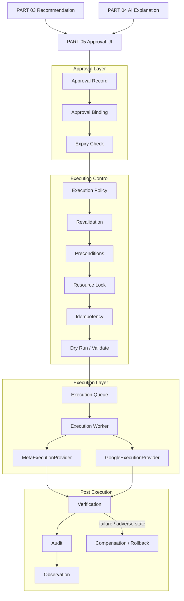
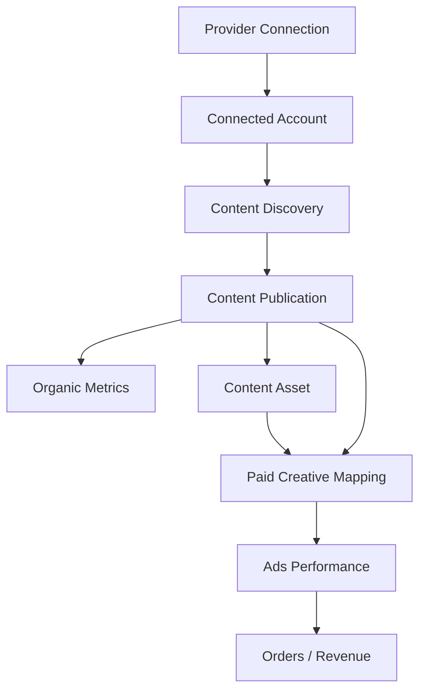
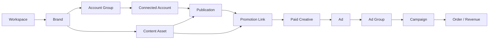
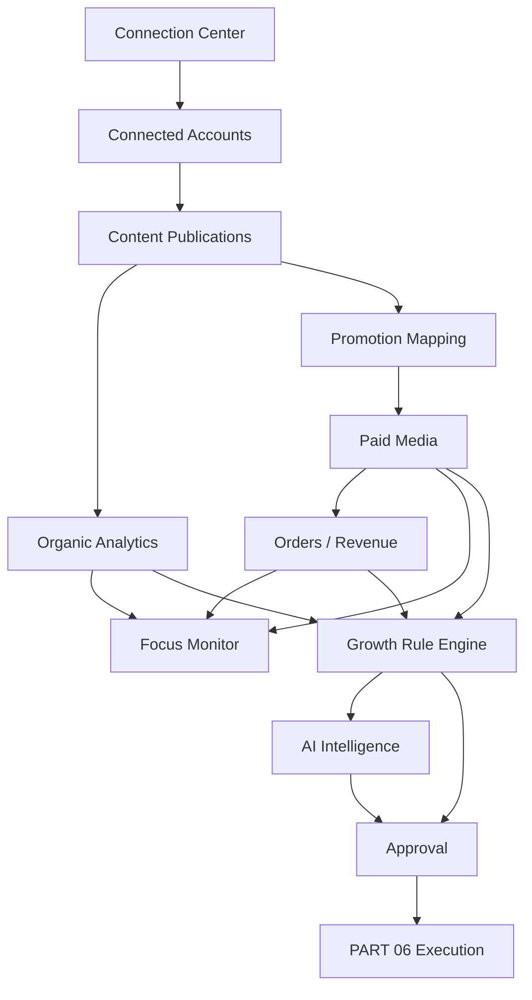
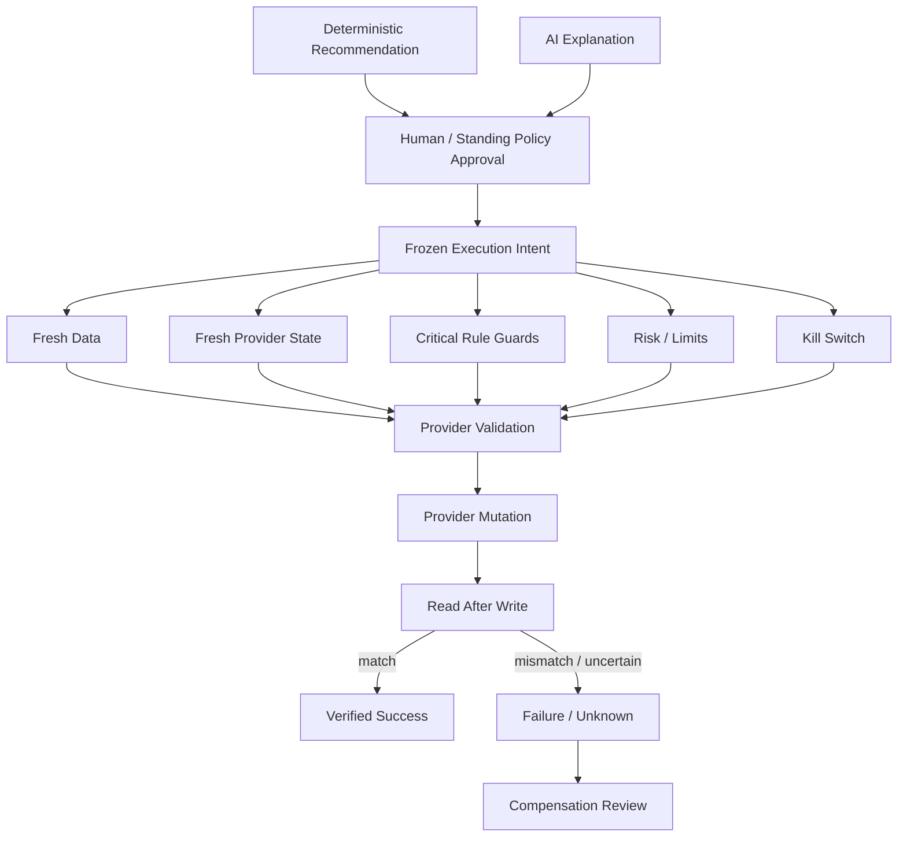

# AI DTC Growth Automation System

## PART 06-01 — Automation Execution + Multi-Account, Content Intelligence & Connection Center Enhancement

**Version:** V1.1 — 06-01 Integrated Enhancement  
**Status:** Ready for Codex Implementation  
**Baseline Date:** 2026-08-10  
**Target:** Codex Development Reference  

**Depends On:**  
- PART 01 — US Operation Environment  
- PART 02 — Data Architecture & API Integration  
- PART 03 — Growth Rule Engine  
- PART 04 — Multi-Agent AI Intelligence  
- PART 05 — Growth Dashboard & Product Experience  

**Next:** PART 07 — Codex Development, Deployment, Security & Production Hardening Specification

---


# 06-01 版本说明

本文件基于已完成的 PART 06 V1.0 做**增量整合**。

PART 06 原有的执行安全链、Approval、Revalidation、Idempotency、Kill Switch、Provider Mutation、Verification、Compensation 等架构全部保留。

本次 06-01 新增的核心能力是：

```text
Multi Workspace / Multi Brand
↓
Multi Platform
↓
Multiple Accounts per Platform
↓
Unified Account Scope
↓
Content Asset / Post / Video
↓
Organic Performance
+
Paid Promotion Performance
↓
Focused Monitoring / Watchlist
↓
Account / Content / Promotion Drilldown
↓
Connection Center / OAuth / API Capability Management
↓
Existing PART 06 Approval + Safe Execution
```

本次修改的目标不是把系统变成普通“社媒管理工具”，而是让它具备：

> **多账号、多内容、多投流对象、多视角统一切换和深度分析能力。**

同时保证：

> **账号连接管理、数据分析和广告执行是三个不同的安全边界。**

---

# 0. 文档目标

PART 01-05 已经完成：

```text
Environment
↓
Data
↓
Rules
↓
AI Intelligence
↓
Dashboard / Human Decision
```

PART 06 第一次允许系统：

> **对 Meta Ads / Google Ads 产生真实外部写操作。**

因此本 Part 是当前整个系统风险最高的一层。

核心原则：

> **Recommendation is not Execution. Approval is not Execution. Execution is a separate controlled transaction.**

必须经过：

```text
Recommendation
↓
Approval
↓
Approval Binding
↓
Approval Expiry Check
↓
Current State Re-fetch
↓
Revalidation
↓
Policy / Guardrail
↓
Dry-run / Validate where supported
↓
Execution Lock
↓
Provider Mutation
↓
Verification
↓
Audit
↓
Observation
↓
Compensation / Rollback if needed
```

任何 Agent、Rule、Dashboard 都不能绕过该链路。

---

# 1. 本阶段必须实现

1. Execution Intent
2. Approval Binding
3. Approval Expiry
4. Execution Policy Engine
5. Risk Classification
6. Revalidation Engine
7. Preconditions
8. Optimistic Concurrency
9. Per-resource Lock
10. Idempotency
11. Dry Run
12. Google validate_only support where available
13. Meta Mutation Adapter
14. Google Mutation Adapter
15. Budget Mutation
16. Status Pause / Enable Mutation
17. Google Negative Keyword Mutation
18. Execution Queue
19. Execution Worker
20. Verification
21. Compensation / Rollback
22. Kill Switch
23. Rate / Volume Limits
24. Change Cooldown
25. Approval Queue
26. Execution Audit
27. Execution History
28. Execution Health
29. Shadow / Preview Mode
30. Auto-execution Policy Framework
31. Unit Tests
32. Provider Sandbox / Test Validation where available
33. Golden Execution Scenarios
34. Codex Implementation Report

---

# 2. 本阶段明确禁止

第一版禁止：

```text
Delete campaigns
Delete ads
Delete ad accounts

Create arbitrary campaigns
Create arbitrary ad structures

Bulk audience mutation
Location targeting mutation
Demographic targeting mutation

Creative replacement without explicit workflow
Bid strategy migration
Conversion action mutation
Pixel / tracking mutation

Shopify product / price mutation
Shopify theme mutation

Unbounded budget increases

Agent directly calling provider mutation
Browser automation modifying Ads Manager UI
```

原则：

```text
API write > browser UI automation
```

正式广告执行只通过官方 API。

---

# 3. 当前官方 API 基线

截至 2026-08-10：

```text
Meta Marketing API:
v26.0

Google Ads API:
v25
```

必须继续：

```text
version configuration
Provider Adapter isolation
```

不得把版本散落在业务逻辑。

---

# 4. 官方能力边界

## Google Ads

Google Ads API 对资源修改使用：

```text
resource-specific mutate services
or
GoogleAdsService.Mutate
```

更新字段需要：

```text
FieldMask
```

部分 mutate 请求支持：

```text
validate_only
partial_failure
```

Campaign 状态可以通过 Campaign mutate 更新。

Campaign Budget 是独立 Resource。

其预算：

```text
amount_micros
```

并且 Budget 可能：

```text
shared by multiple campaigns
```

因此：

> 修改 Google CampaignBudget 前必须检查该 Budget 是否共享以及实际影响范围。

---

## Meta

Meta Marketing API 支持对：

```text
Campaign
Ad Set
Ad
```

等广告对象进行管理。

预算可能位于：

```text
Campaign level
or
Ad Set level
```

取决于 Campaign 配置。

系统不得假设：

```text
每个 Meta Campaign 的预算一定在 Ad Set
```

也不得假设：

```text
每个 Campaign 都是 Campaign-level budget
```

执行前必须查询当前实际 Budget Ownership。

---

# 5. Meta v26 Compatibility

Meta 当前基线：

```text
Marketing API v26.0
```

Meta 在此前版本已经推进统一的 Advantage+ campaign setup，并对 legacy ASC / AAC 产生迁移与兼容性变化。

Codex：

```text
不得实现 legacy ASC/AAC-specific mutation assumptions
```

如果 Provider 返回：

```text
unsupported legacy configuration
```

执行：

```text
BLOCK
REQUIRE_MANUAL_PLATFORM_REVIEW
```

---

# 6. Execution 总体架构



---

# 7. 硬性安全边界

系统必须在代码架构上保证：

```text
Agent
X
Provider Mutation
```

唯一允许路径：

```text
Recommendation
↓
Approval / Authorized Policy
↓
Execution Intent
↓
Execution Engine
↓
Provider Adapter
```

---

# 8. Execution Intent

Approval 之后生成：

```text
execution_intent
```

它是：

> 一次明确、冻结、可审计的拟执行动作。

创建：

```sql
execution_intents
```

字段：

```text
id UUID

workspace_id

recommendation_id
approval_id

provider
account_id

action_type

entity_type
entity_id
external_entity_id

requested_change JSONB

expected_before_state JSONB

expected_before_hash VARCHAR

risk_level

approval_required
approval_expires_at

execution_policy_version

status

idempotency_key

created_at
updated_at
```

---

# 9. Execution Intent 不可随意修改

Approval 后：

```text
requested_change
```

必须冻结。

如果：

```text
预算建议从 +10%
变成 +20%
```

必须：

```text
new recommendation
or
new approval
```

不能修改已有 Intent。

---

# 10. Approval Binding

Approval 必须绑定：

```text
Recommendation
Action
Entity
Current expected state
Proposed state
Risk
Expiry
```

例如：

```json
{
  "entity": "campaign_123",
  "action": "CHANGE_BUDGET",
  "before": 100,
  "after": 115,
  "currency": "USD"
}
```

不是：

```text
“批准 AI 优化 Meta”
```

这种模糊批准无效。

---

# 11. Approval Record

创建：

```sql
execution_approvals
```

字段：

```text
id

recommendation_id

approved_by
approved_at

action_type
entity_type
entity_id

approved_change

risk_level

expires_at

status

approval_hash

created_at
```

Status：

```text
PENDING
APPROVED
REJECTED
EXPIRED
REVOKED
CONSUMED
```

---

# 12. Single-use Approval

第一版：

```text
Approval = single-use
```

执行成功：

```text
CONSUMED
```

执行失败：

不允许自动无限重试导致多次写。

---

# 13. Approval Expiry

不同 Action：

不同 Expiry。

Seed：

```text
Budget change:
4h

Pause:
4h

Negative keyword:
24h
```

只是初始值。

配置化。

---

# 14. 为什么 Approval 必须过期

例如：

```text
09:00
ROAS = 5
系统建议 +20%

17:00
ROAS 已跌到 1.2
```

09:00 的 Approval：

不能继续执行。

---

# 15. Revalidation

Execution 前：

必须重新读取：

```text
Provider current state
PART 02 current data
PART 03 critical guards
```

---

# 16. Revalidation Checklist

每个执行至少检查：

```text
Approval valid
Recommendation not resolved/expired
Entity still exists
Entity status compatible
Current provider state matches expected state
Business target unchanged materially
Hard spend guard not active
Tracking anomaly not active
Data fresh
No critical data issue
No experiment protection conflict
No newer recommendation superseding this one
No conflicting execution in progress
Kill switch not active
```

---

# 17. Revalidation Result

统一：

```text
PASS
FAIL
REQUIRE_REAPPROVAL
NO_DECISION
```

---

# 18. State Drift

如果：

```text
expected budget = $100
current budget = $120
```

则：

```text
STATE_DRIFT
```

默认：

```text
DO NOT EXECUTE
```

需要：

```text
recompute recommendation
```

---

# 19. Optimistic Concurrency

每个 Intent 保存：

```text
expected_before_hash
```

Execution 时重新读取 Provider State：

计算：

```text
current_state_hash
```

如果不匹配：

```text
PRECONDITION_FAILED
```

---

# 20. 为什么不能 Blind Write

错误：

```text
AI approved:
budget → 120
```

然后直接：

```text
set budget = 120
```

可能覆盖：

```text
运营人员刚刚手工改成 150
```

正确：

```text
if current state == expected state:
  mutate
else:
  abort
```

---

# 21. Idempotency

Provider API 不一定提供统一的业务 Idempotency Key。

因此系统自己实现：

```text
idempotency_key
```

建议：

```text
hash(
  workspace
  provider
  entity
  action
  requested_change
  approval_id
)
```

---

# 22. Duplicate Execution

如果相同：

```text
idempotency_key
```

已有：

```text
SUCCESS
```

再次请求：

返回：

```text
ALREADY_EXECUTED
```

不能再次 Provider Mutation。

---

# 23. Unknown Outcome

最危险场景：

```text
Provider request timeout
```

但实际上 Provider 可能已经执行成功。

此时：

不能立即 Retry。

状态：

```text
UNKNOWN_PROVIDER_OUTCOME
```

流程：

```text
Read Provider State
↓
Compare desired state
↓
if matched:
  mark success
else:
  carefully retry if safe
```

---

# 24. Resource Lock

每个可写资源：

使用：

```text
Redis Lock
```

Key：

```text
execution:{provider}:{resource_id}
```

禁止同时：

```text
Budget +20%
Budget -20%
```

两个任务并发。

---

# 25. Hierarchical Lock

Google Shared Budget：

需要：

```text
budget resource lock
```

不是只锁 Campaign。

Meta Campaign-level Budget：

锁：

```text
campaign budget owner
```

---

# 26. Execution Queue

创建：

```text
execution_jobs
```

状态：

```text
PENDING_APPROVAL
APPROVED
REVALIDATING
VALIDATING_PROVIDER
QUEUED
RUNNING
VERIFYING
SUCCEEDED
FAILED
UNKNOWN
COMPENSATING
ROLLED_BACK
COMPENSATION_FAILED
BLOCKED
EXPIRED
CANCELLED
```

---

# 27. Execution Worker

独立：

```text
execution-worker
```

不要和：

```text
AI Worker
Browser Worker
Data Sync Worker
```

混用。

原因：

```text
权限
Secret
风险
扩缩容
Audit
```

不同。

---

# 28. Execution Worker Credential

Execution Worker 才拥有：

```text
Meta write credential
Google write credential
```

其他服务：

```text
read-only credential
```

优先分离。

---

# 29. Credential Least Privilege

如果 Provider 支持：

```text
read/write permission separation
```

采用分离。

至少架构上分：

```text
READ_CREDENTIAL_REFERENCE
WRITE_CREDENTIAL_REFERENCE
```

---

# 30. Execution Provider Interface

统一：

```python
class ExecutionProvider(Protocol):

    async def get_current_state(...): ...

    async def validate_operation(...): ...

    async def execute(...): ...

    async def verify(...): ...

    async def build_compensation(...): ...
```

实现：

```text
MetaExecutionProvider
GoogleExecutionProvider
MockExecutionProvider
```

---

# 31. Provider Operation Result

```text
provider_request_id
provider_resource
operation_type

before_state
requested_state
provider_response

status
error

executed_at
```

---

# 32. Action Registry

只有 Allowlist Action 能执行。

第一版：

```text
META_CHANGE_BUDGET
META_PAUSE_ENTITY
META_ENABLE_ENTITY

GOOGLE_CHANGE_BUDGET
GOOGLE_PAUSE_CAMPAIGN
GOOGLE_ENABLE_CAMPAIGN
GOOGLE_ADD_NEGATIVE_KEYWORD
GOOGLE_REMOVE_SYSTEM_NEGATIVE_KEYWORD
```

---

# 33. 不允许 Arbitrary Mutation

禁止：

```python
execute(provider, resource, fields: dict)
```

这种万能接口。

必须：

```text
typed action
typed schema
```

---

# 34. Action Schema

例如：

```python
class ChangeBudgetAction:
    entity_id: str
    current_budget: Decimal
    proposed_budget: Decimal
    currency: str
```

---

# 35. Action Risk Matrix

建议 Seed：

```text
META_CHANGE_BUDGET small:
MEDIUM

META_CHANGE_BUDGET large:
HIGH

META_PAUSE_ENTITY:
HIGH

META_ENABLE_ENTITY:
MEDIUM

GOOGLE_CHANGE_BUDGET:
MEDIUM/HIGH

GOOGLE_PAUSE_CAMPAIGN:
HIGH

GOOGLE_ADD_NEGATIVE_KEYWORD:
HIGH

GOOGLE_REMOVE_SYSTEM_NEGATIVE_KEYWORD:
MEDIUM
```

---

# 36. Risk 不等于可逆性

例如：

```text
Pause
```

API 上可以：

```text
Enable
```

但业务效果：

```text
delivery interruption
learning impact
auction re-entry
```

不能真正 Undo。

因此仍属于：

```text
HIGH
```

---

# 37. Execution Mode

系统支持：

```text
MODE_0_OBSERVE
MODE_1_MANUAL
MODE_2_GUARDED_AUTO
```

默认：

```text
MODE_1_MANUAL
```

---

# 38. MODE 0 — Observe

```text
Recommendation only
No execution intent
```

用于：

```text
初期验证
Shadow
```

---

# 39. MODE 1 — Manual

所有 External Mutation：

```text
Human approval required
```

系统可自动：

```text
revalidate
execute after approval
verify
audit
```

---

# 40. MODE 2 — Guarded Auto

只有明确：

```text
auto_execution_eligible = true
```

且：

```text
standing policy
risk ≤ allowed level
confidence ≥ threshold
guards pass
change within cap
```

才能不逐条人工批准。

第一版实现框架：

但：

```text
default disabled
```

---

# 41. Auto Execution 不等于 Agent 自主

即使 MODE 2：

执行触发仍来自：

```text
deterministic Rule Recommendation
+
Execution Policy
```

不是：

```text
LLM says scale
```

---

# 42. Auto Policy

创建：

```text
execution_policies
```

字段：

```text
id

workspace_id

provider
action_type

mode

max_risk_level

min_confidence

max_change_pct

max_actions_per_hour
max_actions_per_day

max_total_budget_change_pct_per_day

allowed_scope

require_fresh_data_minutes

cooldown_minutes

enabled

version

created_at
updated_at
```

---

# 43. Standing Approval

如果未来启用 Guarded Auto：

管理员可以批准：

```text
Policy
```

而不是批准：

```text
无限自动优化
```

例如：

```text
Meta budget increases
max +10%
only HIGH confidence
max 3 per day
campaign allowlist
```

---

# 44. Policy Version

每次修改：

```text
new version
```

Execution Job 保存：

```text
execution_policy_version
```

---

# 45. Change Size Guard

预算动作：

```text
delta_pct
```

例如：

```text
(current → proposed)
/
current
```

限制：

```text
max increase
max decrease
```

---

# 46. Daily Cumulative Change

不能：

```text
每小时 +10%
```

最终一天：

```text
翻倍
```

因此保存：

```text
cumulative_budget_change_today
```

---

# 47. Budget Change Daily Cap

Seed：

```text
per-action:
≤ 20%

daily cumulative:
≤ 30%
```

只是保守初值。

必须配置化。

---

# 48. Cooldown

预算变更后：

```text
cooldown
```

在 PART 03 已有规则层 Cooldown。

PART 06 再做执行层 Cooldown。

两层都必须满足。

---

# 49. Execution Cooldown

例如：

```text
same campaign budget:
no new budget mutation for 24h
```

除非：

```text
CRITICAL safety action
```

---

# 50. Rate / Volume Limit

Execution Engine 还要限制：

```text
max actions / hour
max actions / day
max affected campaigns / run
```

防止：

```text
规则 bug → 同时改 500 个 Campaign
```


# 51. Global Kill Switch

必须实现：

```text
GLOBAL_EXECUTION_KILL_SWITCH
```

状态：

```text
ON / OFF
```

一旦 ON：

```text
no external mutations
```

仍允许：

```text
data sync
rule evaluation
AI analysis
dashboard
```

---

# 52. Scoped Kill Switch

支持：

```text
Provider
Account
Action Type
Campaign
```

例如：

```text
Disable all Google negative keyword executions
```

不影响：

```text
Meta budget actions
```

---

# 53. Kill Switch 权限

只能：

```text
ADMIN
```

启用 / 关闭。

启用：

立即生效。

关闭：

建议：

```text
two-step confirmation
```

---

# 54. Emergency Stop

如果：

```text
execution failure spike
unexpected provider behavior
schema drift
auth anomaly
```

系统自动：

```text
AUTO_KILL_SWITCH
```

第一版可以配置：

```text
failure rate threshold
```

---

# 55. Meta Execution Adapter

目录：

```text
backend/app/execution/providers/meta/
```

结构：

```text
meta/
├── provider.py
├── client.py
├── schemas.py
├── budget.py
├── status.py
├── verifier.py
├── compensation.py
└── exceptions.py
```

---

# 56. Meta Current State

执行前读取：

```text
entity id
status
effective_status
budget
budget owner
campaign/adset relationship
updated_time if available
```

---

# 57. Meta Budget Ownership

必须确定：

```text
Campaign-level budget
or
Ad Set-level budget
```

Execution Intent 必须绑定：

```text
actual writable budget resource
```

而不是抽象：

```text
Campaign X budget
```

---

# 58. Meta Budget Change

输入：

```text
budget owner
current budget
proposed budget
currency
```

执行前：

```text
min/max
scope
cooldown
hard cap
```

全部验证。

---

# 59. Meta Status Change

第一版支持：

```text
PAUSE
ENABLE/ACTIVE where supported
```

Target：

```text
Campaign
AdSet
Ad
```

但：

不同 Entity：

必须使用独立 typed action。

---

# 60. Meta Pause Rule

Pause 前：

检查：

```text
entity currently active-compatible
not already paused
no active conflicting experiment
approval valid
```

如果已经：

```text
PAUSED
```

则：

```text
NOOP_SUCCESS
```

而不是再次写。

---

# 61. Meta Enable

Enable 前：

必须检查：

```text
parent campaign active
account valid
entity not deleted/archived
budget valid
```

如果上级停用：

不能声称：

```text
ad enabled successfully
```

只看 API 字段。

Verification 要检查：

```text
effective status
```

---

# 62. Meta Mutation Verification

Provider 返回 success：

不代表业务状态已完全生效。

至少：

```text
re-read object
```

检查：

```text
requested field value
```

并保存：

```text
effective_status if relevant
```

---

# 63. Meta Retry

只有：

```text
known safe transient failure
```

才 Retry。

Timeout：

先：

```text
read state
```

判断是否已经执行。

---

# 64. Meta Compensation

Budget：

```text
change back to previous value
```

Status：

```text
re-enable / re-pause
```

注意：

> 这是补偿动作，不是真正事务 Rollback。

平台学习、竞价和 Delivery 历史不能还原。

---

# 65. Meta Unsupported Action

如果当前 Campaign 类型 / API 版本：

不支持某字段 Mutation：

```text
BLOCKED_PROVIDER_UNSUPPORTED
```

不能：

```text
fallback to browser click
```

---

# 66. Google Execution Adapter

目录：

```text
backend/app/execution/providers/google_ads/
```

结构：

```text
google_ads/
├── provider.py
├── client.py
├── schemas.py
├── campaign.py
├── budget.py
├── negative_keyword.py
├── validate.py
├── verifier.py
├── compensation.py
└── exceptions.py
```

---

# 67. Google Field Mask

Google Ads Update：

必须明确：

```text
FieldMask
```

只写需要修改字段。

例如：

Campaign status：

```text
update_mask = status
```

CampaignBudget：

```text
update_mask = amount_micros
```

禁止：

```text
all fields update
```

除非官方 SDK helper 明确只包含期望字段且已测试。

---

# 68. Google validate_only

如果具体 mutate resource 支持：

先：

```text
validate_only = true
```

进行 Provider-side Validation。

通过后：

才执行真实 mutate。

如果该资源不支持：

记录：

```text
provider_validate_supported = false
```

走本地 Revalidation。

---

# 69. Google partial_failure

第一版执行高风险操作时：

建议：

```text
partial_failure = false
```

即：

```text
all-or-error
```

因为我们倾向：

```text
one execution intent
one logical action
```

如果未来 Batch：

必须显式设计 Partial Failure reconciliation。

---

# 70. Google Campaign Pause

使用：

```text
Campaign mutation
status = PAUSED
FieldMask(status)
```

执行后：

重新 Query：

```text
campaign.status
```

验证。

---

# 71. Google Campaign Enable

设置：

```text
ENABLED
```

前提：

```text
campaign resource supports current transition
```

并检查：

```text
budget
dates
account
```

---

# 72. Google Campaign Budget

Google Budget 是独立 Resource。

预算字段：

```text
amount_micros
```

单位：

```text
1 currency unit = 1,000,000 micros
```

所有 Decimal → micros：

使用：

```text
Decimal
```

禁止 Float。

---

# 73. Shared Budget Guard

这是 Google 执行层最重要的特殊 Guard。

读取：

```text
CampaignBudget.explicitly_shared
reference_count
```

或对应当前 API 可用字段。

如果：

```text
shared by multiple campaigns
```

预算改动会影响多个 Campaign。

默认：

```text
BLOCK
```

除非 Execution Intent：

明确列出：

```text
affected campaigns
```

且风险升级。

---

# 74. Shared Budget Risk

Shared Budget Change：

默认：

```text
HIGH
```

即使：

```text
+5%
```

因为 Scope 更大。

---

# 75. Google Budget Preconditions

检查：

```text
resource_name
currency
amount_micros
period
shared scope
reference count
```

如果 Budget：

```text
CUSTOM_PERIOD / total amount
```

不能套普通：

```text
daily budget change
```

规则。

---

# 76. Google Negative Keyword

第一版支持：

```text
Add Negative Keyword
```

来源只能是：

```text
PART 03 approved candidate
```

并且必须有：

```text
keyword text
match type
scope
campaign/ad group/shared set
```

---

# 77. Negative Keyword Scope

需要显式区分：

```text
Ad Group level
Campaign level
Shared Set
Account-level list where supported
PMax campaign-level where supported
```

不能系统自己猜 Scope。

---

# 78. Negative Keyword Default Risk

```text
HIGH
```

原因：

它可能阻止未来有效搜索流量。

---

# 79. Negative Keyword Preconditions

执行前：

```text
candidate still approved
search term still relevant
same keyword not already excluded
no conflicting positive strategy
scope valid
match type valid
campaign type supports it
```

---

# 80. Negative Keyword Match Type

必须保留：

```text
EXACT
PHRASE
BROAD
```

等当前 Provider 支持定义。

用户批准：

要看到：

```text
keyword
match type
scope
```

---

# 81. PMax Negative Keywords

截至当前 Google Ads API 已支持 Performance Max Campaign negative keywords。

但：

系统必须根据：

```text
current v25 capability
campaign type
criterion rules
```

动态验证。

禁止把 Search Campaign negative keyword implementation：

直接复用到 PMax 而不检查。

---

# 82. Negative Keyword Verification

执行后：

读取：

```text
criterion/shared set
```

确认：

```text
keyword
negative flag
match type
scope
```

---

# 83. Negative Keyword Compensation

如果本系统刚刚添加：

可以：

```text
remove exact created criterion
```

Execution Record 保存：

```text
provider_resource_name
```

用于补偿。

---

# 84. 禁止删除非系统创建的否词

Rollback：

只能默认删除：

```text
created_by_this_execution
```

不能：

```text
按文本搜索然后删除所有同名 negative
```

---

# 85. Execution Preflight

统一流程：

```text
Local Validation
↓
Provider Current State
↓
Provider Validation
↓
Execution
```

---

# 86. Preflight Result

```text
PASS
BLOCK
REAPPROVAL
NOOP
```

---

# 87. NOOP

例如：

```text
Approve Pause
```

但执行前：

人工已经 Pause。

则：

```text
NOOP
```

不是：

```text
FAILED
```

记录：

```text
desired state already satisfied
```

---

# 88. Execution Policy Decision

结构：

```json
{
  "allowed": true,
  "risk": "MEDIUM",
  "requires_approval": true,
  "approval_valid": true,
  "max_change_pct": 20,
  "cooldown_ok": true,
  "kill_switch": false,
  "reasons": []
}
```

---

# 89. Policy Denial

保存：

```text
policy_reason_codes
```

例如：

```text
KILL_SWITCH_ACTIVE
APPROVAL_EXPIRED
STATE_DRIFT
CHANGE_TOO_LARGE
DAILY_CAP_EXCEEDED
SHARED_BUDGET_UNAPPROVED
DATA_STALE
TRACKING_ANOMALY
EXPERIMENT_PROTECTED
ACTION_NOT_ALLOWLISTED
LOW_CONFIDENCE
```

---

# 90. Execution Audit

创建：

```text
execution_audits
```

保存：

```text
recommendation
approval
intent
policy
revalidation
before state
provider request
provider response
after state
verification
compensation
actor
timestamps
```

---

# 91. Audit Immutability

Execution Audit：

原则上：

```text
append-only
```

不要：

```text
UPDATE old audit to hide error
```

---

# 92. Sensitive Redaction

Audit 不保存：

```text
access token
authorization header
service account secret
```

Provider Response：

做：

```text
redaction
```

---

# 93. Execution Event

创建：

```text
execution_events
```

事件：

```text
INTENT_CREATED
APPROVED
REVALIDATION_STARTED
REVALIDATION_FAILED
QUEUED
EXECUTION_STARTED
PROVIDER_REQUEST_SENT
PROVIDER_RESPONSE
VERIFY_STARTED
VERIFIED
FAILED
COMPENSATION_STARTED
ROLLED_BACK
```

---

# 94. Timeline

PART 05 UI 可以直接读取：

```text
execution_events
```

显示执行时间线。

---

# 95. Verification

Verification 必须是：

```text
Provider Read-after-write
```

不能只看：

```text
HTTP 200
```

---

# 96. Verification Result

```text
MATCHED
MISMATCHED
PENDING
UNAVAILABLE
```

---

# 97. Eventual Consistency

Provider 状态可能：

```text
短时间延迟
```

Verification：

允许：

```text
small bounded retry
```

例如：

```text
2s
5s
10s
```

配置化。

不能无限等待。

---

# 98. Verification Failure

如果 Mutation response success：

但 Re-read 不匹配：

```text
EXECUTION_VERIFICATION_FAILED
```

进入：

```text
Manual Review
```

或安全 Compensation。

---

# 99. Compensation vs Rollback

命名建议：

技术层优先使用：

```text
Compensation
```

因为外部广告平台：

不是数据库事务。

---

# 100. Compensation Eligibility

动作分类：

```text
COMPENSATABLE
PARTIALLY_COMPENSATABLE
NON_COMPENSATABLE
```

---

# 101. Budget Change

```text
COMPENSATABLE
```

可以设置回旧预算。

但业务效果：

```text
not fully reversible
```

---

# 102. Pause

```text
PARTIALLY_COMPENSATABLE
```

可以重新 Enable。

但：

```text
delivery interruption
learning
auction effects
```

无法还原。

---

# 103. Negative Keyword Add

```text
COMPENSATABLE
```

如果：

```text
由本系统创建并记录 resource id
```

可 Remove。

---

# 104. Auto Compensation

第一版：

默认：

```text
OFF
```

除非：

```text
provider write succeeded
verification mismatch
and
known-safe compensation
```

建议仍：

```text
human review
```

---

# 105. Compensation Policy

创建：

```text
compensation_policy
```

例如：

```text
budget:
manual

negative keyword newly-created:
manual

status:
manual
```

先稳。

---

# 106. Rollback Plan

Approval Packet：

提前显示：

```text
rollback / compensation plan
```

例如：

```text
Budget:
restore $100

Pause:
set ENABLED

Negative:
remove criterion resource xyz
```

---

# 107. Post-execution Observation

执行后：

进入：

```text
observation window
```

不要立刻再执行反方向动作。

---

# 108. Observation Window

例如：

```text
budget:
24h

status:
12-24h
```

Seed。

---

# 109. Execution Feedback Loop

```text
Execution
↓
Observation
↓
Performance
↓
Rule Engine
↓
Outcome Label
```

后续评估：

```text
Was action followed by desired signal?
```

但不要轻易做因果结论。

---

# 110. Execution Outcome

创建：

```text
execution_outcomes
```

字段：

```text
execution_id

observation_start
observation_end

before_metrics
after_metrics

expected_signal
observed_signal

outcome_label

notes
```

Label：

```text
IMPROVED
DEGRADED
MIXED
NO_CLEAR_SIGNAL
INSUFFICIENT_DATA
```

不叫：

```text
CAUSED_IMPROVEMENT
```

---

# 111. Auto Execution Eligibility

Rule Recommendation 中已有：

```text
auto_execution_eligible
```

PART 06 再检查：

```text
Action allowlist
Policy mode
Risk
Confidence
Scope
Daily limits
Freshness
State
```

---

# 112. Eligible Actions V1

即使 Guarded Auto 框架存在：

第一版建议：

```text
no external advertising actions auto-enabled by default
```

实际上线：

先跑：

```text
MODE_1_MANUAL
```

一段时间。

---

# 113. Auto Enable Process

如果未来打开：

```text
Shadow execution
↓
Manual approval history
↓
False positive review
↓
Policy proposal
↓
Admin standing approval
↓
Canary scope
↓
Guarded auto
```

---

# 114. Shadow Execution

系统模拟：

```text
would execute
```

但不调用 Provider。

保存：

```text
shadow_execution_jobs
```

用于验证：

```text
多少动作
哪些 Campaign
变更幅度
风险
```

---

# 115. Canary

Guarded Auto 首先：

```text
campaign allowlist
```

例如：

```text
1-2 low-risk campaigns
```

不能全账户直接打开。

---

# 116. Blast Radius

每个 Intent 计算：

```text
blast_radius
```

考虑：

```text
affected campaigns
daily spend
revenue exposure
shared resources
traffic share
```

---

# 117. Blast Radius Level

```text
SMALL
MEDIUM
LARGE
ACCOUNT_WIDE
```

Risk Classifier：

结合：

```text
action risk + blast radius
```

---

# 118. Two-person Approval

对：

```text
CRITICAL
ACCOUNT_WIDE
large budget
shared budget
```

预留：

```text
two_person_approval
```

第一版可配置关闭。

---

# 119. Two-person Rule

如果开启：

```text
Approver A != Approver B
```

才能执行。

---

# 120. Self-approval Guard

如果 Recommendation：

由某个用户手工创建：

可配置禁止：

```text
same user approve high-risk action
```

企业级预留。


# 121. Execution Console

PART 05 的 Recommendations 页面扩展：

```text
Approval Queue
Execution Queue
Execution History
Kill Switch
Policies
```

---

# 122. Approval Queue

字段：

```text
Recommendation
Provider
Entity
Action
Current
Proposed
Risk
Confidence
Expires
Approver
```

---

# 123. Approval Detail

必须显示：

```text
Why
Rule Evidence
AI Explanation

Current Provider State
Proposed State

Risk
Blast Radius

Guard Status
Data Freshness

Approval Expiry
Compensation Plan
```

---

# 124. Approve UX

高风险动作：

不能只有：

```text
[Approve]
```

需要确认：

```text
I understand this will change live advertising.
```

但不要设计成繁琐到运营完全不用。

---

# 125. Budget Change Preview

显示：

```text
Current Daily Budget:
$100

Proposed:
$115

Change:
+15%

Daily Change Already Applied:
+10%

Max Daily Cumulative:
30%
```

---

# 126. Shared Budget Warning

Google：

如果 Shared：

显著显示：

```text
SHARED BUDGET
This change affects 3 campaigns.
```

列出：

```text
affected campaigns
```

---

# 127. Pause Preview

显示：

```text
Entity
Current Status
Spend Today
Orders Today
Reason
```

并提示：

```text
Re-enabling later does not fully undo delivery / learning effects.
```

---

# 128. Negative Keyword Preview

显示：

```text
Keyword
Match Type
Scope
Campaign
Recent Spend
Conversions
Semantic Classification
```

---

# 129. Execution Queue UI

字段：

```text
Action
Provider
Entity
State
Approved By
Revalidation
Execution
Verification
Created
```

---

# 130. Execution Detail

Timeline：

```text
Recommendation
Approval
Revalidation
Provider Validation
Execution
Verification
Observation
Compensation
```

---

# 131. Kill Switch UI

顶部显著：

```text
Execution Enabled
```

或：

```text
EXECUTION KILL SWITCH ACTIVE
```

不能藏在 Settings 最深处。

---

# 132. Global Kill Switch Confirmation

Enable Kill Switch：

```text
one-click emergency
```

关闭：

```text
confirmation + permission
```

---

# 133. Policy UI

Admin：

可以看：

```text
Execution Mode
Allowed Actions
Max Change
Max Actions
Cooldown
Confidence
Canary Scope
```

---

# 134. Default Product State

正式部署第一天：

```text
MODE_1_MANUAL
AUTO EXECUTION DISABLED
```

这是硬性默认。

---

# 135. Execution API

新增：

```http
GET /api/v1/execution/intents
GET /api/v1/execution/intents/{id}

POST /api/v1/execution/intents/{id}/approve
POST /api/v1/execution/intents/{id}/reject
POST /api/v1/execution/intents/{id}/cancel

POST /api/v1/execution/intents/{id}/revalidate
POST /api/v1/execution/intents/{id}/execute
```

---

# 136. Approval API

```http
GET /api/v1/execution/approvals
GET /api/v1/execution/approvals/{id}

POST /api/v1/execution/approvals/{id}/revoke
```

---

# 137. Job API

```http
GET /api/v1/execution/jobs
GET /api/v1/execution/jobs/{id}

POST /api/v1/execution/jobs/{id}/retry
POST /api/v1/execution/jobs/{id}/compensate
```

Retry / Compensate：

必须有权限。

---

# 138. Kill Switch API

```http
GET /api/v1/execution/kill-switches

POST /api/v1/execution/kill-switches/global/enable
POST /api/v1/execution/kill-switches/global/disable

POST /api/v1/execution/kill-switches/provider/{provider}/enable
POST /api/v1/execution/kill-switches/provider/{provider}/disable
```

---

# 139. Policy API

```http
GET /api/v1/execution/policies
GET /api/v1/execution/policies/{id}

POST /api/v1/execution/policies
PUT /api/v1/execution/policies/{id}
```

Admin only。

---

# 140. Dry Run API

```http
POST /api/v1/execution/intents/{id}/dry-run
```

输出：

```text
current state
policy result
revalidation
provider validation
would execute
```

不写 Provider。

---

# 141. Preview API

Recommendation 可以：

```http
POST /api/v1/recommendations/{id}/execution-preview
```

创建：

```text
preview
```

不创建真正执行 Job。

---

# 142. Execution Request Security

Frontend 不允许：

```text
传 arbitrary proposed budget
```

执行接口只接受：

```text
intent_id
```

服务器从冻结 Intent 读取动作。

---

# 143. Approval Security

同样：

```text
Approve Intent
```

不是：

```text
Approve arbitrary payload
```

---

# 144. CSRF / Authentication

所有写接口：

必须遵循项目认证机制。

如果 Cookie Session：

需要：

```text
CSRF protection
```

如果 Bearer：

按当前架构。

---

# 145. RBAC

角色：

```text
VIEWER
ANALYST
OPERATOR
ADMIN
```

Execution：

```text
VIEWER:
no approval

ANALYST:
no live approval by default

OPERATOR:
approve medium/high within policy

ADMIN:
policy / kill switch / high risk
```

---

# 146. Execution-specific Permission

建议进一步：

```text
EXECUTION_APPROVE
EXECUTION_HIGH_RISK_APPROVE
EXECUTION_COMPENSATE
EXECUTION_POLICY_ADMIN
EXECUTION_KILL_SWITCH
```

不要只靠角色名称。

---

# 147. Database Tables

至少新增：

```text
execution_intents
execution_approvals
execution_jobs
execution_events
execution_audits

execution_policies
execution_kill_switches

execution_outcomes
execution_compensations

execution_resource_locks optional persistence
```

---

# 148. execution_jobs Schema

```text
id

intent_id
approval_id

provider

action_type

entity_type
entity_id
external_entity_id

status

attempt

provider_request_id
provider_resource_name

before_state
requested_state
after_state

revalidation_result
provider_validation_result
verification_result

error_code
error_message

started_at
finished_at

created_at
updated_at
```

---

# 149. execution_compensations

字段：

```text
id

execution_job_id

compensation_type

before_state
target_state

status

approved_by

provider_request_id

started_at
finished_at

error

created_at
```

---

# 150. execution_kill_switches

字段：

```text
id

scope_type
scope_id

enabled

reason

activated_by
activated_at

deactivated_by
deactivated_at

created_at
updated_at
```

Scope：

```text
GLOBAL
PROVIDER
ACCOUNT
ACTION
ENTITY
```

---

# 151. Secret Architecture

新增：

```text
META_WRITE_CREDENTIAL_REFERENCE
GOOGLE_ADS_WRITE_CREDENTIAL_REFERENCE
```

不要与读 Credential 随意复用。

---

# 152. Environment Variables

`.env.example` 增加：

```env
# ------------------------------------------------
# Execution
# ------------------------------------------------

EXECUTION_ENABLED=true

EXECUTION_MODE=manual

EXECUTION_GLOBAL_KILL_SWITCH=false

EXECUTION_MAX_ACTIONS_PER_HOUR=10
EXECUTION_MAX_ACTIONS_PER_DAY=30

EXECUTION_DEFAULT_APPROVAL_EXPIRY_HOURS=4

EXECUTION_MAX_BUDGET_INCREASE_PCT=20
EXECUTION_MAX_BUDGET_DECREASE_PCT=20
EXECUTION_MAX_DAILY_CUMULATIVE_BUDGET_CHANGE_PCT=30

EXECUTION_DEFAULT_COOLDOWN_HOURS=24

EXECUTION_AUTO_COMPENSATION=false

EXECUTION_TWO_PERSON_APPROVAL=false

EXECUTION_SHADOW_MODE=false

# ------------------------------------------------
# Meta Write
# ------------------------------------------------

META_WRITE_ENABLED=false
META_WRITE_CREDENTIAL_REFERENCE=

# ------------------------------------------------
# Google Ads Write
# ------------------------------------------------

GOOGLE_ADS_WRITE_ENABLED=false
GOOGLE_ADS_WRITE_CREDENTIAL_REFERENCE=

GOOGLE_ADS_VALIDATE_ONLY_FIRST=true
GOOGLE_ADS_PARTIAL_FAILURE=false
```

---

# 153. Config vs Env

这些：

```text
action thresholds
campaign allowlists
provider policies
```

应进入：

```text
database execution_policies
```

而不是全塞 `.env`。

---

# 154. Execution Error Codes

统一：

```text
EXECUTION_DISABLED
KILL_SWITCH_ACTIVE

APPROVAL_REQUIRED
APPROVAL_EXPIRED
APPROVAL_REVOKED
APPROVAL_MISMATCH

ACTION_NOT_ALLOWED
ACTION_RISK_TOO_HIGH

STATE_DRIFT
PRECONDITION_FAILED
RESOURCE_LOCKED

DATA_STALE
TRACKING_ANOMALY_ACTIVE
EXPERIMENT_PROTECTED

CHANGE_LIMIT_EXCEEDED
DAILY_CUMULATIVE_LIMIT_EXCEEDED
RATE_LIMIT_EXCEEDED

SHARED_BUDGET_SCOPE_UNAPPROVED

PROVIDER_VALIDATE_FAILED
PROVIDER_MUTATION_FAILED
PROVIDER_TIMEOUT
PROVIDER_OUTCOME_UNKNOWN

VERIFICATION_FAILED

COMPENSATION_FAILED

UNSUPPORTED_PROVIDER_CONFIGURATION
```

---

# 155. Provider Error Mapping

Meta / Google 原始错误：

保存：

```text
provider_error_code
provider_error_message
provider_request_id
```

用户 UI：

显示安全说明。

---

# 156. Provider Request ID

如果 Provider 返回：

```text
request ID / trace ID
```

必须保存。

便于：

```text
support
debug
audit
```

---

# 157. Structured Logging

示例：

```json
{
  "service": "execution-worker",
  "execution_id": "...",
  "provider": "GOOGLE_ADS",
  "action": "CHANGE_BUDGET",
  "entity_id": "...",
  "event": "PROVIDER_MUTATION",
  "status": "SUCCESS",
  "duration_ms": 870
}
```

---

# 158. Log Redaction

禁止：

```text
token
auth header
service account private key
proxy password
customer PII
```

---

# 159. Observability

至少：

```text
execution_jobs_total
execution_success_total
execution_failed_total

execution_unknown_outcome_total

verification_failure_total

compensation_total
compensation_failure_total

policy_block_total
approval_expired_total

kill_switch_activation_total

execution_latency_p50
execution_latency_p95

provider_mutation_error_rate
```

---

# 160. Safety SLO

建议：

```text
Duplicate live mutation:
0

Unauthorized mutation:
0

Execution without valid approval/policy:
0

Unverified successful mutation:
0
```

这是硬性质量目标。

---

# 161. Auto Kill Trigger

例如：

```text
verification failure rate > configured threshold
```

或：

```text
3 unknown outcomes in 10m
```

系统：

```text
activate scoped/provider kill switch
```

---

# 162. Health Endpoint

```http
GET /api/v1/execution/health
```

返回：

```text
execution enabled
mode

global kill switch

Meta write health
Google write health

queue
failure rate
unknown outcomes

pending approvals
```

---

# 163. Execution Worker Isolation

部署：

```text
execution-worker
```

独立容器 / process。

建议：

```text
concurrency low
```

Seed：

```text
1-4
```

不是高吞吐服务。

---

# 164. Queue

Redis / Celery：

独立：

```text
queue:execution
queue:compensation
```

---

# 165. Priority

```text
P0 Emergency safety
P1 Approved manual action
P2 Guarded auto
P3 Compensation
```

Compensation priority可按策略提高。

---

# 166. No Batch by Default

第一版：

```text
one Intent
one logical action
```

即使 Provider 支持 Batch。

理由：

```text
audit
verification
rollback
blast radius
```

更容易控制。

---

# 167. Future Batch

未来才支持：

```text
Batch Action Group
```

必须：

```text
group approval
individual operation status
partial failure handling
```

---

# 168. Execution Group

Schema 预留：

```text
execution_group_id
```

例如：

```text
scale 3 campaigns
```

第一版仍拆 Job。

---

# 169. Provider Rate Limit

执行层也要：

```text
rate limit aware
```

Google mutate 算 API operations。

Meta 也有应用/账户调用限制。

不要因为队列堆积快速爆发写请求。

---

# 170. Provider Health Block

如果 Write Provider：

```text
AUTH_ERROR
RATE_LIMITED
DEGRADED
```

Policy：

可阻止新执行。

---

# 171. Manual Provider Change Detection

系统外：

运营可能在 Ads Manager 手工改。

PART 02 Sync：

检测：

```text
state changed
```

写：

```text
entity_change_events
source = EXTERNAL_MANUAL
```

---

# 172. External Change Effect

如果 Approval 后出现：

```text
manual change
```

Execution Revalidation：

通常：

```text
STATE_DRIFT
REQUIRE_REAPPROVAL
```

---

# 173. Execution Change Event

系统执行成功：

也写：

```text
entity_change_events
source = SYSTEM_EXECUTION
execution_id
```

供 PART 03 Cooldown。

---

# 174. Feedback Loop

这样形成：

```text
Execution
↓
Entity Change Event
↓
Rule Cooldown
↓
No immediate counter-action
```

---

# 175. Approval Notification

产生 Approval：

通知：

```text
In-app
```

后续可：

```text
Email / Feishu
```

包含：

```text
action
risk
expiry
```

不要直接在通知内容放：

```text
Approve URL with insecure token
```

---

# 176. Expired Approval Notification

如果：

```text
critical recommendation
```

Approval 过期：

可以通知：

```text
Recommendation needs re-evaluation
```

不自动重新审批。

---

# 177. Execution Result Notification

通知：

```text
Succeeded
Failed
Verification failed
Compensation required
Kill switch activated
```

---

# 178. Audit UI

Admin / Operator：

可以按：

```text
date
provider
action
campaign
approver
status
```

搜索。

---

# 179. Outcome UI

执行 24h 后：

显示：

```text
Observed metrics after action
```

但文案：

```text
Observed after execution
```

不是：

```text
Impact caused by execution
```

---

# 180. Golden Scenario Tests

至少：

```text
meta_budget_change_success
meta_budget_state_drift
meta_pause_success
meta_pause_already_paused
meta_timeout_unknown_outcome

google_budget_change_success
google_shared_budget_block
google_shared_budget_explicit_approval

google_pause_success

google_negative_keyword_success
google_negative_keyword_duplicate_noop
google_negative_keyword_wrong_scope_block

approval_expired
approval_payload_mismatch

kill_switch_block

daily_change_limit_block
cooldown_block

tracking_anomaly_block

experiment_protection_block

provider_validate_fail

verification_fail

compensation_budget
compensation_negative_keyword

manual_external_change_drift

duplicate_idempotency
```

---

# 181. Unit Tests

覆盖：

```text
Approval binding
Approval hash
Approval expiry

Idempotency key

State hashing

Risk classifier
Blast radius

Budget decimal/micros

Change percentage

Daily cumulative limits

Policy evaluation

Kill switch

Lock

Preconditions

Compensation builder
```

---

# 182. Integration Tests

Mock Provider：

完整：

```text
Recommendation
↓
Approval
↓
Intent
↓
Revalidate
↓
Execute
↓
Verify
↓
Audit
```

---

# 183. Google validate_only Test

Mock / Live test account：

确认：

```text
validate request
```

不会产生实际修改。

然后：

真实 test action：

需显式环境开关。

---

# 184. Live Write Test Safety

默认 CI：

```text
NO LIVE WRITE
```

Live write test 只能：

```text
explicit manual command
test account
allowlisted resource
```

---

# 185. Live Test Env

例如：

```env
ALLOW_LIVE_EXECUTION_TESTS=false
```

必须显式：

```text
true
```

并配置：

```text
test account
```

---

# 186. Production Guard

如果：

```text
ENV=production
```

且：

```text
ALLOW_LIVE_EXECUTION_TESTS=true
```

测试命令应拒绝运行。

---

# 187. Smoke Test

提供：

```bash
make smoke-execution
```

默认使用：

```text
MockExecutionProvider
```

输出：

```text
Execution DB                PASS
Approval Binding            PASS
Approval Expiry             PASS

Policy Engine               PASS
Kill Switch                 PASS

Revalidation                PASS
State Drift                 PASS
Idempotency                 PASS
Resource Lock               PASS

Mock Meta Budget            PASS
Mock Meta Pause             PASS

Mock Google Budget          PASS
Shared Budget Guard         PASS

Mock Google Negative        PASS

Verification                PASS
Compensation                PASS

Audit                       PASS
Unknown Outcome             PASS
```

---

# 188. Dry Run Command

```bash
make execution-dry-run INTENT_ID=...
```

---

# 189. Shadow Command

```bash
make execution-shadow DAYS=7
```

输出：

```text
would execute count
action distribution
affected spend
blocked actions
risk distribution
```

---

# 190. Kill Switch Command

Admin-only tooling：

```bash
make execution-kill-switch-on
```

关闭：

建议不提供轻易 CLI。

或需要：

```text
confirmation token
```

---

# 191. Repository Structure

新增：

```text
backend/app/
│
├── execution/
│   ├── engine.py
│   ├── intents.py
│   ├── approvals.py
│   ├── policies.py
│   ├── revalidation.py
│   ├── preconditions.py
│   ├── idempotency.py
│   ├── locks.py
│   ├── risk.py
│   ├── blast_radius.py
│   ├── verification.py
│   ├── compensation.py
│   ├── kill_switch.py
│   ├── outcomes.py
│   │
│   ├── actions/
│   │   ├── base.py
│   │   ├── budget.py
│   │   ├── status.py
│   │   └── negative_keyword.py
│   │
│   └── providers/
│       ├── base.py
│       ├── mock.py
│       ├── meta/
│       │   ├── provider.py
│       │   ├── budget.py
│       │   ├── status.py
│       │   ├── verifier.py
│       │   └── compensation.py
│       └── google_ads/
│           ├── provider.py
│           ├── budget.py
│           ├── campaign.py
│           ├── negative_keyword.py
│           ├── validate.py
│           ├── verifier.py
│           └── compensation.py
│
├── models/
│   ├── execution_intent.py
│   ├── execution_approval.py
│   ├── execution_job.py
│   ├── execution_event.py
│   ├── execution_policy.py
│   ├── execution_kill_switch.py
│   └── execution_outcome.py
│
├── api/v1/
│   ├── execution_intents.py
│   ├── execution_jobs.py
│   ├── execution_policies.py
│   └── execution_health.py
│
└── workers/
    ├── execution_tasks.py
    └── compensation_tasks.py
```

---

# 192. Frontend Extension

PART 05 增加：

```text
frontend/src/pages/execution/
├── ApprovalQueue.tsx
├── ExecutionQueue.tsx
├── ExecutionDetail.tsx
├── ExecutionPolicies.tsx
└── KillSwitch.tsx
```

---

# 193. Definition of Done

PART 06 只有满足全部条件才完成。

## Architecture

- [ ] Execution layer physically separated
- [ ] No Agent direct mutation
- [ ] Read/write credential separation supported
- [ ] Execution Worker
- [ ] Execution Queue

## Approval

- [ ] Specific approval binding
- [ ] Approval hash
- [ ] Single use
- [ ] Expiry
- [ ] Revoke
- [ ] High-risk UX
- [ ] Two-person capability

## Revalidation

- [ ] Current provider read
- [ ] Data freshness
- [ ] Rule guard
- [ ] Tracking guard
- [ ] Experiment guard
- [ ] State drift
- [ ] Superseded recommendation

## Safety

- [ ] Idempotency
- [ ] Unknown outcome handling
- [ ] Resource lock
- [ ] Hierarchical shared-budget lock
- [ ] Change limit
- [ ] Daily cumulative limit
- [ ] Cooldown
- [ ] Rate limit
- [ ] Blast radius
- [ ] Kill switch
- [ ] Auto kill trigger

## Meta

- [ ] Budget owner resolution
- [ ] Budget change
- [ ] Campaign pause/enable
- [ ] AdSet pause/enable
- [ ] Ad pause/enable
- [ ] Read-after-write verification
- [ ] Compensation builder
- [ ] Unsupported config block

## Google

- [ ] Field masks
- [ ] validate_only where supported
- [ ] partial_failure disabled by default
- [ ] Campaign pause/enable
- [ ] CampaignBudget update
- [ ] Decimal → micros safe
- [ ] Shared budget guard
- [ ] Negative keyword create
- [ ] Negative keyword scope
- [ ] PMax capability validation
- [ ] Read-after-write verification
- [ ] Compensation resource tracking

## Policy

- [ ] MODE 0 Observe
- [ ] MODE 1 Manual
- [ ] MODE 2 Guarded Auto framework
- [ ] Default Manual
- [ ] Auto disabled by default
- [ ] Policy version
- [ ] Canary scope
- [ ] Standing approval framework

## Audit

- [ ] Append-only audit
- [ ] Execution events
- [ ] Provider request id
- [ ] Redaction
- [ ] Actor
- [ ] Before/after

## Outcome

- [ ] Observation window
- [ ] Execution outcome
- [ ] No causal overclaim
- [ ] Entity change event

## UI

- [ ] Approval Queue
- [ ] Execution Queue
- [ ] Detail
- [ ] Shared Budget Warning
- [ ] Kill Switch visible
- [ ] Policy view
- [ ] Execution timeline

## Testing

- [ ] Unit
- [ ] Integration
- [ ] Golden scenarios
- [ ] Unknown outcome
- [ ] Duplicate prevention
- [ ] State drift
- [ ] Shared budget
- [ ] Kill switch
- [ ] Compensation
- [ ] Smoke execution
- [ ] No live write in CI


# 194. CODEX MASTER INSTRUCTION — PART 06

You are the senior execution-systems engineer implementing:

**AI DTC Growth Automation System — PART 06: Automation Execution, Approval, Revalidation & Rollback System**

PART 01 provides the browser/environment layer.

PART 02 provides canonical data and read-only provider integrations.

PART 03 provides deterministic recommendations and guardrails.

PART 04 provides AI explanations and strategy.

PART 05 provides the operator approval UI.

Your task is to build the ONLY system layer allowed to perform live advertising mutations.

This layer must be conservative, auditable, idempotent and fail-safe.

---

## A. Absolute Architecture Rule

There must be no path:

```text
LLM / Agent
→
Meta / Google mutate
```

The only allowed path is:

```text
Recommendation
→
Approval or authorized execution policy
→
Frozen Execution Intent
→
Revalidation
→
Execution Policy
→
Provider Adapter
→
Verification
→
Audit
```

---

## B. Default Mode

Production default:

```text
EXECUTION_MODE=manual
```

External advertising auto-execution must be disabled by default.

Implement Guarded Auto as a framework only.

Do not turn it on automatically.

---

## C. Typed Actions Only

Implement an explicit Action Registry.

V1 allowlist:

```text
META_CHANGE_BUDGET
META_PAUSE_ENTITY
META_ENABLE_ENTITY

GOOGLE_CHANGE_BUDGET
GOOGLE_PAUSE_CAMPAIGN
GOOGLE_ENABLE_CAMPAIGN
GOOGLE_ADD_NEGATIVE_KEYWORD
GOOGLE_REMOVE_SYSTEM_NEGATIVE_KEYWORD
```

Do not expose a generic:

```text
mutate(fields)
```

API.

---

## D. Approval Binding

Approvals must bind to:

```text
provider
entity
action
expected before-state
proposed after-state
risk
expiry
```

Any material change to the intended operation requires a new approval.

---

## E. Approval Expiry

Every approval expires.

At execution time, verify:

```text
approval exists
approval status is APPROVED
approval is not expired
approval matches intent
approval has not already been consumed
```

---

## F. Revalidation

Immediately before mutation:

1. Read current provider state.
2. Read current data freshness.
3. Check active critical rule guards.
4. Check tracking anomalies.
5. Check experiment protection.
6. Check entity change events.
7. Check recommendation has not been superseded.
8. Check kill switches.
9. Check action policy.
10. Check cooldown.
11. Check rate / volume limits.
12. Check expected before-state.

If current state differs materially from approved expected state:

```text
do not execute
```

Return:

```text
STATE_DRIFT
REQUIRE_REAPPROVAL
```

---

## G. Optimistic Concurrency

Store:

```text
expected_before_state
expected_before_hash
```

before approval.

Compare with fresh provider state before mutation.

Never perform blind writes.

---

## H. Idempotency

Implement system-level idempotency.

A successful intent must never be executed twice.

If provider outcome is unknown due to timeout:

```text
read current provider state first
```

before deciding whether to retry.

Do not blindly retry mutating requests.

---

## I. Resource Locks

Use distributed locks.

Lock the actual writable resource.

Examples:

```text
Meta campaign-level budget:
lock campaign/budget owner

Meta ad set budget:
lock ad set

Google shared CampaignBudget:
lock CampaignBudget resource
```

---

## J. Google Ads

Use current official Google Ads API v25-compatible client libraries and field definitions.

For updates:

```text
use FieldMask
```

For Campaign status:

```text
mutate only status
```

For CampaignBudget:

```text
mutate only amount_micros
```

Use Decimal arithmetic.

Never use float for currency → micros conversion.

---

## K. Google validate_only

Where the current resource mutate endpoint supports it:

```text
validate_only = true
```

before live execution.

If unsupported:

```text
do not fake support
```

record that provider-side dry validation is unavailable.

---

## L. Google partial_failure

For V1 execution:

```text
partial_failure = false
```

by default.

V1 prefers one logical action per execution intent.

Do not introduce complicated partial batch mutation behavior.

---

## M. Google Shared Campaign Budget

Before budget mutation:

read the current CampaignBudget.

Determine whether it is shared and identify affected campaigns.

If a budget impacts multiple campaigns:

```text
raise risk
```

and by default:

```text
block unless approval explicitly covers the shared scope
```

Never assume a Google CampaignBudget affects one campaign only.

---

## N. Google Negative Keywords

Negative keyword execution must originate from an approved PART 03 candidate.

The frozen intent must include:

```text
keyword text
match type
scope
target resource
```

Do not infer scope during execution.

Verify the current API capability for the specific campaign type, including Performance Max.

---

## O. Negative Keyword Compensation

When creating a negative criterion, persist the exact created provider resource name.

If compensation is later approved:

remove only the exact resource created by that execution.

Never remove unrelated manually-created exclusions by text matching.

---

## P. Meta

Use current Meta Marketing API v26.0-compatible object behavior.

Before budget mutation:

determine the actual budget owner.

Do not assume all Meta budgets are:

```text
ad-set-level
```

or:

```text
campaign-level
```

If the current configuration is unsupported or legacy-specific:

```text
block
```

Do not fall back to AdsPower UI clicks.

---

## Q. Meta Status

Support typed status actions for:

```text
Campaign
Ad Set
Ad
```

Verify the actual state after write.

For enable actions, distinguish configured status from effective delivery status.

---

## R. Provider Verification

HTTP/API mutate success is not enough.

Every successful mutation must be followed by read-after-write verification.

Record:

```text
before
requested
provider response
after
verification
```

---

## S. Unknown Outcome

Provider timeout after request transmission is a special state:

```text
UNKNOWN_PROVIDER_OUTCOME
```

Do not categorize it as a normal failure.

Re-read the resource.

If desired state is already present:

mark success.

Otherwise apply safe retry policy.

---

## T. Compensation

Implement compensation builders.

Do not claim external provider actions are transactional rollbacks.

Use the term:

```text
compensation
```

internally.

Examples:

```text
budget change → restore previous amount
pause → re-enable
negative keyword created by system → remove exact created criterion
```

Default automatic compensation:

```text
OFF
```

---

## U. Kill Switch

Implement:

```text
global
provider
account
action
entity
```

kill switches.

Global kill switch must stop all external ad mutations immediately while leaving:

```text
data
rules
AI
dashboard
```

operational.

---

## V. Automatic Kill Switch

Implement configurable safety triggers for execution failures, such as:

```text
unknown provider outcome spike
verification failure spike
provider mutation error spike
```

Default thresholds must be conservative and configurable.

---

## W. Limits

Implement:

```text
max change per action
max cumulative daily budget change
max actions per hour
max actions per day
cooldown
blast radius
```

Do not rely only on PART 03 rule cooldown.

PART 06 needs independent execution safety limits.

---

## X. Guarded Auto

Implement framework support for:

```text
MODE_2_GUARDED_AUTO
```

but keep it disabled.

Guarded Auto requires:

```text
standing policy
action allowlist
confidence threshold
risk threshold
fresh data
revalidation
scope allowlist
rate limits
change limits
kill-switch checks
```

It must not mean “LLM autonomous execution.”

---

## Y. Canary

Guarded Auto must support:

```text
campaign/entity allowlists
```

for canary rollout.

Do not enable full-account auto execution first.

---

## Z. Audit

Execution audit must be append-only in spirit.

Persist:

```text
recommendation
approval
intent
policy
revalidation
before state
provider request metadata
provider response metadata
after state
verification
compensation
actor
timestamps
```

Redact all secrets.

---

## AA. Permissions

Backend must enforce execution-specific permissions.

At minimum support:

```text
EXECUTION_APPROVE
EXECUTION_HIGH_RISK_APPROVE
EXECUTION_COMPENSATE
EXECUTION_POLICY_ADMIN
EXECUTION_KILL_SWITCH
```

Frontend button hiding is not authorization.

---

## AB. Live Test Safety

CI and default local tests must never mutate live advertising accounts.

Live write tests require:

```text
explicit environment flag
test account
allowlisted resource
manual invocation
```

Refuse live execution tests in production environment.

---

## AC. Mock Provider First

Implement:

```text
MockExecutionProvider
```

before live Meta / Google providers.

All lifecycle logic must work against Mock first:

```text
approval
revalidation
policy
execution
verification
compensation
unknown outcome
```

---

## AD. Deliverables

When complete, return:

1. Repository tree
2. Database migrations
3. Action Registry
4. Approval implementation
5. Revalidation implementation
6. Policy Engine
7. Kill Switch
8. Meta write adapter status
9. Google write adapter status
10. Shared budget safety status
11. Negative keyword safety status
12. Verification status
13. Compensation status
14. Execution Console status
15. Permission model
16. Shadow execution results
17. Golden scenario results
18. Smoke test results
19. Automated tests
20. Known limitations
21. Deferred actions
22. READY / NOT READY for PART 07

Do not automatically implement PART 07.

---

# 195. CODEX IMPLEMENTATION ORDER

严格按照以下顺序。

## Step 1 — Schema

实现：

```text
execution_intents
execution_approvals
execution_jobs
execution_events
execution_audits
execution_policies
execution_kill_switches
execution_compensations
execution_outcomes
```

---

## Step 2 — Mock Execution Provider

先实现：

```text
MockExecutionProvider
```

支持：

```text
budget
status
negative keyword
timeout
unknown outcome
verification failure
```

---

## Step 3 — Approval

实现：

```text
approval binding
approval hash
expiry
revoke
single-use
```

---

## Step 4 — Execution Policy

实现：

```text
mode
risk
limits
cooldown
kill switches
blast radius
standing policies
```

---

## Step 5 — Revalidation

实现：

```text
fresh state
state hash
critical guards
data freshness
experiment
manual changes
superseded recommendation
```

---

## Step 6 — Lock / Idempotency

完成：

```text
Redis resource locks
hierarchical resource handling
idempotency
unknown outcome workflow
```

---

## Step 7 — Execution Worker

建立独立：

```text
execution-worker
queue:execution
queue:compensation
```

---

## Step 8 — Mock End-to-End

先跑通：

```text
Recommendation
→ Approval
→ Intent
→ Revalidation
→ Policy
→ Mock Mutation
→ Verification
→ Audit
```

---

## Step 9 — Google Provider

实现顺序：

```text
read current state
validate_only support
campaign pause/enable
CampaignBudget update
shared budget guard
negative keyword
verification
compensation
```

---

## Step 10 — Meta Provider

实现：

```text
budget owner resolution
budget update
Campaign status
AdSet status
Ad status
verification
compensation
unsupported config blocking
```

---

## Step 11 — Execution Console

扩展 PART 05：

```text
Approval Queue
Execution Queue
Execution Detail
Policy
Kill Switch
```

---

## Step 12 — Shadow Execution

实现：

```text
would-execute
without provider write
```

跑历史推荐样本。

---

## Step 13 — Golden Tests

运行本文档所有 Execution Scenarios。

---

## Step 14 — Provider Test Validation

只在明确测试环境中运行。

默认：

```text
no live write
```

---

## Step 15 — Smoke Execution

运行：

```bash
make smoke-execution
```

---

## Step 16 — Implementation Report

完成后停止。

---

# 196. Codex 完成后必须回传

```markdown
# PART 06 IMPLEMENTATION REPORT

## 1. Overall Status
READY / NOT READY

## 2. Repository Tree

## 3. Database Migrations

## 4. Execution Architecture

## 5. Action Registry

## 6. Approval System
### Binding
### Expiry
### Revocation
### Single-use
### High-risk Approval
### Two-person Capability

## 7. Revalidation
### Provider Current State
### Data Freshness
### Rule Guards
### State Drift
### Manual Change Detection
### Recommendation Supersession

## 8. Policy Engine
### Execution Modes
### Risk
### Blast Radius
### Change Limits
### Daily Limits
### Cooldown
### Rate Limits

## 9. Kill Switch
### Global
### Provider
### Account
### Action
### Auto Kill Trigger

## 10. Idempotency

## 11. Resource Locks

## 12. Unknown Outcome Handling

## 13. MockExecutionProvider

## 14. Meta Execution
### Budget Owner
### Budget Update
### Campaign Status
### AdSet Status
### Ad Status
### Verification
### Compensation

## 15. Google Ads Execution
### Field Masks
### Validate Only
### Campaign Status
### Campaign Budget
### Shared Budget Guard
### Negative Keyword
### PMax Capability Validation
### Verification
### Compensation

## 16. Execution Worker

## 17. Execution Queue

## 18. Audit

## 19. Execution Console

## 20. Shadow Execution Results

## 21. Golden Scenario Results

## 22. Smoke Execution Results

## 23. Automated Test Results

## 24. Live Write Test Status
DISABLED / TEST ACCOUNT ONLY

## 25. Known Issues

## 26. Deferred Actions

## 27. Ready / Not Ready for PART 07
```

将该报告返回给 ChatGPT。

---


# PART 06-01 EXTENSION — Multi-Account, Social Connection, Content Asset & Focus Monitoring Architecture

---

# E01. 本扩展解决的问题

当系统从单品牌、单广告账户进入真实运营环境后，必须同时处理：

```text
一个 Workspace
├── 多品牌
│
├── Instagram
│   ├── Account A
│   ├── Account B
│   └── Account C
│
├── TikTok
│   ├── Account A
│   └── Account B
│
├── YouTube
│   ├── Channel A
│   └── Channel B
│
├── Facebook
│   ├── Page A
│   └── Page B
│
├── Meta Ads
│   ├── Ad Account A
│   └── Ad Account B
│
├── Google Ads
│   └── Ads Account A
│
└── Shopify
    ├── Store A
    └── Store B
```

同时：

```text
一个视频
可能：
发布到多个账号
↓
形成多个平台 Post
↓
其中某一个 Post 被拿去投流
↓
生成一个或多个 Paid Creative
↓
进入多个 Ad / AdSet / Campaign
↓
产生订单与收入
```

系统必须能够完整回答：

```text
这个账号怎么样？

这个账号最近哪些视频最好？

这个视频自然流量怎么样？

这个视频拿去投流后怎么样？

它的 Organic 强还是 Paid 强？

现在是否值得继续放大？

如果我特别关注这个视频，
能不能给它单独做重点看盘和预警？
```

---

# E02. 成熟产品案例中应吸收的模式

本系统不从零发明所有交互逻辑。

## Sprout Social 可借鉴

成熟模式包括：

```text
Profile-based filtering
Cross-network reporting
Paid + Organic reporting
Top Post / Top Campaign correlation
Cross-network performance views
```

我们吸收：

```text
多账号筛选
多网络聚合
账号级 Drilldown
内容与 Paid Campaign 关联
```

但不复制其产品结构。

## Hootsuite 可借鉴

成熟模式：

```text
Multiple network overview
Network / account filtering
Configurable analytics views
Multiple metrics in one report
```

我们吸收：

```text
可切换 Scope
可保存 View
统一指标组件
账号与网络并列比较
```

## Postiz 可借鉴

Postiz 使用：

```text
Organization
↓
Group
↓
Integration / Channel
↓
Post
↓
Post Analytics
```

该模型非常适合我们做：

```text
Workspace
↓
Account Group
↓
Connected Account
↓
Content Publication
↓
Organic Analytics
```

Postiz 主仓库使用 AGPL-3.0，因此：

> **可以学习架构与交互，不默认直接复制其代码到本项目。**

## Mixpost 可借鉴

Mixpost 的成熟结构包括：

```text
Workspace
↓
Social Accounts
↓
Content
↓
Platform-specific Analytics
```

并且将：

```text
Social Account Management
Analytics
Media Library
Workspace
```

放在同一产品中。

Mixpost Lite 为 MIT License，但其 Lite / Pro / Enterprise 功能存在边界。

本项目仅：

```text
学习抽象
评估可复用的 MIT 组件
```

不依赖其商业功能作为系统核心。

---

# E03. 平台官方 API 能力的现实边界

不能假设：

```text
所有平台
都能返回完全一样的视频指标
```

例如：

## Instagram

Instagram Media Insights 可提供媒体级 Insights。

但：

```text
不同 Media Type
不同 API Version
不同发布时间
```

可用 Metric 会变化。

## TikTok

Display API 可以：

```text
读取授权用户信息
列出用户视频
查询具体视频 Metadata / Counts
```

例如：

```text
view_count
like_count
comment_count
share_count
```

具体高级 Analytics 能力取决于：

```text
TikTok 产品
Scope
App Approval
```

## YouTube

YouTube Analytics / Reporting API 支持：

```text
Channel
Video
Date
Country
Traffic Source
Reach
Watch metrics
```

并支持针对特定视频过滤和自定义 Group。

因此：

> **系统必须采用 Capability Registry，而不是写死一个“万能 Social Metric Schema”。**

---

# E04. 新的统一实体层级

本系统新增统一层级：

```text
Workspace
↓
Brand
↓
Account Group
↓
Connected Account
↓
Content Asset
↓
Content Publication
↓
Promotion Link
↓
Paid Creative
↓
Ad
↓
Ad Group / AdSet
↓
Campaign
↓
Order / Revenue
```

---

# E05. Workspace

`workspace` 是最高产品边界。

一个 Workspace 可以代表：

```text
一个品牌
一个项目
一个客户
一个事业部
```

第一版即使只有一个品牌：

仍保留该抽象。

---

# E06. Brand

新增：

```text
brands
```

字段：

```text
id
workspace_id

name
slug

default_timezone
reporting_currency

status

created_at
updated_at
```

未来一个 Workspace 可以管理：

```text
Brand A
Brand B
```

---

# E07. Account Group

新增：

```text
account_groups
```

用途：

```text
把账号按业务逻辑组合
```

例如：

```text
US Main Accounts

Organic Accounts

Paid Accounts

Creator Test Accounts

Brand A

Brand B
```

字段：

```text
id
workspace_id
brand_id

name
description

created_at
updated_at
```

---

# E08. Connected Account

统一所有社媒账号：

```text
connected_accounts
```

字段：

```text
id

workspace_id
brand_id
account_group_id

provider
platform

account_type

external_account_id
external_parent_id

username
display_name

profile_url
avatar_url

country
timezone

connection_id

status
health_status

is_primary
is_test

last_profile_sync_at
last_content_sync_at
last_analytics_sync_at

metadata

created_at
updated_at
```

---

# E09. Account Type

允许：

```text
INSTAGRAM_BUSINESS
INSTAGRAM_CREATOR

FACEBOOK_PAGE

TIKTOK_CREATOR
TIKTOK_BUSINESS

YOUTUBE_CHANNEL

X_ACCOUNT
LINKEDIN_PAGE
PINTEREST_ACCOUNT

META_AD_ACCOUNT
GOOGLE_ADS_ACCOUNT

SHOPIFY_STORE
```

Provider-specific 类型可以继续扩展。

---

# E10. Connection != Account

这是必须强制区分的概念。

一个 OAuth / API Connection：

可能暴露多个 Resource。

例如 Meta：

```text
Meta OAuth Connection
↓
Facebook Page A
Facebook Page B
Instagram Account A
Instagram Account B
Ad Account A
Ad Account B
```

所以：

```text
Connection
!=
Connected Account
```

---

# E11. Connection Center

新增独立一级页面：

# Connection Center

它负责：

```text
OAuth
API Credentials
Permissions
Scopes
Account Discovery
Account Mapping
Webhook
Quota
Health
Reauthorization
```

不负责：

```text
Growth Analysis
Campaign Mutation
```

---

# E12. Connection Center 页面结构

建议：

```text
Connections
Accounts
Capabilities
Webhooks
Sync
Credentials
Developer Apps
Audit
```

---

# E13. Connection Card

例如：

```text
Meta

Connected
OAuth Health: Good

Accounts discovered: 6
Accounts linked: 4

Scopes:
✓ instagram_basic
✓ insights
✓ ads_read
...

Last refreshed:
8 min ago

Webhook:
Healthy

[Manage]
```

---

# E14. Connection 数据模型

新增：

```text
provider_connections
```

字段：

```text
id

workspace_id
provider

connection_type

external_identity_id

credential_reference

status

authorized_scopes

token_expires_at

last_validated_at
last_refreshed_at

app_id_reference

metadata

created_at
updated_at
```

前端永远不拿：

```text
raw access token
refresh token
client secret
```

---

# E15. Account Discovery

Connection 建立后：

流程：

```text
OAuth Success
↓
Discover Resources
↓
Show Account Selection
↓
Operator Selects
↓
Link Accounts
↓
Capability Detection
↓
Initial Sync
```

不能：

```text
OAuth 成功
→ 自动把所有发现账号全部接入
```

除非用户明确选择。

---

# E16. Account Mapping

同一个外部 Account：

只能在一个明确 Workspace/Brand Scope 下完成映射。

需要防止：

```text
Duplicate Mapping
Wrong Brand Mapping
Cross-workspace Leak
```

---

# E17. Connection Health

状态：

```text
HEALTHY
EXPIRING
REAUTH_REQUIRED
SCOPE_MISSING
RATE_LIMITED
WEBHOOK_FAILED
DISABLED
UNKNOWN
```

---

# E18. Capability Registry

新增：

```text
provider_capabilities
```

不要假设每个账号都有：

```text
followers
reach
watch time
saves
skip rate
paid mapping
comments
audience demographic
```

Capability 示例：

```text
ACCOUNT_PROFILE
ACCOUNT_FOLLOWERS
ACCOUNT_AUDIENCE
CONTENT_LIST
CONTENT_VIEWS
CONTENT_REACH
CONTENT_LIKES
CONTENT_COMMENTS
CONTENT_SHARES
CONTENT_SAVES
CONTENT_WATCH_TIME
CONTENT_COMPLETION
CONTENT_SKIP_RATE
CONTENT_TRAFFIC_SOURCE

COMMENTS_READ
MENTIONS_READ

PAID_CREATIVE_LINK
ADS_READ
ADS_WRITE
```

---

# E19. Account Capability

新增：

```text
account_capabilities
```

字段：

```text
account_id

capability_key

supported
permission_granted

provider_field
provider_version

last_verified_at

limitations
```

UI 依据 Capability：

决定展示哪些模块。

---

# E20. Metric Catalog

新增：

```text
social_metric_catalog
```

每个 Metric 定义：

```text
metric_key

canonical_name

metric_level
account/content/audience

aggregation_type

unit

comparable_cross_platform

positive_direction

provider

provider_metric_name

availability_notes
```

---

# E21. 指标聚合类型

至少区分：

```text
ADDITIVE
SEMI_ADDITIVE
NON_ADDITIVE
RATE
UNIQUE_ESTIMATE
PROVIDER_NATIVE_ONLY
```

例如：

```text
Spend
→ ADDITIVE

Views
→ 通常可按 Content 累加，但跨平台语义需标记

Follower Count
→ NON_ADDITIVE across time

Engagement Rate
→ RATE

Reach
→ 不能声称跨平台 unique reach

Instagram Skip Rate
→ PROVIDER_NATIVE_ONLY
```

---

# E22. Cross-network Metric Guard

如果用户选择：

```text
Instagram A
+
TikTok A
+
YouTube A
```

系统可以显示：

```text
Total Published Content
Total Provider-reported Views
Total Engagement Events
```

但不能显示：

```text
Unique Audience = 三个平台 Reach 相加
```

也不能默认把：

```text
各平台 Engagement Rate
```

直接求平均。

---

# E23. Unified Scope System

整个前端增加：

```text
ScopeContext
```

字段：

```text
workspace_ids
brand_ids

platforms
account_group_ids
account_ids

content_asset_ids
publication_ids

paid_account_ids
campaign_ids
creative_ids

date_range
comparison
timezone
currency
```

---

# E24. Scope Switcher

Top Bar 核心组件：

```text
[Workspace]
[Brand]
[Platform]
[Account]
[Content/Promotion]
```

支持：

```text
All Accounts
Single Platform
Multiple Accounts
Single Account
Single Content
Single Promotion
```

---

# E25. Scope Breadcrumb

例如：

```text
RECOLLECT
>
Instagram
>
@recollect.audio
>
Reel #IG-20260807-04
>
Paid Promotion
```

任何时候用户都知道：

```text
现在看的是谁的数据
```

---

# E26. Scope Persistence

Scope 写入 URL：

```text
?workspace=...
&brand=...
&platform=instagram
&account=...
&content=...
```

刷新不丢。

链接可分享。

---

# E27. Favorite Scope

用户可以：

```text
Pin
```

例如：

```text
US All Accounts
Instagram Main
Video 032 Paid Focus
Google Search Main
```

新增：

```text
saved_scopes
```

---

# E28. 视角切换

页面顶部增加：

```text
VIEW AS
```

支持：

```text
Executive
Growth
Social
Content
Media Buyer
Analyst
Operations
```

不是切换不同数据库。

而是：

> **同一 Scope，不同信息密度和决策视角。**

---

# E29. Executive View

重点：

```text
Revenue
Spend
Blended ROAS
Account Growth
Top Content
Top Risks
Top Recommendations
```

隐藏：

```text
复杂 Search Term
Raw API
Agent Trace
```

---

# E30. Growth View

重点：

```text
Organic + Paid
Funnel
Channel Mix
Content Winners
Recommendations
Experiments
```

---

# E31. Social View

重点：

```text
Followers
Views
Reach
Engagement
Content Performance
Posting Cadence
Audience
Comments
```

---

# E32. Content View

重点：

```text
Video/Post
Organic performance
Creative DNA
Lifecycle
Content Matrix
Watch time
Paid Amplification
```

---

# E33. Media Buyer View

重点：

```text
Campaign
AdSet / AdGroup
Creative
Spend
CPA
ROAS
Budget
Rule
Execution
```

---

# E34. Analyst View

重点：

```text
Metric definitions
Breakdowns
Cross-account comparison
Cohort
Raw dimensions
Attribution
Data Quality
```

---

# E35. Operations View

重点：

```text
Connections
Scopes
Webhooks
Sync
API Health
Permissions
Execution Health
Kill Switch
```

---

# E36. Account Center

新增一级页面：

# Accounts

布局：

```text
Account Portfolio
Account Comparison
Account Detail
Account Health
```

---

# E37. Account Portfolio

展示：

```text
Instagram
@brand_main
Healthy

TikTok
@brand_main
Healthy

Instagram
@brand_test
Watch

YouTube
Brand Channel
Healthy
```

卡片字段：

```text
Avatar
Platform
Account
Connection Health

Followers
Follower Growth

Views
Engagement

Content Count

Paid Linked?
Focused Items

Last Sync
```

---

# E38. Account Comparison

可选择：

```text
2-10 accounts
```

比较：

```text
Follower Growth
Views
Engagement
Content Output
Paid Spend
Attributed Traffic
Revenue Contribution where available
```

注意：

跨平台指标只有 Metric Catalog 标记：

```text
comparable_cross_platform = true
```

才进入统一比较。

其他指标：

显示 Native Column。

---

# E39. Account Detail 首页

结构：

```text
Account Header
↓
Account KPIs
↓
Growth Trend
↓
Content Performance
↓
Audience
↓
Organic/Paid Contribution
↓
Top Content
↓
Focused Content
↓
Recommendations
↓
Connection Health
```

---

# E40. Account Header

显示：

```text
Avatar
@username
Platform
Account Type

Connected Since
Account Health
API Health

Followers

[Focus Account]
[Manage Connection]
```

---

# E41. Account KPI

按 Capability 动态展示：

```text
Followers
Net Follower Growth

Views
Reach

Engagements
Engagement Rate

Profile Visits
Link Clicks

Posts/Reels Published

Organic Traffic
Paid Spend
Paid Revenue
```

不要空白显示不支持的指标。

---

# E42. Account ECharts — Follower Growth

图：

```text
Line
```

X：

```text
Date
```

Y：

```text
Followers
```

Annotation：

```text
Major Content Published
Promotion Started
Campaign Change
```

---

# E43. Account ECharts — Views & Engagement

建议：

```text
Views
```

和：

```text
Engagement Events
```

分两个关联图。

共享：

```text
axisPointer
dataZoom
```

避免乱用双轴。

---

# E44. Account ECharts — Publishing Heatmap

Heatmap：

```text
weekday × hour
```

值：

```text
content count
average engagement
or average views
```

可切 Metric。

用途：

```text
观察发布时间与表现
```

但 UI 标：

```text
correlation, not causation
```

---

# E45. Account ECharts — Content Distribution

Treemap：

```text
Content Type
↓
Video / Reel / Carousel / Image
```

Area：

```text
Views
or Engagement
```

颜色：

```text
Efficiency / Lifecycle
```

---

# E46. Account ECharts — Content Matrix

这是核心图。

Scatter：

```text
X = Organic Views / Reach
Y = Paid ROAS / Paid CPA Efficiency
Bubble = Revenue or Spend
```

象限：

```text
Organic Strong + Paid Strong
→ Scale Stars

Organic Weak + Paid Strong
→ Hidden Paid Winners

Organic Strong + Paid Weak
→ Attention Winners / Monetization Weak

Organic Weak + Paid Weak
→ Retire / Low Priority
```

使用：

```text
visualMap
```

映射：

```text
Lifecycle
Risk
Spend
```

---

# E47. ECharts Dataset Contract

前端统一使用：

```text
dataset
+
encode
+
visualMap
```

后端输出：

```text
dimensions
rows
metric metadata
```

避免每张图自己拼结构。

---

# E48. ECharts Interaction

利用：

```text
click
legendselectchanged
datazoom
```

实现联动。

例如：

点击 Content Matrix 某个 Bubble：

```text
→ 打开 Content Detail Drawer
```

或者：

```text
→ 切换 Scope 到该 Content
```

---

# E49. Content Asset

新增核心实体：

```text
content_assets
```

定义：

> **业务层面的内容母资产。**

例如：

```text
原始视频 001
```

它可能被发布到：

```text
Instagram
TikTok
YouTube Shorts
Facebook Reels
```

---

# E50. content_assets Schema

```text
id

workspace_id
brand_id

asset_type

title
internal_name

source_asset_uri
thumbnail_uri

asset_hash

duration
width
height
aspect_ratio

created_at_source

owner_user_id

status

metadata

created_at
updated_at
```

---

# E51. Content Publication

同一个 Asset 发布到某个账号后：

生成：

```text
content_publications
```

字段：

```text
id

content_asset_id
account_id

provider
platform

external_post_id
external_media_id

content_type

caption

published_at

public_url

provider_status

metadata

created_at
updated_at
```

---

# E52. Asset vs Publication

必须区分：

```text
Asset
=
原始内容

Publication
=
该 Asset 在某个账号/平台上的一次具体发布
```

例如：

```text
Video001
↓
Instagram Reel 123
↓
TikTok Video 456
↓
YouTube Short 789
```

---

# E53. Content Performance Snapshot

新增：

```text
content_performance_snapshots
```

Grain：

```text
publication
+
observed_at
```

字段按 Catalog：

```text
views
reach

likes
comments
shares
saves

watch_time
average_watch_time
completion_rate
skip_rate

profile_visits
follows

provider_native_metrics

observed_at
```

---

# E54. Provider-native Metrics

不能因为统一模型：

就丢掉平台独有指标。

字段：

```text
provider_native_metrics JSONB
```

例如 Instagram 新 Insights Metric：

如果其他平台没有：

仍保留。

---

# E55. Content Organic Daily Fact

新增：

```text
fact_content_performance_daily
```

用于：

```text
Account
Content
Cross-account
```

长期查询。

---

# E56. Promotion Link

新增最关键桥梁：

```text
content_promotion_links
```

负责把：

```text
Organic Publication
```

连接到：

```text
Paid Creative / Ad
```

---

# E57. Promotion Link Schema

```text
id

workspace_id

content_asset_id
publication_id

paid_platform

paid_account_id

creative_id
ad_id
ad_group_id
campaign_id

promotion_type

started_at
ended_at

mapping_confidence

mapping_source

status

created_at
updated_at
```

Mapping Source：

```text
API_DIRECT
MANUAL
URL_MATCH
ASSET_HASH
CREATIVE_ID
OPERATOR_CONFIRMED
```

---

# E58. 为什么必须有 Promotion Link

否则系统只能知道：

```text
这个 Reel 很火
```

和：

```text
这个 Meta Ad ROAS 很高
```

但不知道：

> **它们其实是同一个视频。**

Promotion Link 建立后才能回答：

```text
这个视频自然表现
+
这个视频 Paid 表现
+
这个视频最终 Revenue
```

---

# E59. 自动映射优先级

优先：

```text
Provider-native creative/post relationship
```

其次：

```text
Creative ID / Media ID
```

其次：

```text
Asset Hash
```

再：

```text
Manual Mapping
```

禁止只靠：

```text
文件名相似
```

自动高置信关联。

---

# E60. Content Detail

这是产品最重要的 Drilldown 页面之一。

结构：

```text
Header
↓
Lifecycle
↓
Organic Summary
↓
Paid Summary
↓
Business Outcome
↓
Performance Timeline
↓
Organic/Paid Funnel
↓
Audience / Placement
↓
Creative DNA
↓
Promotion Links
↓
Focused Monitoring
↓
Recommendations
↓
Execution
```

---

# E61. Content Header

显示：

```text
Video Preview
Content Asset Name

Publication:
Instagram @account

Published:
Aug 7

Lifecycle:
SCALING

Organic Status:
WINNER

Paid Status:
STRONG

[Focus]
[Compare]
[View Ads]
```

---

# E62. Organic Summary

按平台 Capability 动态：

```text
Views
Reach
Likes
Comments
Shares
Saves

Watch Time
Average Watch Time
Completion
Skip Rate

Profile Visits
Follows
```

---

# E63. Paid Summary

关联 Promotion：

```text
Spend
Paid Impressions
Clicks
CTR
CPC

Purchases
CPA

Platform ROAS

Mapped Net Revenue
```

---

# E64. Organic + Paid 不要混算

例如：

```text
Organic Views
+
Paid Impressions
```

不是一个有业务语义的“Total Reach”。

UI 分栏：

```text
Organic
Paid
Business
```

只对明确可合并指标做总计。

---

# E65. Business Outcome

如果 Attribution Link 可用：

显示：

```text
Orders
Net Revenue
Refund
Blended Content ROAS
```

但必须标：

```text
attribution model
confidence
```

---

# E66. Content Timeline

ECharts：

```text
Organic Views / Engagement
Paid Spend
Paid Purchases
```

通过：

```text
multiple grids
shared xAxis
linked tooltip
dataZoom
```

垂直 Annotation：

```text
Published
Promotion Started
Budget Changed
Creative Fatigue Rule
Promotion Paused
```

---

# E67. Paid Start Marker

用户应该一眼看到：

```text
自然流量表现
↓
哪一天开始投流
↓
投流后 Paid 变化
↓
Organic 是否继续增长
```

---

# E68. Content Velocity

特别适合视频。

显示：

```text
Views / hour
Views / day

Engagement / hour

Paid Spend / hour

Orders / hour
```

用于：

```text
爆发期
衰退期
```

---

# E69. Lifecycle State

统一：

```text
DRAFT
PUBLISHED
ORGANIC_TEST
ORGANIC_WINNER
PAID_TEST
SCALING
STABLE
DECLINING
FATIGUED
ARCHIVED
```

Lifecycle 由：

```text
Rule + Operator
```

共同决定。

---

# E70. Organic/Paid 四象限

Content Matrix 是账号和 Content Portfolio 的核心视图。

ECharts Scatter：

```text
X = normalized organic performance percentile
Y = normalized paid efficiency percentile
```

比直接：

```text
views vs ROAS
```

更适合跨不同体量内容。

允许切换：

```text
Raw
Percentile
```

---

# E71. Content Comparison

选择：

```text
2-6 videos
```

比较：

```text
Organic
Paid
Watch
Creative DNA
Lifecycle
Audience
Revenue
```

---

# E72. Content Cohort

按：

```text
Published Week
Creative Type
Hook
Duration
Account
```

做 Cohort。

例如：

```text
所有 20-30s Cassette Insert Hook
```

7 天表现。

---

# E73. Focus Monitoring

新增：

# Focus Monitor

用于解决：

> **我现在对这个账号下这条视频投流了，我要重点盯它。**

---

# E74. Focus Object

允许 Focus：

```text
ACCOUNT
CONTENT_ASSET
PUBLICATION
PROMOTION
CAMPAIGN
AD
SEARCH_TERM
```

---

# E75. Focus Monitor Schema

新增：

```text
focus_monitors
```

字段：

```text
id

workspace_id

scope_type
scope_id

name

priority

metrics

rules

refresh_interval

notification_policy

baseline_strategy

started_at
ends_at

status

created_by

created_at
updated_at
```

---

# E76. Focus Priority

```text
NORMAL
WATCH
HIGH
CRITICAL
```

---

# E77. Focus Dashboard

用户可创建：

```text
Focus Room
```

例如：

```text
Video 032 — US Meta Scale Test
```

显示：

```text
Organic
Paid
Revenue
Spend Velocity
ROAS
CPA
Watch Metrics
Funnel
Rule Alerts
Execution Changes
```

---

# E78. Focus Header

```text
FOCUSING

Instagram
@brand

Video 032

Promotion:
Meta Campaign 18

Monitoring:
Every 15 min

Alerts:
High

[Stop Focus]
```

---

# E79. Focus ECharts Layout

建议：

```text
1. Paid Spend vs Revenue Timeline
2. Organic Views Velocity
3. CPA / ROAS Trend
4. Funnel Step Trend
5. Rule / Execution Event Timeline
```

不要一页 20 张小图。

---

# E80. Focus Baseline

用户选择：

```text
Previous Period
Same Content First 24h
Account Median
Winner Median
Manual Baseline
```

---

# E81. Focus Alert

例如：

```text
Spend > Target CPA × 2
and Purchase = 0

ROAS drops > threshold

Organic velocity collapses

Checkout conversion drops

Data stale

Tracking anomaly

Promotion paused
```

全部复用 PART 03/06 Rule 和 Execution。

不要在 Focus 页面再造第二套规则引擎。

---

# E82. Focus Watchlist

新增：

```text
watchlists
watchlist_items
```

默认：

```text
My Focus
Team Focus
High Spend
New Paid Tests
```

---

# E83. Watchlist Card

字段：

```text
Thumbnail
Account
Content

Organic Status
Paid Status

Spend Today
ROAS
CPA

Alert

Last Update
```

---

# E84. 多账号总览

新增：

# Portfolio View

用于：

```text
All Accounts
```

它不是简单把所有指标相加。

需要：

```text
Portfolio Metric Semantics
```

---

# E85. Portfolio KPI

安全可聚合：

```text
Published Content
Total Provider Views
Total Engagement Events
Paid Spend
Orders
Net Revenue
```

需要解释：

```text
Provider Views are summed events, not deduplicated people.
```

---

# E86. Portfolio Account Ranking

按：

```text
Growth
Organic Performance
Engagement
Paid Efficiency
Revenue Contribution
```

切换排名。

---

# E87. Account Small Multiples

ECharts Small Multiple 逻辑：

```text
Instagram A
TikTok A
YouTube A
Instagram B
```

每个 Account：

同一 Metric、同一时间范围。

更容易比较趋势。

---

# E88. Platform View

用户切：

```text
Platform = Instagram
```

看到：

```text
所有 Instagram Accounts
```

统一比较：

```text
Followers
Views
Reach
Reels
Engagement
```

因为同一平台 Metric 语义更一致。

---

# E89. Single Account View

切：

```text
Account = @brand_us
```

进入：

```text
Account Intelligence
```

展示最深指标。

---

# E90. Single Content View

切：

```text
Content = Reel 032
```

进入：

```text
Content Detail
```

---

# E91. Paid Promotion View

切：

```text
Promotion = Meta Ad 123
```

重点：

```text
Paid Performance
```

但左侧始终保留：

```text
Source Content
```

链接。

---

# E92. Drill Paths

必须支持：

```text
Portfolio
→ Account
→ Content
→ Promotion
→ Ad
→ Recommendation
→ Execution
```

以及反向：

```text
Ad
→ Creative
→ Content Asset
→ Original Publication
→ Organic Performance
```

---

# E93. Deep Link Model

URL：

```text
/workspaces/{w}/accounts/{account}
/content/{publication}
/promotion/{promotion}
```

任何 Scope 可分享。

---

# E94. Account/Content Link Panel

所有 Paid Creative 详情：

显示：

```text
Source Content

Instagram Reel:
...
Organic Views:
...
```

如果无映射：

```text
Link Source Content
```

---

# E95. Manual Mapping UX

用户选择：

```text
Paid Creative
↓
Link to Content
```

候选：

```text
Asset Hash match
Same account post
Same thumbnail
Same publish window
```

系统给：

```text
confidence
```

用户确认。

---

# E96. Mapping Audit

Manual Link：

保存：

```text
operator
before
after
timestamp
```

不能静默变更。

---

# E97. Social Listening 扩展

账号级未来可接：

```text
Comments
Mentions
Sentiment
FAQ
Pain Points
```

但必须 Capability-driven。

第一版：

如果 Provider API 可稳定读取评论：

可先实现：

```text
comment ingestion
```

不作为 06-01 阻塞项。

---

# E98. Engagement Inbox 边界

可以借鉴 Mixpost / Sprout：

```text
Unified Inbox
```

但我们当前系统的首要目标：

```text
Growth Analytics
```

不是 Customer Service。

因此：

```text
Inbox
```

列为：

```text
future module
```

避免项目膨胀。

---

# E99. Connection Center — Developer App

连接 API 的复杂性不能散落 Settings。

新增：

```text
Developer Apps
```

用于管理：

```text
Meta App
TikTok App
Google OAuth App
YouTube API Project
```

字段：

```text
provider
app display name

client id reference
secret reference

redirect URI

approval status

scopes

environment

last validation
```

---

# E100. API Credential 安全

前端只能看到：

```text
Configured
Not Configured
Expires Soon
Reauthorize
```

绝不返回：

```text
Secret
Token
Refresh Token
Private Key
```

---

# E101. Connection Capability Matrix

Connection Center 提供表：

```text
                Instagram   TikTok   YouTube
Profile             ✓          ✓         ✓
Content List        ✓          ✓         ✓
Views               ✓          ✓         ✓
Watch Time          varies     varies    ✓
Audience            ✓          varies    ✓
Comments            ✓          varies    ✓
Webhooks            ✓          varies    varies
Paid Link           ✓          varies    via Ads
```

这里：

```text
varies
```

必须来自 Runtime Capability Registry。

不要前端写死。

---

# E102. API Quota View

Connection Detail：

显示：

```text
Requests
Rate-limit status
Quota state
Last rate-limit
Retry after
```

---

# E103. Webhook View

显示：

```text
Subscribed
Last Event
Delivery Health
Signature Validation
Failure Rate
```

---

# E104. Sync View

每个 Account：

```text
Profile Sync
Content Sync
Analytics Sync
Audience Sync
Comments Sync
Paid Mapping Sync
```

支持：

```text
Run Sync
Backfill
Reconcile
```

Admin only。

---

# E105. Backfill Status

社媒账号初接入：

需要：

```text
Historical Backfill
```

UI：

```text
Profile      done
Content      342 items
Analytics    81%
Audience     unsupported
```

---

# E106. Newly Connected Account UX

账号刚接入时：

不要空白。

显示：

```text
Connection complete.

Content discovery running.
Analytics history importing.

Estimated coverage:
provider dependent.
```

注意：

不要保证具体时间。

---

# E107. Account Health vs Connection Health

区分：

```text
Connection Health
```

API / OAuth。

和：

```text
Account Performance Health
```

Growth 表现。

一个账号可以：

```text
Connection HEALTHY
Performance AT_RISK
```

---

# E108. Account Native Dashboard

每个平台 Account Detail：

支持：

```text
Common Metrics
+
Native Metrics
```

Tab：

```text
Overview
Content
Audience
Native Metrics
Paid
Recommendations
Connection
```

---

# E109. Instagram Account Dashboard

如果 Capability 支持：

```text
Followers
Views
Reach
Interactions
Reels
Profile activity

Top Reels
Recent Reels
```

Video Detail：

根据当前 Insights API：

动态渲染可用指标。

禁止永久依赖已废弃 Metric。

---

# E110. TikTok Account Dashboard

如果 Scope 支持：

```text
Followers
Likes
Video Count

Videos
View Count
Like
Comment
Share
```

高级指标只有授权/产品支持时展示。

---

# E111. YouTube Account Dashboard

利用：

```text
YouTube Analytics API
Reporting API
```

展示：

```text
Views
Watch Time
Subscribers
Reach
Traffic Source
Videos
```

并允许：

```text
Video filter / groups
```

---

# E112. Account Analytics Adapter

新增：

```text
SocialAnalyticsProvider
```

接口：

```python
validate_connection()

discover_accounts()

get_account_profile()

list_content()

get_account_metrics()

get_content_metrics()

get_audience_metrics()

get_capabilities()

sync_webhooks()
```

---

# E113. Provider Adapter

目录：

```text
backend/app/integrations/social/
├── base.py
├── meta_instagram/
├── facebook/
├── tiktok/
├── youtube/
└── ...
```

不要把：

```text
Instagram/TikTok/YouTube
```

全部塞在一个 `social.py`。

---

# E114. Provider Metric Mapper

每个 Provider：

负责：

```text
Native Metric
→ Canonical Metric
```

不能：

```text
前端直接识别 provider field
```

---

# E115. Content Data Pipeline



---

# E116. Full Entity Graph



---

# E117. 统一看板布局

新的 Dashboard 不再固定：

```text
Overview
Ads
Creative
```

一级导航建议升级为：

```text
Command Center
Accounts
Content Intelligence
Paid Media
Search Intelligence
Funnel
Market Intelligence
Focus
Recommendations
Experiments
Connections
Data Health
AI Intelligence
Execution
Settings
```

---

# E118. Command Center

全局经营驾驶舱。

顶部 Scope：

```text
All Accounts
or
Selected Accounts
```

---

# E119. Command Center 第一屏

```text
Business Status

Net Revenue
Paid Spend
Orders
Blended ROAS

Organic Views
Engagement
Follower Growth

High Priority
Focused Items
```

---

# E120. Command Center 第二屏

ECharts：

```text
Revenue / Spend Trend
Channel Contribution
Account Growth
Content Matrix
```

---

# E121. Channel Contribution

Stacked Bar：

```text
Organic Social Traffic
Meta Paid
Google Paid
Other
```

如果 Attribution 不完整：

显示：

```text
Observed Contribution
```

不要声称：

```text
Causal Contribution
```

---

# E122. Account Portfolio Chart

Bubble：

```text
X = Account Growth
Y = Engagement Efficiency
Bubble = Views or Revenue
```

点击：

切换 Account Scope。

---

# E123. Content Portfolio

Content Matrix：

```text
Organic × Paid
```

这是 Content 运营首页核心。

---

# E124. ECharts Chart Registry

新增前端：

```text
ChartRegistry
```

统一管理：

```text
time-series
scatter
heatmap
treemap
funnel
sankey
stacked-bar
small-multiple
```

---

# E125. ECharts 使用约束

不要：

```text
每个页面随便 new 一个 option
```

统一：

```text
BaseChart
TimeSeriesChart
ScatterMatrix
HeatmapChart
TreemapChart
FunnelChart
SankeyChart
```

---

# E126. Linked Charts

一个 Account Detail：

图表共享：

```text
date range
cursor
selected content
```

点击某一天：

下方 Content Table 同步过滤。

---

# E127. dataZoom

对于：

```text
90d+
```

时序图启用：

```text
dataZoom
```

支持：

```text
zoom
brush time window
```

---

# E128. visualMap

适合：

```text
Content Matrix
Account Portfolio
```

映射：

```text
Spend
Revenue
Lifecycle
Risk
```

---

# E129. Heatmap

适合：

```text
Posting Time
Audience Activity
Content Output
Alert Frequency
```

---

# E130. Treemap

适合：

```text
Content Type Contribution
Account Contribution
Revenue by Product/Content Group
```

---

# E131. Sankey

只在关系清晰时使用：

```text
Content
→ Paid Creative
→ Campaign
→ Landing Page
→ Order
```

如果 Attribution 不足：

不要强画完整链。

---

# E132. Account Grid vs Table

Accounts 页面默认：

```text
Grid
```

适合快速识别。

切：

```text
Table
```

适合运营分析。

---

# E133. Content Grid

Content 默认采用：

```text
Thumbnail + KPI
```

类似视频后台。

切：

```text
Analytics Table
```

做深度比较。

---

# E134. Watch Button

每个：

```text
Account
Content
Promotion
Campaign
```

都有：

```text
☆ Watch
```

点击：

创建 Focus Monitor。

---

# E135. Watch Preset

例如 Content：

```text
Watch Organic
Watch Paid
Watch Full Funnel
Watch Scale
```

自动加载对应 Metrics。

---

# E136. Focus Monitor 不重复 Rule Engine

Focus 只决定：

```text
Scope
Metric subset
Refresh
Notification priority
```

判断逻辑继续使用：

```text
PART 03 Rules
PART 06 Execution guards
```

---

# E137. Focus Promotion Special Mode

如果 Content 有 Active Promotion：

自动出现：

```text
Paid Focus
```

快捷入口。

---

# E138. Paid Focus 第一屏

```text
Video
Account

Current Spend
Purchases
CPA
ROAS

Organic Views
Organic Velocity

Promotion Status

Rule
Execution Status
```

---

# E139. Paid Focus Timeline

事件：

```text
Post Published
Paid Started
Budget +10%
Rule Triggered
Approval
Execution
ROAS Change
Creative Fatigue
```

统一时间轴。

---

# E140. 数据刷新等级

不同页面不同刷新：

```text
Account Profile:
daily/hourly depending provider

Content Organic:
provider-dependent

Paid Ads:
15m target

Shopify:
webhook / near realtime

Focus:
use fastest available source
```

不能为了 Focus：

超过 Provider 合理 API 频率。

---

# E141. Data Freshness Per Metric

同一页面：

```text
Organic Views updated 42m ago
Paid Spend updated 8m ago
Orders updated 20s ago
```

显示：

```text
metric-level freshness
```

不要只显示一个全局：

```text
Updated 8m ago
```

---

# E142. Multi-account Cache Key

所有 Query Cache：

必须包含：

```text
workspace
brand
platform
account_ids
content
date
comparison
metric set
```

防止账号切换：

串数据。

---

# E143. Workspace Isolation Test

Critical Test：

```text
Workspace A
```

绝对不能看到：

```text
Workspace B account
```

包括：

```text
search
AI
cached query
deep link
export
```

---

# E144. Multi-account Aggregation Test

测试：

```text
Instagram A + Instagram B
```

Follower：

UI：

```text
Combined account followers
```

不能标：

```text
Unique followers
```

---

# E145. Cross-platform Aggregation Test

测试：

```text
Instagram + TikTok
```

Reach：

不能输出：

```text
Unique Reach
```

除非未来有 Dedup Model。

---

# E146. Content Paid Mapping Test

同一 Video：

```text
Organic Publication
→ Meta Creative
→ 3 Ads
```

Content Detail 必须：

聚合三条 Ad：

```text
Spend
Purchases
Revenue
```

但仍可 Drilldown 每条 Ad。

---

# E147. Multiple Promotion Test

同一 Content：

可能：

```text
Meta Campaign A
Meta Campaign B
Google/YouTube Promotion
```

不能假设：

```text
一个 Content = 一个 Campaign
```

---

# E148. Multiple Publication Test

同一 Asset：

```text
Instagram Publication
TikTok Publication
YouTube Publication
```

Organic Metric：

必须按 Publication 保留。

Asset View：

再聚合。

---

# E149. Content Metric Semantics

Asset View 显示：

```text
Across Publications
```

并明确：

```text
sum of provider events
```

不是：

```text
deduplicated human audience
```

---

# E150. Connection Center 角色权限

建议：

```text
VIEWER:
view health

ANALYST:
view capabilities

OPERATOR:
re-sync selected account

ADMIN:
OAuth
link/unlink
reauthorize
developer app
credentials
webhook
```

---

# E151. Disconnect Account

Disconnect 不能直接删历史数据。

逻辑：

```text
status = DISCONNECTED
```

历史：

保留。

如果用户明确执行 Data Deletion：

另走 Admin Workflow。

---

# E152. Reconnect

Reconnect：

尽量匹配：

```text
same external_account_id
```

恢复同一个 Connected Account。

避免创建 Duplicate。

---

# E153. Token Expiry UX

Connection Center：

提前显示：

```text
Expires Soon
```

允许：

```text
Reauthorize
```

---

# E154. Scope / Permission Diff

Reauthorize 后：

比较：

```text
before scopes
after scopes
```

如果少了重要 Scope：

```text
CAPABILITY_DEGRADED
```

---

# E155. API Management Dashboard

一级 Connections 页面：

顶部 KPI：

```text
Providers Connected
Accounts Linked
Connections Healthy
Needs Reauth
Webhook Failures
Rate-limited
```

---

# E156. Connection Matrix

表：

```text
Provider
Connection
Accounts
Scopes
Webhook
Quota
Last Sync
Health
```

---

# E157. Account Coverage

每个 Provider：

显示：

```text
Discovered 8
Linked 5
Ignored 3
```

防止用户忘了还有没接入的账号。

---

# E158. Capability Missing UX

例如 TikTok 当前 Connection 只有：

```text
video.list
```

没有高级 Audience。

Account 页面：

显示：

```text
Audience analytics unavailable for this connection.
Manage permissions.
```

---

# E159. API Onboarding Wizard

新增：

```text
Step 1 Provider
Step 2 OAuth/API App
Step 3 Permissions
Step 4 Discover Accounts
Step 5 Select Accounts
Step 6 Capability Check
Step 7 Backfill
Step 8 Ready
```

---

# E160. Provider App Requirement UX

某平台需要：

```text
Developer App Review
```

UI 显示：

```text
Setup Required
Approval Required
Configured
Production Ready
```

---

# E161. 第三方 Social Manager 的使用策略

我们不建议：

> 把 Postiz / Mixpost 直接作为整个 Growth OS Backend。

原因：

我们的核心额外能力包括：

```text
Organic + Paid Mapping
Rule Engine
AI Decision
Execution Safety
Shopify Revenue
Focus Monitor
Cross-channel Attribution
```

这不是普通 Scheduler 的核心。

推荐：

```text
学习其 Account/Integration 抽象
必要时复用部分连接逻辑
但本系统继续拥有 Canonical Data Model
```

---

# E162. 可选 Postiz Adapter

如果未来希望快速获得：

```text
更多 Social Provider Publishing
```

可以增加：

```text
PostizAdapter
```

作为外部 Provider。

但必须：

```text
license review
security review
data ownership review
```

并且：

```text
Postiz integration id
→ our connected_account
```

不能让 Postiz 变成我们唯一数据主键。

---

# E163. 可选 Mixpost 参考

Mixpost Lite MIT：

可以评估：

```text
provider connection patterns
workspace patterns
account UI ideas
```

但：

```text
不要假设所有 Pro/Enterprise Analytics 代码属于 Lite MIT 可用范围
```

---

# E164. Unified Account API

新增：

```http
GET /api/v1/accounts
GET /api/v1/accounts/{id}

GET /api/v1/accounts/{id}/overview
GET /api/v1/accounts/{id}/content
GET /api/v1/accounts/{id}/analytics
GET /api/v1/accounts/{id}/capabilities
GET /api/v1/accounts/{id}/health
```

---

# E165. Portfolio API

```http
GET /api/v1/portfolio/overview
GET /api/v1/portfolio/accounts
GET /api/v1/portfolio/content
GET /api/v1/portfolio/content-matrix
```

参数：

```text
workspace
brand
platform[]
account_ids[]
date
compare
```

---

# E166. Content API

```http
GET /api/v1/content
GET /api/v1/content/{asset_id}

GET /api/v1/publications/{id}

GET /api/v1/publications/{id}/organic
GET /api/v1/publications/{id}/paid
GET /api/v1/publications/{id}/timeline
GET /api/v1/publications/{id}/promotions
```

---

# E167. Promotion Mapping API

```http
GET /api/v1/content/{id}/promotion-links

POST /api/v1/content/{id}/promotion-links
DELETE /api/v1/content/{id}/promotion-links/{link_id}
```

写 Mapping：

需要 Audit。

不是广告执行。

---

# E168. Focus API

```http
GET /api/v1/focus-monitors
POST /api/v1/focus-monitors

GET /api/v1/focus-monitors/{id}
PUT /api/v1/focus-monitors/{id}

POST /api/v1/focus-monitors/{id}/stop
```

---

# E169. Connections API

```http
GET /api/v1/connections
POST /api/v1/connections/{provider}/start-oauth

GET /api/v1/connections/{id}

POST /api/v1/connections/{id}/validate
POST /api/v1/connections/{id}/reauthorize
POST /api/v1/connections/{id}/discover

GET /api/v1/connections/{id}/resources

POST /api/v1/connections/{id}/link-accounts
```

---

# E170. Capability API

```http
GET /api/v1/provider-capabilities
GET /api/v1/accounts/{id}/capabilities
POST /api/v1/accounts/{id}/refresh-capabilities
```

---

# E171. Connection API Security

OAuth Callback：

必须：

```text
state validation
PKCE where applicable
redirect allowlist
workspace binding
audit
```

---

# E172. Credential Storage

继续遵循 PART 02 / 06：

```text
credential_reference
```

连接层 Credential：

和：

```text
Execution Write Credential
```

必须逻辑区分。

---

# E173. 社媒写权限与广告写权限

例如 Instagram Content Publishing：

不是本扩展默认开启。

06-01 首要目标：

```text
Read + Analytics
```

Publishing：

未来单独设计。

广告写操作：

继续只走 PART 06 Execution Engine。

---

# E174. Database Extension

新增至少：

```text
brands
account_groups

provider_connections
connected_accounts

provider_capabilities
account_capabilities

social_metric_catalog

content_assets
content_publications
content_performance_snapshots
fact_content_performance_daily

content_promotion_links

focus_monitors
watchlists
watchlist_items

saved_scopes

developer_app_configs

connection_audits
```

---

# E175. Indexes

至少：

```text
connected_accounts:
(workspace_id, platform)
(external_account_id, provider)

content_publications:
(account_id, published_at)
(external_post_id, provider)

content_performance:
(publication_id, observed_at)

promotion_links:
(publication_id)
(creative_id)
(ad_id)

focus_monitors:
(workspace_id, status)
```

---

# E176. Scope-aware Rule Engine

PART 03 Rule Context：

扩展：

```text
account_id
publication_id
content_asset_id
promotion_link_id
```

允许未来规则：

```text
CONTENT_ORGANIC_WINNER
CONTENT_PAID_WINNER
CONTENT_ORGANIC_PAID_DIVERGENCE
ACCOUNT_GROWTH_ANOMALY
```

但 06-01 不要求重写现有规则。

---

# E177. New Rule Candidates

可新增 Shadow：

```text
CONTENT-001 Organic Winner
CONTENT-002 Paid Winner
CONTENT-003 Organic Strong / Paid Weak
CONTENT-004 Organic Weak / Paid Strong
CONTENT-005 Content Fatigue
CONTENT-006 Promotion Burn
ACCOUNT-001 Follower Growth Anomaly
ACCOUNT-002 Content Output Drop
ACCOUNT-003 Engagement Decline
```

先 Shadow。

---

# E178. Organic Strong / Paid Weak

例如：

```text
Organic percentile > 80
Paid ROAS < target
```

Action：

```text
CHECK CTA
CHECK OFFER
CHECK LANDING PAGE
```

不一定是：

```text
内容失败
```

---

# E179. Organic Weak / Paid Strong

例如：

```text
Organic percentile < 40
Paid ROAS > target
```

Label：

```text
HIDDEN_PAID_WINNER
```

这类视频不应该因为自然播放量低就被淘汰。

---

# E180. Focus Execution Integration

Focus Monitor 如果检测到：

```text
PART 03 Recommendation
```

UI 可以直接：

```text
Open Approval
```

然后继续走：

```text
PART 06
Approval
→ Revalidation
→ Execution
```

Focus 不能绕过。

---

# E181. Account-level Execution Scope

如果未来一个账号下有多个 Campaign：

Execution Intent 必须仍然绑定：

```text
具体 Provider Resource
```

不能批准：

```text
“优化 Instagram Account A”
```

这种模糊动作。

这延续 PART 06 的 Approval Binding 原则。

---

# E182. Multi-account Execution Safety

Execution Policy 增加：

```text
allowed_account_ids
```

避免：

```text
Recommendation from Account A
```

误执行到：

```text
Ad Account B
```

---

# E183. Content-to-Ad Safety

Paid Promotion Link：

进入 Execution 前：

必须确认：

```text
promotion_link.ad_id
provider account
campaign
```

关系仍有效。

如果 Mapping 被改：

```text
STATE_DRIFT
```

---

# E184. Account Scope Execution Kill Switch

Scoped Kill Switch 增加：

```text
CONNECTED_ACCOUNT
```

例如：

```text
disable all execution related to Brand Test Account
```

---

# E185. 视角和 Execution 的分离

Executive View：

可以：

```text
Approve
```

如果权限允许。

Social View：

不默认显示执行按钮。

Media Buyer View：

显示完整：

```text
Recommendation
Approval
Execution
```

Operations：

显示：

```text
Execution Health
Kill Switch
```

---

# E186. Frontend Navigation V2

建议最终：

```text
Command Center

Accounts
├── Portfolio
└── Account Detail

Content Intelligence
├── Library
├── Content Matrix
├── Winners
└── Content Detail

Paid Media
├── Meta
├── Google
└── Creative Mapping

Search Intelligence

Funnel

Focus

Market Intelligence

Recommendations

Experiments

Connections
├── Providers
├── Accounts
├── Capabilities
├── Webhooks
└── Sync

Data Health

AI Intelligence

Execution
├── Approvals
├── Queue
├── History
├── Policies
└── Kill Switch

Settings
```

---

# E187. Product Redundancy Control

需要避免功能重复。

## Accounts

负责：

```text
Who
```

## Content

负责：

```text
What content
```

## Paid Media

负责：

```text
Where money is spent
```

## Focus

负责：

```text
What I need to watch now
```

## Recommendations

负责：

```text
What system thinks needs action
```

## Connections

负责：

```text
How data/accounts are connected
```

## Data Health

负责：

```text
Can data be trusted
```

## Execution

负责：

```text
What live changes happen
```

---

# E188. 页面间不重复

不要：

```text
Accounts
Content
Paid
Focus
```

每个页面都复制同样 KPI 模块。

使用：

```text
shared EntitySummary
```

然后每个页面只突出其业务问题。

---

# E189. Account Summary Drawer

全局：

点击账号：

可打开：

```text
AccountSummaryDrawer
```

快速看：

```text
Followers
Views
Top Content
Health
```

深度分析再进入 Account Detail。

---

# E190. Content Summary Drawer

点击任意 Video：

显示：

```text
Organic
Paid
Lifecycle
Focus
```

再进入 Detail。

---

# E191. Promotion Drawer

显示：

```text
Campaign
Ad
Spend
ROAS
Rule
Execution
```

---

# E192. 数据导出

Analyst 可以：

```text
Export current table
```

导出必须保留：

```text
scope
date
timezone
metric definitions
```

---

# E193. Saved Dashboard View

新增：

```text
saved_views
```

例如：

```text
US Main Social

All Instagram

Paid Videos

My Focus

Content Winners
```

---

# E194. URL + Saved View

Saved View：

保存：

```text
scope
filters
columns
chart metrics
view mode
```

不保存：

```text
raw data snapshot
```

---

# E195. Testing — Multi-account

必须新增 Golden Scenarios：

```text
same_platform_multiple_accounts
cross_platform_portfolio

switch_account_no_data_leak
switch_workspace_no_data_leak

one_asset_multiple_publications
one_publication_multiple_paid_ads

organic_winner_paid_weak
organic_weak_paid_winner

focus_paid_video
focus_data_stale

connection_expired
connection_scope_missing

account_discovery_multiple_resources
reconnect_existing_account

promotion_mapping_manual
promotion_mapping_drift

cross_network_non_additive_metric
```

---

# E196. E2E — Multi-account Switch

流程：

```text
All Accounts
↓
Instagram
↓
@accountA
↓
@accountB
```

验证：

```text
KPI
Content
Charts
Recommendations
```

全部 Scope 更新。

---

# E197. E2E — Video Paid Focus

```text
Account A
↓
Content
↓
Video 032
↓
Paid Focus
↓
View Meta Promotion
↓
Rule Trigger
↓
Open Approval
```

验证：

```text
Organic data remains visible
Paid data remains visible
Execution uses correct Ad resource
```

---

# E198. E2E — Connection Center

```text
Add Provider
↓
OAuth
↓
Discover 4 Accounts
↓
Select 2
↓
Capability Check
↓
Backfill
↓
Account Center
```

---

# E199. Performance

系统需要处理：

```text
20+ accounts
10,000+ content publications
100,000+ content metric snapshots
```

第一版即使实际体量更小：

UI 和 API 不应采用：

```text
load all
```

---

# E200. Pagination / Virtualization

Content：

```text
server-side pagination
```

Large Table：

```text
virtualization
```

Chart：

```text
aggregated endpoint
```

---

# E201. Account Analytics Aggregator

新增：

```text
AccountAnalyticsService
```

不要前端：

请求 20 个接口再相加。

---

# E202. Content Intelligence Aggregator

新增：

```text
ContentIntelligenceService
```

负责：

```text
Organic
Paid
Business
Lifecycle
Focus
```

统一返回。

---

# E203. Scope Service

新增：

```text
ScopeService
```

负责：

```text
validate workspace
resolve accounts
resolve metric semantics
permission
aggregation policy
```

---

# E204. Connection Service

新增：

```text
ConnectionService
```

负责：

```text
OAuth
Discover
Link
Capability
Health
Sync
```

---

# E205. Focus Service

新增：

```text
FocusService
```

负责：

```text
Focus Scope
Metric Set
Alert binding
Refresh policy
Notification
```

---

# E206. Recommended Implementation Order

在正式 PART 07 之前：

Codex 按：

```text
1. Schema / Scope
2. Connection Center backend
3. Connected Account
4. Capability Registry
5. Content Asset / Publication
6. Organic Metric Pipeline
7. Promotion Link
8. Account Analytics
9. Content Intelligence
10. Focus Monitor
11. ECharts V2
12. Account / Content / Focus UI
13. Execution scope integration
14. Tests
```

---

# E207. Phase A — Scope Foundation

实现：

```text
Brand
Account Group
Connected Account
Scope Context
```

---

# E208. Phase B — Connections

实现：

```text
Provider Connection
OAuth
Account Discovery
Capabilities
Connection Center
```

---

# E209. Phase C — Content

实现：

```text
Content Asset
Publication
Organic Metrics
Content Library
```

---

# E210. Phase D — Paid Fusion

实现：

```text
Promotion Links
Organic + Paid Content Detail
Content Matrix
```

---

# E211. Phase E — Focus

实现：

```text
Focus Monitor
Watchlist
Paid Focus
Notifications
```

---

# E212. Phase F — Visualization

实现：

```text
Account Dashboard
Portfolio
ECharts Linked Charts
Content Matrix
Heatmap
Treemap
```

---

# E213. Phase G — Execution Integration

实现：

```text
Account scope safety
Promotion resource binding
Execution account allowlist
Focus → Approval
```

---

# E214. Definition of Done — 06-01

## Multi-account

- [ ] Workspace
- [ ] Brand
- [ ] Account Group
- [ ] Multiple accounts same platform
- [ ] Multiple platforms
- [ ] Account switch
- [ ] Multi-account filter
- [ ] Saved Scope
- [ ] URL scope persistence
- [ ] No workspace/account data leak

## Connections

- [ ] Connection Center
- [ ] Provider Connection
- [ ] OAuth lifecycle
- [ ] Account discovery
- [ ] Account selection
- [ ] Capability registry
- [ ] Scope visibility
- [ ] Token/reauth health
- [ ] Webhook health
- [ ] Sync health
- [ ] Credentials never exposed frontend

## Account Analytics

- [ ] Account Portfolio
- [ ] Platform View
- [ ] Single Account View
- [ ] Account KPIs
- [ ] Native metrics
- [ ] Follower trend
- [ ] Content distribution
- [ ] Top content
- [ ] Account recommendations
- [ ] Connection health link

## Content

- [ ] Content Asset
- [ ] Publication
- [ ] Multi-publication same asset
- [ ] Content metrics
- [ ] Provider-native metrics
- [ ] Content Detail
- [ ] Video timeline
- [ ] Lifecycle
- [ ] Comparison

## Organic + Paid

- [ ] Promotion Link
- [ ] Auto mapping
- [ ] Manual mapping
- [ ] Mapping audit
- [ ] One content → many ads
- [ ] One asset → many publications
- [ ] Organic/Paid separate
- [ ] Business Outcome
- [ ] Paid Focus
- [ ] Content Matrix

## Focus

- [ ] Focus Monitor
- [ ] Account Focus
- [ ] Content Focus
- [ ] Promotion Focus
- [ ] Watchlist
- [ ] Baseline
- [ ] Priority
- [ ] Alert integration
- [ ] Rule reuse
- [ ] No duplicate rule engine

## Visualization

- [ ] ECharts dataset contract
- [ ] visualMap
- [ ] dataZoom
- [ ] Linked charts
- [ ] Content Scatter Matrix
- [ ] Posting Heatmap
- [ ] Treemap
- [ ] Account Portfolio
- [ ] Timeline annotations
- [ ] Drilldown click interaction

## Metric Semantics

- [ ] Metric Catalog
- [ ] Additive/non-additive classification
- [ ] Cross-platform comparability
- [ ] Native metrics preserved
- [ ] No fake unique cross-platform reach
- [ ] No invalid average rates

## Execution

- [ ] Execution tied to actual paid resource
- [ ] Account allowlist
- [ ] Promotion mapping revalidated
- [ ] Scope Kill Switch
- [ ] No vague account-level approval
- [ ] Existing PART 06 safety chain preserved

## Testing

- [ ] Multi-account Golden Scenarios
- [ ] Workspace isolation
- [ ] Content mapping
- [ ] Focus flow
- [ ] Connection lifecycle
- [ ] Cross-network metric semantics
- [ ] E2E account switch
- [ ] E2E video paid focus
- [ ] E2E connection onboarding

---

# E215. CODEX MASTER INSTRUCTION — PART 06-01

You are extending the already implemented:

**AI DTC Growth Automation System — PART 06**

Do not remove or weaken the existing execution safety architecture.

Your task is to add:

**Multi-Account + Social Connection + Content Asset + Organic/Paid Fusion + Focus Monitoring**.

---

## A. Preserve PART 06

Do not change the safety rule:

```text
Recommendation
→ Approval
→ Frozen Intent
→ Revalidation
→ Execution Policy
→ Provider Mutation
→ Verification
→ Audit
```

Multi-account and content features must connect into this chain, never bypass it.

---

## B. Add Multi-Account Scope

Implement:

```text
Workspace
Brand
Account Group
Connected Account
Platform
Content Asset
Publication
Promotion
```

The entire frontend and API must be scope-aware.

---

## C. Same Platform Multiple Accounts

The system must support:

```text
Instagram Account A
Instagram Account B
Instagram Account C
```

with fast switching and side-by-side comparison.

Do not assume one account per provider.

---

## D. Cross-platform Accounts

Support:

```text
Instagram
TikTok
YouTube
Facebook
```

through provider adapters and capability detection.

Do not assume all providers expose the same metrics.

---

## E. Connection Center

Build a dedicated Connection Center.

Responsibilities:

```text
OAuth
API connection
resource discovery
account linking
scopes
capabilities
webhook health
sync health
reauthorization
```

Credentials must never be returned to the frontend.

---

## F. Capability Registry

Every connected account must declare available capabilities.

UI and analytics must render dynamically based on capability.

Do not render unsupported metric as zero.

---

## G. Metric Semantics

Implement a Social Metric Catalog.

Classify metrics:

```text
ADDITIVE
SEMI_ADDITIVE
NON_ADDITIVE
RATE
UNIQUE_ESTIMATE
PROVIDER_NATIVE_ONLY
```

Never claim cross-network unique reach by summing provider reach.

Never blindly average provider engagement rates.

---

## H. Content Asset Model

Implement:

```text
Content Asset
→ Content Publication
```

One Asset can have many Publications.

A Publication belongs to one connected social account.

---

## I. Organic Analytics

Implement account-level and publication-level organic metrics through provider adapters.

Store provider-native metrics in addition to canonical metrics.

---

## J. Paid Mapping

Implement:

```text
Content Publication
→ Promotion Link
→ Paid Creative
→ Ad
→ Campaign
```

Prefer provider-native IDs and stable asset hashes.

Manual mapping must be audited.

---

## K. Content Detail

Build a full Content Detail view with:

```text
Organic
Paid
Business Outcome
Timeline
Creative DNA
Promotion Links
Lifecycle
Recommendations
Focus
```

Organic and paid metrics must remain semantically separate.

---

## L. Content Matrix

Implement an ECharts scatter matrix for:

```text
Organic strength
vs
Paid efficiency
```

Support raw metrics and percentile mode.

Use bubble size for spend or revenue.

Use visualMap for lifecycle / risk where appropriate.

---

## M. Account Dashboard

Each social account must have:

```text
Profile
Growth
Content
Audience
Native Metrics
Paid
Recommendations
Connection
```

Render only supported capabilities.

---

## N. Portfolio View

Implement:

```text
All Accounts
Platform
Selected Accounts
Single Account
```

Portfolio aggregation must follow metric semantics.

---

## O. Focus Monitoring

Implement Focus Monitor for:

```text
Account
Content
Publication
Promotion
Campaign
Ad
```

Focused items can have:

```text
priority
metric set
baseline
refresh policy
notification policy
```

Do not create a second business Rule Engine.

Reuse PART 03 findings.

---

## P. Paid Video Focus

When a publication is promoted:

provide a dedicated Paid Focus view showing:

```text
Organic
Paid
Revenue
Spend velocity
ROAS
CPA
Funnel
Rule alerts
Execution events
```

---

## Q. ECharts

Use reusable chart components.

Implement:

```text
dataset
encode
visualMap
dataZoom
event linking
```

Build reusable:

```text
TimeSeries
Scatter
Heatmap
Treemap
Funnel
Sankey
```

Do not create unrelated one-off chart configs everywhere.

---

## R. Account Switching

Switching accounts must update:

```text
KPIs
charts
content
recommendations
focus
AI scope
execution scope
```

without stale data leakage.

Cache keys must include full Scope.

---

## S. Execution Safety

Before executing any recommendation originating from a focused content/account view:

revalidate:

```text
connected account
paid account
promotion mapping
provider resource
campaign
ad
```

Execution must bind to the actual provider resource.

Never approve:

```text
“optimize Account A”
```

as an execution intent.

---

## T. Open-source Reuse

You may study:

```text
Postiz
Mixpost
```

for account/integration architecture.

Do not blindly copy AGPL Postiz code into this repository.

Any Mixpost code reuse must verify the exact code is from an MIT-licensed component and not a commercial-only feature.

Prefer architectural learning over dependency coupling.

---

## U. Tests

Implement all Golden Scenarios listed in this extension.

Critical:

```text
multi-account switching
workspace isolation
one asset many publications
one publication many paid ads
focus paid video
connection reauth
scope missing
metric aggregation semantics
promotion mapping drift
execution resource correctness
```

---

## V. Deliverables

When complete return:

```text
1. Repository tree changes
2. DB migrations
3. Scope architecture
4. Connection Center
5. Provider adapters
6. Capability registry
7. Metric catalog
8. Account Portfolio
9. Account Detail
10. Content Asset / Publication
11. Organic analytics
12. Promotion mapping
13. Content Detail
14. Content Matrix
15. Focus Monitor
16. ECharts components
17. Execution scope integration
18. Golden tests
19. E2E tests
20. Screenshots
21. Known limitations
22. READY / NOT READY for PART 07
```

Do not automatically start PART 07.

---

# E216. PART 07 新输入要求

正式进入 PART 07 前，Production Hardening 除原 PART 06 内容外，还必须覆盖：

```text
OAuth callback security

Credential lifecycle
Token refresh
Reauthorization

Multi-workspace isolation

Account scope RBAC

Provider API quotas

Social analytics backfill

Webhook reliability

Content metric retention

Connection disaster recovery

Promotion mapping consistency

Focus monitor scheduling

ECharts frontend performance

Large content datasets

Cross-platform metric governance
```

---

# E217. 06-01 最终产品结构

```text
AI DTC Growth Automation System

Workspace
│
├── Command Center
│
├── Accounts
│   ├── Portfolio
│   └── Account Intelligence
│
├── Content Intelligence
│   ├── Asset Library
│   ├── Publications
│   ├── Content Matrix
│   └── Content Detail
│
├── Paid Media
│
├── Search Intelligence
│
├── Funnel
│
├── Focus
│
├── Market Intelligence
│
├── Recommendations
│
├── Experiments
│
├── Connections
│   ├── Providers
│   ├── Accounts
│   ├── Capabilities
│   ├── Webhooks
│   └── Sync
│
├── Data Health
│
├── AI Intelligence
│
├── Execution
│   ├── Approval
│   ├── Queue
│   ├── History
│   ├── Policies
│   └── Kill Switch
│
└── Settings
```

---

# E218. 06-01 核心闭环



---

# E219. 06-01 结论

完成后系统不再只是：

```text
Ads Dashboard
```

而是具备：

```text
多品牌
多社媒
同平台多账号
账号完全切换
账号级深度看板
内容级深度看板
单条视频重点监控
Organic + Paid 融合
Content → Ad → Revenue 链路
API / OAuth Connection Center
Provider Capability 管理
多维 ECharts 可视化
安全广告执行
```

这才是正式进入 PART 07 Production Hardening 前需要冻结的产品架构。

---

# E220. Research References

本增强方案参考成熟产品与官方 API 能力，开发时仍需按各 Provider 当前 API 版本验证字段与权限。

## Multi-account / Reporting Patterns

Sprout Social — Profile Performance / Cross-network:

https://support.sproutsocial.com/hc/en-us/articles/213223226-How-do-I-use-the-Profile-Performance-Report

https://support.sproutsocial.com/hc/en-us/articles/360020887731-What-s-included-in-the-Cross-Network-Paid-Performance-Report

https://sproutsocial.com/features/social-media-reporting/

Hootsuite — multi-network analytics:

https://help.hootsuite.com/s/article/types-of-analytics-reports

https://help.hootsuite.com/s/article/multi-network-metrics

## Open Source References

Postiz:

https://github.com/gitroomhq/postiz-app

https://docs.postiz.com/cli/integrations

https://docs.postiz.com/cli/managing-posts

Mixpost:

https://github.com/inovector/mixpost

https://docs.mixpost.app

## Platform APIs

Instagram Insights:

https://developers.facebook.com/documentation/instagram-platform/reference/instagram-media/insights

TikTok Display API:

https://developers.tiktok.com/doc/display-api-overview

YouTube Analytics:

https://developers.google.com/youtube/analytics

https://developers.google.com/youtube/reporting

## Visualization

Apache ECharts:

https://echarts.apache.org/handbook/en/concepts/dataset/

https://echarts.apache.org/handbook/en/concepts/visual-map/

https://echarts.apache.org/handbook/en/concepts/event/

---


# 197. PART 07 输入契约

下一阶段：

# PART 07 — Codex Development, Deployment, Security & Production Hardening Specification

PART 07 不再新增大量业务能力。

它负责把 PART 01-06 统一成：

```text
可部署
可升级
可监控
可恢复
可备份
可安全上线
```

主要包括：

```text
Monorepo / Repository Standard

Environment
Development / Staging / Production

Docker
Reverse Proxy
TLS

PostgreSQL Backup
Redis
Object Storage

Secrets
RBAC
SSO readiness

Migration Strategy
API Version Upgrade Strategy

CI/CD
Testing Gates

Observability
Logging
Metrics
Tracing

Incident Response
Disaster Recovery

Deployment Runbook
Rollback Runbook

Cost Control

Codex Working Rules
Definition of Done
```

---

# 198. Production Launch Gate

即使 PART 06 实现完成：

也不得立即打开 Guarded Auto。

生产上线建议顺序：

```text
1. Read-only production
2. Rule recommendations
3. AI intelligence
4. Manual approvals
5. Live execution with every action manually approved
6. Observe execution history
7. Validate false-positive / failure rate
8. Shadow auto-execution
9. Canary guarded auto
10. Broader guarded auto if justified
```

---

# 199. Execution Maturity Levels

建议产品显示：

```text
L0 — Observe
L1 — Recommend
L2 — Manual Execute
L3 — Guarded Auto
```

当前 PART 06 完成后：

默认进入：

```text
L2 — Manual Execute
```

而不是：

```text
L3
```

---

# 200. Official Reference Baseline

开发时以官方当前文档为最终准则。

## Meta

Marketing API:

https://developers.facebook.com/documentation/ads-commerce/marketing-api

Campaign:

https://developers.facebook.com/documentation/ads-commerce/marketing-api/reference/ad-campaign-group

Ad Set:

https://developers.facebook.com/documentation/ads-commerce/marketing-api/reference/ad-campaign

Ad:

https://developers.facebook.com/documentation/ads-commerce/marketing-api/reference/adgroup

Budgets:

https://developers.facebook.com/documentation/ads-commerce/marketing-api/bidding/overview/budgets

Advantage Campaign Budget:

https://developers.facebook.com/documentation/ads-commerce/marketing-api/bidding/guides/advantage-campaign-budget

Marketing API v26 announcement:

https://developers.facebook.com/blog/post/2026/07/29/introducing-graph-api-v26-and-marketing-api-v26/

Marketing API v25 migration changes:

https://developers.facebook.com/blog/post/2026/02/18/introducing-graph-api-v25-and-marketing-api-v25/

---

## Google Ads

Mutating Resources:

https://developers.google.com/google-ads/api/docs/mutating/overview

Mutate Best Practices:

https://developers.google.com/google-ads/api/docs/mutating/best-practices

Update Campaign Sample:

https://developers.google.com/google-ads/api/samples/update-campaign

Field Masks:

https://developers.google.com/google-ads/api/docs/client-libs/python/field-masks

Campaign Budgets:

https://developers.google.com/google-ads/api/docs/campaigns/budgets/overview

Create Campaign Budgets:

https://developers.google.com/google-ads/api/docs/campaigns/budgets/create-budgets

Shared Sets / Negative Keyword Lists:

https://developers.google.com/google-ads/api/docs/targeting/shared-sets

Performance Max Campaign Criteria:

https://developers.google.com/google-ads/api/performance-max/create-campaign-criteria

Criteria:

https://developers.google.com/google-ads/api/docs/targeting/criteria

API Limits / Quotas:

https://developers.google.com/google-ads/api/docs/best-practices/quotas

Release Notes:

https://developers.google.com/google-ads/api/docs/release-notes

---

# 201. Implementation Notes from Current Official API State

截至 Baseline Date：

### Meta

当前 Marketing API 主版本已经到：

```text
v26.0
```

Codex 必须检查 v26 当前对象字段，不要从旧代码示例复制 legacy campaign assumptions。

### Google

Google Ads 当前样例已经使用：

```text
v25
```

Campaign update 示例使用：

```text
Campaign mutate
+
Field Mask
```

Google Ads mutate 体系支持：

```text
validate_only
```

的资源应优先在真实写之前进行 Provider Validation。

Google CampaignBudget：

```text
独立 Resource
```

并且可能：

```text
shared
```

所以这是强制 Precondition。

Performance Max 当前支持 Campaign-level negative keyword criteria，但必须按照当前 CampaignCriterion 规则实现，不能假设与普通 Search 的路径完全一致。

---

# 202. 最终 Execution 安全模型



---

# 203. PART 06 结束

完成 PART 06 后，系统首次拥有完整闭环：

```text
Observe
↓
Measure
↓
Diagnose
↓
Recommend
↓
Explain
↓
Approve
↓
Revalidate
↓
Execute
↓
Verify
↓
Observe Outcome
↓
Learn
```

但系统仍坚持：

> **可控自动化，而不是无边界 AI 自主投放。**

下一阶段：

# PART 07 — Production Hardening & Codex Development Specification

会把 PART 01-06 整体打磨为可长期运行的生产系统。
