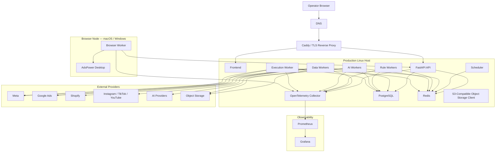
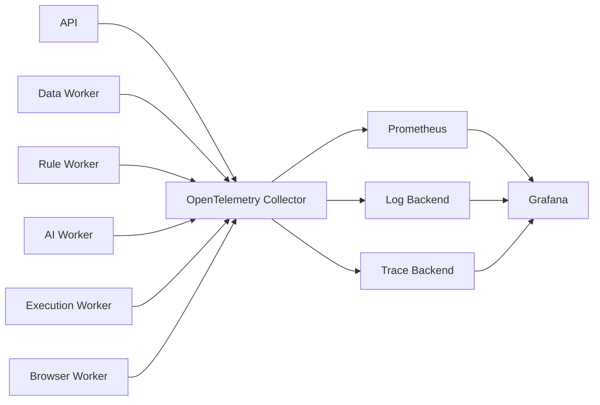

# AI DTC Growth Automation System

## PART 07 — Production Hardening, Deployment, Security & Codex Development Specification

**Version:** V1.0  
**Status:** Ready for Codex Implementation  
**Baseline Date:** 2026-08-10  
**Target:** Codex Development / Production Launch Reference  

**Depends On:**  
- PART 01 — US Operation Environment / AdsPower  
- PART 02 — Data Architecture & API Integration  
- PART 03 — Growth Rule Engine  
- PART 04 — Multi-Agent AI Intelligence  
- PART 05 — Growth Dashboard & Product Experience  
- PART 06-01 — Automation Execution + Multi-Account, Content Intelligence & Connection Center Enhancement  

---

# 0. 文档目标

PART 01–06-01 已经完成了业务能力设计：

```text
Environment
↓
Connections
↓
Data
↓
Multi Account
↓
Content / Organic / Paid
↓
Rules
↓
AI
↓
Dashboard
↓
Approval
↓
Execution
↓
Verification
```

PART 07 不再继续堆大量业务功能。

PART 07 的目标是：

> **把前面的完整系统变成可以长期运行、可以安全升级、可以恢复、可以监控、可以审计、可以由 Codex 持续维护的生产级系统。**

核心问题从：

```text
“功能能不能跑”
```

升级到：

```text
“故障后能不能恢复？”
“升级会不会把生产数据搞坏？”
“Token 泄漏怎么办？”
“OAuth 过期怎么办？”
“Redis 挂了会不会丢执行任务？”
“数据库误删能不能恢复到 30 分钟前？”
“AI Provider 挂了 Dashboard 还能不能用？”
“Execution Worker 出问题能不能立即停止？”
“多 Workspace 会不会串数据？”
“Codex 修改一个模块会不会把别的模块改坏？”
```

---

# 1. Production Hardening 核心原则

必须遵循：

```text
1. Production data is more important than code.
2. Execution safety is more important than automation speed.
3. PostgreSQL is the source of truth for durable business state.
4. Redis is never the only copy of critical state.
5. AI is an optional enhancement layer, not a system dependency.
6. Browser automation is isolated from the core control plane.
7. Provider credentials follow least privilege.
8. Production secrets never live in Git.
9. Every deploy must be reproducible.
10. Every important change must be observable and reversible where possible.
11. Backups are not valid until restore has been tested.
12. A failed dependency must degrade the system, not collapse the entire platform.
13. Multi-workspace isolation is a security boundary.
14. No Agent can bypass the execution safety chain.
15. No production live-write test runs automatically in CI.
```

---

# 2. Production Maturity Model

系统上线分为：

```text
L0 — Local Development

L1 — Staging

L2 — Production Read-only

L3 — Production Recommendations

L4 — Production Manual Execution

L5 — Shadow Auto-execution

L6 — Canary Guarded Auto

L7 — Broader Guarded Auto
```

---

# 3. 默认上线目标

PART 07 完成后：

默认目标：

```text
L4 — Production Manual Execution
```

即：

```text
真实数据
真实 Rules
真实 AI
真实 Dashboard
真实 Recommendation
真实 Human Approval
真实 Provider Execution
```

但：

```text
每个广告写操作默认仍需人工批准
```

Guarded Auto：

```text
framework ready
default OFF
```

---

# 4. 生产上线顺序

严格：

```text
1. Production Read-only
2. Validate data
3. Validate account isolation
4. Validate Rules
5. Enable AI
6. Validate AI Evals
7. Enable Recommendation approval
8. Enable Manual Execution
9. Observe execution history
10. Shadow Auto
11. Canary Auto
12. Broader Auto only if justified
```

禁止：

```text
第一次生产部署
→ 直接打开 Guarded Auto
```

---

# 5. Environment Architecture

必须建立：

```text
LOCAL
TEST
STAGING
PRODUCTION
```

环境之间：

```text
database
redis
secrets
OAuth callback
provider account
object storage
execution policy
```

全部隔离。

---

# 6. LOCAL

用途：

```text
Codex development
Mock provider
Unit tests
UI development
Local integration
```

默认：

```text
DATA_PROVIDER_MODE=mock
AI_PROVIDER_MODE=mock
EXECUTION_MODE=observe
LIVE_WRITE=false
```

允许：

```text
AdsPower local integration
```

但不得使用正式广告写 Credential。

---

# 7. TEST

用于：

```text
Automated Integration
Golden Scenarios
E2E
Migration Test
Rule Replay
AI Evals
Execution Mock
```

每次 CI 可以重建。

禁止：

```text
live production provider mutation
```

---

# 8. STAGING

Staging 必须尽量接近 Production。

拥有：

```text
independent database
independent redis
independent object storage
independent secrets
independent OAuth callback URLs
```

推荐使用：

```text
Provider test account
or
limited read-only production-like data
```

Live write：

默认关闭。

---

# 9. PRODUCTION

Production：

```text
real provider connections
real business data
real accounts
real approvals
real execution
```

具有：

```text
strongest RBAC
strongest backup
deployment gate
audit
alerting
kill switch
```

---

# 10. Environment Variable Rule

禁止：

```text
if ENV != local:
  maybe production
```

必须显式：

```text
APP_ENV=local
APP_ENV=test
APP_ENV=staging
APP_ENV=production
```

未知值：

```text
startup fail
```

---

# 11. Production Deployment Strategy

当前项目规模下：

推荐第一阶段：

> **Single Production Control Plane + Isolated Browser Node**

而不是直接 Kubernetes。

核心原因：

```text
团队小
Codex 主导开发
服务数量虽多但负载不大
运营系统比互联网高并发服务更重视可控性
```

Docker Compose 官方支持单主机生产部署。

---

# 12. Recommended Production Topology



---

# 13. Production Node Roles

## Control Plane Host

运行：

```text
Caddy
Frontend
API
Scheduler
Workers
PostgreSQL
Redis
Observability components
```

如果未来数据量增大：

再拆数据库和 Observability。

---

# 14. Browser Node

Browser Node 继续负责：

```text
AdsPower
US browser environment
public competitor research
browser tasks
```

Browser Node 不拥有：

```text
Meta write credential
Google Ads write credential
PostgreSQL admin password
Execution Policy admin key
```

---

# 15. Execution Worker

Execution Worker：

必须单独 Service。

拥有：

```text
write credential references
execution queue access
execution tables
```

不拥有：

```text
AdsPower
Browser tools
arbitrary shell
AI prompts
```

---

# 16. Execution Worker Isolation

容器配置：

```text
low concurrency
non-root
read-only filesystem where practical
minimal volume mounts
no Docker socket
no browser
restricted network egress where practical
```

这是全系统权限最高的应用 Worker。

---

# 17. Browser Node Network Model

生产推荐：

> **Browser Node 主动连接 Control Plane，而不是 Control Plane 直接暴露 AdsPower Local API。**

不要：

```text
Internet
→ AdsPower :50325
```

AdsPower Local API：

保持：

```text
localhost / node-local
```

---

# 18. Browser Worker Transport

生产建议新增：

```text
Browser Node Gateway
```

流程：

```text
Browser Worker
↓
HTTPS authenticated task API
↓
Control Plane
```

或者：

```text
outbound persistent worker channel
```

第一版不建议：

```text
直接把 Redis 暴露给远程 Browser Node
```

---

# 19. Browser Node Authentication

使用：

```text
node identity
+
rotatable secret / mTLS
```

至少：

```text
node_id
node_secret_reference
```

并支持：

```text
revoke node
```

---

# 20. Browser Node Allowlist

数据库：

```text
browser_nodes
```

字段：

```text
id
name
status

allowed_workspace_ids

last_heartbeat_at
version

credential_reference

created_at
updated_at
```

---

# 21. Heartbeat

Browser Worker：

每：

```text
30-60s
```

发送 Heartbeat。

状态：

```text
ONLINE
DEGRADED
OFFLINE
REVOKED
```

---

# 22. No Public Database

Production：

禁止公开：

```text
5432 PostgreSQL
6379 Redis
50325 AdsPower
Prometheus
Grafana
```

到 Internet。

Public：

默认只有：

```text
80
443
```

SSH：

应限制来源或通过安全运维通道。

---

# 23. Reverse Proxy

推荐：

```text
Caddy
```

理由：

```text
simple configuration
automatic HTTPS
reverse proxy
health-check support
```

也可以使用：

```text
Nginx
```

如果现有团队更熟悉。

Codex 不因为本文档强制重写已有稳定代理层。

---

# 24. TLS

所有公网流量：

```text
HTTPS
```

HTTP：

仅用于：

```text
redirect → HTTPS
```

Production 禁止：

```text
tls_insecure_skip_verify
```

作为正常方案。

---

# 25. Security Headers

至少：

```text
Strict-Transport-Security
X-Content-Type-Options
Referrer-Policy
Content-Security-Policy
frame-ancestors
```

CSP 根据 React 应用实际资源生成。

不要为了方便：

```text
script-src *
```

---

# 26. CORS

Production：

显式 Allowlist：

```text
https://growth.example.com
```

禁止：

```text
Access-Control-Allow-Origin: *
```

用于带认证管理接口。

---

# 27. Authentication

生产系统必须有真正的应用身份体系。

推荐：

```text
OIDC / SSO ready
```

可以接：

```text
Google Workspace
Microsoft Entra ID
other trusted IdP
```

---

# 28. Authentication V1

如果当前只有极少内部用户：

仍至少需要：

```text
unique user
strong password / SSO
session expiration
MFA-ready
audit
```

不要共享：

```text
admin / admin123
```

---

# 29. Step-up Authentication

以下动作建议支持：

```text
recent authentication
or
MFA/SSO step-up
```

例如：

```text
Disable global kill switch
Approve account-wide action
Change execution policy
Change provider credential
Delete historical data
```

---

# 30. Session Security

如果使用 Cookie Session：

要求：

```text
Secure
HttpOnly
SameSite
rotation
expiry
CSRF protection
```

如果使用 Token：

同样要求：

```text
short-lived access
refresh lifecycle
revocation
```

---

# 31. OAuth Provider Connection Security

06-01 Connection Center 引入大量 OAuth。

生产必须：

```text
state validation
PKCE where applicable
redirect URI allowlist
workspace binding
provider binding
callback expiry
single-use authorization transaction
audit
```

---

# 32. OAuth Transaction

创建：

```text
oauth_transactions
```

字段：

```text
id
workspace_id
provider

state_hash
pkce_verifier_reference

redirect_uri

initiated_by

expires_at
consumed_at

status

created_at
```

---

# 33. OAuth Callback

Callback：

必须先验证：

```text
state
transaction not expired
not consumed
workspace
provider
redirect
```

之后才允许：

```text
exchange code
```

---

# 34. OAuth Redirect

禁止：

```text
redirect_uri
```

从用户 Query 任意传入。

使用：

```text
server-side allowlist
```

---

# 35. Credential Boundaries

至少区分：

```text
SOCIAL_READ
ADS_READ
ADS_WRITE
SHOPIFY_READ
AI_PROVIDER
BROWSER_NODE
DEPLOYMENT
DATABASE
```

---

# 36. Read / Write Separation

继续执行 PART 06：

```text
META_READ_CREDENTIAL
META_WRITE_CREDENTIAL

GOOGLE_READ_CREDENTIAL
GOOGLE_WRITE_CREDENTIAL
```

如果 Provider 无法真正分成两个 Token：

应用层仍要：

```text
separate references
separate usage policy
separate worker permissions
```

---

# 37. Secrets

Production Secret 不得：

```text
commit Git
store in README
store in source code
return to frontend
write logs
store raw in database metadata
```

---

# 38. Secret Provider Interface

统一：

```python
SecretProvider
```

实现可以是：

```text
LocalEnvSecretProvider
CloudSecretManagerProvider
VaultProvider
```

业务层只使用：

```text
credential_reference
```

---

# 39. Local .env

只允许：

```text
development
```

Production：

推荐 Secret Manager。

如果第一版单机无法立即使用云 Secret Manager：

至少使用：

```text
protected server-side secret file
strict filesystem permissions
outside Git
```

并制定迁移计划。

---

# 40. GitHub Actions Deployment Credentials

如果部署到支持 OIDC 的云：

优先：

```text
GitHub Actions OIDC
```

获取短期部署 Credential。

避免：

```text
长期 Cloud Access Key
```

放 GitHub Secrets。

---

# 41. GitHub Environments

必须建立：

```text
staging
production
```

Production Environment：

启用：

```text
deployment protection
required reviewers where available
branch restrictions
environment-scoped secrets
```

---

# 42. Repository Branch Strategy

建议：

```text
main
```

始终代表：

```text
deployable code
```

Feature：

```text
feature/*
fix/*
chore/*
```

通过 PR 合并。

---

# 43. No Direct Production Patch

禁止：

```text
ssh server
vim file
restart
```

作为正常部署方式。

紧急修复后：

必须回写 Git。

---

# 44. Immutable Build

部署：

```text
source commit
↓
container image
↓
immutable tag/digest
↓
staging
↓
production
```

不要在服务器：

```text
git pull
pip install
npm install
```

动态拼生产环境。

---

# 45. Image Tag

使用：

```text
git SHA
release version
```

例如：

```text
growth-api:sha-abc123
```

不要生产依赖：

```text
latest
```

---

# 46. Dependency Pinning

Python：

使用 lockfile。

Node：

使用：

```text
package-lock / pnpm-lock / yarn lock
```

Container：

固定：

```text
tested major/minor or digest
```

---

# 47. Version Upgrade Policy

依赖升级分：

```text
PATCH
MINOR
MAJOR
SECURITY
```

Major：

必须：

```text
staging
regression
migration review
```

---

# 48. Docker Compose Structure

建议：

```text
compose.yaml
compose.dev.yaml
compose.staging.yaml
compose.prod.yaml
```

---

# 49. Base Compose

定义：

```text
service names
networks
volumes
health checks
common dependencies
```

---

# 50. Production Override

定义：

```text
restart policy
resource limit
production image
secrets
logging
no source bind mount
read-only options
```

---

# 51. Production Services

至少：

```text
frontend
api

scheduler

worker-data
worker-rules
worker-ai
worker-execution

postgres
redis

otel-collector
prometheus
grafana
```

可选：

```text
loki
minio
```

如果 Object Storage 使用云 S3：

不需要 MinIO Production。

---

# 52. Network Segmentation

Compose Network：

建议：

```text
edge
app
data
observability
```

---

# 53. Edge Network

只有：

```text
reverse proxy
frontend/api
```

需要接。

---

# 54. Data Network

只有：

```text
API
workers
postgres
redis
```

连接。

---

# 55. Execution Network

如果 Compose 无法做到非常细：

至少逻辑限制：

```text
Execution Worker
```

不加入 Browser 相关网络。

---

# 56. No Docker Socket Mount

应用容器禁止：

```text
/var/run/docker.sock
```

除非一个明确、隔离的运维服务必须使用。

当前系统：

```text
不需要
```

---

# 57. Container User

应用容器：

```text
non-root
```

---

# 58. Linux Capabilities

尽量：

```text
cap_drop:
  - ALL
```

如服务确实需要：

再最小添加。

---

# 59. Read-only Filesystem

适合：

```text
frontend
api
rule worker
AI worker
execution worker
```

启用：

```text
read_only
```

临时文件：

使用：

```text
tmpfs
```

---

# 60. Health Checks

每个 Service：

必须有：

```text
healthcheck
```

但区分：

```text
liveness
readiness
dependency health
```

---

# 61. API Liveness

```http
GET /health/live
```

只回答：

```text
process is running
```

不访问外部 Provider。

---

# 62. API Readiness

```http
GET /health/ready
```

检查：

```text
Postgres
Redis critical path
migration state
```

AI Provider：

不是 API readiness 的必需条件。

---

# 63. Dependency Health

```http
GET /health/dependencies
```

返回：

```text
Meta
Google
Shopify
Social connections
AI
Browser nodes
Object storage
```

---

# 64. Health Response Security

公开 Liveness：

不要返回：

```text
DB hostname
credential
internal network
provider account IDs
```

详细 Dependency：

仅 Admin。

---

# 65. Graceful Shutdown

API / Worker 收到：

```text
SIGTERM
```

必须：

```text
stop accepting new work
finish/abandon safely
release lock
checkpoint
```

---

# 66. Execution Worker Shutdown

执行中：

不能简单：

```text
kill process
```

需要：

```text
finish provider response
or
mark UNKNOWN
```

并进入：

```text
reconciliation
```

---

# 67. Scheduler Singleton

生产只允许一个逻辑 Scheduler。

使用：

```text
distributed leader lock
```

防止：

```text
2 Celery Beat
→ 同一 Job 重复调度
```

---

# 68. Durable Job Pattern

关键 Job：

先写：

```text
PostgreSQL job record
```

再发送：

```text
Redis queue
```

---

# 69. Redis 不是 Source of Truth

如果 Redis 丢失：

不能永久丢：

```text
Execution Intent
Sync Job
Recommendation
Focus Monitor
```

这些都在 PostgreSQL。

---

# 70. Queue Reconciliation

启动时/定时：

```text
JobReconciler
```

查：

```text
DB state = QUEUED
but no active queue delivery
```

重新入队。

---

# 71. Execution Queue Recovery

尤其：

```text
execution_jobs
```

需要：

```text
PostgreSQL state machine
```

Redis 只负责 Transport。

---

# 72. Redis Persistence

Redis：

至少配置合理持久化和备份策略。

但即使 Redis 完全丢失：

系统应可以从 DB 恢复关键任务。

---

# 73. Redis ACL

不同 Service：

使用不同 Redis User/ACL。

例如：

```text
api
scheduler
data-worker
execution-worker
browser-gateway
```

不要全用：

```text
default user
same password
```

---

# 74. Redis TLS

如果 Redis 流量跨 Host：

必须：

```text
TLS
```

同 Host private network：

仍不得公开端口。

---

# 75. PostgreSQL Source of Truth

以下 Durable State：

必须 PostgreSQL：

```text
accounts
connections
content
ads
orders

rules
recommendations

AI run metadata
memory

approvals
execution

audit

focus monitors
```

---

# 76. Database Roles

至少：

```text
migration_role
app_readwrite
execution_role
readonly_analytics
backup_role
```

---

# 77. Execution DB Role

Execution Worker：

只能访问：

```text
execution-related
required recommendation/provider mapping
```

不应拥有：

```text
CREATE DATABASE
DROP DATABASE
SUPERUSER
```

---

# 78. Migration Role

只有：

```text
CI/CD migration step
```

使用。

应用 Runtime：

不需要 DDL 权限。

---

# 79. Database Schema Migration

继续使用：

```text
Alembic
```

---

# 80. Migration Rule

Production Migration 必须：

```text
reviewed
tested against production-like backup
idempotent where practical
```

---

# 81. Expand / Contract

破坏性 Schema 修改：

使用：

```text
Expand
↓
Deploy compatible code
↓
Backfill
↓
Switch reads/writes
↓
Contract later
```

---

# 82. 禁止直接 Rename Critical Column

不要：

```text
rename column
deploy code simultaneously
```

可能造成：

```text
old worker crash
```

先加新字段。

---

# 83. Large Backfill

数据库 Backfill：

必须：

```text
batch
rate limited
restartable
observable
```

不能：

```text
one transaction update 50 million rows
```

---

# 84. Migration Preflight

部署前：

```text
alembic current
alembic heads
pending migration
migration graph
```

必须检查。

---

# 85. Migration Backup Gate

对于：

```text
destructive
large
high-risk
```

Migration：

必须先确认：

```text
recent backup exists
```

---

# 86. PostgreSQL Backup Strategy

PostgreSQL 官方支持：

```text
SQL dump
file-level backup
continuous archiving / PITR
```

生产推荐组合：

```text
logical backup
+
base backup / managed snapshot
+
WAL archiving / PITR
```

---

# 87. Backup Tiers

建议：

## Tier A — Daily Logical

```text
pg_dump custom format
```

用途：

```text
table/object recovery
migration debugging
portable restore
```

## Tier B — Physical / Base Backup

用于：

```text
whole database recovery
PITR base
```

## Tier C — WAL Archive

用于：

```text
point-in-time recovery
```

---

# 88. Backup Schedule Seed

可以从：

```text
Daily logical backup

Continuous WAL archive

Weekly full/base backup
```

开始。

具体频率：

根据：

```text
RPO
cost
database size
```

调整。

---

# 89. Backup Retention Seed

建议初始：

```text
Daily: 14-30 days
Weekly: 8-12 weeks
Monthly: 6-12 months
```

这是产品初始策略。

根据业务合规和成本调整。

---

# 90. Backup Encryption

备份：

```text
encrypted at rest
encrypted in transit
```

Backup Bucket：

与 Production Host 分离。

---

# 91. Backup Immutability

至少保留：

```text
restricted-delete backup copy
```

防止：

```text
生产服务器被入侵
→ 连备份一起删
```

---

# 92. Restore Test

硬性原则：

> **A backup that has never been restored is unverified.**

至少：

```text
monthly restore drill
```

---

# 93. Restore Drill

流程：

```text
Create isolated restore environment
↓
Restore backup
↓
Run migration integrity
↓
Run DB consistency
↓
Run application smoke
↓
Document RTO
```

---

# 94. RPO / RTO

初始目标：

```text
PostgreSQL RPO:
≤ 15 min where PITR is available

PostgreSQL RTO:
≤ 2 h

Application RTO:
≤ 1 h for single-host rebuild if data services healthy
```

这些是内部 Seed SLO。

根据基础设施再调整。

---

# 95. Redis RPO

关键任务不依赖 Redis 唯一持久化。

所以：

```text
Redis data loss
```

目标：

```text
no durable business-state loss
```

任务从 PostgreSQL Reconcile。

---

# 96. Object Storage

保存：

```text
creative media
screenshots
browser evidence
AI derived assets
raw bulk data
exports
```

---

# 97. Object Storage Policy

Production 优先：

```text
managed S3-compatible storage
```

本地：

```text
MinIO
```

---

# 98. Object Versioning

建议：

```text
versioning
```

用于：

```text
evidence
creative asset
important exports
```

---

# 99. Object Key

禁止用户文件名直接做唯一 Key。

使用：

```text
workspace/{id}/content/{uuid}/...
```

---

# 100. Signed URL

前端访问私有 Asset：

使用：

```text
short-lived signed URL
```

不要：

```text
public bucket
```

---

# 101. Object Metadata

DB 保存：

```text
object_key
content_hash
mime_type
size
created_at
```

---

# 102. Content Retention

需要配置：

```text
raw creative
derived frames
browser screenshot
AI transcript
```

不同 Retention。

---

# 103. Raw Social Snapshot Retention

06-01 content snapshot 数据可能快速增长。

建议：

```text
high-frequency snapshots
→ short online retention

daily facts
→ long-term
```

例如：

```text
15m snapshots 90d
daily content facts long-term
```

---

# 104. Archive

旧 Raw：

迁移：

```text
object storage
```

减少 PostgreSQL 膨胀。

---

# 105. PostgreSQL Maintenance

需要监控：

```text
DB size
table size
index size
dead tuples
vacuum
slow queries
connections
locks
```

---

# 106. Autovacuum

不要随便关闭。

生产按监控结果：

调整热点大表。

---

# 107. Database Connection Pool

FastAPI / Workers：

设置：

```text
bounded connection pool
```

防止：

```text
20 workers × 20 connections
→ exhaust DB
```

---

# 108. PgBouncer

第一版：

```text
optional
```

当连接数明显成为问题：

再加入。

不要一开始增加无必要复杂度。

---

# 109. Query Timeout

应用查询：

设置：

```text
statement timeout
```

尤其 Dashboard。

避免一个 Analyst 查询拖垮 DB。

---

# 110. Analytics Heavy Query

复杂报表：

优先：

```text
MART
materialized view
preaggregation
```

不要 UI 直接扫 Raw 亿级行。

---

# 111. Multi-workspace Query Rule

所有 Business Query：

必须显式带：

```text
workspace_id
```

不允许依赖：

```text
frontend filter only
```

---

# 112. Workspace Isolation

Backend Authorization：

必须在 Repository/Service 层检查：

```text
user
→ workspace
→ resource
```

---

# 113. Row-level Security

如果项目复杂度允许：

未来可采用：

```text
PostgreSQL RLS
```

作为第二层防线。

V1 可先：

```text
service-layer strict scope
+
critical isolation tests
```

---

# 114. Cache Isolation

Redis Cache Key：

必须包含：

```text
environment
workspace
scope
```

例如：

```text
prod:w123:account:a456:...
```

---

# 115. AI Cache Isolation

Creative / Search AI Cache：

如果输出受：

```text
brand knowledge
workspace
```

影响：

Cache Key 也包含：

```text
workspace / brand context hash
```

---

# 116. Export Isolation

CSV / file export：

必须绑定：

```text
workspace
requester
expiry
```

---

# 117. Search Isolation

Global Search：

只能搜索：

```text
authorized workspace resources
```

---

# 118. OAuth Account Discovery Isolation

Provider Connection：

绑定：

```text
workspace_id
```

Discover 出来的资源：

不能被另一个 Workspace Link。

---

# 119. Provider Connection Lifecycle

状态：

```text
PENDING
HEALTHY
EXPIRING
REAUTH_REQUIRED
SCOPE_MISSING
RATE_LIMITED
DISABLED
REVOKED
```

---

# 120. Token Refresh

如果 Provider 支持 Refresh：

建立：

```text
TokenRefreshWorker
```

---

# 121. Token Refresh Job

持久化：

```text
provider_connection_refresh_jobs
```

防止：

```text
Refresh request crash
→ Connection silently expire
```

---

# 122. Token Refresh Alert

例如：

```text
expires in 7d
expires in 24h
refresh failed
```

通知 Admin。

---

# 123. Scope Drift

Reauthorization 后：

对比：

```text
old scopes
new scopes
```

如果减少：

```text
CAPABILITY_DEGRADED
```

---

# 124. Account Removal

Provider 账号被删除/权限取消：

Connected Account：

```text
DISCONNECTED
```

历史数据：

保留。

---

# 125. Account Reconnect

External ID 一致：

优先恢复同一个：

```text
connected_account
```

不要重复创建。

---

# 126. API Quota Governance

每个 Provider：

监控：

```text
requests
quota
rate limit
retry-after
error rate
```

---

# 127. Quota Budget

任务优先级：

```text
P0 Execution revalidation
P1 Webhook / critical data
P2 Focus
P3 Ads intraday
P4 Account analytics
P5 Backfill
P6 Research
```

---

# 128. Focus 不能无限提高频率

即使用户 Watch：

仍受：

```text
Provider quota
data finality
account limits
```

Focus 只是提高：

```text
priority
UI freshness
alert priority
```

不绕过 Provider 限流。

---

# 129. API Circuit Breaker

Provider 持续：

```text
429
5xx
auth failure
```

进入：

```text
DEGRADED
```

降低请求。

---

# 130. Backfill Throttle

Backfill：

始终低优先级。

Production：

不得影响：

```text
live execution
webhooks
intraday monitor
```

---

# 131. Webhook Reliability

Webhook Receiver：

必须：

```text
verify signature
persist raw event
deduplicate
fast 2xx
async process
```

---

# 132. Webhook Dead Letter

处理多次失败：

进入：

```text
webhook_dead_letters
```

---

# 133. Dead Letter UI

Data Health：

显示：

```text
provider
topic
received
attempt
error
```

Admin 可：

```text
reprocess
```

---

# 134. Webhook Replay Safety

Reprocess：

依赖：

```text
idempotent consumer
```

不能重复创建订单/内容。

---

# 135. CI/CD 总体流程


---

# 136. PR Required Checks

至少：

```text
Python lint
Python type check

Backend unit tests

Frontend lint
Frontend type check
Frontend unit tests

Migration check

Rule Golden Scenarios

AI Mock Evals

Execution Mock Golden Scenarios

Workspace isolation tests

OAuth callback tests

Docker build
```

---

# 137. Static Analysis

Python：

使用项目选择的：

```text
Ruff
Mypy/Pyright
```

Frontend：

```text
ESLint
TypeScript
```

具体工具可以根据当前 Repository。

---

# 138. Security CI

至少：

```text
dependency vulnerability check
secret scanning
container image scan
```

阻止：

```text
known critical vulnerability
committed secret
```

进入 Production。

---

# 139. Migration CI

新 Migration：

CI：

```text
fresh DB upgrade head
downgrade where supported
upgrade again
```

同时：

```text
existing fixture DB → head
```

---

# 140. Rule Regression Gate

PART 03 Rule 变更：

必须：

```text
Golden Scenarios
Historical Replay sample
```

---

# 141. AI Regression Gate

Prompt / model-route change：

必须：

```text
AI Eval Suite
```

Critical Failure：

阻止发布。

---

# 142. Execution Regression Gate

PART 06 任何 Execution 代码变更：

必须：

```text
Mock Execution Golden Suite
```

关键：

```text
duplicate
unknown outcome
state drift
shared budget
kill switch
```

全 PASS。

---

# 143. No Live Write CI

CI：

硬性：

```text
ALLOW_LIVE_EXECUTION_TESTS=false
```

并且代码检查：

如果：

```text
CI=true
```

Live write test 命令直接拒绝。

---

# 144. Staging Deployment Gate

只有：

```text
main
or
release branch
```

可以部署 Staging。

---

# 145. Production Deployment Gate

Production：

需要：

```text
successful staging
all required checks
manual approval
```

---

# 146. GitHub Environment

GitHub Production Environment：

配置：

```text
required reviewers
branch restrictions
environment secrets
```

---

# 147. Deployment Artifact

Production 部署使用：

```text
exact same image
```

从 Staging Promote。

不要：

```text
Staging build A
Production rebuild B
```

---

# 148. Database Migration Deployment Order

采用 Expand/Contract：

通常：

```text
1. Backup / verify restore point
2. Expand migration
3. Deploy backward-compatible app
4. Run controlled backfill
5. Validate
6. Switch feature
7. Contract later
```

---

# 149. Maintenance Mode

需要支持：

```text
MAINTENANCE_MODE
```

用途：

```text
rare high-risk migration
```

但平时部署尽量：

```text
no-downtime / low-downtime
```

---

# 150. Deployment Health Gate

部署后：

自动检查：

```text
API ready
DB migration head
Redis
Dashboard
Scheduler heartbeat
Workers
Data sync
Rule run
AI optional
Execution health
```

---

# 151. Post Deploy Smoke

命令：

```bash
make smoke-production-readonly
```

禁止自动执行真实 Mutation。

---

# 152. Manual Execution Smoke

如果需要验证真实 Execution：

使用：

```text
allowlisted test resource
explicit operator
```

不在普通 Deploy Pipeline。

---

# 153. Deployment Rollback

如果应用代码有问题：

```text
deploy previous image digest
```

---

# 154. Migration Rollback

数据库不一定安全 Downgrade。

所以：

```text
Code rollback
```

与：

```text
DB rollback
```

必须分开。

破坏性 Migration：

依靠：

```text
Expand/Contract
Backup/PITR
```

而不是盲目 Alembic downgrade。

---

# 155. Release Record

创建：

```text
releases
```

字段：

```text
version
git_sha
image_digests

db_revision

deployed_by
deployed_at

environment

status

rollback_from

notes
```


# 156. Observability Architecture

生产必须同时覆盖：

```text
Metrics
Logs
Traces
Events
Business Health
```

不要只看：

```text
CPU / RAM
```

---

# 157. OpenTelemetry

推荐：

```text
OpenTelemetry SDK
+
OpenTelemetry Collector
```

作为统一 Telemetry Pipeline。

OpenTelemetry Collector 是 Vendor-neutral 的接收、处理、导出层。

---

# 158. Telemetry Flow



---

# 159. Observability Deployment

第一版可以：

```text
OpenTelemetry Collector
Prometheus
Grafana
```

日志：

可以先：

```text
structured JSON
Docker log rotation
```

再升级：

```text
Loki / equivalent
```

Trace：

可以先：

```text
OTel-compatible backend
```

或保存必要 Application Trace。

---

# 160. No Observability Dependency

如果 Grafana 挂：

业务系统继续运行。

Observability：

不是：

```text
critical request dependency
```

---

# 161. Structured Logging

全服务统一 JSON。

字段：

```text
timestamp
environment
service
version

request_id
trace_id

workspace_id

user_id if applicable

job_id
run_id
execution_id

provider
event

level

duration_ms

error_code
```

---

# 162. Sensitive Log Filter

统一 Middleware：

删除：

```text
Authorization
Cookie
Access Token
Refresh Token
Client Secret
API Key
Proxy Password
Private Key
Customer PII
```

---

# 163. Log Level

Production 默认：

```text
INFO
```

Debug：

仅临时：

```text
scoped
time-limited
```

---

# 164. Log Retention

Seed：

```text
application logs:
30-90d

audit:
longer

execution audit:
long-term
```

按成本/合规调整。

---

# 165. Audit != Log

Audit：

```text
business/security evidence
```

普通 Log：

```text
debug/operation
```

不能因为 Log retention 删除：

```text
execution audit
approval history
```

---

# 166. Core System Metrics

至少：

## API

```text
http_requests_total
http_errors_total
http_latency

active_sessions
```

## Database

```text
db_connections
db_pool_wait
query_latency
slow_query_count
lock_wait
```

## Queue

```text
queue_depth
oldest_job_age
job_failure_rate
```

---

# 167. Data Pipeline Metrics

```text
provider_sync_success
provider_sync_failure

records_ingested

freshness_seconds

backfill_queue

webhook_lag
webhook_dead_letters
```

---

# 168. Rule Metrics

```text
rule_runs
rule_errors

recommendations_created

no_decision_rate
suppression_rate

rule_false_positive_feedback
```

---

# 169. AI Metrics

```text
ai_runs
ai_failures

model_calls
token_usage
estimated_cost

tool_failures

review_rejection

eval_score
```

---

# 170. Execution Metrics

继续 PART 06：

```text
execution_success
execution_failure

unknown_provider_outcome

verification_failure

compensation

approval_expired

policy_block

kill_switch
```

---

# 171. Connection Metrics

06-01 新增：

```text
connections_healthy
connections_expiring
reauth_required

scope_missing
quota_limited

accounts_linked

content_sync_lag
```

---

# 172. Browser Metrics

```text
browser_node_online

browser_task_success
browser_task_failure

profile_health

proxy_health
```

---

# 173. Product Metrics

系统自身：

```text
daily_active_operator
recommendation_open_rate
recommendation_acceptance

focus_monitors_active

content_drilldown

ai_query_count
```

仅用于产品优化。

---

# 174. Dashboard Monitoring

Grafana 主要系统 Dashboard：

```text
System Overview
API
PostgreSQL
Redis / Queues
Data Pipeline
Provider Connections
Rules
AI
Browser Nodes
Execution Safety
Cost
```

---

# 175. Alerting

推荐：

```text
Prometheus rules
+
Alertmanager
```

或：

```text
Grafana Alerting
```

当前项目不需要同时维护两套重复 Alert。

---

# 176. Alert Philosophy

Alert 必须：

```text
actionable
```

不要：

```text
每个 warning 都推送
```

---

# 177. Alert Severity

```text
P1 CRITICAL
P2 HIGH
P3 WARNING
P4 INFO
```

---

# 178. P1

例如：

```text
Unauthorized execution attempt
Execution duplicate detected
Global DB unavailable
Execution verification spike
Backup completely failing
Production certificate failure
Cross-workspace isolation failure
```

需要立即处理。

---

# 179. P2

例如：

```text
Shopify webhook dead
Meta/Google data stale
Execution provider auth fail
Browser node offline during required task
OAuth refresh failures
WAL archive failure
```

---

# 180. P3

例如：

```text
AI provider degraded
Backfill delayed
high AI cost
content sync slow
non-critical browser research fail
```

---

# 181. Alert Grouping

同类：

```text
Meta 30 accounts stale
```

尽量聚合为：

```text
Meta ingestion degraded
```

避免 30 条通知。

---

# 182. Alert Routing

第一版：

```text
In-app
Email
```

后续：

```text
Feishu
Slack
PagerDuty
```

按团队习惯。

---

# 183. Silence

Maintenance：

支持：

```text
planned silence
```

但：

```text
Execution safety P1
```

不应随便全局静默。

---

# 184. SLO

建立最小内部 SLO。

这些是 Seed：

## API

```text
availability target:
99.5%
```

## Dashboard

```text
core page p95:
< 3s typical
```

## Meta / Google Ingestion

```text
freshness:
< 20m target
```

## Shopify Webhook

```text
internal lag:
< 2m
```

## Execution

```text
unauthorized mutations:
0

duplicate mutations:
0
```

---

# 185. AI SLO

AI 不应定义成：

```text
99.99% availability
```

如果 AI Provider 挂：

系统仍能：

```text
Data
Rules
Dashboard
Execution based on approved deterministic Recommendation
```

---

# 186. Focus SLO

Focus Monitor：

目标：

```text
use latest provider-available data
```

不是承诺：

```text
real-time
```

---

# 187. Incident Response

必须建立：

```text
Incident Runbook
```

---

# 188. Incident Severity

```text
SEV-1
SEV-2
SEV-3
SEV-4
```

---

# 189. SEV-1

例如：

```text
Unauthorized live ad changes
Workspace data leak
Production DB corruption
Secrets exposure
Execution runaway
```

---

# 190. SEV-1 Immediate Actions

```text
1. Activate global execution kill switch
2. Preserve audit/log evidence
3. Revoke compromised credentials
4. Stop affected worker
5. Restrict user access if needed
6. Assess blast radius
7. Restore / compensate safely
8. Communicate incident
```

---

# 191. Execution Incident

如果出现：

```text
unexpected provider mutations
```

第一动作：

```text
GLOBAL KILL SWITCH ON
```

而不是：

```text
restart system
```

---

# 192. Credential Incident

如果 Token 泄漏：

```text
revoke at provider
rotate secret
invalidate connection
audit recent use
re-auth
```

---

# 193. Workspace Isolation Incident

立即：

```text
disable affected API path
revoke sessions if needed
preserve request traces
verify cache keys
verify search/export
```

视为：

```text
SEV-1
```

---

# 194. Data Corruption Incident

先：

```text
stop writes if necessary
```

然后：

```text
determine corruption time
PITR / restore isolated
validate
recover
```

---

# 195. Incident Record

创建：

```text
incidents
```

字段：

```text
id

severity
title
status

started_at
detected_at
resolved_at

affected_services
affected_workspaces

root_cause
timeline

actions_taken

followups

created_at
```

---

# 196. Postmortem

SEV-1 / SEV-2：

必须：

```text
postmortem
```

内容：

```text
what happened
impact
timeline
root cause
why safeguards failed
what worked
action items
owner
deadline
```

---

# 197. Blameless but Exact

Postmortem：

不做：

```text
模糊“加强注意”
```

要做：

```text
具体控制项
```

例如：

```text
Add execution test for shared budget.
```

---

# 198. Disaster Recovery

DR 场景：

```text
Production Host destroyed
PostgreSQL corruption
Redis loss
Object storage unavailable
Browser Node lost
Provider credential lost
```

---

# 199. Full Host Loss

恢复：

```text
New Linux Host
↓
Docker
↓
Deploy pinned images
↓
Restore secrets
↓
Restore PostgreSQL
↓
Restore object storage config
↓
Start Redis
↓
Run queue reconciliation
↓
Validate connections
↓
Start workers
↓
Keep execution kill switch ON
↓
Smoke
↓
Enable read-only
↓
Manual execution later
```

---

# 200. Execution After DR

DR 恢复后：

默认：

```text
Execution Kill Switch ON
```

直到：

```text
provider current state reconciled
pending executions reviewed
approvals reviewed
```

---

# 201. Pending Jobs After DR

不要自动继续所有：

```text
approved execution
```

恢复后：

重新：

```text
approval expiry
revalidation
state drift
```

---

# 202. Redis Loss Recovery

```text
Start empty Redis
↓
Rebuild cache lazily
↓
Reconcile persistent DB jobs
↓
Requeue eligible work
```

---

# 203. Browser Node Loss

Core System：

继续：

```text
Data APIs
Rules
AI without browser research
Dashboard
Execution
```

Competitor Browser Research：

```text
DEGRADED
```

---

# 204. Object Storage Loss

如果暂时不可用：

```text
media previews unavailable
creative analysis new jobs blocked
existing structured analytics remain
```

不要让：

```text
Ads execution
```

因此失效。

---

# 205. DR Runbook

创建：

```text
docs/runbooks/disaster-recovery.md
```

---

# 206. Restore Script

提供：

```bash
make restore-drill
```

但：

Production 真恢复需要：

```text
explicit environment confirmation
```

---

# 207. Backup Commands

提供：

```bash
make backup-db-logical
make backup-db-base
make verify-backups
make restore-drill
```

具体物理备份命令：

按部署环境。

---

# 208. Backup Monitoring

指标：

```text
last_backup_success
backup_age
backup_size
wal_archive_lag
restore_test_age
```

---

# 209. Backup Alert

P1/P2：

```text
no successful backup > expected window
WAL archiving broken
restore drill overdue
```

---

# 210. Data Retention Governance

建立配置：

```text
retention_policies
```

---

# 211. Retention Categories

```text
raw provider payload
webhook raw
intraday ads snapshot
content snapshots
browser screenshots
AI traces
AI derived media
logs
audit
execution
```

---

# 212. Retention Principle

长期需要分析的：

保留：

```text
normalized daily facts
business events
audit
```

高频 Raw：

可以归档/删除。

---

# 213. Customer PII

继续：

```text
minimize
```

系统默认不保存：

```text
customer email
phone
address
```

除非未来业务明确需要。

---

# 214. PII Deletion

如果未来引入 PII：

必须建立：

```text
data deletion workflow
```

当前不是 V1 核心。

---

# 215. Data Export

导出：

```text
workspace-scoped
permission-controlled
audited
expiring file
```

---

# 216. Security Review

上线前进行：

```text
Threat Model
```

---

# 217. Threat Model 核心资产

```text
Provider tokens
Ad write credentials
Customer revenue data
Workspace isolation
Execution approval
Business targets
AI prompt / memory
Browser session
```

---

# 218. Threat Actors / Failure Types

至少考虑：

```text
stolen admin account
malicious OAuth callback
prompt injection
browser compromise
API token leak
Codex-generated insecure code
misconfigured CORS
workspace IDOR
execution replay
queue duplication
DB backup theft
```

---

# 219. IDOR Protection

所有：

```text
/accounts/{id}
/content/{id}
/recommendations/{id}
/execution/{id}
```

必须：

```text
resource belongs to authorized workspace
```

不能只检查：

```text
ID exists
```

---

# 220. SSRF

Browser Snapshot / URL Fetch：

属于 SSRF 高风险区。

必须：

```text
URL policy
scheme allowlist
DNS/IP validation
private IP blocking where appropriate
redirect revalidation
```

AdsPower public research：

不允许访问：

```text
localhost
cloud metadata
internal control endpoints
```

---

# 221. Browser Research URL Policy

默认：

```text
https only
public hosts
```

必要：

```text
provider domain allowlist
```

---

# 222. Webhook Endpoint

Webhook：

必须：

```text
provider signature
body limit
rate limit
idempotency
```

不要信任：

```text
source IP only
```

---

# 223. API Request Limit

配置：

```text
max body
max upload
timeout
```

特别：

```text
video upload
bulk export
```

走 Object Storage / presigned flow。

---

# 224. Rate Limiting

Admin API：

至少：

```text
login
OAuth start
AI query
browser snapshot
execution preview
```

有合理限流。

---

# 225. Brute Force

Authentication：

要有：

```text
rate limit
lockout/backoff
MFA/SSO
```

---

# 226. Content Security

用户/Provider Caption：

展示时：

```text
escape HTML
```

不要：

```text
dangerouslySetInnerHTML
```

直接渲染。

---

# 227. Prompt Injection

继续 PART 04：

Provider Content：

```text
DATA
```

不是：

```text
Instructions
```

---

# 228. MCP Security

AdsPower MCP：

只能通过：

```text
Gateway Tool Allowlist
```

生产不能：

```text
expose all MCP tools to generic Agent
```

---

# 229. AI Provider Secret

AI API Keys：

只给：

```text
AI Worker
```

Frontend / Rule Worker：

不需要。

---

# 230. AI Model Data Policy

Provider Adapter 统一可配置：

```text
send_internal_data
send_confidential_data
send_media
```

默认：

```text
no PII
```

---

# 231. AI Trace Data

如果：

```text
AI_STORE_MODEL_INPUTS=false
```

Trace 只保存：

```text
hash
structured references
safe summary
```

---

# 232. High-risk Prompt Data

以下不进入 LLM：

```text
access tokens
browser cookies
write credentials
DB passwords
private keys
```

---

# 233. RBAC Hardening

PART 05/06 角色：

```text
VIEWER
ANALYST
OPERATOR
ADMIN
```

Production 再加 Permission-based check。

---

# 234. Permission Examples

```text
ACCOUNT_VIEW
ACCOUNT_CONNECT
ACCOUNT_DISCONNECT

DATA_BACKFILL

RULE_EDIT

AI_RUN
AI_ADMIN

EXECUTION_APPROVE
EXECUTION_HIGH_RISK_APPROVE
EXECUTION_POLICY_ADMIN
EXECUTION_KILL_SWITCH

SECRET_ADMIN
AUDIT_VIEW
```

---

# 235. Permission not Role-only

角色只是 Permission Bundle。

Backend 最终检查：

```text
permission
```

---

# 236. High-risk Permission

以下默认仅少数 Admin：

```text
SECRET_ADMIN
EXECUTION_KILL_SWITCH
EXECUTION_POLICY_ADMIN
```

---

# 237. Audit Coverage

Audit：

至少：

```text
login
OAuth connect
account link/unlink
scope change

target change
rule change

AI memory approval

recommendation approval

execution
kill switch

secret rotation

deployment
backup restore
```

---

# 238. Audit Actor

保存：

```text
user
service
automation
```

例如：

```text
SYSTEM_SCHEDULER
CODEX_CI
EXECUTION_WORKER
```

---

# 239. Audit Request Context

保存：

```text
request_id
IP hashed / safe if required
user_agent
environment
```

根据隐私策略。

---

# 240. Performance Hardening

不要过度追求高并发。

目标：

```text
稳定
```

---

# 241. Dashboard Performance

Seed：

```text
Overview p95 < 3s

Account detail < 3s

Content matrix < 5s

10k-row table server pagination
```

---

# 242. API Pagination

所有大列表：

```text
cursor pagination
or
server-side page
```

---

# 243. Maximum Page Size

例如：

```text
default 50
max 200
```

配置化。

---

# 244. Chart API

图表 Endpoint：

返回：

```text
aggregated series
```

不要前端拿 100k Rows 自己算。

---

# 245. Content Matrix

后端：

```text
ContentMatrixService
```

预聚合：

```text
organic percentile
paid percentile
spend
revenue
lifecycle
```

---

# 246. Focus Monitor Scaling

Focus：

使用：

```text
scheduled metric materialization
```

避免每个用户打开页面：

重新查询全部 Raw。

---

# 247. Async Heavy Jobs

以下：

```text
CSV export
large backfill
video AI
historical replay
rule simulation
```

必须 Async。

---

# 248. Export Job

创建：

```text
export_jobs
```

并：

```text
signed URL
expiry
audit
```

---

# 249. Database Query Budget

API Service：

对每个 Request：

尽量避免：

```text
N+1
```

---

# 250. Slow Query Log

超过：

```text
configurable threshold
```

记录。

---

# 251. Frontend Bundle

执行：

```text
code splitting
route lazy loading
```

Creative/AI 重页面：

不要阻塞 Overview。

---

# 252. ECharts Performance

大数据：

```text
sampling
progressive rendering
server aggregation
```

不要把所有 Content Snapshot 送浏览器。

---

# 253. Frontend Cache

Account 切换：

Cache Key 必须严格 Scope-aware。

---

# 254. CDN

第一版：

可选。

静态前端如果经 Caddy：

已经足够。

规模增加再 CDN。

---

# 255. Provider Version Management

新增：

```text
provider_api_versions
```

---

# 256. Provider Version Health

记录：

```text
provider
configured_version
verified_version

deprecation_date if known
upgrade_status
```

---

# 257. API Upgrade Process

```text
Read provider changelog
↓
Fixture update
↓
Adapter compatibility test
↓
Staging
↓
Shadow / read-only
↓
Production
```

---

# 258. Provider Upgrade Isolation

升级：

```text
Meta
```

不应该要求同时升级：

```text
Google
Shopify
TikTok
```

Provider Adapter 完全隔离。

---

# 259. Provider Contract Tests

每个 Provider：

```text
recorded sanitized fixture
```

测试：

```text
parse
map
capability
error
```

---

# 260. Capability Drift

例如 Instagram Metric 被移除：

Capability Registry：

更新：

```text
supported=false
```

UI：

动态隐藏/显示 unavailable。

---

# 261. No Silent Metric Replacement

如果 Provider 废弃：

```text
Metric A
```

不要自动：

```text
用 Metric B 当作同一指标
```

Metric Catalog：

新 Version。

---

# 262. Feature Flags

Production 必须支持：

```text
workspace
environment
global
```

Scope。

---

# 263. Feature Flag Examples

```text
AI_ENABLED
COMPETITOR_ENABLED
SOCIAL_TIKTOK_ENABLED

EXECUTION_META_ENABLED

GUARDED_AUTO_ENABLED

NEW_CONTENT_MATRIX
```

---

# 264. Progressive Rollout

新功能：

```text
internal admin
↓
one workspace
↓
10%
↓
all
```

---

# 265. Kill Switch vs Feature Flag

区别：

```text
Feature Flag:
product rollout

Kill Switch:
emergency safety
```

不要混用。

---

# 266. Cost Control

系统成本主要：

```text
Server
DB
Object storage
AI Tokens
Video analysis
Provider API quotas
Logs/metrics
```

---

# 267. AI Cost Budget

保持 PART 04：

```text
daily
weekly
monthly
```

Budget。

---

# 268. Video Cost

视频分析：

```text
asset hash cache
```

避免重复。

---

# 269. Browser Cost

AdsPower / Proxy：

记录：

```text
active profiles
proxy subscriptions
browser task volume
```

---

# 270. Storage Cost

监控：

```text
raw payload
screenshots
derived video frames
logs
backup
```

---

# 271. Cost Alert

例如：

```text
AI daily spend > target
Object storage growth abnormal
Log ingestion spike
```

---

# 272. Cost Dashboard

Grafana / Admin：

```text
Infrastructure
AI
Storage
Provider
```

---

# 273. Codex Development Model

正式进入长期维护后：

Codex 不能：

```text
看到任务
→ 一次改 100 个文件
→ 不跑测试
```

---

# 274. Codex Working Contract

项目根目录新增：

```text
AGENTS.md
```

或：

```text
CODEX.md
```

作为最高工程规范。

---

# 275. AGENTS.md 内容

至少：

```text
Architecture Boundaries
Repository Structure
Commands
Testing Gates
Security Boundaries
Execution Boundaries
Migration Rules
No-secret rules
Provider Adapter rules
Workspace isolation rules
Definition of Done
```

---

# 276. Codex Task Workflow

每个中大型任务：

```text
1. Read relevant docs
2. Inspect existing implementation
3. State impacted modules
4. Implement smallest coherent change
5. Add/update tests
6. Run targeted tests
7. Run regression gates
8. Update docs
9. Return implementation report
```

---

# 277. No Unrequested Architecture Rewrite

Codex 禁止：

```text
因为发现另一个库更流行
→ 重写整个 Agent / Frontend / Queue
```

除非任务明确批准。

---

# 278. Respect Part Contracts

例如：

PART 04：

```text
LangGraph is orchestration
```

Codex 不得自行：

```text
改成 CrewAI
```

---

# 279. Dependency Addition

新增重大 Dependency 前：

必须说明：

```text
why
license
maintenance
security
alternative
```

---

# 280. Open Source License

项目引入第三方源码：

必须记录：

```text
license
source
version
usage
```

---

# 281. AGPL Guard

例如：

```text
Postiz AGPL
```

不要直接复制代码进入闭源/不兼容产品，除非：

```text
明确接受 AGPL obligations
```

默认：

```text
architecture reference only
```

---

# 282. Migration Rule for Codex

Codex 不允许：

```text
直接删除 production column
```

必须：

```text
Expand/Contract
```

---

# 283. Security Rule for Codex

Codex 不允许：

```text
disable auth
disable TLS verify
wildcard CORS
print tokens
mount Docker socket
```

作为“临时解决”。

---

# 284. Execution Rule for Codex

任何新 Provider write Action：

必须：

```text
typed action
approval
revalidation
policy
verification
audit
compensation analysis
golden scenario
```

---

# 285. Social Provider Rule

新增 Social API：

必须：

```text
Provider Adapter
Capability Registry
Metric Catalog
Connection Center
Contract Tests
```

---

# 286. Workspace Rule

任何新 Resource：

必须明确：

```text
workspace scope
```

---

# 287. Background Job Rule

任何新 Job：

必须：

```text
DB durable state if critical
idempotency
retry policy
dead-letter / terminal state
metrics
```

---

# 288. Error Rule

禁止：

```text
except Exception:
  pass
```

生产关键路径。

---

# 289. Error Taxonomy

新增错误：

映射到：

```text
domain error code
```

---

# 290. Test Pyramid

要求：

```text
many unit
focused integration
critical E2E
few live provider tests
```

---

# 291. Live Provider Test

只针对：

```text
connection
read
explicit staging write
```

生产：

不自动测试 live mutation。


# 292. Production Repository Structure

建议最终结构：

```text
ai-dtc-growth-system/
│
├── AGENTS.md
├── README.md
├── CHANGELOG.md
├── SECURITY.md
├── LICENSES.md
│
├── compose.yaml
├── compose.dev.yaml
├── compose.staging.yaml
├── compose.prod.yaml
│
├── Makefile
├── .env.example
├── .gitignore
│
├── docs/
│   ├── architecture/
│   ├── runbooks/
│   ├── adr/
│   ├── api/
│   ├── operations/
│   └── parts/
│
├── backend/
├── frontend/
├── browser-worker/
│
├── config/
│   ├── ai/
│   ├── rules/
│   ├── providers/
│   └── observability/
│
├── infra/
│   ├── caddy/
│   ├── postgres/
│   ├── redis/
│   ├── otel/
│   ├── prometheus/
│   ├── grafana/
│   └── scripts/
│
├── migrations/
│
├── tests/
│   ├── unit/
│   ├── integration/
│   ├── e2e/
│   ├── golden/
│   ├── security/
│   └── performance/
│
├── evals/
│
├── scripts/
│
└── .github/
    └── workflows/
        ├── ci.yml
        ├── staging.yml
        ├── production.yml
        ├── security.yml
        └── backup-check.yml
```

---

# 293. Architecture Decision Records

重大技术决策：

记录：

```text
docs/adr/
```

例如：

```text
ADR-001 LangGraph as primary orchestrator
ADR-002 PostgreSQL as durable source of truth
ADR-003 Redis not durable source of truth
ADR-004 Docker Compose first production topology
ADR-005 AdsPower local-only browser node
ADR-006 Execution worker isolation
```

---

# 294. ADR 格式

```text
Context
Decision
Alternatives
Consequences
Status
Date
```

避免未来 Codex 不知道：

```text
为什么这样设计
```

---

# 295. Runbooks

至少：

```text
deploy.md
rollback.md
database-backup.md
database-restore.md
disaster-recovery.md
execution-incident.md
provider-auth-failure.md
oauth-reauthorization.md
browser-node-recovery.md
kill-switch.md
secret-rotation.md
api-version-upgrade.md
```

---

# 296. Deployment Runbook

必须写到：

```text
谁能部署
部署前检查
Migration
Image
Health
Smoke
Rollback
```

---

# 297. Rollback Runbook

区分：

```text
Application rollback
Database recovery
Provider execution compensation
```

三者不是一回事。

---

# 298. Secret Rotation Runbook

流程：

```text
Create new secret
↓
Deploy dual/compatible config if possible
↓
Validate
↓
Revoke old
↓
Audit
```

---

# 299. Provider Credential Rotation

Provider Token：

优先：

```text
new authorization
validate
switch reference
revoke old
```

---

# 300. OAuth Reauthorization Runbook

```text
mark connection REAUTH_REQUIRED
↓
notify admin
↓
reauthorize
↓
compare scopes
↓
discover resources
↓
relink existing IDs
↓
sync
↓
health
```

---

# 301. Provider App Secret Rotation

Meta/TikTok OAuth App Secret：

属于高风险。

必须：

```text
planned change
staging validation
callback test
production switch
```

---

# 302. Browser Node Recovery Runbook

```text
Install AdsPower
Restore profile metadata
Restore proxy config securely
Register node
Health test
Smoke public snapshot
Do not restore cookies from unknown source
```

---

# 303. Production Config Backup

除了 DB：

备份：

```text
rule config
AI prompt versions
feature flags
Caddy config
observability config
provider configuration metadata
```

Git-managed config：

Git 本身就是版本源。

---

# 304. Secrets Backup

Secrets：

不能：

```text
dump into normal backup archive
```

由 Secret Manager 自己管理。

---

# 305. Infrastructure as Code

第一阶段：

至少：

```text
Docker Compose
Caddy
Observability config
deployment scripts
```

全部 Git 管理。

---

# 306. Cloud Infrastructure

如果后续迁移云：

可增加：

```text
Terraform
OpenTofu
Pulumi
```

当前 PART 07 不强制。

---

# 307. Single-host Limit

Docker Compose 单机适合当前阶段。

需要迁移更复杂编排的信号：

```text
multiple production hosts
high availability API
high queue throughput
multi-region
frequent host failure
team size increases
```

---

# 308. Kubernetes Boundary

不要因为：

```text
服务很多
```

就立刻 Kubernetes。

只有明确收益再迁移。

---

# 309. Production Capacity Plan

初始容量估算：

至少覆盖：

```text
20-50 connected accounts
100k+ content facts
millions of ad metric facts over time
multiple daily AI runs
small operator team
```

---

# 310. Resource Monitoring

每个 Service：

记录：

```text
CPU
memory
disk
restart
OOM
```

---

# 311. Disk Guard

Production Host：

监控：

```text
disk usage
inode
Docker logs
Postgres
backup temp
```

---

# 312. Disk Alert

例如：

```text
> 80% warning
> 90% critical
```

Seed。

---

# 313. Docker Log Rotation

必须限制：

```text
max-size
max-file
```

避免：

```text
log fills disk
```

---

# 314. PostgreSQL Disk

更严格：

数据库磁盘：

不要等：

```text
99%
```

才处理。

---

# 315. Object Storage Quota

监控：

```text
storage growth / day
```

尤其视频帧。

---

# 316. Backup Disk Isolation

备份不能只：

```text
放同一块磁盘 /backups
```

---

# 317. Scheduler Health

Scheduler：

Heartbeat：

```text
last schedule tick
```

---

# 318. Worker Heartbeat

各 Worker：

```text
data
rule
AI
execution
browser
```

都有 Heartbeat。

---

# 319. Stuck Job Detection

Job：

超过：

```text
expected_max_duration
```

标：

```text
STUCK
```

---

# 320. Stuck Execution

Execution Job：

绝对不能简单 Retry。

进入：

```text
manual / unknown state reconciliation
```

---

# 321. Worker Version Drift

每个 Worker Heartbeat：

报告：

```text
app_version
git_sha
```

如果：

```text
old worker still running
```

Dashboard Alert。

---

# 322. Schema Version

Worker 启动：

检查：

```text
DB schema compatibility
```

不兼容：

拒绝启动。

---

# 323. Rolling Deploy Worker

先停止获取新任务。

再：

```text
drain
shutdown
replace
```

---

# 324. Execution Worker Deployment

更保守：

```text
kill switch optional during high-risk upgrade
drain queue
deploy
run mock self-check
resume
```

---

# 325. Execution Deployment Gate

如果修改：

```text
execution/
```

Production Deploy：

需要额外 Reviewer。

---

# 326. Critical Path Owners

建议定义：

```text
Data Owner
Rule Owner
AI Owner
Execution Owner
Infrastructure Owner
```

即使当前可能是同一个人。

---

# 327. CODEOWNERS

GitHub 可增加：

```text
CODEOWNERS
```

Execution / Security：

未来多人团队时：

要求特定 Review。

---

# 328. Security Sensitive Paths

例如：

```text
backend/app/execution/**
backend/app/auth/**
backend/app/secrets/**
infra/**
.github/workflows/**
```

---

# 329. Production Configuration Matrix

创建：

```text
docs/operations/config-matrix.md
```

包含：

```text
Config
Environment
Default
Secret?
Owner
Restart required?
```

---

# 330. Configuration Validation

应用启动：

使用：

```text
typed settings
```

缺关键 Production Config：

```text
fail fast
```

---

# 331. Production Unsafe Default Check

如果 Production：

发现：

```text
CORS=*
DEBUG=true
Mock execution provider
default secret
live tests enabled
```

直接：

```text
startup fail
```

---

# 332. Production Safety Assertions

启动检查：

```text
APP_ENV=production

DEBUG=false

EXECUTION_MODE in allowed values

ALLOW_LIVE_EXECUTION_TESTS=false

no mock write provider

secrets loaded

DB not localhost default password

CORS explicit
```

---

# 333. Feature Flag Production Default

高风险：

```text
GUARDED_AUTO=false
BROWSER_ARBITRARY_URL=false
AI_MEMORY_AUTO_APPROVE=false
```

---

# 334. Execution Startup

如果：

```text
write credential missing
```

Execution Worker：

```text
DEGRADED / disabled
```

Core App：

仍启动。

---

# 335. AI Startup

AI Key missing：

```text
AI disabled
```

Dashboard：

仍可用。

---

# 336. Social Provider Startup

某 Provider 配置缺失：

只禁用该 Provider。

---

# 337. Dependency Degradation Matrix

创建：

```text
docs/operations/degradation-matrix.md
```

例如：

| Dependency | System Behavior |
|---|---|
| OpenAI down | AI degraded, Data/Rules continue |
| Gemini down | Video analysis unavailable |
| Redis down | New async work paused, DB state preserved |
| Browser node down | Competitor research unavailable |
| Meta read down | Meta data stale |
| Meta write down | Meta execution blocked |
| Shopify down | Revenue freshness degraded |
| Object storage down | media preview/AI media jobs degraded |
| Grafana down | observability UI down, app continues |

---

# 338. Health Dashboard

Admin Production Health 页面：

```text
Core
Database
Redis
Workers
Providers
Connections
Browser Nodes
AI
Execution
Backup
Observability
```

---

# 339. Backup Health UI

显示：

```text
Last logical backup
Last PITR archive
Last base backup
Last restore drill
```

---

# 340. Production Release UI

Admin 可查看：

```text
Version
Git SHA
DB revision
Deployed at
Status
```

---

# 341. Maintenance Banner

如果：

```text
maintenance
data delay
execution disabled
```

全局 Banner。

---

# 342. Execution Safety Banner

如果 Kill Switch ON：

顶部：

```text
LIVE EXECUTION DISABLED
```

---

# 343. Data Degraded Banner

如果关键业务数据：

```text
Shopify stale
```

Overview：

显示。

---

# 344. Observability Public Access

Grafana：

默认不公网裸开放。

使用：

```text
VPN
SSO
restricted reverse proxy
```

---

# 345. Prometheus Public Access

禁止公网。

---

# 346. OTel Collector Endpoint

仅内部网络。

如果 Browser Node 跨网：

使用：

```text
authenticated TLS endpoint
```

或由 Browser Worker 通过 Core API 发送有限 Telemetry。

---

# 347. Docker Remote Daemon

不要公开：

```text
2375
```

如果需要远程 Docker：

使用：

```text
SSH
or
TLS client auth
```

---

# 348. SSH

生产 SSH：

```text
key only
no password
restricted users
```

建议：

```text
disable root remote login
```

按服务器环境。

---

# 349. Operating System Updates

定义：

```text
monthly patch window
critical security patch expedited
```

---

# 350. Container Rebuild

基础镜像有安全更新：

重新 Build。

不要：

```text
docker exec apt upgrade
```

在运行容器里长期打补丁。

---

# 351. Time Synchronization

Production Host / Browser Node：

保持：

```text
NTP
```

因为：

```text
OAuth
logs
approval expiry
attribution
```

依赖时间。

---

# 352. Timezone

服务器：

建议：

```text
UTC
```

Business Date：

仍按 Account / Workspace Timezone。

---

# 353. Clock Drift Alert

如果 Browser Node / Host：

时间偏差明显：

告警。

---

# 354. DNS

Production Domain：

使用稳定 DNS。

OAuth Callback：

不轻易变更。

---

# 355. Domain Plan

建议：

```text
growth.example.com
api.growth.example.com optional
```

第一版同域：

更简单。

---

# 356. OAuth Callback Domains

Production / Staging：

完全分开。

例如：

```text
growth.example.com/oauth/meta/callback
staging-growth.example.com/oauth/meta/callback
```

---

# 357. No Localhost Production OAuth

Production Provider App：

不得使用：

```text
localhost callback
```

---

# 358. CSP Reporting

可选：

配置：

```text
CSP report-only
```

先观察。

再启用严格 CSP。

---

# 359. Frontend Source Maps

Production：

可以上传到错误追踪服务。

不要公开暴露敏感 source maps。

---

# 360. Error Page

Production Error：

不显示：

```text
stack trace
SQL
secret
internal path
```

---

# 361. API Docs

OpenAPI：

Production 可以：

```text
authenticated
or disabled public
```

---

# 362. Admin APIs

```text
backfill
kill switch
rule edit
execution policy
```

必须：

```text
auth
permission
audit
rate limit
```

---

# 363. Database Admin

不要把：

```text
pgAdmin
```

公网。

---

# 364. Backup Restore Privilege

只有：

```text
Infrastructure Admin
```

---

# 365. Secret View

UI：

永远：

```text
configured
last rotated
expires
```

不显示 secret value。

---

# 366. Token Hashing

不需要搜索 Token：

就不要 DB 存明文。

OAuth Token 本体：

Secret Store。

DB：

reference。

---

# 367. Webhook Secret

同样：

Secret Store。

---

# 368. Signing Key Rotation

Session/JWT Signing Key：

支持轮换。

---

# 369. Key Version

Token/Session 数据：

保存：

```text
key version
```

如实现需要。

---

# 370. Data Encryption at Rest

Production：

至少依赖：

```text
encrypted disk / managed storage encryption
```

Secret：

独立 Secret Manager。

---

# 371. Database TLS

如果 DB 跨 Host：

要求：

```text
TLS
```

同单机 Docker Network：

不公网。

---

# 372. Backup Database Credentials

Backup Role：

只给：

```text
required read/backup
```

---

# 373. Rate-limit User APIs

例如：

```text
AI query
CSV export
simulation
backfill
browser snapshot
```

防止：

```text
一个用户耗尽系统
```

---

# 374. Cost-limit User AI

可以：

```text
workspace daily AI budget
```

---

# 375. AI Request Queue

大 AI：

Async。

简单 AI：

可同步。

---

# 376. AI Provider Outage

Circuit Breaker：

减少：

```text
反复失败调用
```

---

# 377. Provider Outage UI

显示：

```text
Provider temporarily unavailable.
Last successful data: ...
```

---

# 378. No Fabricated Recovery

Provider 数据 stale：

AI 不补：

```text
“估算实时数据”
```

当真实数据。

---

# 379. Production Data Seeding

Production 禁止：

```text
seed-demo-data
```

运行。

命令应检查：

```text
APP_ENV
```

---

# 380. Dangerous Commands

例如：

```text
db reset
truncate
seed
live write test
```

Production：

默认拒绝。

---

# 381. CLI Safety Confirmation

生产破坏性 CLI：

需要：

```text
--environment production
--confirm <token>
```

甚至：

二次确认。

---

# 382. Makefile Safety

`make reset-db`：

Production：

必须 Fail。

---

# 383. Test Data

Staging：

使用：

```text
synthetic
sanitized
```

不随意复制真实 Customer PII。

---

# 384. Production Snapshot to Staging

如果必须：

先：

```text
sanitize
```

---

# 385. Data Sanitization

至少：

```text
credentials removed
PII removed
workspace identifiers remapped where needed
```

---

# 386. Release Versioning

建议：

```text
SemVer
```

例如：

```text
1.4.0
```

业务规则/Prompt：

另外 Version。

---

# 387. Changelog

每次 Release：

写：

```text
Added
Changed
Fixed
Security
Migration
Provider Compatibility
```

---

# 388. Provider Compatibility Matrix

文档：

```text
docs/operations/provider-compatibility.md
```

列：

```text
Meta API
Google Ads API
Shopify
Instagram
TikTok
YouTube
AdsPower
AI Providers
```

---

# 389. Compatibility Test Date

每个 Provider：

保存：

```text
last_verified_at
```

---

# 390. Deprecation Alert

如果 Provider 宣布：

```text
version sunset
```

创建：

```text
PROVIDER_UPGRADE_REQUIRED
```

---

# 391. Dependency Upgrade Cadence

建议：

```text
monthly routine
weekly security review
```

---

# 392. Automated Dependency PR

可以：

```text
Dependabot / Renovate equivalent
```

但 Merge：

仍跑全部 CI。

---

# 393. Production Metrics Retention

Prometheus 本地：

按磁盘：

```text
15-30d
```

Seed。

长期业务指标：

已经在 PostgreSQL。

---

# 394. Grafana Config

Dashboards：

尽量：

```text
provisioned from Git
```

---

# 395. Alert Rules as Code

Prometheus/Grafana Alert：

存：

```text
infra/
```

---

# 396. Alert Test

CI：

语法验证。

---

# 397. Runbook Link in Alert

每个 P1/P2 Alert：

包含：

```text
runbook URL
```

---

# 398. Backup Runbook Link

例如：

```text
WAL_ARCHIVE_FAILED
```

直接指向：

```text
database-backup.md
```

---

# 399. Incident Timeline from Events

Execution / Sync / Deployment：

都保存 Event。

Postmortem：

可自动拉 Timeline。

---

# 400. Production Launch Checklist

正式上线前：

必须逐项确认。

## Infrastructure

- [ ] Production host hardened
- [ ] Docker installed
- [ ] Only required ports open
- [ ] TLS valid
- [ ] DNS correct
- [ ] Time sync correct
- [ ] Disk monitoring enabled

## Application

- [ ] Production image pinned
- [ ] DEBUG off
- [ ] CORS allowlist
- [ ] Security headers
- [ ] Health endpoints
- [ ] Graceful shutdown

## Database

- [ ] PostgreSQL production role
- [ ] Migrations current
- [ ] Backup success
- [ ] PITR configured where applicable
- [ ] Restore test completed
- [ ] Disk monitoring
- [ ] Slow query monitoring

## Redis

- [ ] Private
- [ ] ACL
- [ ] Persistence configured appropriately
- [ ] Queue reconciliation works
- [ ] Redis loss test passes

## Secrets

- [ ] No production secret in Git
- [ ] Secret references valid
- [ ] Write/read separation
- [ ] Rotation process documented

## OAuth / Connections

- [ ] State validation
- [ ] PKCE where applicable
- [ ] Redirect allowlist
- [ ] Staging/production callbacks separated
- [ ] Account discovery tested
- [ ] Reauth tested
- [ ] Scope degradation tested

## Workspace

- [ ] Cross-workspace isolation tests PASS
- [ ] Cache isolation PASS
- [ ] Search isolation PASS
- [ ] Export isolation PASS

## Data

- [ ] Meta sync
- [ ] Google sync
- [ ] Shopify webhook
- [ ] Social account sync
- [ ] Content analytics
- [ ] Promotion mapping
- [ ] Data freshness

## Rules

- [ ] Golden scenarios PASS
- [ ] Rule versions loaded
- [ ] Targets configured
- [ ] Shadow validation reviewed

## AI

- [ ] Mock fallback
- [ ] Evals PASS
- [ ] Prompt injection tests PASS
- [ ] Tool permission tests PASS
- [ ] Cost limits
- [ ] AI failure degradation tested

## Browser

- [ ] AdsPower local-only
- [ ] Browser Node registered
- [ ] Proxy health
- [ ] Public snapshot test
- [ ] Node revoke test
- [ ] No write credentials on node

## Execution

- [ ] Manual mode
- [ ] Guarded Auto OFF
- [ ] Kill switch
- [ ] Approval expiry
- [ ] Idempotency
- [ ] Unknown outcome
- [ ] State drift
- [ ] Shared budget
- [ ] Verification
- [ ] Audit
- [ ] Mock smoke PASS
- [ ] Test account live-write validation only if explicitly performed

## Observability

- [ ] OpenTelemetry
- [ ] Metrics
- [ ] Logs
- [ ] Dashboard
- [ ] P1/P2 Alerts
- [ ] Alert routing
- [ ] Runbook links

## CI/CD

- [ ] Required PR checks
- [ ] Staging gate
- [ ] Production environment
- [ ] Manual production approval
- [ ] Immutable images
- [ ] Rollback tested

---

# 401. Production Launch Day

建议流程：

```text
1. Global execution kill switch ON
2. Deploy
3. Run read-only smoke
4. Validate data freshness
5. Validate accounts
6. Validate dashboard
7. Validate rules
8. Validate AI
9. Monitor 1 business cycle
10. Enable manual execution
11. Keep Guarded Auto OFF
```

---

# 402. First Week

重点观察：

```text
Data reliability
Rule false positives
AI groundedness
Connection stability
Execution verification
OAuth lifecycle
Queue stability
Backup success
```

---

# 403. First Guarded Auto Gate

只有至少：

```text
manual execution history sufficient
zero unauthorized mutation
zero duplicate mutation
low false-positive rate
reliable provider verification
stable data freshness
```

才评估。

---

# 404. Guarded Auto Approval

需要：

```text
documented decision
```

而不是：

```text
打开一个 env=true
```

---

# 405. Production Hardening Definition of Done

PART 07 完成标准：

## Environment

- [ ] local/test/staging/production
- [ ] isolated DB/Redis/secrets
- [ ] production safety assertions
- [ ] environment config validation

## Deployment

- [ ] Docker Compose production
- [ ] immutable images
- [ ] Caddy/TLS
- [ ] private DB/Redis
- [ ] non-root containers
- [ ] no docker.sock
- [ ] health checks
- [ ] graceful shutdown

## Browser

- [ ] local AdsPower API only
- [ ] remote browser gateway
- [ ] authenticated node
- [ ] node heartbeat
- [ ] node revoke
- [ ] no direct Redis exposure

## Database

- [ ] roles
- [ ] bounded pool
- [ ] Alembic
- [ ] expand/contract
- [ ] backups
- [ ] PITR design
- [ ] restore drill
- [ ] RPO/RTO documented

## Redis

- [ ] ACL
- [ ] private
- [ ] persistence
- [ ] durable state in DB
- [ ] queue reconciliation
- [ ] loss recovery test

## Object Storage

- [ ] private
- [ ] signed URLs
- [ ] versioning where needed
- [ ] retention
- [ ] backup/DR

## Authentication

- [ ] app auth
- [ ] session security
- [ ] SSO ready
- [ ] step-up ready
- [ ] rate limit

## OAuth

- [ ] state
- [ ] PKCE
- [ ] redirect allowlist
- [ ] workspace binding
- [ ] reauth
- [ ] scope drift
- [ ] token refresh
- [ ] audit

## Secrets

- [ ] SecretProvider
- [ ] credential references
- [ ] no secret frontend
- [ ] no secret logs
- [ ] CI OIDC where applicable
- [ ] rotation runbook

## Multi-workspace

- [ ] service authorization
- [ ] cache isolation
- [ ] search isolation
- [ ] export isolation
- [ ] connection isolation
- [ ] critical tests

## Provider Governance

- [ ] version registry
- [ ] contract tests
- [ ] capability drift
- [ ] quota governance
- [ ] circuit breakers

## CI/CD

- [ ] PR checks
- [ ] security checks
- [ ] migration tests
- [ ] rule regressions
- [ ] AI eval gate
- [ ] execution golden gate
- [ ] staging
- [ ] production approval
- [ ] same artifact promotion
- [ ] rollback

## Observability

- [ ] OTel
- [ ] Prometheus
- [ ] Grafana
- [ ] logs
- [ ] traces
- [ ] alerts
- [ ] SLO
- [ ] runbook links

## Incident / DR

- [ ] incident levels
- [ ] runbooks
- [ ] kill-switch incident
- [ ] DB recovery
- [ ] full host recovery
- [ ] restore drill
- [ ] postmortem template

## Codex

- [ ] AGENTS.md
- [ ] architecture boundaries
- [ ] safe development workflow
- [ ] no unrequested rewrite
- [ ] dependency/license policy
- [ ] migration rules
- [ ] security rules
- [ ] execution rules
- [ ] workspace rules

## Production Gate

- [ ] launch checklist PASS
- [ ] Guarded Auto OFF
- [ ] Manual execution ready
- [ ] backups verified
- [ ] monitoring active


# 406. Standard Commands

项目必须统一常用命令。

建议：

```bash
make bootstrap

make dev
make dev-down

make lint
make typecheck
make test
make test-unit
make test-integration
make test-e2e
make test-security

make test-rules
make test-ai-evals
make test-execution

make db-migrate
make db-check
make db-backup
make restore-drill

make smoke
make smoke-staging
make smoke-production-readonly

make build

make deploy-staging
```

Production Deploy：

建议通过：

```text
GitHub Actions protected environment
```

而不是日常本地 `make deploy-production`。

---

# 407. Dangerous Commands

危险命令：

```text
db reset
data purge
live write test
secret rotation
kill-switch disable
PITR restore
```

必须单独脚本。

不能和普通：

```text
make dev
```

混在一起。

---

# 408. CI Workflow

`.github/workflows/ci.yml`

步骤：

```text
Checkout
↓
Dependency install from lock
↓
Lint
↓
Typecheck
↓
Unit
↓
Integration
↓
Rules Golden
↓
AI Mock Evals
↓
Execution Mock Golden
↓
Workspace Isolation
↓
OAuth Security
↓
Frontend Build
↓
Docker Build
```

---

# 409. Security Workflow

`.github/workflows/security.yml`

包含：

```text
dependency scan
secret scan
container scan
```

以及：

```text
security-specific tests
```

---

# 410. Staging Workflow

`.github/workflows/staging.yml`

```text
CI PASS
↓
Build Image
↓
Push Registry
↓
Deploy Staging
↓
Migrate
↓
Smoke
↓
E2E
↓
Publish Deployment Record
```

---

# 411. Production Workflow

`.github/workflows/production.yml`

```text
Select tested release/image
↓
GitHub Production Environment Gate
↓
Required reviewer
↓
Verify backup
↓
Expand migration
↓
Deploy exact staging-tested images
↓
Readiness
↓
Post-deploy smoke
↓
Observe
```

---

# 412. Production Workflow Kill Safety

Production Deployment：

不得自动：

```text
disable execution kill switch
enable guarded auto
change execution policy
```

这些是独立业务安全动作。

---

# 413. Deployment vs Business Execution

必须分开：

```text
software deployment
```

和：

```text
advertising execution
```

发布新代码：

不等于：

```text
批准广告动作
```

---

# 414. Release Promotion

推荐：

```text
Release Candidate
```

从 Staging Promote。

记录：

```text
image digest
db revision
test report
```

---

# 415. Production Deploy Rollback Trigger

例如：

```text
5xx spike
readiness fail
critical UI fail
queue fail
workspace isolation error
```

触发：

```text
rollback application
```

---

# 416. Execution Safety During Deploy

如果 Execution Worker 本次代码发生改变：

部署窗口建议：

```text
1. Pause new execution jobs
2. Drain / reconcile
3. Deploy worker
4. Mock self-check
5. Execution health
6. Resume
```

---

# 417. Database Migration During Deploy

Migration：

必须：

```text
backward-compatible with both old and new app
```

至少在部署过渡期间。

---

# 418. Release Notes

Production Release 自动生成：

```text
Git SHA
Image digest
DB migration
Provider changes
Rule changes
Prompt changes
Execution changes
```

---

# 419. Production Configuration Review

每次 Release 如果修改：

```text
environment variables
OAuth redirect
permissions
execution policy
```

Release Note 必须显式列出。

---

# 420. CODEX MASTER INSTRUCTION — PART 07

You are the senior platform, security, reliability and production engineer implementing:

**AI DTC Growth Automation System — PART 07: Production Hardening, Deployment, Security & Codex Development Specification**

PART 01–06-01 define the business system.

Do not redesign those business contracts.

Your task is to make the entire system safely deployable and maintainable in production.

---

## A. Preserve Existing Architecture

Do not replace:

```text
LangGraph
PostgreSQL canonical data
Growth Rule Engine
Execution safety chain
Multi-account scope model
Connection Center
Content Asset / Publication model
Focus Monitor
```

unless an actual incompatibility is proven and documented.

---

## B. Production Topology

Implement a pragmatic first production topology using:

```text
Docker Compose
Linux control-plane host
Caddy or existing equivalent reverse proxy
PostgreSQL
Redis
separate workers
OpenTelemetry
Prometheus
Grafana
object storage adapter
```

Keep AdsPower on a separate macOS/Windows browser node.

Do not deploy AdsPower Local API publicly.

---

## C. No Kubernetes Requirement

Do not introduce Kubernetes only because there are multiple services.

The first production architecture should remain understandable and operable by a small team.

Document the scale signals that would justify migration later.

---

## D. Public Network

Only expose the minimum public ports.

Normally:

```text
80
443
```

Do not expose:

```text
PostgreSQL
Redis
AdsPower Local API
Prometheus
Docker daemon
```

to the public internet.

---

## E. Browser Node

Change remote production browser-worker communication so that the Browser Node does not require a public Redis or public AdsPower API.

Use a controlled authenticated Browser Node Gateway or outbound worker protocol.

AdsPower Local API remains node-local.

---

## F. Execution Worker Isolation

The Execution Worker must remain isolated.

It is the only application worker allowed to resolve advertising write credentials.

Do not give it:

```text
browser access
generic shell execution
AI orchestration permissions
Docker socket
```

Use low concurrency.

---

## G. Durable State

PostgreSQL is the durable source of truth.

Redis is transport/cache.

Critical state must survive Redis loss.

This includes:

```text
sync jobs
focus monitors
recommendations
approvals
execution jobs
execution outcomes
```

Implement reconciliation that can rebuild queue work from DB state.

---

## H. Database Security

Create separate roles for:

```text
migration
application
execution
read-only analytics
backup
```

Runtime applications must not have unnecessary DDL or superuser permissions.

---

## I. Migrations

Use Alembic.

Implement production-safe migration practices:

```text
expand
backward-compatible deploy
backfill
switch
contract later
```

Do not use destructive one-step schema changes on critical tables.

---

## J. Backups

Implement and document:

```text
logical backup
physical/base backup or managed equivalent
WAL/PITR where available
off-host backup storage
retention
encryption
restore testing
```

Backups are not considered valid until a restore drill succeeds.

---

## K. Restore Drill

Provide a repeatable restore-drill workflow.

It must:

```text
restore into isolated environment
verify DB
run migrations
run application smoke
record RTO
```

---

## L. Redis

Redis must be private.

Use ACLs.

Use TLS if it crosses hosts.

Configure persistence appropriately, while retaining the architectural rule that Redis loss cannot cause durable business-state loss.

---

## M. Secrets

Implement a `SecretProvider` abstraction.

Production business code should consume:

```text
credential_reference
```

not raw secrets stored in normal DB configuration.

Do not expose secrets to the frontend or logs.

---

## N. GitHub Actions Authentication

Where the deployment target supports it, prefer GitHub Actions OIDC and short-lived credentials instead of long-lived cloud keys.

Use GitHub Environments for staging and production.

Production should support required deployment approval and environment-scoped secrets.

---

## O. Authentication / Authorization

Production must have:

```text
real user identity
session security
permission-based RBAC
audit
```

Make OIDC/SSO integration possible.

High-risk operations must support recent-auth / step-up authentication.

---

## P. OAuth Connection Security

For the Connection Center, implement:

```text
state validation
PKCE where applicable
redirect allowlist
workspace binding
provider binding
single-use auth transaction
expiry
audit
```

Do not accept arbitrary callback redirect URIs from frontend input.

---

## Q. OAuth Lifecycle

Implement and monitor:

```text
token expiry
refresh
reauthorization
scope drift
resource rediscovery
account reconnect
```

Credentials remain in SecretProvider.

---

## R. Multi-workspace Security

Treat `workspace_id` as a security boundary.

Every resource lookup must validate:

```text
authenticated user
workspace permission
resource membership
```

Test:

```text
API
cache
global search
exports
AI context
deep links
connections
execution
```

for cross-workspace leakage.

---

## S. Docker Security

Production containers should:

```text
run non-root
avoid privileged mode
not mount docker.sock
drop unnecessary capabilities
use read-only filesystem where practical
```

Protect any remote Docker daemon using SSH or TLS; never expose insecure TCP Docker.

---

## T. Reverse Proxy / TLS

Use production HTTPS.

Caddy may manage automatic HTTPS and reverse proxy.

Do not disable TLS verification as a normal workaround.

Implement security headers and strict production CORS.

---

## U. Health

Implement:

```text
/health/live
/health/ready
/health/dependencies
```

Liveness must not depend on external providers.

Readiness checks only critical runtime dependencies.

Detailed dependency status is admin-only.

---

## V. Graceful Shutdown

Workers must handle SIGTERM safely.

Execution Worker must not convert an interrupted provider mutation into an ordinary retry.

Use UNKNOWN outcome reconciliation when required.

---

## W. Scheduler

Guarantee one logical scheduler using a leader lock.

Prevent duplicate scheduled work.

---

## X. Webhooks

Harden webhook ingestion with:

```text
signature verification
body limits
idempotency
durable raw persistence
async processing
dead-letter
reprocessing
```

---

## Y. Provider Quotas

Implement provider-level quota governance.

Backfills and public research must yield to:

```text
execution revalidation
critical webhooks
intraday business data
focus monitors
```

---

## Z. Capability Drift

Provider API capability changes must update the Capability Registry.

Do not silently replace removed metrics with semantically different metrics.

---

## AA. Observability

Instrument the system using OpenTelemetry.

Provide production metrics, logs and traces.

Recommended baseline:

```text
OpenTelemetry Collector
Prometheus
Grafana
```

Keep observability independent from the request critical path.

---

## AB. Alerts

Create actionable P1/P2 alerts for:

```text
database outage
backup failure
execution anomaly
unknown provider outcomes
verification failures
workspace isolation/security failures
critical data staleness
OAuth failures
browser node failure where required
```

Alerts should link to runbooks.

---

## AC. SLO

Document initial service SLOs.

Treat:

```text
duplicate external mutation = 0
unauthorized mutation = 0
```

as hard safety objectives.

---

## AD. Incident Response

Create incident runbooks.

For unexpected live provider mutation:

```text
global execution kill switch first
```

Preserve evidence before cleanup.

---

## AE. Disaster Recovery

Document and test recovery for:

```text
host loss
PostgreSQL corruption
Redis loss
browser node loss
object storage loss
credential loss
```

After DR, keep execution disabled until provider state and pending jobs are reconciled.

---

## AF. CI

Implement PR gates for:

```text
lint
typecheck
unit
integration
frontend
migrations
rule golden tests
AI mock evals
execution mock golden tests
workspace isolation
OAuth security
Docker build
```

---

## AG. Security CI

Add:

```text
dependency vulnerability scanning
secret scanning
container scanning
```

Critical findings must fail production promotion.

---

## AH. No Live Write in CI

CI must hard refuse advertising live-write tests.

Live provider write testing requires:

```text
explicit manual invocation
test account
allowlisted resource
non-production environment
```

---

## AI. Staging

Staging must use:

```text
separate database
separate redis
separate secrets
separate OAuth callbacks
separate object storage scope
```

It should run production-like smoke and E2E.

---

## AJ. Production Deployment

Production deployment must use:

```text
immutable images
exact tested artifact
protected environment
manual release approval
post-deploy verification
```

Do not deploy via manual `git pull` as the normal process.

---

## AK. Application Rollback

Keep previous image digests available.

App rollback must be fast.

Database rollback must use safe migration/restore strategy and must not be conflated with application image rollback.

---

## AL. Feature Flags

Use feature flags for rollout.

Use kill switches for emergency safety.

They are not the same thing.

---

## AM. Cost Control

Monitor:

```text
AI model costs
video analysis
object storage
logs
infrastructure
proxy/browser resources
```

Set alert thresholds.

---

## AN. Codex Engineering Contract

Create `AGENTS.md`.

Codex must:

```text
read relevant architecture first
make the smallest coherent change
preserve architecture boundaries
add/update tests
run targeted tests
run critical regressions
update docs
report exact results
```

---

## AO. No Architecture Drift

Codex may not replace major frameworks or rewrite whole subsystems just because another library exists.

Major architecture change requires:

```text
ADR
justification
approval
migration plan
```

---

## AP. Dependency / License

Every significant dependency must be reviewed for:

```text
license
maintenance
security
need
```

Do not copy AGPL code into the repository without explicit license decision.

---

## AQ. Dangerous Code Patterns

Do not introduce:

```text
wildcard production CORS
disabled TLS verification
hardcoded credentials
public DB/Redis
public AdsPower API
Docker socket mount
arbitrary SQL tools for AI
generic provider mutate endpoint
cross-workspace unscoped query
silent exception swallowing
```

---

## AR. Production Unsafe Defaults

Production startup must fail if clearly unsafe settings are detected.

Examples:

```text
DEBUG=true
default secrets
live execution tests enabled
mock live-write provider
wildcard CORS
invalid production environment config
```

---

## AS. Provider Degradation

The system must degrade by capability.

Examples:

```text
AI down
→ Data / Rules remain

Browser down
→ Competitor research degraded

Google read down
→ Google stale

Google write down
→ Google execution blocked
```

Do not collapse the entire application.

---

## AT. Deliverables

When PART 07 is complete, return:

1. Final production repository tree
2. Environment matrix
3. Production topology diagram
4. Docker Compose files
5. Reverse proxy / TLS config
6. Container security configuration
7. Database role design
8. Migration strategy
9. Backup configuration
10. Restore drill result
11. Redis durability/reconciliation status
12. Browser Node production gateway
13. OAuth security implementation
14. SecretProvider
15. Multi-workspace security results
16. Provider quota/circuit-breaker status
17. Observability stack
18. Grafana dashboards
19. Alert rules
20. SLO document
21. Incident runbooks
22. Disaster recovery runbook
23. CI/CD workflows
24. Security scan results
25. Staging deployment report
26. Production readiness report
27. AGENTS.md
28. ADRs
29. Production launch checklist
30. Known risks
31. Deferred infrastructure
32. GO / NO-GO recommendation

Do not enable Guarded Auto as part of the PART 07 implementation.

---

# 421. CODEX IMPLEMENTATION ORDER

Codex 必须严格按照以下顺序。

## Step 1 — Repository Audit

先检查：

```text
PART 01-06-01 implementation
existing services
current compose
current secrets
current CI
current migrations
```

输出：

```text
Production Gap Report
```

再编码。

---

# 422. Step 2 — Production Configuration

实现：

```text
APP_ENV
typed settings
production safety assertions
environment matrix
feature flags
```

---

# 423. Step 3 — Compose / Network

实现：

```text
compose base
production override
private networks
health checks
non-root
read-only where possible
no docker.sock
```

---

# 424. Step 4 — Edge

实现：

```text
Caddy / existing reverse proxy
HTTPS
headers
CORS
```

---

# 425. Step 5 — Database Hardening

实现：

```text
DB roles
pool limits
migration separation
backup scripts
PITR documentation
restore drill
```

---

# 426. Step 6 — Redis Hardening

实现：

```text
private
ACL
persistence
job reconciler
Redis loss recovery test
```

---

# 427. Step 7 — Secrets

实现：

```text
SecretProvider
credential refs
rotation-ready
no frontend/log leaks
```

---

# 428. Step 8 — Auth / OAuth

实现：

```text
production auth
permissions
state
PKCE
redirect allowlist
reauth
scope drift
token refresh
```

---

# 429. Step 9 — Workspace Isolation

Audit：

```text
repositories
services
cache
search
export
AI
connection
execution
```

添加 Security Tests。

---

# 430. Step 10 — Browser Node Production

实现：

```text
Browser Node Gateway
node auth
heartbeat
revoke
no public Redis
no public AdsPower
```

---

# 431. Step 11 — Observability

实现：

```text
OTel
Prometheus
Grafana
metrics
logs
traces
dashboards
```

---

# 432. Step 12 — Alerting

实现：

```text
P1/P2 rules
routing
grouping
runbook links
```

---

# 433. Step 13 — CI/CD

实现：

```text
PR CI
security
staging
production protected workflow
same-artifact promotion
```

---

# 434. Step 14 — Runbooks / DR

完成：

```text
deploy
rollback
backup
restore
incident
kill switch
OAuth
browser recovery
secret rotation
```

---

# 435. Step 15 — Staging

完整部署 Staging：

```text
migration
sync
rules
AI
dashboard
mock/manual execution
```

运行：

```text
E2E
security
load
```

---

# 436. Step 16 — Production Readiness

运行：

```text
PART 07 launch checklist
```

所有 Critical：

必须 PASS。

---

# 437. Step 17 — Implementation Report

停止。

不要自动：

```text
enable production Guarded Auto
```

---

# 438. CODEX IMPLEMENTATION REPORT

Codex 完成后返回：

```markdown
# PART 07 IMPLEMENTATION REPORT

## 1. Overall Status
GO / NO-GO

## 2. Production Gap Report

## 3. Final Repository Tree

## 4. Environment Matrix
### Local
### Test
### Staging
### Production

## 5. Deployment Architecture

## 6. Docker Compose
### Services
### Networks
### Volumes
### Health Checks
### Security

## 7. Reverse Proxy / TLS

## 8. Authentication / RBAC

## 9. OAuth Security
### State
### PKCE
### Redirect
### Reauthorization
### Scope Drift
### Token Refresh

## 10. Secrets
### SecretProvider
### Credential References
### Rotation

## 11. Multi-workspace Isolation
### API
### Cache
### Search
### Export
### AI
### Connections
### Execution

## 12. PostgreSQL
### Roles
### Pool
### Migration
### Backup
### PITR
### Restore Drill
### RPO / RTO

## 13. Redis
### ACL
### Persistence
### Queue Reconciliation
### Loss Recovery

## 14. Object Storage

## 15. Browser Node
### Gateway
### Authentication
### Heartbeat
### Revoke
### AdsPower Local-only Validation

## 16. Provider Governance
### API Versions
### Capabilities
### Quotas
### Circuit Breakers

## 17. Observability
### OpenTelemetry
### Prometheus
### Grafana
### Logs
### Traces

## 18. Alerting
### P1
### P2
### Routing
### Runbooks

## 19. SLO

## 20. Incident Response

## 21. Disaster Recovery

## 22. CI/CD
### PR
### Security
### Staging
### Production

## 23. Security Scan Results

## 24. Migration Test Results

## 25. Rule Regression Results

## 26. AI Eval Results

## 27. Execution Golden Results

## 28. Workspace Security Test Results

## 29. Staging E2E

## 30. Performance Results

## 31. Backup Test

## 32. Restore Drill Result

## 33. Production Launch Checklist

## 34. AGENTS.md

## 35. ADRs

## 36. Known Risks

## 37. Deferred Infrastructure

## 38. Production Recommendation
GO / NO-GO

## 39. Guarded Auto
MUST REMAIN DISABLED
```

将该报告返回给 ChatGPT。

---

# 439. Production GO 条件

只有以下成立：

```text
Critical tests PASS

backup verified

restore drill PASS

workspace isolation PASS

execution golden PASS

OAuth security PASS

staging PASS

no critical known vulnerability

kill switch verified

monitoring active
```

才能：

```text
GO
```

---

# 440. Production NO-GO 条件

任何：

```text
backup unverified
workspace leak
duplicate execution
execution bypass
OAuth state vulnerability
public Redis/DB
secrets in repository
critical security scan finding
kill switch not working
```

必须：

```text
NO-GO
```

---

# 441. Guarded Auto Gate

即使 Production：

```text
GO
```

也不代表：

```text
Guarded Auto GO
```

这是独立成熟度 Gate。

---

# 442. Post-PART 07 Operating Model

系统进入长期运营后：

```text
Daily:
system health
data health
execution health

Weekly:
backup review
provider health
rule feedback
AI cost/eval

Monthly:
restore drill
dependency update
security review
rule calibration

Quarterly:
DR exercise
access review
credential review
architecture review
```

---

# 443. Monthly Access Review

检查：

```text
users
permissions
workspace access
provider connections
write credentials
browser nodes
```

删除离职/不再需要权限。

---

# 444. Credential Review

检查：

```text
expires
last used
scope
owner
rotation
```

---

# 445. Provider App Review

检查：

```text
Meta App
TikTok App
Google Project
```

生产状态。

---

# 446. Execution Policy Review

至少定期检查：

```text
allowed actions
change limits
approval
canary scope
```

即使 Guarded Auto 未启用。

---

# 447. Rule Review

通过：

```text
feedback
false positives
trigger rate
```

调整。

---

# 448. AI Review

通过：

```text
eval
human reject rate
cost
model updates
```

维护。

---

# 449. Browser Review

检查：

```text
AdsPower version
profiles
proxy
node OS patch
node credentials
```

---

# 450. Data Growth Review

监控：

```text
fact tables
content snapshots
raw data
AI media
backups
```

根据增长：

调整 retention / partition。

---

# 451. Scale-up Roadmap

如果达到：

```text
many brands
100+ accounts
large team
high execution volume
```

评估：

```text
managed PostgreSQL
dedicated Redis
separate worker hosts
object storage/CDN
managed observability
container orchestration
```

---

# 452. Do Not Prematurely Scale

系统架构已经：

```text
模块化
```

不代表：

必须马上：

```text
微服务 + Kubernetes
```

先用真实负载决定。

---

# 453. Official Reference Baseline

开发时请以官方当前文档为最终依据。

## Docker

Docker Compose production:

https://docs.docker.com/compose/how-tos/production/

Docker Compose:

https://docs.docker.com/compose/

Docker Engine Security:

https://docs.docker.com/engine/security/

Protect Docker Daemon Socket:

https://docs.docker.com/engine/security/protect-access/

Rootless mode:

https://docs.docker.com/engine/security/rootless/

---

## PostgreSQL

Backup and Restore:

https://www.postgresql.org/docs/current/backup.html

SQL Dump:

https://www.postgresql.org/docs/current/backup-dump.html

Continuous Archiving / PITR:

https://www.postgresql.org/docs/current/continuous-archiving.html

pg_basebackup:

https://www.postgresql.org/docs/current/app-pgbasebackup.html

Warm Standby / Replication:

https://www.postgresql.org/docs/current/warm-standby.html

---

## Redis

Security:

https://redis.io/docs/latest/operate/oss_and_stack/management/security/

ACL:

https://redis.io/docs/latest/operate/oss_and_stack/management/security/acl/

TLS:

https://redis.io/docs/latest/operate/oss_and_stack/management/security/encryption/

Configuration / Persistence:

https://redis.io/docs/latest/operate/oss_and_stack/management/config/

---

## GitHub Actions

Deployment Environments:

https://docs.github.com/actions/deployment/targeting-different-environments/using-environments-for-deployment

Deployments and Environments:

https://docs.github.com/en/actions/reference/workflows-and-actions/deployments-and-environments

OIDC:

https://docs.github.com/en/actions/concepts/security/openid-connect

OIDC Cloud Provider Setup:

https://docs.github.com/en/actions/how-tos/secure-your-work/security-harden-deployments/oidc-in-cloud-providers

Secrets:

https://docs.github.com/en/actions/reference/security/secrets

Secure Use:

https://docs.github.com/en/actions/reference/security/secure-use

---

## OpenTelemetry

Collector:

https://opentelemetry.io/docs/collector/

Collector Deployment:

https://opentelemetry.io/docs/collector/deploy/

Collector Management:

https://opentelemetry.io/docs/collector/management/

---

## Prometheus

Alerting:

https://prometheus.io/docs/prometheus/latest/configuration/alerting_rules/

Alertmanager Configuration:

https://prometheus.io/docs/alerting/latest/configuration/

---

## Grafana

Grafana Alerting:

https://grafana.com/docs/grafana/latest/alerting/

Alerting Fundamentals:

https://grafana.com/docs/grafana/latest/alerting/fundamentals/

---

## Caddy

Automatic HTTPS:

https://caddyserver.com/docs/automatic-https

Reverse Proxy:

https://caddyserver.com/docs/caddyfile/directives/reverse_proxy

HTTPS Quick Start:

https://caddyserver.com/docs/quick-starts/https

---

## OAuth / Web Security

OWASP OAuth2 Cheat Sheet:

https://cheatsheetseries.owasp.org/cheatsheets/OAuth2_Cheat_Sheet.html

OWASP Authentication Cheat Sheet:

https://cheatsheetseries.owasp.org/cheatsheets/Authentication_Cheat_Sheet.html

OWASP CSP Cheat Sheet:

https://cheatsheetseries.owasp.org/cheatsheets/Content_Security_Policy_Cheat_Sheet.html

OWASP TLS Cheat Sheet:

https://cheatsheetseries.owasp.org/cheatsheets/Transport_Layer_Security_Cheat_Sheet.html

OWASP IDOR Prevention:

https://cheatsheetseries.owasp.org/cheatsheets/Insecure_Direct_Object_Reference_Prevention_Cheat_Sheet.html

OWASP MCP Security:

https://cheatsheetseries.owasp.org/cheatsheets/MCP_Security_Cheat_Sheet.html

---

# 454. PART 07 结束

完成 PART 07 后：

系统不再只是：

```text
一个“能运行的 AI DTC 项目”
```

而应该成为：

```text
可部署
可升级
可恢复
可监控
可审计
可安全执行
可长期由 Codex 维护
```

的生产级：

# AI DTC Growth Operating System

最终核心闭环：

```text
Connections
↓
Accounts
↓
Content
↓
Organic + Paid
↓
Revenue
↓
Data Quality
↓
Rules
↓
AI Intelligence
↓
Recommendations
↓
Focus Monitoring
↓
Human Approval
↓
Safe Execution
↓
Verification
↓
Outcome
↓
Learning
↓
Production Operations
```

PART 07 的完成不是“打开所有自动化”。

真正完成标志是：

> **系统可以在出现错误、Provider 故障、服务器故障、Token 过期、代码升级、数据库恢复和人工误操作时，仍然保持边界明确、数据可恢复、执行可停止、问题可追踪。**
