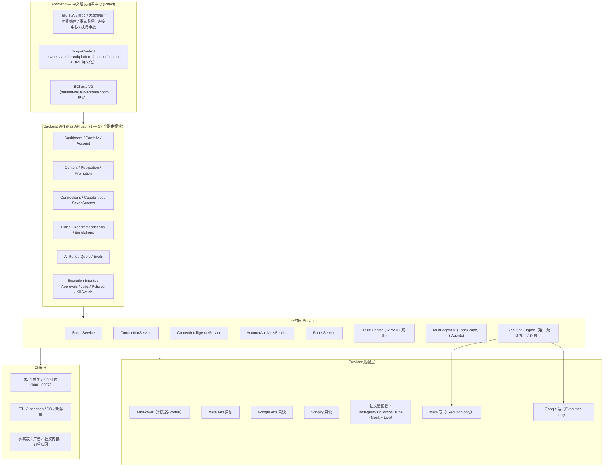
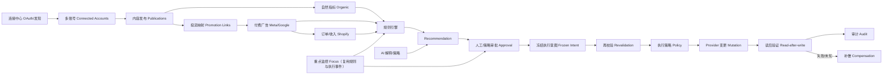
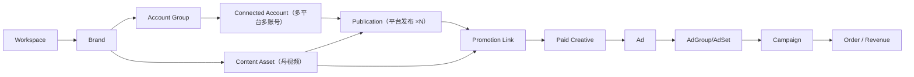

# AI DTC Growth Automation System — 项目结构简报（供外部 AI 架构评审）

> 用法：把本文件（或其中你需要的章节）直接粘贴给另一个 Codex / GPT / Claude，要求它：
> “请基于以下架构简报做一次架构评审：指出不合理、重复、可整合、有风险的地方，按优先级排序，并给出具体改造方案。”

## 0. 一句话概览

这是一个面向 DTC 品牌的“增长操作系统”：从多平台社媒/广告/电商数据接入，到规则引擎与多 Agent AI 分析，再到人工审批后的安全广告执行，前端统一为中文增长指挥中心。当前为本地演示可运行状态（Mock 数据源），生产硬化未开始（PART 07）。

## 1. 技术栈与运行形态

```text
后端: Python 3.9 · FastAPI · SQLAlchemy 2 async · Alembic · Celery/Redis · Pydantic v2
数据库: PostgreSQL（生产约定） / SQLite demo_data.db（当前演示）
前端: React 18 · TypeScript · Vite · Tailwind · ECharts 5 · React Router
环境层: AdsPower（浏览器 Profile 管理） · Playwright（Browser Worker）
AI: LangGraph 编排 · OpenAI/Gemini Provider（当前 Mock）
```

## 2. 分层架构图



## 3. 核心业务闭环（Observe → Learn）



## 4. 实体层级（06-01 统一图谱）



## 5. 数据库迁移与模型分布

| 迁移 | 内容 | 模型数（约） |
|---|---|---|
| 0001 | 初始：环境/Profile/代理/浏览器 | ~10 |
| 0002 | 数据平台：营销/广告/电商事实表、同步、DQ | ~30 |
| 0003 | 规则引擎：规则/评估/推荐/实验/变更事件 | ~13 |
| 0004 | AI：运行/步骤/工具审计/知识/记忆/创意 | ~15 |
| 0005 | 产品：Workspace/通知/实验/创意简报/偏好 | ~7 |
| 0006 | 执行：Intent/Approval/Job/Event/Audit/Policy/KillSwitch/Compensation/Outcome | ~9 |
| 0007 | 06-01：Brand/连接/账号/内容/投流映射/Focus/看板范围 | ~18 |
| 0008 | 优化：实体注册表/指标语义/RBAC/Provider Manifest/凭据引用/Job Registry/Outbox/执行绑定 | ~14 |

合计 105 个模型类，8 个迁移（优化轮新增 governance 层）。

## 6. 前端导航与页面地图（29 页）

```text
指挥中心 Command Center
账号 Accounts
├── Portfolio（卡片/表格/小图）
└── Account Detail（KPI/增长/内容/能力）
内容智能 Content Intelligence
├── 内容库 / 内容矩阵
└── Content Detail（自然+付费+时间线+映射）
付费媒体 Paid Media（Ads/Campaign Detail）
搜索智能 / 漏斗 / 市场情报 / 实验 / 推荐
重点监控 Focus Monitors
连接中心 Connections（Provider/发现/能力矩阵）
数据健康 / AI 智能 / 通知
执行 Execution
├── 审批队列 / 执行队列 / 执行详情
└── 策略 / Kill Switch
设置 / 环境 / Profile 详情 / 规则控制台
```

## 7. 后端模块清单

```text
app/core        config / database / security / logging
app/models      91 个 ORM 模型（营销/广告/电商/规则/AI/执行/社交）
app/api/v1      37 个路由模块（dashboard/ads/creatives/rules/ai/execution/accounts/...）
app/integrations adspower | meta_ads(RO) | google_ads(RO) | shopify | social(IG/TT/YT)
app/etl         管道 / 映射器 / 指标注册表 / 校验
app/ingestion   同步 / 回填 / 幂等 / 编排 / 调度
app/rules       52 条 YAML 规则 / 特征 / 守卫 / 冲突 / 推荐 / 模拟
app/ai          LangGraph 编排 / 8 Agents / 工具注册表 / 知识 / 记忆 / Evals
app/execution   引擎 / 审批 / 策略 / 再校验 / 锁 / 幂等 / 提供方(Mock/Meta/Google)
app/services    dashboard/data-health/execution/social(scope/connection/content/account/focus)
app/workers     celery（ai/rule/etl）+ execution worker（独立队列）
scripts         20 个（seed/smoke/CLI）
tests           23 个测试文件（78 passed / 1 skipped）
```

## 8. 当前验证状态

```text
smoke-social     17/17 通过（多账号/隔离/映射/Focus/连接/指标语义）
smoke-execution  34/34 通过（审批/漂移/幂等/未知结果/共享预算/KillSwitch/补偿/Shadow）
pytest           78 passed / 1 skipped
前端             npm run build 通过；10 张截图在 docs/screenshots/part0601-*.png
本地运行         后端 http://127.0.0.1:8000 · 前端 http://localhost:5173
```

## 9. 建议评审 AI 关注的结构疑点（按风险排序）

以下是我（实施方）已知的、值得外部评审重点检查的接缝，不是结论，供分析 AI 聚焦：

1. **实体 ID 语义不统一**：`recommendations.entity_id` 混用本地 UUID / 外部 ID / Mock ID；`execution.intents`、`dim_campaigns`、`connected_accounts` 之间缺少统一“实体注册表/解析层”。评审重点：是否应加 canonical entity reference。
2. **三层 Provider 抽象**：`integrations/{meta_ads,google_ads}`（只读）、`execution/providers/{meta,google}`（写）、`integrations/social`（社媒）各有一套客户端/健康/配置逻辑。评审重点：能否整合配置、凭据引用、配额与健康检查，且不破坏“写权限仅执行层”的红线。
3. **前端页面潜在重复**：Overview / LiveMonitor / Ads / Funnel 与新的 CommandCenter / Accounts / ContentIntelligence 并存；KPI 模块多处复制。评审重点：页面归并矩阵与共享 EntitySummary。
4. **认证/RBAC 尚未落地**：执行权限目前是 `X-Execution-Permission` header + demo 开关；推荐/审批接口没有用户体系。评审重点：PART 07 的 RBAC/SSO 设计应如何接入。
5. **数据粒度/重复事实**：`fact_ad_performance_daily`、`content_performance_snapshots`、`fact_content_performance_daily`、订单归因并存；社媒与广告实体在 `dim_*` 与 `connected_accounts/content_*` 两套表之间如何对齐。
6. **Worker 与调度重叠**：Celery（AI/规则/ETL）+ 独立 execution worker + browser worker；定时策略散落。评审重点：统一调度与队列治理。
7. **演示数据库差异**：SQLite（当前 demo）与 Postgres（生产）在时区/JSON/并发上的差异已多次需要兼容处理；评审重点：是否应在 PART 07 提前统一到 Postgres 开发。
8. **API 面一致性**：37 个路由模块的鉴权、分页、Scope 参数、缓存键风格不完全统一；多账号缓存必须含全 Scope。
9. **测试形态**：黄金场景以脚本形式存在（scripts/smoke_*），pytest 只覆盖单元；缺少 CI 门槛。
10. **06-01 与 06 的关系**：执行层保留完整（34/34），但社交“写发布”被刻意禁用；连接层与执行层凭据分离需要确认在 PART 07 的密钥管理设计中是否清晰。

## 10. 可复制的评审 Prompt 模板

```text
请对这份 AI DTC Growth Automation System 架构做一次严谨评审：
1) 输出一张你认为最合理的“现状架构图”（可基于简报修正）；
2) 列出所有重复、冗余、自相矛盾或过度设计之处；
3) 列出所有安全与可靠性风险（写权限边界、凭据、幂等、隔离）；
4) 给出按优先级 P0/P1/P2 排序的整合与优化建议，每项包含：
   问题 → 影响 → 建议方案 → 工作量估计；
5) 最后给出：若只做 3 件事，应该先做哪 3 件，为什么。
请引用简报中的具体模块/表名，不要泛泛而谈。
```

## 11. 附：关键文件路径

```text
规范:      docs/PART-01..PART-06-01-*.md（含每份 IMPLEMENTATION-REPORT）
后端入口:  backend/app/main.py
数据模型:  backend/app/models/（10+ 文件，91 类）
执行引擎:  backend/app/execution/engine.py
社交服务:  backend/app/services/social/
前端入口:  frontend/src/App.tsx · components/app-shell/AppShell.tsx
范围状态:  frontend/src/domain/scope.tsx
图表组件:  frontend/src/components/charts/v2/
迁移:      backend/migrations/versions/0001..0007
截图:      docs/screenshots/part0601-*.png
```
