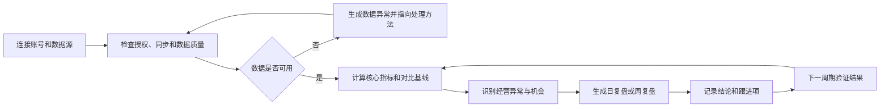
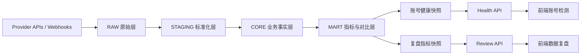
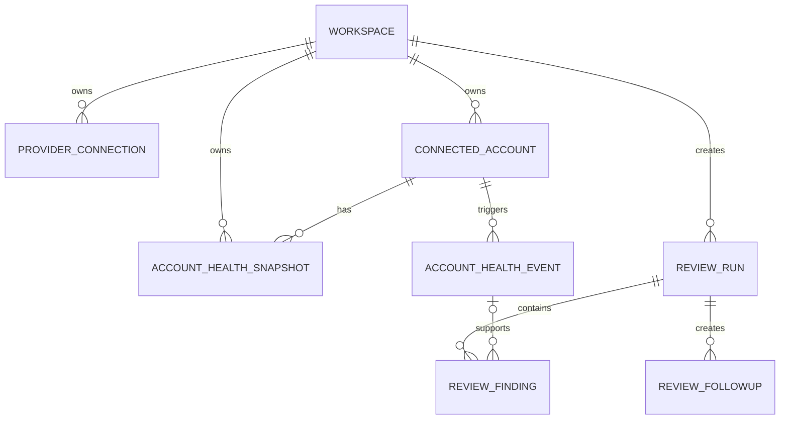

# 多平台账号检测与数据复盘中心 — 产品方案 V1.0

> 文档状态：可进入评审与排期  
> 更新日期：2026-08-11  
> 一期范围：账号检测、数据健康、经营数据复盘  
> 主要使用者：DTC 增长运营、账号负责人、业务负责人  
> 当前证据边界：方案基于项目现有代码、配置和本地演示数据梳理；演示数据不代表真实经营结果。

## Executive Summary

项目一期应从“大而全的 AI DTC 增长系统”收敛为一个明确、可日常使用的产品：**多平台账号检测与数据复盘中心**。

它首先回答三个问题：

1. 账号现在是否正常？
2. 核心数据发生了什么变化？
3. 哪些异常或机会值得优先处理？

一期不把自动投放、审批执行、实验管理、AI 控制台作为主业务线。相关模块和安全链保留在系统底层，通过权限与功能开关隐藏，避免破坏未来扩展能力。前台只保留 5 个主要入口：**今日概览、账号中心、数据复盘、数据健康、连接与设置**。

一期完成后，运营人员应能在 1 分钟内识别异常账号，在 10 分钟内完成一次日常数据复盘，并且能明确看到每个指标的来源、更新时间、口径和数据限制。

---

## 1. 产品决策

### 1.1 产品定位

一句话定位：

> 面向 DTC 增长团队的多平台账号检测与数据复盘中心，统一监测账号连接、数据质量和经营表现，并输出有证据的复盘结论。

产品不是单纯的数据看板，也不是一期就自动调广告的执行系统。它的核心价值是把分散在 Meta、Google、Shopify、Instagram、TikTok、YouTube 等平台中的账号与指标，整理为一套可判断、可追溯、可复盘的工作流。

### 1.2 一期核心业务线

| 业务线 | 解决的问题 | 一期优先级 |
|---|---|---|
| 账号检测 | 连接、授权、同步和账号表现是否异常 | P0 |
| 数据健康 | 数据是否新鲜、完整、可信、可用于决策 | P0 |
| 数据复盘 | 核心指标发生了什么变化，主要驱动是什么 | P0 |
| 复盘留痕 | 结论、异常、待办是否可保存和跟踪 | P0 |
| 自动建议 | 根据规则生成带证据的关注项 | P1 |
| 审批与执行 | 对广告平台进行预算或投放变更 | 暂不进入一期前台 |
| 实验和 AI 控制台 | 自动实验、对话分析和智能执行 | 暂不进入一期前台 |

### 1.3 一期目标

- 统一展示所有已连接账号及其真实状态。
- 分离连接健康、数据健康、经营表现，避免一个模糊的“健康”标签掩盖问题。
- 建立日复盘、周复盘的标准模板和指标口径。
- 所有结论都能追溯到指标、时间范围、数据源和异常规则。
- 明确区分真实数据、演示数据、缺失数据和不支持的数据。
- 保持 workspace 隔离和只读安全边界，不触发外部平台写操作。

### 1.4 一期非目标

- 不自动调整预算、广告组、素材或出价。
- 不以一个“综合分数”替代具体异常原因。
- 不承诺跨平台用户去重或归因真值。
- 不把平台归因收入等同于 Shopify 第一方净收入。
- 不为了填满页面增加无决策价值的图表。
- 不在没有真实数据时使用 `0` 冒充正常结果。

---

## 2. 用户与使用场景

### 2.1 用户角色

| 角色 | 主要任务 | 默认权限 |
|---|---|---|
| 增长运营 / 账号负责人 | 每日巡检账号、查看异常、完成数据复盘、记录待办 | 查看、确认异常、创建复盘、维护跟进项 |
| 业务负责人 | 查看经营结论、趋势、风险和机会 | 查看、筛选、导出复盘 |
| 系统管理员 | 连接数据源、处理授权、配置规则与阈值 | 管理连接、规则和成员权限 |
| 数据 / 工程支持 | 排查同步任务、数据质量和口径问题 | 查看技术诊断，不默认获得业务执行权限 |

### 2.2 核心 Jobs To Be Done

#### 每日巡检

当运营开始工作时，希望快速知道：

- 哪些账号断连、即将过期或权限不足；
- 哪些数据源延迟、同步失败或出现缺失；
- 哪些账号的花费、转化、CPA、ROAS 或内容表现异常；
- 今天最优先需要处理什么。

#### 周度复盘

当团队做周会时，希望统一回答：

- 本周收入、花费、订单、ROAS 与上周相比如何；
- 变化主要来自哪个平台、账号、Campaign 或内容；
- 哪些异常已经恢复，哪些问题仍未解决；
- 下周应持续观察什么。

#### 故障排查

当数据突然变成 0 或大幅波动时，希望判断这是业务变化、授权问题、同步故障，还是指标口径变化，而不是直接得出错误经营结论。

---

## 3. 产品原则

1. **先判断数据能不能用，再判断业务好不好。** 数据过期或缺失时，经营结论必须降级。
2. **结论先于图表。** 页面先显示“发生了什么、影响多大、为什么值得关注”，图表用于验证。
3. **健康维度必须分开。** 连接健康、数据健康、经营健康和内容活跃度不能混成一个标签。
4. **指标必须有口径。** 每个核心指标都带来源、统计周期、更新时间和计算方式。
5. **未知不是零。** 不支持、未授权、未同步、查询失败分别显示 `不支持`、`未授权`、`未同步`、`加载失败`。
6. **平台指标与第一方指标分开。** 平台归因 ROAS 与基于 Shopify 净收入的 blended ROAS 不互相替代。
7. **前台只展示高频任务。** 低频管理能力进入设置，未来执行能力不占据一期主导航。
8. **系统默认只读。** 一期复盘可以保存内部记录，但不写回广告或电商平台。

---

## 4. 核心业务闭环



一期闭环终点是“形成结论与跟进项”，不是自动执行。未来如恢复审批与执行能力，应从已确认的复盘发现进入现有安全链：建议 → 审批 → 执行策略 → Kill Switch → 审计。

---

## 5. 信息架构

### 5.1 主导航

| 一级入口 | 主要内容 | 主要使用者 |
|---|---|---|
| 今日概览 | 全局健康、优先异常、关键数据变化、待完成复盘 | 全员 |
| 账号中心 | 账号列表、账号详情、状态、指标与异常历史 | 运营 |
| 数据复盘 | 日复盘、周复盘、对比分析、结论和跟进项 | 运营、负责人 |
| 数据健康 | 新鲜度、质量问题、同步任务、口径状态 | 管理员、数据支持 |
| 连接与设置 | 平台连接、授权、能力范围、规则阈值、成员 | 管理员 |

### 5.2 建议路由

```text
/overview                         今日概览
/accounts                         账号列表
/accounts/:accountId              账号详情
/reviews                          复盘列表
/reviews/new                      新建复盘
/reviews/:reviewId                复盘详情
/data-health                      数据健康
/settings/connections             平台连接
/settings/rules                   检测规则
/settings/members                 成员与权限
```

### 5.3 现有模块处理方式

| 现有模块 | 一期处理 | 说明 |
|---|---|---|
| Command Center | 重构为“今日概览” | 去掉与一期无关的操作入口，保留概览和异常摘要 |
| Accounts / Account Detail | 保留并重构 | 成为一期核心工作区 |
| Data Health | 保留并增强 | 增加 workspace 范围和问题处理状态 |
| Connections | 移入设置 | 低频管理能力不占主导航 |
| Recommendations | 隐藏为内部能力 | 后续作为复盘发现来源，不在一期单独占入口 |
| Approvals / Execution Queue | 功能开关隐藏 | 代码和安全链保留，不参与一期业务流程 |
| Experiments / AI Console | 功能开关隐藏 | 等真实数据和复盘闭环稳定后再评估 |
| Rules / Execution Policy / Kill Switch | 移入管理员区或隐藏 | 保留安全能力，不面向普通运营 |

---

## 6. 页面方案

### 6.1 今日概览

#### 页面目标

让用户进入系统后，无需切换多个页面即可判断今天是否需要处理问题。

#### 信息层级

1. 顶部状态条：数据更新时间、真实/演示环境、当前 workspace、时间范围。
2. 第一屏左侧：需要立即处理的账号与数据异常。
3. 第一屏右侧：健康账号数、异常账号数、过期连接数、延迟数据源数。
4. 第二层：核心经营指标及与上一周期的变化。
5. 第三层：账号表现排名、主要驱动、待完成复盘和跟进项。

#### 核心组件

- 优先处理列表：严重级别、账号、问题、影响、发现时间、处理入口。
- 健康分布：连接健康、数据健康、经营健康分别统计。
- 核心指标卡：净收入、花费、订单、blended ROAS、平台 ROAS。
- 异常摘要：花费突增、无转化消耗、CPA 超标、同步失败、数据断层。
- 复盘状态：今日未复盘、上次复盘时间、未关闭跟进项。

#### 布局要求

- 桌面端第一屏使用 `minmax()` 自适应两列，异常列表占主要宽度，健康摘要为次级栏。
- 宽屏内容最大宽度建议 1440–1600px，避免内容挤在左侧并留下大片空白。
- 小于 1024px 改为单列，异常列表优先；小于 640px 的指标卡按两列或单列自适应。
- 任何卡片内容不足时应缩短高度或与相邻信息合并，不设置无意义固定高度。

### 6.2 账号中心

#### 账号列表

默认字段：

| 字段 | 说明 |
|---|---|
| 账号 | 平台图标、显示名、账号 ID、品牌或分组 |
| 连接状态 | 正常、即将过期、需重新授权、权限不足、断开 |
| 数据状态 | 新鲜、延迟、过期、缺失、未知 |
| 经营状态 | 正常、需关注、高风险、无足够数据 |
| 最近同步 | 最后成功时间和距今时长 |
| 关键指标 | 根据账号类型显示花费/ROAS 或内容/互动 |
| 周期变化 | 与上一等长周期比较 |
| 未处理异常 | 数量及最高严重级别 |

筛选器：平台、账号类型、品牌/分组、连接状态、数据状态、经营状态、是否有未处理异常。

默认排序：严重异常 → 数据不可用 → 经营需关注 → 正常；同级按最近异常时间倒序。

#### 账号详情

账号详情使用 5 个页签：

1. **概览**：账号状态、核心指标、周期变化、主要异常。
2. **检测记录**：异常时间线、规则、证据、恢复时间和处理记录。
3. **数据复盘**：该账号的日/周表现、排名、主要驱动。
4. **内容或广告明细**：按账号类型显示内容、Campaign、Ad Group 或 Creative。
5. **连接信息**：授权范围、同步能力、最近任务，仅管理员可操作。

详情页顶部必须同时显示：

- 账号基础身份；
- 连接健康；
- 数据健康；
- 经营健康；
- 最近一次成功同步；
- 当前数据是否可用于经营判断。

### 6.3 数据复盘

#### 复盘类型

| 类型 | 默认周期 | 默认对比 | 使用场景 |
|---|---|---|---|
| 日复盘 | 昨日 | 前一日、近 7 日同星期均值 | 每日运营巡检 |
| 周复盘 | 上一完整自然周 | 前一自然周、近 4 周均值 | 周会与资源调整 |
| 月复盘 | 上一完整自然月 | 前一月、去年同期（有数据时） | P1 经营总结 |
| 自定义复盘 | 用户选择 | 上一等长周期 | 专题分析 |

#### 复盘结构

1. 数据可用性结论。
2. 一句话总结。
3. 核心 KPI 及对比。
4. 平台与账号贡献拆解。
5. 主要异常和机会。
6. 可能驱动及证据。
7. 数据限制和待验证事项。
8. 跟进项、负责人、截止时间。

#### 一句话总结模板

```text
本周期净收入较上一周期 {上升/下降} {X%}，主要由 {平台/账号/产品} 驱动；
同时 {异常指标} 达到 {当前值}，受 {数据异常/业务变化} 影响，建议优先关注 {事项}。
```

系统只能填入已验证的事实。无法判断因果时使用“相关”“同时发生”或“可能驱动”，不能把时间相关性写成确定因果。

#### 复盘交互

- 用户选择范围、周期和对比基线后先生成预览。
- 预览显示数据新鲜度和不完整警告。
- 用户可编辑文字结论，但系统保留原始计算结果和编辑历史。
- 保存后形成不可变的指标快照，后续数据补录不得静默改写历史复盘。
- 支持关闭、重新打开和指派跟进项。
- P1 支持导出 Markdown/PDF；一期优先保证站内可追溯。

### 6.4 数据健康

页面分为 4 个区域：

1. **数据源新鲜度**：最后成功时间、延迟、预期频率、状态。
2. **质量问题**：缺失、重复、断层、异常值、口径漂移。
3. **同步任务**：任务状态、耗时、读取记录数、错误信息、重试次数。
4. **指标可用性**：哪些指标可计算，哪些因权限、数据源或延迟不可用。

技术错误信息默认收起，普通运营看到影响和处理建议；管理员可展开错误码、任务 ID、游标和请求次数。

### 6.5 连接与设置

连接卡片必须展示：

- Provider 和连接名称；
- 当前状态；
- 已授权 scope；
- token 过期时间；
- 最近验证时间；
- 关联账号数；
- 支持的读取能力；
- 是否允许写入。

一期所有外部写入能力显示为“已禁用”，不得用可点击但无效果的按钮误导用户。

### 6.6 通用页面状态

所有核心页面必须覆盖以下状态：

| 状态 | 产品表现 |
|---|---|
| Loading | 使用与最终布局一致的骨架，不造成页面跳动 |
| Empty | 说明为什么为空，并给出连接账号或调整筛选的入口 |
| Unsupported | 明确平台不支持该指标，不显示为 0 |
| Unauthorized | 标记缺少的权限和重新授权入口 |
| Stale | 显示最后更新时间，并禁止输出确定经营结论 |
| Partial | 标记缺失账号/日期，允许查看但降低结论可信度 |
| Error | 保留已成功加载区域，局部失败可重试 |
| Demo | 全局显示演示标识，不与真实经营环境混淆 |

---

## 7. 账号检测体系

### 7.1 四个独立健康维度

| 维度 | 判断对象 | 典型问题 |
|---|---|---|
| 连接健康 | 授权、scope、token、webhook、限流 | token 过期、需重新授权、权限不足 |
| 数据健康 | 新鲜度、完整性、同步任务、口径 | 60 分钟未更新、连续任务失败、日期断层 |
| 经营健康 | 花费、收入、转化、效率和趋势 | 无转化消耗、CPA 超标、ROAS 下滑 |
| 内容活跃度 | 发布频率、观看、互动和衰退 | 长期未发布、观看断崖、素材疲劳 |

总状态用于排序，不替代四个维度。总状态按最严重问题优先：

```text
CRITICAL > AT_RISK > WARNING > HEALTHY > UNKNOWN
```

- `CRITICAL`：账号断连、关键数据不可用或存在高影响风险。
- `AT_RISK`：问题已明显影响判断或经营，需要当天处理。
- `WARNING`：有趋势性风险或轻度延迟，需要观察。
- `HEALTHY`：所有适用检测通过。
- `UNKNOWN`：数据不足或检测能力不支持，不能判定为健康。

### 7.2 P0 检测规则

| 规则代码 | 维度 | 默认条件 | 严重级别 | 处理建议 |
|---|---|---|---|---|
| `CONNECTION_REAUTH_REQUIRED` | 连接 | Provider 返回需重新授权 | CRITICAL | 重新授权并验证 scope |
| `TOKEN_EXPIRING` | 连接 | token 剩余时间 ≤ 7 天 | WARNING | 提前更新授权 |
| `SCOPE_MISSING` | 连接 | 缺少核心读取权限 | AT_RISK | 补充授权 scope |
| `RATE_LIMITED` | 连接 | 达到限流且影响同步 | WARNING/AT_RISK | 降频并检查重试计划 |
| `SYNC_NEVER_SUCCEEDED` | 数据 | 已启用数据源从未成功同步 | CRITICAL | 检查连接和任务配置 |
| `DATA_DELAYED` | 数据 | 距最后成功同步 > 20 分钟 | WARNING | 观察任务或手动诊断 |
| `DATA_STALE` | 数据 | 距最后成功同步 > 60 分钟 | AT_RISK | 暂停经营结论并处理同步 |
| `SHOPIFY_WEBHOOK_LAG` | 数据 | webhook 延迟 > 2 分钟 | WARNING | 检查 webhook 状态 |
| `SYNC_FAILURE_STREAK` | 数据 | 连续 3 次同步失败 | AT_RISK | 查看错误、游标和权限 |
| `MISSING_DATE_PARTITION` | 数据 | 活跃账号预期日期无记录 | AT_RISK | 回补并验证记录数 |
| `METRIC_DISCONTINUITY` | 数据 | 关键指标异常断层或口径跳变 | AT_RISK | 验证 schema 和来源 |
| `SPEND_VELOCITY_HIGH` | 经营 | 花费速度 > 基线 2 倍 | AT_RISK | 核查预算、时区和重复数据 |
| `NO_PURCHASE_BURN` | 经营 | 花费超过阈值且无购买 | AT_RISK | 检查追踪、落地页和投放 |
| `CPA_OVERSHOOT` | 经营 | CPA > 目标 1.5 倍且样本充分 | WARNING/AT_RISK | 拆解 Campaign 和素材 |
| `ROAS_DROPPED` | 经营 | ROAS 较基线下降且花费充分 | WARNING | 检查收入与花费驱动 |
| `CTR_DETERIORATION` | 内容/广告 | CTR 较基线下降 30% | WARNING | 检查素材疲劳和受众 |
| `CONTENT_INACTIVE` | 内容 | 超过平台配置天数未发布 | WARNING | 确认是否为计划内停更 |

阈值必须支持按 workspace、品牌、平台和账号类型覆盖。默认阈值只是起点，规则触发时要保存实际值、基线、样本量和版本，不能只保存一段文本。

### 7.3 防误报机制

- 先检查数据健康，再运行经营规则。
- 经营规则设置最小花费、最小曝光、最小订单等样本门槛。
- 考虑平台归因延迟；当天未成熟数据不与完整历史周期直接比较。
- 使用账号所在时区切分日期，并在跨账号汇总时明确展示报告时区。
- 新账号、新 Campaign 和暂停账号使用独立基线。
- 相同根因产生的多个异常合并为一个事件，保留受影响指标列表。
- 异常恢复后自动记录恢复时间，但不删除历史事件。

### 7.4 检测频率

| 任务 | 建议频率 | 数据成熟度 |
|---|---|---|
| 连接与 token 检查 | 每 15 分钟 | 实时状态 |
| 数据新鲜度检查 | 每 15 分钟 | 实时状态 |
| 同步失败与质量规则 | 每次任务完成后 + 每小时 | 近实时 |
| 花费速度和高风险规则 | 每小时 | 标记为初步数据 |
| 日度经营规则 | 每日数据成熟后 | 最终日数据 |
| 周复盘预计算 | 每周一或 workspace 配置时间 | 上一完整周 |

---

## 8. 数据复盘指标体系

### 8.1 P0 核心指标

| 指标 | 定义/公式 | 优先来源 | 聚合注意事项 |
|---|---|---|---|
| 净收入 | 商品收入 + 运费 + 税费 - 折扣 - 退款 | Shopify 订单 | 按订单状态、退款状态和币种处理 |
| 订单数 | 符合口径的去重订单数 | Shopify 订单 | 不能使用平台购买数替代 |
| AOV | 净收入 / 订单数 | Shopify | 订单数为 0 时显示不可计算 |
| 花费 | 平台报告 spend 之和 | Meta / Google | 统一币种后才能跨平台汇总 |
| 展示 | 平台报告 impressions | 广告平台 | 可相加，但不代表去重用户 |
| 点击 | 平台报告 clicks | 广告平台 | 需标注点击定义 |
| CTR | clicks / impressions | 广告平台或统一计算 | 汇总时用总点击/总展示，不平均百分比 |
| CPC | spend / clicks | 统一计算 | 点击为 0 时不可计算 |
| CPM | spend / impressions × 1000 | 统一计算 | 展示为 0 时不可计算 |
| 平台购买 | 平台归因 purchases | 广告平台 | 不等于 Shopify 订单数 |
| 平台 CPA | spend / 平台购买 | 广告平台 | 标记归因窗口 |
| 平台 ROAS | 平台归因 revenue / spend | 广告平台 | 不跨平台直接去重 |
| Blended ROAS | Shopify 净收入 / 总广告花费 | Shopify + 广告平台 | 时区、币种、周期必须一致 |
| 内容数 | 周期内发布内容数量 | 社媒平台 | 以 publication 为准 |
| 观看量 | 平台报告 views 事件总数 | 社媒平台 | 不是跨平台唯一观看人数 |
| 互动事件 | likes + comments + shares | 社媒平台 | 事件口径需按平台说明 |
| 互动率 | 互动事件 / views 或 reach | 平台配置 | 分母必须显式标注 |
| 新增关注 | 周期内 follows | 社媒平台 | 与账号当前 followers 分开 |
| 数据新鲜度 | 当前时间 - 最后成功同步时间 | 同步系统 | 按数据源期望频率判断 |
| 同步成功率 | 成功任务数 / 总任务数 | 同步系统 | 默认统计最近 24h/7d |
| 缺失天数 | 期望日期 - 实际有数据日期 | CORE/MART | 排除未启用和暂停周期 |

### 8.2 口径强制要求

- 每个指标返回 `definition`、`measurement_basis`、`source`、`freshness`、`timezone`、`currency`、`caveats`。
- 当前粉丝数是存量指标，多个账号可做“账号粉丝规模合计”，但不得表述为去重受众。
- Reach 跨账号、跨平台不能宣称去重。
- 平台归因收入、Shopify 订单收入和净收入使用不同名称和颜色标签。
- 货币不一致时禁止直接汇总，必须先换算或按币种拆分。
- 比例类指标使用分子分母重新计算，不能对各账号百分比做简单平均。
- 任何核心 KPI 数据过期时，数值仍可展示，但必须附带过期标识并降低结论级别。

### 8.3 对比基线

系统支持以下基线：

- 上一等长周期；
- 前一自然日/周/月；
- 近 7 日或近 4 周移动均值；
- 同星期基线；
- 目标值或规则阈值。

页面必须显示当前周期和基线的完整日期，避免只写“环比”。

---

## 9. 数据架构与模型

### 9.1 数据链路



PostgreSQL 继续作为业务事实和复盘记录的唯一权威来源。Redis 仅用于队列、锁和缓存，不保存无法恢复的健康或复盘事实。

### 9.2 复用现有模型

| 现有模型 | 一期用途 |
|---|---|
| `ProviderConnection` | 授权、scope、token、webhook、限流状态 |
| `ConnectedAccount` | 社媒账号主数据、同步时间和展示信息 |
| `ProviderCapability` / `AccountCapability` | 指标与动作是否支持 |
| `DataSource` | 数据源和最近同步状态 |
| `SyncJob` / `SyncCursor` | 同步任务、失败、游标和读取记录数 |
| `DataQualityIssue` | 数据质量问题及解决状态 |
| `AdPerformanceDaily` | 广告表现事实 |
| `Order` | Shopify 第一方订单与收入事实 |
| 内容 publication / metric fact | 内容发布和社媒表现 |
| `MetricDefinition` | 指标定义、来源、口径和限制 |

### 9.3 建议新增模型

#### `account_health_snapshots`

保存每次计算后的账号健康状态，用于列表快速查询和历史趋势。

| 字段 | 说明 |
|---|---|
| `id` | 主键 |
| `workspace_id` | 强制隔离字段 |
| `account_ref_type` / `account_ref_id` | 社媒、广告或商业账号引用 |
| `evaluated_at` | 计算时间 |
| `connection_status` | 连接维度状态 |
| `data_status` | 数据维度状态 |
| `performance_status` | 经营维度状态 |
| `content_status` | 内容维度状态，可为空 |
| `overall_status` | 用于排序的总状态 |
| `data_usable` | 是否可用于经营判断 |
| `rule_version` | 规则版本 |
| `summary` | 结构化摘要，不替代事件明细 |

#### `account_health_events`

| 字段 | 说明 |
|---|---|
| `id` | 主键 |
| `workspace_id` / `account_ref_id` | 归属范围 |
| `rule_code` / `rule_version` | 触发规则 |
| `severity` / `status` | 严重级别与 OPEN/ACKNOWLEDGED/RESOLVED |
| `detected_at` / `resolved_at` | 生命周期 |
| `observed_value` / `baseline_value` | 触发值与基线 |
| `evidence` | 数据源、时间范围、样本量、相关实体 |
| `owner_id` / `acknowledged_at` | 处理人和确认时间 |

#### `review_runs`

| 字段 | 说明 |
|---|---|
| `id` | 复盘 ID |
| `workspace_id` | workspace 隔离 |
| `review_type` | DAILY/WEEKLY/MONTHLY/CUSTOM |
| `period_start` / `period_end` | 当前周期 |
| `baseline_start` / `baseline_end` | 对比周期 |
| `scope` | 平台、账号、品牌筛选 |
| `data_status` | COMPLETE/PARTIAL/STALE/BLOCKED |
| `metric_snapshot` | 保存时的不可变指标快照 |
| `summary` / `caveats` | 结论和限制 |
| `created_by` / `created_at` | 创建信息 |

#### `review_findings`

保存复盘中的异常、机会与驱动，关联健康事件和指标证据。

#### `review_followups`

保存跟进项、负责人、截止时间、状态和验证结果。它只管理内部工作，不触发外部平台变更。

### 9.4 关键关系



### 9.5 当前模型需要补齐的范围问题

以下问题应作为 P0 数据正确性任务，不应等 UI 完成后再处理：

1. `DataSource` 与数据健康查询需要明确 `workspace_id` 归属；建议使用 expand/contract 迁移，先增加可空字段并回填，再切换读取，最后收紧约束。
2. 社媒 `ConnectedAccount` 与广告 `MarketingAccount` 需要稳定的统一账号引用，避免前端靠名称拼接。
3. 当前账号连接健康接口不能继续返回固定 `HEALTHY`，必须来自 `ProviderConnection`、scope 和最近验证结果。
4. Paid metric 查询必须按 workspace 和 account scope 过滤；不能只按平台与日期查询。
5. Commerce metric 查询必须审计 workspace、数据源和结束日期边界，防止跨范围或超周期聚合。
6. 数据健康接口必须增加 workspace 隔离，并为管理员提供跨 workspace 视图的独立权限。
7. 当前组合概览按账号逐个调用 Provider 的方式应改为后台同步 + 快照读取，避免页面响应时间和 Provider 可用性耦合。

---

## 10. API 方案

### 10.1 新增或重构接口

| 方法 | 路径 | 用途 |
|---|---|---|
| GET | `/api/v1/health/summary` | workspace 全局健康摘要 |
| GET | `/api/v1/health/events` | 异常列表和筛选 |
| POST | `/api/v1/health/events/{id}/acknowledge` | 确认异常 |
| GET | `/api/v1/accounts/{id}/health-detail` | 四维健康和事件历史 |
| GET | `/api/v1/metrics/compare` | 当前周期与基线的统一指标查询 |
| GET | `/api/v1/reviews/preview` | 生成复盘预览，不落库 |
| POST | `/api/v1/reviews` | 保存复盘和指标快照 |
| GET | `/api/v1/reviews` | 复盘列表 |
| GET | `/api/v1/reviews/{id}` | 复盘详情 |
| POST | `/api/v1/reviews/{id}/followups` | 创建内部跟进项 |
| PATCH | `/api/v1/review-followups/{id}` | 更新跟进状态 |

所有接口强制接收或从身份上下文解析 `workspace_id`，并在服务层和数据库查询层重复校验，不能只依赖前端传参。

### 10.2 健康摘要响应示例

```json
{
  "workspace_id": "ws_123",
  "evaluated_at": "2026-08-11T09:00:00+08:00",
  "environment": "demo",
  "counts": {
    "total_accounts": 12,
    "critical": 1,
    "at_risk": 2,
    "warning": 3,
    "healthy": 5,
    "unknown": 1
  },
  "data_usable": false,
  "blocking_reasons": ["shopify_data_stale"],
  "top_events": [],
  "freshness": {
    "status": "STALE",
    "last_success_at": "2026-08-11T07:42:00+08:00"
  }
}
```

### 10.3 指标返回要求

每个指标对象至少包含：

```json
{
  "metric_key": "blended_roas",
  "value": 2.34,
  "unit": "ratio",
  "period": {"start": "2026-08-04", "end": "2026-08-10"},
  "baseline_value": 2.18,
  "delta_percent": 7.34,
  "source": ["shopify_orders", "meta_ads", "google_ads"],
  "freshness": "FRESH",
  "measurement_basis": "shopify_net_revenue / paid_media_spend",
  "caveats": [],
  "status": "AVAILABLE"
}
```

---

## 11. 操作说明

### 11.1 管理员首次配置

1. 确认当前环境为 Demo、Safe 或 Production，并在页面全局显示。
2. 创建或选择 workspace。
3. 连接 Shopify、Meta、Google 和需要的社媒账号。
4. 验证 scope、token、账号映射、时区和币种。
5. 执行第一次历史同步，检查任务读取记录数和失败信息。
6. 进入数据健康页，处理缺失、延迟和断层问题。
7. 配置目标 CPA、最低 ROAS、日花费阈值和内容停更天数。
8. 确认所有关键指标有定义和来源后，再开放给运营使用。

本地安全启动沿用项目已有流程：

```bash
make bootstrap
make up-safe
make seed-safe
make verify-local
```

安全环境默认使用 Mock Provider 且禁用 Provider 写入。即使未来连接真实读取数据，也不应同时打开写权限。

### 11.2 运营每日 10 分钟 SOP

1. 打开“今日概览”，确认环境、workspace 和数据更新时间。
2. 先处理连接或数据异常；数据不可用时不做确定经营结论。
3. 查看高风险账号，进入账号详情核验证据和时间范围。
4. 打开“数据复盘”，选择“昨日”并与前一日/同星期基线比较。
5. 检查净收入、花费、订单、blended ROAS 和平台 ROAS。
6. 查看平台、账号、Campaign 或内容的贡献拆解。
7. 保存一句话结论、数据限制和最多 3 个跟进项。
8. 对已确认异常点击“已知晓”，但不要在问题未恢复时关闭。

### 11.3 周复盘 SOP

1. 选择上一完整自然周，确认数据全部成熟。
2. 与前一周和近 4 周均值比较。
3. 先看第一方净收入与总花费，再看各平台归因指标。
4. 拆解到平台、账号和主要 Campaign/内容。
5. 汇总本周新发生、已恢复和仍未解决的异常。
6. 记录事实、可能驱动、数据限制和下周跟进项。
7. 业务负责人确认后锁定本次复盘快照。

### 11.4 数据故障 SOP

```text
发现异常数值
→ 检查数据新鲜度
→ 检查同步任务与连接授权
→ 检查记录数、日期断层、时区和币种
→ 数据恢复后重新计算
→ 对比恢复前后结果
→ 记录影响范围和恢复时间
```

如果无法确认真实数据，页面和复盘统一标记“数据不可用/部分可用”，不输出“业务下降”或“业务恢复”的确定结论。

---

## 12. UI、布局与响应式规范

### 12.1 视觉层级

- 红色只用于需要处理的严重异常，不用于普通下降。
- 黄色表示警告或数据不完整；绿色表示检测通过，不等于业务优秀。
- 数据不可用使用中性灰，并配合明确文字，不只依赖颜色。
- 页面主标题、结论、核心 KPI、辅助说明和技术元数据形成清晰层级。
- 统一使用 4、8、12、16、24、32、48px 的间距尺度。
- 同类卡片保持圆角、边框、阴影、标题基线和操作区一致。

### 12.2 空间利用和组件分布

- 页面内容使用合理 `max-width`，大屏不集中在一小块区域。
- 优先异常、复盘结论和关键指标占主要视觉区域；技术状态和低频配置放次级区域。
- 内容少的模块合并或自适应收缩，不使用固定高度制造空白。
- 内容多的列表使用筛选、折叠、分页或局部滚动，避免整页无限延长。
- 同一行的 KPI 卡按信息重要度和内容长度分配宽度，不机械平均。
- 相关操作与对象就近放置，避免页面顶部和底部重复出现无关联按钮。

### 12.3 响应式要求

- ≥1280px：双栏或多栏布局，保证异常列表和指标区域视觉平衡。
- 768–1279px：减少列数，次要信息折叠，不压缩核心操作。
- <768px：单列布局，筛选器使用抽屉或折叠区，表格切换为信息卡。
- 使用 `grid-template-columns: repeat(auto-fit, minmax(...))`、`clamp()`、百分比和最大宽度约束。
- 不允许横向溢出、按钮过窄、文字异常截断、卡片遮挡或移动端大面积空白。

### 12.4 UI 验收清单

- [ ] 无明显无意义大面积空白。
- [ ] 无局部过度拥挤。
- [ ] 同级组件对齐、高度和视觉重量协调。
- [ ] 页面视觉重心平衡，异常和结论最醒目。
- [ ] 信息层级清晰，技术信息不会干扰业务判断。
- [ ] 桌面端和移动端均无横向溢出。
- [ ] Loading、Empty、Error、Stale、Partial、Unsupported 状态均已设计。
- [ ] 颜色之外还有文字或图标表达状态，满足可访问性要求。
- [ ] 实际浏览器完成 1440×900、1280×720、768×1024、390×844 视觉验收。
- [ ] 页面优化没有破坏既有筛选、跳转、权限和数据加载逻辑。

---

## 13. 实施路线图

### 13.1 阶段计划

| 阶段 | 建议周期 | 主要交付 | 退出标准 |
|---|---:|---|---|
| 0. 产品收口 | 2–3 天 | 导航收口、功能开关、术语统一、Demo 标识 | 普通用户只看到一期 5 个入口 |
| 1. 数据正确性 | 1–2 周 | workspace 隔离、账号映射、指标口径、真实连接健康 | 跨 workspace 测试通过，未知不再显示为健康或 0 |
| 2. 账号检测 | 1–2 周 | 健康快照、事件、规则调度、概览和账号页 | 能发现、确认、恢复并追溯异常 |
| 3. 数据复盘 | 1–2 周 | 指标对比、复盘预览、保存、发现和跟进项 | 运营可在 10 分钟内完成日复盘 |
| 4. QA 与试运行 | 1 周 | 数据、接口、权限、视觉、响应式验收 | 连续 7 天试运行无 P0 数据错误 |

### 13.2 P0 Backlog

#### 产品与前端

- [ ] 将 17 个左右一级入口收口为 5 个主入口。
- [ ] 重构今日概览的信息优先级。
- [ ] 重构账号列表与账号详情的四维健康展示。
- [ ] 新增复盘列表、预览、详情和跟进项。
- [ ] 全局增加环境、数据时间和数据状态标识。
- [ ] 完成通用 Empty/Partial/Stale/Unsupported/Error 状态。

#### 后端与数据

- [ ] 增加 workspace 级数据源隔离。
- [ ] 建立社媒、广告和电商账号统一引用。
- [ ] 修复账号健康固定返回 `HEALTHY` 的占位逻辑。
- [ ] 审计并修复 Paid/Commerce metric 的账号、workspace 和日期范围过滤。
- [ ] 新增健康快照和健康事件模型。
- [ ] 将页面读取从实时逐账号 Provider 调用切换为同步后的快照/MART。
- [ ] 实现核心指标定义、币种、时区、freshness 和 caveat 返回。
- [ ] 实现日/周对比和复盘不可变快照。

#### 运维与安全

- [ ] Safe 环境继续保持 Provider writes disabled。
- [ ] 保留审批、执行策略、Kill Switch 和审计链，但通过权限和功能开关隐藏。
- [ ] 为健康任务增加日志、耗时、失败告警和重试。
- [ ] 为数据延迟和 API 可用性建立 SLO 监控。

### 13.3 P1

- 复盘导出 Markdown/PDF。
- 自定义检测规则和规则模板。
- 邮件/Slack/飞书等异常通知。
- 月度复盘和更丰富的同期对比。
- 自动生成带证据的复盘初稿。
- 异常归因树和跨指标关联分析。
- 业务目标、预算和目标值管理。

### 13.4 P2

- 将已确认发现转为建议。
- 恢复审批队列和受控执行。
- 实验管理、自动优化和 AI 控制台。
- 在完整权限、安全策略和审计覆盖下逐步开放 Provider 写入。

---

## 14. 验收标准

### 14.1 业务验收

- 运营能在 1 分钟内找到断连、数据过期和最高风险账号。
- 运营能在 10 分钟内完成并保存一次日复盘。
- 周复盘能解释收入和花费的主要平台/账号贡献。
- 每个异常都有规则、实际值、基线、时间、数据源和处理状态。
- 每个核心指标都有定义、来源、freshness、时区、币种和 caveat。
- 数据不可用时系统不会输出确定经营结论。

### 14.2 数据验收

- 同一指标在详情、概览和复盘中的口径一致。
- 比例类指标按总分子/总分母计算。
- 平台购买与 Shopify 订单分别展示。
- 平台 ROAS 与 blended ROAS 分别展示。
- workspace A 的账号、数据源、指标、异常和复盘不能被 workspace B 查询。
- 日期边界、账号时区、报告时区和夏令时场景有自动化测试。
- 多币种数据在未换算时不得直接汇总。

### 14.3 安全验收

- 一期页面没有任何可触发 Provider 写操作的入口。
- Safe 环境下 Provider 写入始终关闭。
- 复盘、确认异常和跟进项只写内部数据库。
- 管理连接和规则需要管理员权限。
- 所有状态变更记录操作者、时间和前后值。

### 14.4 性能与可靠性验收

- 核心概览 API p95 ≤ 3 秒，与现有 dashboard SLO 对齐。
- 页面加载不依赖逐账号实时 Provider 调用。
- 数据源常规新鲜度目标 ≤ 20 分钟；Shopify webhook 延迟目标 ≤ 2 分钟。
- 同步失败可重试，重复任务保持幂等，不产生重复事实记录。
- Provider 不可用时保留最近成功快照并明确标记过期。

### 14.5 视觉验收

- 使用真实浏览器完成桌面和移动端截图检查。
- 检查空间利用、组件分布、视觉协调、响应式和所有异常状态。
- 不以构建成功或组件测试通过替代视觉验收。

---

## 15. 测试计划

| 层级 | 必测内容 |
|---|---|
| 单元测试 | 指标公式、健康优先级、规则阈值、时间与币种处理 |
| 模型测试 | 新表约束、workspace 外键、唯一键、迁移回滚 |
| 服务测试 | 快照生成、事件去重、恢复、复盘保存和不可变性 |
| API 测试 | 权限、workspace 隔离、筛选、分页、错误与部分数据状态 |
| 集成测试 | Provider → RAW → CORE → MART → Health/Review API |
| 数据质量测试 | 缺失日期、重复、断层、零值、异常值、口径漂移 |
| E2E | 首次连接、每日巡检、日复盘、周复盘、故障恢复 |
| 视觉测试 | 1440×900、1280×720、768×1024、390×844 |
| 安全测试 | Safe 模式无 Provider 写操作，越权和跨 workspace 请求失败 |

现有 smoke 流程应继续运行，并补充：

```bash
make smoke-api
make smoke-backend
make smoke-ui
make e2e
make verify-local
```

实际命令以项目 Makefile 当前目标为准；实施时不得为了通过测试伪造业务数据或关闭安全检查。

---

## 16. 风险与应对

| 风险 | 影响 | 应对 |
|---|---|---|
| 平台指标口径不同 | 横向比较失真 | 指标目录、平台 caveat、禁止伪统一 |
| 授权或同步不稳定 | 把数据故障误判为业务下降 | 数据健康前置、最近成功快照、结论降级 |
| 账号模型分散 | 账号重复或错误聚合 | 建立统一账号引用和显式映射 |
| workspace 范围不完整 | 数据泄露和指标污染 | 模型、服务、API 三层隔离测试 |
| 页面实时调用 Provider | 慢、易失败、不可复现 | 后台同步、快照读取、缓存只做加速 |
| 告警过多 | 用户忽略系统 | 样本门槛、去重、根因合并、严重级别排序 |
| 当天数据未成熟 | 频繁误报 | 归因延迟保护、初步/最终状态 |
| 演示数据与真实数据混淆 | 错误业务判断 | 全局 Demo 标识、来源和更新时间 |
| 一期再次扩张 | 核心闭环无法完成 | 以 5 个入口和 P0 DoD 作为范围门禁 |

---

## 17. 一期 Definition of Done

只有同时满足以下条件，一期才算完成：

1. 普通运营只看到 5 个核心入口。
2. 账号四维健康来自真实状态或明确的 `UNKNOWN`，不存在固定健康占位。
3. 核心数据完成 workspace、账号、日期、时区和币种边界校验。
4. 运营可以完成“发现异常 → 查看证据 → 保存复盘 → 创建跟进项”的完整闭环。
5. 所有核心指标可追溯，未知和缺失不显示为 0。
6. Safe 环境无任何 Provider 写入路径。
7. 自动化测试、浏览器视觉检查和响应式验收全部通过。
8. 使用真实或经明确标记的 Demo 数据连续试运行 7 天，没有 P0 数据错误。

---

## 18. 默认假设与待确认项

为使方案可以直接进入实施，V1.0 采用以下默认假设：

- 首要用户是内部 DTC 增长运营和账号负责人。
- P0 经营数据优先覆盖 Shopify、Meta Ads、Google Ads。
- Instagram、TikTok、YouTube 等社媒一期优先覆盖账号连接、内容活跃度和基础内容表现。
- 日复盘默认“昨日 vs 前一日/同星期基线”，周复盘默认“上一完整周 vs 前一完整周”。
- 一期只允许读取外部平台；保存复盘、异常确认和跟进项属于内部写入。
- 中文为一期主界面语言，指标 key 和系统状态保留稳定英文枚举。

进入开发前需要产品负责人最终确认：

1. P0 平台是否按 Shopify + Meta Ads + Google Ads 排序。
2. 账号负责人是否需要按品牌、国家或团队分组。
3. 目标 CPA、ROAS、花费和内容停更阈值由谁维护。
4. 日复盘和周复盘的业务截止时间及报告时区。
5. 一期是否需要 Markdown/PDF 导出；若非刚需，建议放入 P1。

这些确认项不会改变一期主方向，只影响字段、默认值和排期细节。

---

## 19. 现有实现映射

方案优先复用现有能力，不重新搭建一套平行系统：

- 账号列表与组合概览：`frontend/src/pages/Accounts.tsx`
- 账号详情与趋势：`frontend/src/pages/AccountDetail.tsx`
- 当前指挥中心：`frontend/src/pages/CommandCenter.tsx`
- 数据健康页面：`frontend/src/pages/DataHealth.tsx`
- Provider 连接页面：`frontend/src/pages/Connections.tsx`
- 账号 API：`backend/app/api/v1/accounts.py`
- 组合分析 API：`backend/app/api/v1/portfolio.py`
- 数据健康 API：`backend/app/api/v1/data_health.py`
- 社媒账号与连接模型：`backend/app/models/social.py`
- 数据源、同步与质量模型：`backend/app/models/data_source.py`、`sync.py`、`data_quality.py`
- 账号和组合服务：`backend/app/services/social/account_service.py`
- 指标定义与查询：`backend/app/services/metric_service.py`
- 新鲜度与质量汇总：`backend/app/services/data_health_service.py`
- 核心检测规则：`config/rules/core_safety.yaml`、`config/rules/meta_performance.yaml`
- 可观测性目标：`config/observability/slo.yml`

实施原则是：先修正数据边界和健康模型，再重构前台；不通过堆叠新页面掩盖底层口径问题。

